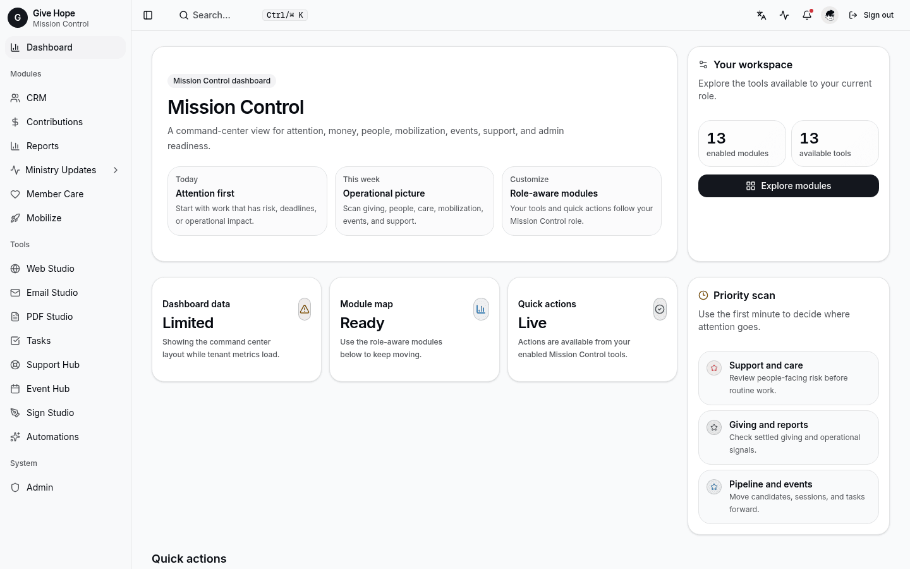
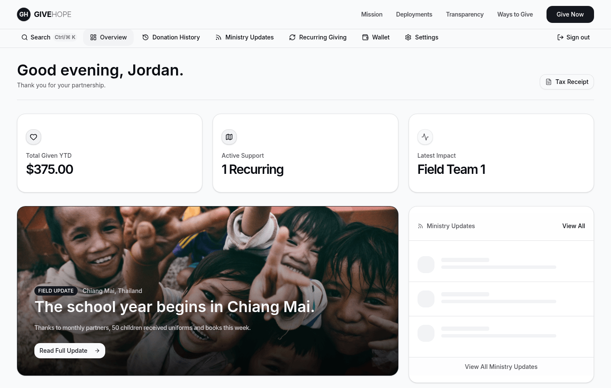
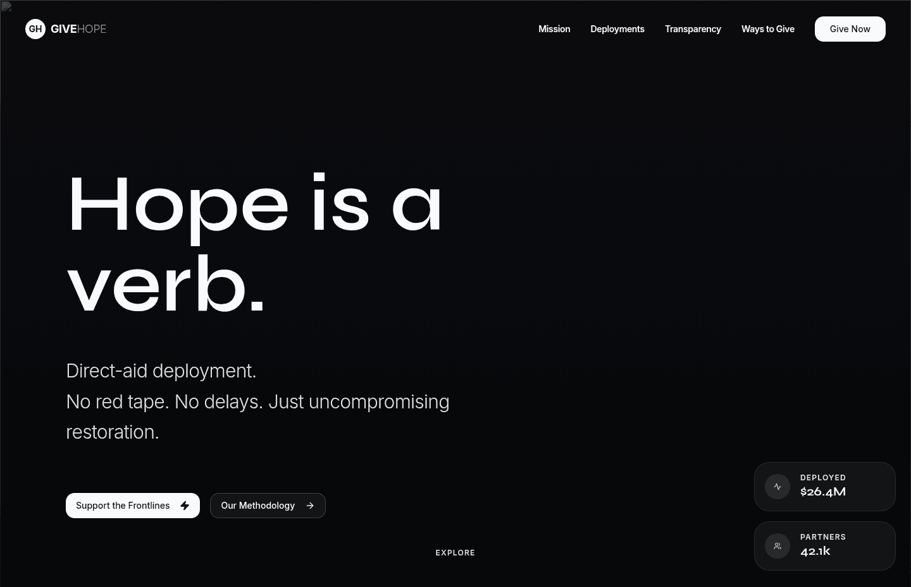
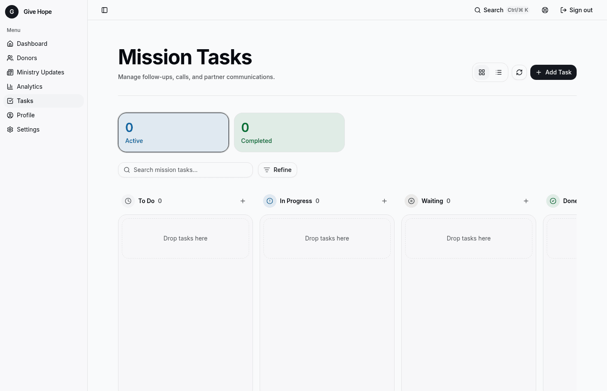
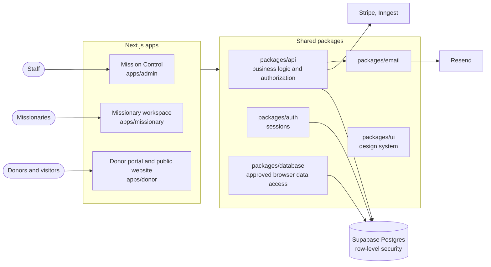

# Asymmetric.al Core

One connected platform for Christian missions sending organizations: giving,
donor care, missionary support raising and staff operations in a single system
instead of a stack of disconnected tools and spreadsheets.

[](https://github.com/Asymmetric-al/core/actions/workflows/ci.yml)
[](LICENSE)



<sub>Mission Control running locally with the demo tenant "Give Hope".</sub>

## Why Core exists

A missions organization receives gifts, issues receipts, cares for donors and
keeps missionaries funded. Most do that across a donor database, a payment
processor, an email tool, a website builder and a set of spreadsheets that
staff reconcile by hand. Small teams are left choosing between expensive legacy
software and fragile, patched-together tools.

Core is the software behind [Asym](https://asym.app/): one operating system for
a missions organization's whole operation, from giving, receipts and statements
to donor and missionary relationships, member care, mobilization, support,
events, websites, email, documents, automations and reporting. Organizations
are tenants; staff, missionaries and donors are users within them, and each
sees a role-appropriate view of the same records, so money and people data
stay accurate wherever they appear.

## What is in the repository

- **Mission Control** for staff: CRM, contributions, reports, member care,
  mobilization, support, events, tasks and automations, plus studios for the
  website, email, PDF documents and signatures.
- **Donor portal** for self-service: giving history, recurring gifts, payment
  methods, receipts and ministry updates.
- **Public ministry website** for discovery and giving: missionary profiles, a
  where-we-work map, CMS pages and checkout.
- **Missionary workspace** for support raising: donors, ministry updates,
  tasks and analytics.
- **One source of truth.** Asym Postgres owns CRM, giving and operational
  records. Business logic lives in a shared server package, and tenant
  isolation is enforced by server-side checks and by Postgres row-level
  security.
- **Written-down intent.** Accepted product and platform requirements live in
  [`openspec/`](openspec/project.md), and architecture decisions in
  [`docs/adr/`](docs/adr/README.md), so the reasons behind the code are
  reviewable.

## Project status

Core is under active development.

- Maturity varies by module. Some flows work end to end, some screens are
  prototypes or partial implementations, and some capabilities exist only as
  accepted plans.
- `openspec/specs/` records accepted requirements. `openspec/changes/` records
  proposed work, which does not prove that behavior has shipped. The code,
  tests and runtime establish what exists.
- "Give Hope" in screenshots, fixtures and default screens is a demo tenant
  with sample data, not a real organization.

## Screens

<table>
  <tr>
    <td width="33%"></td>
    <td width="33%"></td>
    <td width="33%"></td>
  </tr>
  <tr>
    <td align="center">Donor portal</td>
    <td align="center">Public ministry website</td>
    <td align="center">Missionary workspace</td>
  </tr>
</table>

These are cropped from the browser captures in
[`docs/qa/core-ui/after/`](docs/qa/core-ui/README.md), taken from a local
development build in October 2026 with demo fixtures and placeholder database
endpoints. The figures on the demo website are sample content.

## How it fits together



Core is a Bun + Turborepo monorepo of Next.js App Router applications:

| App                    | Package                 | Dev port | Surface                                                                                     |
| ---------------------- | ----------------------- | -------: | ------------------------------------------------------------------------------------------- |
| `apps/admin`           | `@asym/admin`           |     3030 | Mission Control: staff operations; also hosts Payload CMS (Web Studio)                      |
| `apps/donor`           | `@asym/donor`           |     3000 | Public ministry website (`app/(public)`) and authenticated donor portal (`app/(dashboard)`) |
| `apps/missionary`      | `@asym/missionary-app`  |     4000 | Missionary workspace                                                                        |
| `apps/factory-console` | `@asym/factory-console` |     3092 | Private operator console for the software factory VM; not a product app                     |

Shared code lives in `packages/*` (`api`, `auth`, `database`, `env`, `ui` and
others), lint and TypeScript configuration in `tooling/*`, operational scripts
in `scripts/*` and the database in `supabase/*`. App route handlers stay thin
and call `packages/api`. The
[architecture overview](docs/guides/architecture/overview.md) maps routes and
data flow.

**Built with:** Next.js 16 (App Router, Cache Components), React 19,
TypeScript, Bun, Turborepo, Supabase (Postgres and auth), Stripe, Payload CMS,
Resend, Inngest, Tailwind CSS 4 with Base UI and shadcn components, TanStack
Query and DB, Sentry, Vitest and Playwright. `package.json` files and
`bun.lock` are the source for exact versions.

## Quick start

### Prerequisites

- Node.js `24.22.3` (`.node-version`; `engines.node` is `>=24.22.3 <25`)
- Bun `1.4.3` (`.bun-version` and `packageManager`)
- Git

`bun run verify:node-version` and `bun run verify:bun-version` check the local
toolchain. Apps run on Node through Next.js; do not use `bun --bun`.

### Try Mission Control without any credentials

```bash
git clone https://github.com/Asymmetric-al/core.git
cd core
bun run setup:mission-control:cloud
bun run dev:mission-control
```

Open `http://localhost:3030`. Setup fills missing or placeholder values in the
gitignored `.env.local` (a placeholder Supabase URL and key,
`E2E_AUTH_BYPASS=true`, CI env defaults) and keeps real values you already set.
It installs with the frozen lockfile and runs `bun run skills:verify`. With the
placeholder Supabase project you see the interface, sample content and empty
states, not live data. An explicit `E2E_AUTH_BYPASS=false` is kept unless you
pass `--force-bypass`.

### Run against a hosted Supabase project

1. Run setup: `bun run setup` (macOS, Linux, Git Bash) or
   `pwsh -File .\scripts\setup.ps1` (Windows; add `-SkipInstall` to skip the
   install). The first run copies `.env.example` to `.env.local`.
2. Set `NEXT_PUBLIC_SUPABASE_URL` and `NEXT_PUBLIC_SUPABASE_ANON_KEY` in
   `.env.local` and run setup again. Setup then installs dependencies, runs
   `bun run skills:verify` and `bun run setup:verify`. A 401 from
   `setup:verify` means the URL and anon key belong to different projects.
3. Start one app (`bun run dev:donor`, `dev:admin`, `dev:missionary`) or all
   of them (`bun run dev`).

Collaborators can ask a maintainer for the shared development Supabase URL and
anon key. Other variables in `.env.example` (Stripe, demo accounts, Payload and
others) are optional for most work; demo sign-in is described in
[docs/auth/sign-in.md](docs/auth/sign-in.md). Never use the service-role key in
browser code.

The repo-root `.env.local` is the single env source: each app's
`next.config.ts` loads it. `bun run env:link-apps` links it into app
directories only for tools that require app-local env files.

## Verify changes

| Command                          | Use                                                                             |
| -------------------------------- | ------------------------------------------------------------------------------- |
| `bun run check`                  | Standard code gate: lint, typecheck, unit tests                                 |
| `bun run format:check`           | Prettier check over the repository                                              |
| `bun run ci:preflight`           | PR and push readiness; mirrors the blocking CI stages                           |
| `bun run ci:preflight -- --full` | Full QA or release checkpoint, including compilation of all apps                |
| `bun run test:e2e`               | Playwright suite with CI env defaults                                           |
| `bun run build:<app>`            | Production build of one app (`admin`, `donor`, `missionary`, `factory-console`) |

Husky runs `lint-staged` and the staged Shadscan gate on commit, and
`bun run ci:preflight` on push (`--full` for pushes that target `production`).
CI jobs and branch protection are described in [docs/ci.md](docs/ci.md).

Core does not automatically deploy merges into `develop`. Use an explicit `qa:smoke` preview when a feature is ready to review; the preview compiles on GitHub and uploads prebuilt output to Vercel. Routine PRs keep correctness checks without compiling all three apps. Full compilation remains required for production releases. Existing development URLs serve the last successful deployment until explicitly refreshed. See [CI policy](docs/ci.md#development-deployment-checkpoints-al-1921).

After pulling changes to skills, run `bun run skills:verify`. If it reports
drift, run `bun run skills:sync` and commit the regenerated mirrors.

## Database

`bun run supabase -- <command>` runs the Supabase CLI at the version pinned in
`scripts/supabase-cli.mjs`, using a global CLI only when its version matches.
`bun run db:migrate:local` resets the local database from migrations;
`bun run seed:demo:local` also loads `supabase/seed.sql`. Hosted databases
migrate only through the Release workflow, which also deploys production; see
[the release job runbook](docs/ops/release-job.md). Hosted seed commands
require explicit target variables; read `supabase/AGENTS.md` and
`scripts/AGENTS.md` first.

## Documentation

- [`AGENTS.md`](AGENTS.md): repository rules, authority order and routing to
  scoped `AGENTS.md` files and rulebooks. Start here before changing code,
  whether you are a person or a coding agent.
- [`CONTRIBUTING.md`](CONTRIBUTING.md): branch, pull request and review
  workflow.
- [`docs/README.md`](docs/README.md): documentation index.
- [`docs/guides/architecture/overview.md`](docs/guides/architecture/overview.md):
  routes and data flow.
- [`openspec/`](openspec/project.md): accepted product and platform
  requirements.
- [`docs/ai/rules/frontend.md`](docs/ai/rules/frontend.md) and
  [`packages/ui/AGENTS.md`](packages/ui/AGENTS.md): Cache Components route
  rules (promise `params`, every server `await` a deliberate Stream, Cache or
  Block decision), exact `base-maia` with semantic tokens such as
  `bg-background` rather than `zinc-*` utilities, and shared UI imports from
  `@asym/ui`.
- `docs/ai/rules/*` and `docs/ai/skills/*`: rulebooks and canonical agent
  skills. `.claude/skills` and `.cursor/skills` are generated mirrors, and
  `.agents/skills` holds generated copies plus ecosystem skills that are owned
  there; do not edit a generated copy by hand.

Internal dependencies use `workspace:*`, with one exception: the native PDF
Studio migration intentionally consumes the five vendored Phase 47 React PDF
tarballs under `vendor/react-pdf-packages/*.tgz` until those packages are
published or promoted into this monorepo.

### Product planning

The [SiteStacker parity program](docs/prds/sitestacker-parity/README.md)
tracks outcome parity and phase dependencies. The
[Phase 25 Donor Dashboard Depth specification](docs/prds/sitestacker-parity/phase-25-donor-dashboard-depth.md)
records the ratified donor scope, acceptance criteria, source contracts and
qualification gates. It is planning authority, not implemented or activated
behavior; its source-owner amendments remain proposed.

## Contributing and security

Core is public to read and to fork. New issues and pull requests on this
repository are currently restricted to collaborators; see
[`CONTRIBUTING.md`](CONTRIBUTING.md) for the workflow. If you want to help
build it, or your organization wants to follow along, start at
[asym.app](https://asym.app/).

Please report security issues privately through GitHub Security Advisories, as
described in [`SECURITY.md`](SECURITY.md), and not in a public issue.

## License

AGPL-3.0-only; see [`LICENSE`](LICENSE). If you run a modified version for
users over a network, you must offer them the corresponding source. The
license does not grant trademark rights. Third-party attributions are in
[`THIRD_PARTY_NOTICES.md`](THIRD_PARTY_NOTICES.md).
