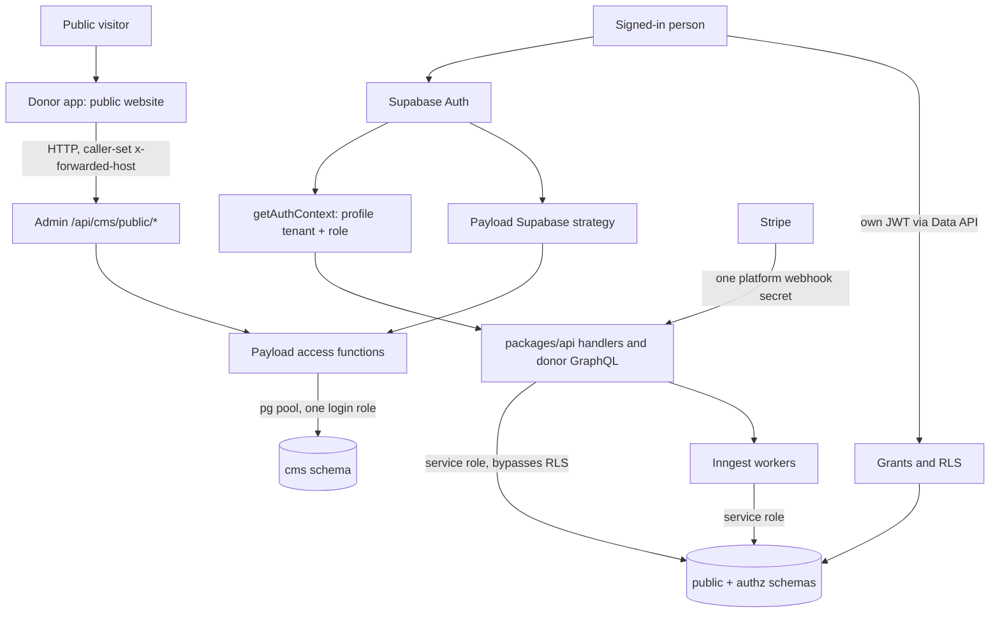

# Core CRM, CMS and database audit — adjudicated baseline

**Status:** adjudicated factual baseline, dated 15 November 2026. Section 11.4 was added on 16 November 2026 and holds what the seven council rounds that reviewed the companion plan found in source. Research and audit only; nothing in the product was changed.

**Successor notice.** This report succeeds _Core: Supabase, CRM, CMS, and Multi-Tenant Product Audit_ (research date 15 November 2026), which was supplied as a chat attachment (`Core_Supabase_CRM_CMS_Architecture_Audit_2026-11-15.md`, 1,977 lines) and does not exist in this repository. It is called "the original report" below. Every substantive claim in it has a disposition in [Appendix A](#appendix-a--dispositions-of-every-claim-in-the-original-report). Where this report and the original disagree, this report is the current-state record. The companion document is [`core-crm-cms-database-target-architecture.md`](./core-crm-cms-database-target-architecture.md).

**Repository:** `Asymmetric-al/core`, branch `t3/crm-cms-database-architecture-audit`, commit `8ed81f5561c389fa47a576cd4c00d2d03e868fc9` (same commit as the `develop` tip the original report audited). The working tree was clean when the audit ran, so no uncommitted change was audited. The only uncommitted files now are this report, its companion and the companion's council record.

## 1. Executive assessment

**Core has sound parts and no coherent whole yet.** The original report's central conclusion holds: the main problem is inconsistent authority, not the choice of Supabase, Postgres or Payload. Three independent reviewers and the coordinator re-opened its evidence and upheld nearly all of it. Of its 77 numbered findings and about 35 further claims and sections, none of the numbered findings was refuted; eighteen claims or sections needed qualification; two claims, four of its listed strengths and its own register of open questions could not be verified; and one item on its "rejected false positives" list needed qualifying, because a mistyped lookup exists there, though it changes nothing shown today.

The review also found problems the original report missed. The ones that most change the picture:

1. **The product cannot yet hold a second organization.** Nothing in the product creates, suspends or removes a tenant. Each person has one profile with one tenant, sign-up assigns everyone to the demo tenant, and there is no tenant switch. Both hosted databases hold exactly one tenant, so multi-tenant behaviour has never been exercised on a hosted database or in the running application. The only two-tenant coverage is the database-level isolation tests CI runs against a disposable Postgres (`.github/workflows/ci-integration.yml:97-100`).
2. **The database's own tenant key does not work.** Policies on 19 tables in the development database depend on a tenant claim in the login token. No product code writes that claim, and the helper that reads it rejects the demo tenant's ID. It returns nothing for every user in both hosted databases.
3. **The staff-to-`super_admin` escalation is real and reaches further than reported.** Any tenant staff member can grant themselves `super_admin` through the donor app's GraphQL endpoint. That role is also unscoped in Payload, so it opens every tenant's CMS content.
4. **Money safeguards stop at the first write.** Starting a gift is atomic and idempotent. What follows is not: a payment can complete without its gift being staged, a crashed worker leaves an event stuck in `processing` with no reclaim, recurring-invoice counters can double-count, and older staged-gift endpoints let any staff member reassign donors and approve gifts without the newer finance permissions.
5. **The public giving journey does not work end to end.** Checkout requires a signed-in donor account, `/give` and `/donate` redirect to a directory built from sample data, and published CMS pages render only their images and body text — headings, calls to action and other layout blocks are dropped.
6. **A documented command would wipe the production-named database.** `seed:demo:hosted` defaults to that project, pushes every pending migration, then runs a seed that deletes all tenants' rows.
7. **The written design is far ahead of the build.** `docs/adr/` holds 216 decision records, and most recent ones describe themselves as accepted target intent rather than implementation. One of them (ADR-0179) already classifies the current CMS as a prototype to be replaced. Much of what this audit inspects in the CMS is therefore scheduled for replacement by design.

Two facts make this a good moment to fix foundations:

- **Almost nothing needs preserving.** Both hosted databases hold demo-scale data: one tenant each, 36 donations, six authored CMS documents counted in development (one page, four templates, one giving page) and none in the production-named project, and zero objects in Supabase Storage. Vercel Blob, where Payload media is stored, was not inspected. This describes volume, not permission to discard (section 11.2).
- **There is no evidence the giving pipeline has run on the development database.** It has no outbox rows and no staged gifts, and several tables the newer contribution code needs do not exist there. Empty tables are not proof, because the seed clears them, and pipeline rows were not counted in the production-named project.

**What remains unknown** matters as much: which source revision is deployed, which database role the deployed Payload process uses, backup and point-in-time-recovery settings, and Supabase Auth dashboard settings. Nothing in this report was exercised against a running application.

## 2. Scope, environment, versions, access and method

### 2.1 What was inspected

| Item                                     | Value                                                                                                                                                                                                                                                |
| ---------------------------------------- | ---------------------------------------------------------------------------------------------------------------------------------------------------------------------------------------------------------------------------------------------------- |
| Inspection date                          | 15 November 2026                                                                                                                                                                                                                                     |
| Source revision                          | `8ed81f5561c389fa47a576cd4c00d2d03e868fc9`, clean tree                                                                                                                                                                                               |
| Development database                     | Supabase project `pnmlrbgjiqzzsthsoikm`, us-east-1, Postgres 17.6 (Supabase 17.6.1.063), `max_connections` 60, 26 MB                                                                                                                                 |
| Production-named database                | Supabase project `btewedpsxwsjczvmegby`, us-west-2, Postgres 17.6 (17.6.1.063), `max_connections` 60, 227 MB. The owner states the product is not in production; the name is not evidence of launch.                                                 |
| Local database                           | None running; not inspected                                                                                                                                                                                                                          |
| Deployed application revision            | **Unknown.** Nothing here establishes which commit runs against either database.                                                                                                                                                                     |
| Declared dependency versions             | `payload` and all `@payloadcms/*` 4.0.0-beta.3; `next` 16.4.2; `@supabase/supabase-js` 2.118.0; `@supabase/ssr` 0.12.7; `pg` 8.20.0; `stripe` 22.2.0; `inngest` 4.25.0 (`apps/admin/package.json`, `packages/api/package.json`, root `package.json`) |
| Upstream versions on the inspection date | npm `payload`: `latest` 3.93.0 (4 November), `beta` 4.0.0-beta.9 (13 November); 4.0.0-beta.3 was published 19 October                                                                                                                                |
| Supabase CLI                             | 2.115.0 installed locally (latest 3.1.0)                                                                                                                                                                                                             |

### 2.2 Evidence classes

Every statement in this report carries one of these labels, explicitly or by the section it sits in.

| Label            | Meaning                                                                                      | What it does not establish                                          |
| ---------------- | -------------------------------------------------------------------------------------------- | ------------------------------------------------------------------- |
| **Intent**       | An accepted spec, contract or decision record says the product should do this.               | That it is built.                                                   |
| **Source**       | Code, configuration, migrations or tests at the pinned commit say this.                      | That this code is deployed.                                         |
| **DB**           | A catalog or aggregate query against a hosted database returned this on the inspection date. | That it was always so, or that the application behaves accordingly. |
| **Demonstrated** | Behaviour was exercised and observed.                                                        | —                                                                   |
| **Inference**    | A consequence reasoned from the above, not observed.                                         | That it happens in practice.                                        |

**Nothing in this audit is Demonstrated** except the database queries themselves and the original report's four anonymous HEAD-request counts, which were not repeated.

### 2.3 How database evidence was collected

- All SQL ran through the Supabase connector's `execute_sql` endpoint as role `postgres`: catalog views, `information_schema`, `pg_stat_*` and `count(*)` aggregates only. No row contents, personal data or secret values were read. No DDL or DML was run.
- Evidence was collected in three passes on 15 November 2026: 14:27–14:31 UTC (baseline shared with all reviewers), about 14:32–14:38 UTC (data census, dated by the save time of its record), and between about 15:00 and 15:40 UTC (checks the reviewers requested). Only the first window is a clock reading.
- Council members had no database access. They worked from the shared baseline and the original report's appendices, and requested targeted checks from the coordinator. **This is one measurement interpreted by several reviewers, not several independent measurements.**
- The original report's appendices (table, function, trigger and policy inventories) were used as the catalog inventory. Every headline number the coordinator re-tested from them reproduced.
- Where this report says a newer table is absent from both hosted databases, absence was observed in development. For the production-named project it is inferred from the migration ledger, whose newest entry (`20260513173938`) predates the migrations that create those tables.

### 2.4 Side effects of this audit (disclosed)

1. Running the Supabase CLI inside the repository rewrote a tracked cache file, `supabase/.temp/cli-latest`. It was restored with `git restore`; the tree is clean.
2. One CLI test query (`select current_user, now()`) against the development project went through the Management API, which issued a five-minute password for the existing platform role `cli_login_postgres`. No schema or data changed. The CLI was not used again.

### 2.5 Not inspected

Supabase Auth dashboard settings (MFA policy, SMTP, redirect allowlists, leaked-password protection); backup and point-in-time-recovery configuration; Edge Function source in the production-named project; the deployed Vercel application, its environment variables and its Payload database role; the Supavisor pool mode in use; Vercel Blob contents; Stripe, Resend and Inngest provider state. Supabase advisors were not re-run. No test, build, migration replay or application start was performed. Official SiteStacker and Twenty material, which the assignment asked for, was not researched in Round 1; nothing in this report rests on either. Payload's own REST and GraphQL routes exist (`apps/admin/app/(payload)/api/[...slug]/route.ts`, `apps/admin/app/(payload)/api/graphql/route.ts`); their exposure and access rules were not assessed. Payload localization is not configured. Logging, monitoring and tracing, and agreement between generated database types and the schema, were not examined.

## 3. Intended product and current system

### 3.1 What Core is meant to be

Sources: `openspec/specs/platform-product-intent`, `platform-surfaces`, `platform-principles`, `platform-boundaries`, `crm-core`, `identity-and-access`, `donation-lifecycle`, `contribution-operations`, and their contracts under `openspec/contracts/`. All are accepted specs.

- **Tenant** is a sending organization and the outer isolation and permission boundary.
- **Four surfaces** share one set of records: Mission Control (staff), the donor portal, the missionary workspace, and the public ministry website. Narrow surfaces show role-appropriate projections; operational depth lives in Mission Control.
- **CRM is operational truth, CMS is public truth.** "CRM MUST own operational identity, relationships, giving, permissions-sensitive records, workflows, approvals, money-related history, and other operational truth." "CMS MUST own public presentation, managed website content, public page structure, and content publishing state." The two "MUST NOT compete for source-of-truth ownership", and where they disagree CRM wins (`openspec/contracts/platform-boundaries.md`, contracts `8ac6e5a07205e467fd8d` and `ebd32f4b823f763f6509`).
- **Site sits beneath Tenant.** Every tenant has at least one Site and exactly one Default Site. A Site is presentation and giving-entry attribution; it "MUST NOT be a Tenant, billing account, payment identity, or authorization boundary". Operational Site identity lives in `public.*`; the CMS owns authored content aligned to it (contract `6d422b44a032b307a303`).
- **Payload is confined to `apps/admin`.** Donor and missionary apps consume public CMS APIs and do not import Payload.
- **Tenant isolation must hold in depth**, with database enforcement as an independent backup to application checks (`openspec/specs/identity-and-access/spec.md:35-53`).

Later accepted decisions refine the target. They are intent, not implementation, and most say so in their own status line:

| Decision             | What it settles                                                                                                                                                                      |
| -------------------- | ------------------------------------------------------------------------------------------------------------------------------------------------------------------------------------ |
| ADR-0207             | `public.sites` owns operational Site identity; a Payload `cms.sites` owns presentation; both share one UUID with disjoint fields. No sync engine.                                    |
| ADR-0174             | Supabase Auth plus Core authorization are the only staff authority. Payload "authenticates or authorizes nothing independently"; its user record is a non-authoritative link.        |
| ADR-0178             | Commit to the Payload v4 major line; choose the exact version at implementation time.                                                                                                |
| ADR-0179             | The current CMS is a prototype. Replace it once with a clean target after a census of what must be kept; no dual-write or live-migration machinery.                                  |
| ADR-0214             | One shared login credential, complete per-tenant isolation, no cross-tenant donor linking.                                                                                           |
| ADR-0213, 0215, 0216 | Profiles stay the login anchor; claims need fresh proof; guest attribution never reveals or grants access; donor merge is non-destructive and never rewrites issued financial facts. |
| ADR-0206             | Posted financial rows are immutable; mutable operational state lives in separate records.                                                                                            |
| ADR-0003, 0012       | Payer of record is the legal donor; recurring commitments and fixed-total pledges are different things.                                                                              |

ADR numbers are not unique (NA-09): 0027, 0028, 0029 and 0030 each appear on three files, and eleven other numbers on two. In this report ADR-0027 means `0027-transport-agnostic-public-content-reader.md`, ADR-0028 `0028-defense-in-depth-public-isolation.md`, ADR-0029 `0029-reference-not-copy-cms-operational.md` and ADR-0030 `0030-function-level-tagged-caching-publish-signal.md`.

### 3.2 How the system is actually arranged

| Layer            | What exists **[Source / DB]**                                                                                                                                                                                                                                                                                                                                                                                                                                                                             |
| ---------------- | --------------------------------------------------------------------------------------------------------------------------------------------------------------------------------------------------------------------------------------------------------------------------------------------------------------------------------------------------------------------------------------------------------------------------------------------------------------------------------------------------------- |
| Schemas          | `public` (87 tables development, 62 production-named) and `authz` (1 table) are owned by Supabase SQL migrations. `cms` (94 tables) is created as a shell by one SQL migration and filled by Payload migrations. Every `cms` table in both projects, and every `public` table in development, is owned by `postgres`. Development has no foreign key between `cms` and `public`/`authz` in either direction. The production-named project was not queried for `public` table ownership or for such a key. |
| Identity         | `supabase.auth.getUser()` per request, then one `profiles` row by `user_id` (`packages/auth/context.ts:265-280`).                                                                                                                                                                                                                                                                                                                                                                                         |
| Tenant           | `profiles.tenant_id`, with the demo tenant as fallback for `super_admin` (`context.ts:297-302`). Memberships are loaded for that one tenant only (`:303`, `:321-355`). One route differs: donor feed preferences take the tenant from the token claim (`packages/api/src/feed-preferences/index.ts:76`).                                                                                                                                                                                                  |
| Role             | `profiles.role` **or** an active `authz.memberships` row (`packages/auth/permissions.ts:59-115`).                                                                                                                                                                                                                                                                                                                                                                                                         |
| Server API       | `withOperation` authenticates, then hands every handler the service-role client (`packages/api/src/shared/with-operation.ts:137-165`). Tenant scoping is a `.eq("tenant_id", …)` convention. The page proxy skips every `/api/*` path (`packages/auth/middleware.ts:198-200`).                                                                                                                                                                                                                            |
| Browser data     | TanStack DB collections query the Data API with the user's token; grants and RLS apply.                                                                                                                                                                                                                                                                                                                                                                                                                   |
| Payload          | Ten collections, no globals, no multi-tenant plugin, admin at `/web-studio` (`apps/admin/payload.config.ts`). A custom strategy turns a Supabase session into a `cms_users` row and finds or creates a `cms.tenants` row **by slug** (`apps/admin/src/cms/auth/supabase-strategy.ts:168-264`, `:387-449`).                                                                                                                                                                                                |
| CRM↔CMS links    | Text and integer values only: tenant by slug; missionary by a UUID string field; fund and missionary IDs on giving and project pages.                                                                                                                                                                                                                                                                                                                                                                     |
| Public content   | Donor app → admin `/api/cms/public/*` with a host header the donor app sets itself → tenant by `primaryDomain` or first host label → a single published-content reader.                                                                                                                                                                                                                                                                                                                                   |
| Money            | Authenticated donor → `begin_donation_saga` (one SQL function) → outbox → Stripe PaymentIntent → webhook → raw event store → donation update → staged gift.                                                                                                                                                                                                                                                                                                                                               |
| Jobs             | Inngest functions under `packages/api/src/workflows/functions/`; cron-style routes check `CRON_SECRET`.                                                                                                                                                                                                                                                                                                                                                                                                   |
| Files            | Three public Supabase buckets (no objects stored) and public Vercel Blob for Payload media.                                                                                                                                                                                                                                                                                                                                                                                                               |
| Outside the repo | A Stripe sync engine in the production-named project: 29 `stripe` tables, three Edge Functions, a per-minute `pg_cron` job.                                                                                                                                                                                                                                                                                                                                                                               |

### 3.3 Database roles **[DB]**

Neither hosted database has a custom role for Payload or for the prepared tenant guard. The only login roles are Supabase-managed. `postgres` and `service_role` both bypass RLS by Supabase's platform defaults (the attribute itself was not queried). `cms` tables have RLS off and no table grants to `anon` or `authenticated`, though both roles hold schema `USAGE` on `cms`. Whichever role the deployed Payload process uses, it can only be one of the existing privileged logins.

## 4. Requirements against implementation

Status vocabulary: **built**, **partial**, **planned** (accepted intent, not built), **inconsistent** (built, but contradicts intent), **unverified**. "Source" here means the pinned commit, not a deployment.

| #   | Product outcome                                                                       | Entities and owner                                   | Intent source                                                                | Current implementation                                                                                                                                                       | Status                            |
| --- | ------------------------------------------------------------------------------------- | ---------------------------------------------------- | ---------------------------------------------------------------------------- | ---------------------------------------------------------------------------------------------------------------------------------------------------------------------------- | --------------------------------- |
| 1   | One sending organization is one tenant, isolated from others                          | Tenant, membership — platform                        | `platform-boundaries/spec.md:187-205`                                        | Tenant columns and memberships exist. No tenant provisioning. One tenant per hosted database.                                                                                | **partial; isolation unverified** |
| 2   | Identity, tenant and role resolve server-side                                         | Auth user, profile, membership — identity            | `identity-and-access/spec.md:14-33`                                          | `getAuthContext` re-reads profile and memberships on every request.                                                                                                          | **built**, single-tenant only     |
| 3   | Isolation holds in depth, with the database as an independent backup                  | All tenant tables — identity, database               | `identity-and-access/spec.md:35-53`                                          | Server work runs as the service role. The database guard covers two workflow functions.                                                                                      | **inconsistent**                  |
| 4   | A person can belong to several organizations with correct per-tenant roles            | Membership, account link — identity                  | ADR-0214; `openspec/contracts/identity-and-access.md` (contract `af71db6f…`) | One profile, one tenant, no switch. Other memberships are never loaded by request paths. A resolver for this exists in source and is not wired in.                           | **planned**                       |
| 5   | Removing a membership removes access                                                  | Membership — identity                                | `openspec/contracts/identity-and-access.md` (contract `af71db6f…`); ADR-0214 | `profiles.role` fallback survives membership removal, in Core and in Payload.                                                                                                | **inconsistent**                  |
| 6   | Site beneath Tenant; domains verified                                                 | Site, Site domain — platform                         | `platform-boundaries` contract `6d422b…`; ADR-0207                           | `siteId: null`; no `sites` table in source or database; host resolution matches a non-unique CMS `primaryDomain` and otherwise falls back to the first host label as a slug. | **planned**                       |
| 7   | CRM operational truth, CMS public truth, kept aligned                                 | CRM records, CMS documents — CRM, CMS                | contracts `8ac6e5…`, `ebd32f…`                                               | Separate schemas; slug bridge; no foreign keys; no alignment mechanism.                                                                                                      | **partial**                       |
| 8   | Login, person, donor, missionary, household and organization stay distinct and linked | Party, donor, missionary, household — CRM            | `crm-core/spec.md:38-90`                                                     | CRM is donor-centred. `persons` is an inert scaffold and absent from both hosted databases.                                                                                  | **planned**                       |
| 9   | Giving without an account; guest attribution never grants access                      | Donor, gift — giving, identity                       | ADR-0215; Phase 4 PRD                                                        | Checkout and the donate API require a signed-in donor. The guest matcher is a pure function with no caller.                                                                  | **planned**                       |
| 10  | Claims and invitations carry independent proof                                        | Claim, invitation — identity                         | ADR-0213, 0215                                                               | `account_claim_requests` and `legacy_account_invitations` are schema-only; absent from hosted. No invitation flow.                                                           | **planned**                       |
| 11  | Legal donor distinct from recognition and attribution                                 | Payer of record, recognition credit — giving         | ADR-0003                                                                     | Flat donor-to-donation link.                                                                                                                                                 | **planned**                       |
| 12  | Recurring commitment distinct from fixed-total pledge                                 | Recurring commitment, pledge — giving                | ADR-0012; `donation-lifecycle/spec.md:119-136`                               | Legacy `donor_pledges` reflects Stripe subscription events; no subscription creation path.                                                                                   | **planned**                       |
| 13  | Gift creation is server-authoritative and idempotent                                  | Gift, outbox — giving                                | `donation-lifecycle/spec.md:14-33`                                           | `begin_donation_saga` commits donation, audit and outbox together under a tenant-scoped key.                                                                                 | **built**                         |
| 14  | Recovery never duplicates or loses money effects                                      | Gift, staged gift, provider event — giving           | `donation-lifecycle/spec.md:188-203`                                         | Durable handoff exists; several later steps do not converge on retry.                                                                                                        | **partial**                       |
| 15  | Money actions need specific capabilities and a reason                                 | Staged gift, correction — contribution operations    | `contribution-operations/spec.md:68-101`                                     | Newer command path enforces this; legacy staged-gift routes do not.                                                                                                          | **inconsistent**                  |
| 16  | Issued receipts and statements use immutable facts                                    | Receipt, statement — giving                          | `donation-lifecycle/spec.md:138-165`; ADR-0206                               | Donor downloads regenerate from live rows. The receipt-record writer has no caller.                                                                                          | **inconsistent**                  |
| 17  | Financial execution pinned to one legal entity                                        | Legal entity, settlement binding — giving            | `donation-lifecycle/spec.md:97-117`                                          | One platform Stripe key is the fallback for every tenant; one webhook secret.                                                                                                | **planned**                       |
| 18  | Outbound communication is governed: intent, consent, provider acceptance, delivery    | Communication, consent, suppression — communications | `platform-surfaces/spec.md:170-182`; ADR-0217–0223                           | Fail-closed consent and suppression gate exists. Full history model is planned. Support replies are queued and never sent.                                                   | **partial**                       |
| 19  | Tenant-controlled review before missionary content goes public                        | Post, ministry update — missionary workspace, CMS    | `platform-boundaries/spec.md:230-250`                                        | Two unconnected models (`public.posts`, CMS `ministry-updates`).                                                                                                             | **partial**                       |
| 20  | Withdrawal reaches public pages, caches and media                                     | Page, media, cache — CMS                             | `platform-boundaries/spec.md:230-250`; ADR-0126, 0171                        | Unpublish blocks the reader. No invalidation signal. Media bytes stay public.                                                                                                | **partial**                       |
| 21  | Care and sensitive missionary data stay restricted after revocation                   | Care notes — member care                             | `identity-and-access/spec.md:35-53`; contract `af71db6f…`                    | Private-note policy keeps author access with no membership check.                                                                                                            | **inconsistent**                  |
| 22  | Imports, merges and corrections keep provenance                                       | Merge record, import batch — CRM                     | ADR-0216; Phase 30 PRD                                                       | Merge is a planner with no executor. No import path. Export exists.                                                                                                          | **planned**                       |

**Open product decisions the sources record, not resolved here:**

- Which tenant a self-registered donor belongs to. Today it is always the demo tenant.
- Whether published posts and their reactions are meant to be readable across tenants with the public key.
- Whether a care-note author keeps access after leaving the organization.
- Donor email uniqueness per tenant (in source) against ADR-0215's rule that a guest gift is attributed only on one eligible same-tenant match and that ambiguity goes to staff review, which presumes several donors can share one email.
- Who owns generalizing the Twenty-shaped `crm_record_links` table (Phase 30 and Phase 31 both claim it).

**Not open, although the code suggests otherwise:** the Stripe account model. The Phase 13 PRD and the roadmap settle Stripe Connect with direct charges on tenant-owned connected accounts (`docs/prds/sitestacker-parity/roadmap.md:655`, marked groomed, not built). The accepted contract requires every gift to store its legal entity and settlement account binding (`openspec/contracts/donation-lifecycle.md:582-603`). The topology has no ADR of its own yet: ADR-0011 calls it "ratified-but-unwritten" and says to delete the plaintext tenant key. The platform-key fallback in NA-08 is an implementation gap against that intent.

## 5. Findings

IDs beginning D, A, B, P and C are the original report's. New findings carry the seat that raised them: **NA** (Seat A), **NB** (Seat B), **NC** (Seat C), **NV** (cross-provider verifier), **NX** (coordinator), **NR** (the Round 3 to Round 6 reviews of the companion plan; these are listed in section 11.4, not in the tables below). New IDs are not contiguous. Severity, confidence and urgency are separate judgements. "Verified by" lists who independently opened the evidence: **O** original report, **A**, **B**, **C** council seats, **X** coordinator, **V** cross-provider verifier, **W** the second verification pass described in section 11.1, shown only on rows it changed or whose confidence it raised. A row without a file citation rests on the seat report named under "Verified by"; those reports are working material outside the repository.

Urgency key: **T** before additional tenants · **M** before real money · **L** before public launch · **H** later hardening · **I** needs investigation · **N** now, because it is cheap or dangerous.

### 5.1 Tenancy and environment foundations

#### NA-02 — No tenant can be created or retired by the product

- **Class:** incomplete implementation and operational gap. **Severity:** high. **Confidence:** high. **Urgency:** T.
- **Claim [Source]:** rows enter `public.tenants` only from the init migration, `supabase/seed.sql`, a local CMS seed script, and test or scanner fixtures; no product code inserts one. The demo tenant UUID is a hard-coded fallback in `packages/auth/context.ts:297-302`, `packages/auth/resolve-user-role.ts`, `apps/admin/src/cms/auth/supabase-strategy.ts:397-402`, the sign-up trigger (`20260227060000_auth_role_hardening.sql:82`) and `packages/api/src/admin/org-settings.ts:9`.
- **[DB]:** one tenant in each database; no user has memberships in more than one tenant. Foreign keys to `public.tenants`: 58 cascade, 12 no action, 2 set null in development (33 / 12 / 2 production-named). Textual counts for a full replay of source give 152 such keys: Seat A split them 126 / 23 / 3 and the second pass 128 / 20 / 4. Neither count replays later drops or alterations.
- **Impact:** a second organization can only be created by hand-written SQL. Deleting a tenant is either blocked or erases most of its history, including financial rows.
- **Counter-evidence:** the CMS half self-provisions a `cms.tenants` document on staff sign-in, and a `super_admin` can create, edit and delete those documents. They are not operational tenants.
- **Unknown:** intended onboarding and offboarding process. **Smallest check:** none needed for absence; a design is needed.
- **Verified by:** A, X (database), V (wording narrowed to operational tenants).

#### NX-03 / NA-01 / A07 — The database's tenant key is empty for every hosted user

- **Class:** incomplete implementation. **Severity:** medium today, high architectural weight. **Confidence:** high. **Urgency:** T.
- **Claim [Source]:** `authz.current_tenant_id()` reads `app_metadata.tenant_id` from the token and returns it only if it matches a UUID pattern requiring a version digit 1–5 (`20260226113000_authz_memberships_foundation.sql:130-141`). The application's tenant is `profiles.tenant_id`. Outside test and scanner fixtures, the only writer of the token claim in source is `supabase/seed.sql:125`, for one seeded user, and it writes the demo tenant ID the helper rejects. No product runtime code writes it and no later migration replaces the helper. The seed accounts for at most one of the hosted users who carry the claim; how the others got it was not established.
- **[DB]:** development: 8 users, 3 carry the claim, all 3 equal the profile tenant, **0 pass the pattern** because the demo tenant ID is `00000000-0000-0000-0000-000000000001`. Production-named: 8 users, 4 carry it, 0 pass. In development 76 policies on 19 tables call this helper; in the production-named project none do.
- **Correction to the original report (A07):** its "three profile/claim mismatches among six profiles" are three profiles with **no claim at all**, not three disagreeing values. Production-named has four.
- **Also affected [Source]:** the donor feed-preferences route takes its tenant from the same claim through the same pattern (`packages/api/src/feed-preferences/index.ts:11-12`, `:76`), so it refuses every hosted user.
- **Already known in the repository:** `docs/security/tenant-read-floor.md:70` says signed-in reads "mostly return 0 rows" today and that the helper is to follow a request-tenant setting instead (#2298; `docs/security/tenant-guard.md` cites #668 for the same change).
- **Impact [Inference]:** policies keyed on the claim return no rows for ordinary users. It fails closed, so this is a functional break rather than a leak, and it is limited to the claim-keyed policies and that one route: other policies admit by ownership or membership without the claim. Populating the claim later would introduce stale-token behaviour that the live-lookup helpers (`has_membership`, `is_super_admin`) do not have.
- **Verified by:** O (partly), A, B, C, X (database and source), V.

#### D01 — Anonymous reads of operational tables on both hosted databases

- **Class:** defect (deployed state). **Severity:** high once real data exists. **Confidence:** high. **Urgency:** M and L.
- **[DB]:** 21 `SELECT TO anon USING (true)` policies in `public` on both projects, covering among others `donors`, `donations`, `profiles`, `tenants`. Anonymous `SELECT` grants: 29 development, 30 production-named. The original report's four HEAD-request counts were not repeated.
- **Qualification:** this was a deliberate read-only demo posture (`20260216153000_demo_readonly_rls.sql:55`; `supabase/AGENTS.md`). Forward migrations in source drop all 21 policies (`20260625002117…:21` and `:97`; `20261025120800…:82`), but they are not applied to either hosted database.
- **Residual [Source] (NA-06):** after a full replay, anonymous users can still read six tenant-owned tables with no tenant predicate: published public `posts`; `post_comments`, `post_likes`, `post_prayers` and `post_fires` on such posts; and published `locations`. `currency_metadata`, a global reference table with no tenant column, stays anonymously readable too (`20260625002117…:130-149`; `20261003051630_currency_foundation.sql:185`). A migration comment says anonymous public ministry reads are intended; no accepted spec says cross-tenant reads are. This is an open product decision.
- **Verified by:** O, A, B, C, X (database); NA-06: A, V.

#### D02 / D03 / A11 — Source and both hosted databases are three different states

- **Class:** operational gap. **Severity:** high. **Confidence:** high. **Urgency:** N.
- **[DB]:** 114 files under `supabase/migrations/` (100 numeric forward migrations). Development records 33 versions, production-named 25. Payload history: development has only the initial migration; production-named has a `dev` row with batch −1, the marker of a development schema push. Both `cms.media` tables have 12 `sizes_*` columns and none of the `variants_*` or `original_filename` columns current source expects.
- **[DB] (NX-02):** these newer tables are absent from development: `crm_notes`, `persons`, `account_claim_requests`, `legacy_account_invitations`, `workflow_dispatch_requests`, `workflow_work_claims`, `contribution_adjustments`, `contribution_corrections`, `contribution_receipt_snapshots`, `contribution_refund_attempts`, `gift_receipt_records`, `donor_merge_candidates`. Code that depends on them cannot run there.
- **[Source]:** no CI workflow applies migrations to a hosted database; the hosted push is a manual script (`scripts/db-migrate-hosted.mjs`). CI replays migrations on a disposable Postgres, which proves a fresh build, not hosted parity.
- **Verified by:** O, A, B, C, X.

#### NA-03 — The hosted seed command targets the production-named project and deletes everything

- **Class:** operational gap. **Severity:** high once real data exists; low today. **Confidence:** high. **Urgency:** N.
- **[Source]:** `scripts/seed-demo.sh:6` defaults the expected project to `btewedpsxwsjczvmegby`. Its only guard compares `NEXT_PUBLIC_SUPABASE_URL` to that project. It then runs `supabase db push` and `psql -f supabase/seed.sql`. The guard does not tie `SUPABASE_DB_URL` to the URL it checked. The seed deletes every row of `authz.memberships` and 28 `public` tables, including `tenants`, `profiles`, `donors` and `donations`, with no tenant predicate, inside its own transaction, then reseeds (`supabase/seed.sql:12`). It is wired as a `package.json` script (`:152`) and described as the normal hosted workflow in `supabase/AGENTS.md`.
- **Impact:** total loss of all tenants' data, plus an unreviewed push of every pending migration onto a drifted database (D02).
- **Verified by:** A, X (script read), V. Not run.

#### NA-04 / NX-05 / C10 — Payload has no database role of its own

- **Class:** design tradeoff with operational risk. **Severity:** medium. **Confidence:** high for source and catalog; deployed role unknown. **Urgency:** L.
- **[Source]:** Payload's connection string falls back to `SUPABASE_DB_URL`, the variable the hosted migration push uses (`apps/admin/src/cms/payload-database-config.ts:6-9`). Schema push is disabled only when `PAYLOAD_DISABLE_SCHEMA_PUSH` is exactly `"1"` (`payload.config.ts:146`); upstream 4.0.0-beta.3 pushes outside production unless `push` is false (tagged upstream source, section 8).
- **[DB]:** no dedicated role exists; `postgres` owns every `cms` table. The `dev`, batch −1 row in the production-named project is consistent with a schema push having happened there.
- **Counter-evidence:** `.env.example:177` and the Payload CLI wrapper (`scripts/cms/run-payload-command.mjs:42`) default schema push off, and protected deployments have guards that reject unsuitable URLs (`payload-database-config.ts:288`). The exposure is a process started outside those paths.
- **Impact [Inference]:** the CMS process may hold DDL rights over operational schemas, and a development server pointed at a hosted database without the flag can alter `cms` outside migrations.
- **Smallest check:** read `current_user` and schema privileges through the deployed connection.
- **Verified by:** O (C10, C16), A, C, X (catalog), V (medium confidence; wording narrowed).

#### Other foundation findings

| ID    | Finding                                                                                                                                                                                                                                                                                                                                                          | Class            | Severity    | Confidence | Urgency | Verified by         |
| ----- | ---------------------------------------------------------------------------------------------------------------------------------------------------------------------------------------------------------------------------------------------------------------------------------------------------------------------------------------------------------------- | ---------------- | ----------- | ---------- | ------- | ------------------- |
| D04   | Default privileges in `public` grant ALL on new tables to `anon` and `authenticated`. `TRUNCATE` is held by `anon` on 9 tables and `authenticated` on 40 (development) or 15 (production-named). Latent: the Data API exposes no truncate. **[DB]**                                                                                                              | operational gap  | medium      | high       | H       | O, A, B, C, X       |
| D05   | Of 127 foreign keys where both tables carry `tenant_id`, 23 include it (development); 0 of 80 in production-named. No mismatched pair exists, but there is one tenant. **[DB]**                                                                                                                                                                                  | design tradeoff  | high        | high       | T       | O, A, B, C, X       |
| D06   | Three public buckets with no size or type limits; zero objects stored. Source already narrows the `profiles` bucket and adds limits in unapplied migrations (`20261027100000`, `20261028100000`). **[DB / Source]**                                                                                                                                              | operational gap  | medium      | high       | L       | O, A, B, C, X       |
| D07   | Realtime publication has no tables in either project. **[DB]** Source does add seven tables to it; see NR-09 in section 11.4.                                                                                                                                                                                                                                    | incomplete       | low         | high       | H       | O, A, B, C, X       |
| D10   | `tenants.stripe_secret_key` and `stripe_webhook_secret` sit in an anonymously readable table. Zero non-empty values. `stripe_webhook_secret` has no reader in source. **[DB / Source]**                                                                                                                                                                          | design tradeoff  | high latent | high       | M       | O, A, B, C, X       |
| D11   | Stripe sync engine in the production-named project: 29 tables, per-minute cron (286,517 calls), 556 mirrored payment intents, last sync run started 13 November, no foreign key to `public`. Not tracked in source, though `openspec/changes/add-stripe-data-pipeline-plumbing/` plans related work. Edge Function authentication was not re-inspected. **[DB]** | operational gap  | medium      | high       | I       | O (partly), B, C, X |
| D13   | Two overloads of `record_donation_saga_failure` (6 and 7 arguments) coexist in development; both are service-role only. **[DB]**                                                                                                                                                                                                                                 | maintenance debt | low         | high       | H       | O, B, X             |
| D09   | Eight `backup_*` tables and nine `crm_*` tables remain. `crm_command_logs` is still written by current code. The Phase 1 ownership matrix and ADR-0001 do record dispositions for several of the others, so "owner not established" overstated it.                                                                                                               | operational gap  | low         | high       | H       | O, B, C             |
| NX-04 | The seven-row duplicate `(tenant_id, profile_id)` group in `missionaries` exists in **both** databases, not only development. **[DB]**                                                                                                                                                                                                                           | data defect      | medium      | high       | T       | X                   |
| NX-09 | No MFA factor is enrolled in either project; in development all identities use the email provider (not queried in production-named). **[DB]**                                                                                                                                                                                                                    | observation      | —           | high       | I       | X                   |

### 5.2 Identity, authorization and tenant isolation

#### A01 / NA-07 — Any tenant staff member can become platform `super_admin`

- **Class:** defect. **Severity:** critical. **Confidence:** high for source; not exercised; deployment unknown. **Urgency:** N.
- **Actor and boundary:** an authenticated user with an active staff membership, calling the donor app's `/api/graphql`.
- **Chain [Source]:**
  1. The route re-exports the handler with no guard (`apps/donor/app/api/graphql/route.ts`), and the proxy skips `/api/*`.
  2. `updateUserRole` requires only `admin`, `staff` or `super_admin` (`packages/graphql/handler.ts:810`).
  3. The schema enum `UserRole` includes `super_admin` (`:51-57`), the resolver's input type accepts it, and the target may be the caller (`:802-806`).
  4. The role is passed unchanged to a service-role call (`:813-823`).
  5. `atomic_update_user_role_with_audit` checks only that the profile is in the tenant, then writes the role (`20260223170000_atomic_rpc_and_donation_saga.sql:742-797`). No later migration redefines it; no trigger guards `profiles`.
- **[DB]:** one overload with identical body hash in both projects; `EXECUTE` is `postgres` and `service_role` only, so the SQL function is not directly callable by a signed-in user. The gateway is the fault.
- **Reach:** on server paths the promoted user stays in their home tenant. Cross-tenant reach comes from the 151 policies carrying `authz.is_super_admin()` (development) through the browser Data API, and from Payload, where `super_admin` is unscoped across tenants (`apps/admin/src/cms/access/tenant-access.ts`, `staff-access.ts`, `public-read.ts`, `hooks/tenant.ts`). The same mutation can demote any same-tenant admin.
- **Smallest check:** in an isolated environment, call the mutation as ordinary staff and confirm rejection after a fix.
- **Verified by:** O, A (line by line, no missed guard), B, C, X; NA-07: A, V.

#### A03 / C08 — Removing a membership does not remove access

- **Class:** defect. **Severity:** high. **Confidence:** high. **Urgency:** T.
- **[Source]:** `hasRole` admits staff when an active membership exists **or** `profiles.role` is admin, staff or super_admin (`packages/auth/permissions.ts:59-115`). Payload prefers the profile role too (`supabase-strategy.ts:417-421`). A test asserts the fallback, so it is deliberate compatibility.
- **[DB]:** two privileged profiles in development have no active staff membership and rely on the fallback today; none in production-named.
- **Verified by:** O, A, B, C, X.

#### A10 — Server-side tenant isolation is an application convention

- **Class:** design tradeoff, against accepted intent. **Severity:** high. **Confidence:** high. **Urgency:** T.
- **[Source]:** every `withOperation` handler and the GraphQL context receive the service-role client. The repository's own enforced gate records a shrink-only allowlist frozen at 117 entries covering 188 service-role call sites in 111 files (`docs/security/tenant-guard.md:232`); the allowlist file at this commit sums to 183 sites. The prepared tenant guard (non-login, non-bypass role, transaction-local tenant) allowlists two workflow functions only (`packages/api/src/identity/tenant-guard.ts:20-23`) and is absent from both hosted databases.
- **Verified by:** O, A, B, C.

#### A19 — Support tables allow direct writes around the command boundary

- **Class:** defect. **Severity:** high for audit integrity. **Confidence:** high for source. **Urgency:** T.
- **[Source]:** the Support Hub migration grants authenticated `SELECT`, `INSERT`, `UPDATE`, `DELETE` on its tables, including `support_audit_log` (`20260515025814_support_hub_core_modules.sql:520-571`).
- **Qualification (Seat A, narrowed by the verifier):** on the 19 core-module tables the non-`super_admin` branch requires both `tenant_id = authz.current_tenant_id()` and an active staff membership. Because that helper returns nothing for hosted users (NX-03), the direct path on those tables is in practice open only to `super_admin`. The older `support_contacts` and `support_tickets` tables admit staff by membership alone, without the claim (`20260501001500_support_hub_foundation.sql:109`, `:153`). The defect is real in design and mostly dormant today.
- **Verified by:** O, A, B, C; qualification: A, V.

#### Other identity and access findings

| ID        | Finding                                                                                                                                                                                                                                                                                     | Class                              | Severity   | Confidence | Urgency | Verified by                                                |
| --------- | ------------------------------------------------------------------------------------------------------------------------------------------------------------------------------------------------------------------------------------------------------------------------------------------- | ---------------------------------- | ---------- | ---------- | ------- | ---------------------------------------------------------- |
| A02       | Restricted CRM note title and body are copied into `crm_command_logs.command_payload`, readable by ordinary staff; the logger redacts by key name only (`admin/crm/notes/service.ts:253-275`, `crm/commands/log.ts:46-92`). `crm_notes` is absent from hosted.                              | defect                             | high       | high       | T       | O, A, B, C                                                 |
| A04       | Private care-note policies require authorship only for read, update and delete, with no current-membership check (`20260414180338_member_care_foundation.sql:335-380`). One note exists in development.                                                                                     | defect, pending a product decision | high       | high       | T       | O, A, B, C                                                 |
| A05       | `audit_logs` insert policy does not bind `user_id` to the caller; the shared logger ignores returned insert errors (`packages/lib/audit/logger.ts:73-85`).                                                                                                                                  | defect                             | high       | high       | M       | O, A, B, C                                                 |
| A06       | `derivePrimaryRole` returns `staff` before legacy `admin`; restricted notes and native PDF permissions then deny a legitimate admin.                                                                                                                                                        | defect                             | medium     | high       | T       | O, A, B, C                                                 |
| A08 / C07 | Payload queries `.schema("authz")`, which the Data API does not expose, and ignores the error. Membership-only staff cannot enter Web Studio.                                                                                                                                               | defect                             | high       | high       | T       | O, A, B, C, X                                              |
| A09       | Sign-up creates a donor profile in the demo tenant with no membership; no invitation or claim flow; password recovery is unavailable in all three apps.                                                                                                                                     | incomplete                         | high       | high       | L       | O, A, B, C                                                 |
| A12–A18   | Seven smaller correctness defects (partial profile write, note idempotency, callback routing, demo sign-out cookies, demo-user cleanup selector, fixed-tenant org settings, cookie parsing).                                                                                                | defects                            | low–medium | high       | H       | O, B, C (A16, A17 also A)                                  |
| B01–B06   | Conditional gaps: cache scoping on authority change, CSRF centralization, auth cache headers, cross-domain sign-in, staff sub-roles all sharing one capability set, MFA policy.                                                                                                             | hypotheses and design gaps         | varies     | medium     | I       | O, B, C (B05 also A)                                       |
| NC-01     | Blob client-upload access is `Boolean(req.user)`, not a staff-and-tenant check (`payload-runtime-integrations.ts:41-43`). `cms.media.filename` is unique across all tenants and blobs share one prefix, so tenants can collide on filenames. Only staff obtain `req.user`.                  | defect                             | medium     | medium     | T       | C, X (source lines), W                                     |
| NC-03     | No Payload relationship field sets `filterOptions` or validates the related document's tenant; the local seed script itself creates a cross-tenant media reference. Public reads strip foreign relations.                                                                                   | defect                             | medium     | medium     | T       | C, X (grep: no `filterOptions` in `apps/admin/src/cms`), W |
| C06       | Reference validation prefers the actor's home tenant over the document's tenant (`collections/page-builders.ts:119-137`), so a `super_admin` editing another tenant validates against the wrong one. The template endpoint resolves the selected tenant correctly and does not repair this. | defect                             | medium     | high       | T       | O, B, C, V, W                                              |

### 5.3 CRM and identity model

| ID                      | Finding                                                                                                                                                                                                                                                                                                                                                                                                                                                                                                                                                                                                                                                                                                                                                                                      | Class                                 | Severity             | Confidence | Urgency | Verified by                   |
| ----------------------- | -------------------------------------------------------------------------------------------------------------------------------------------------------------------------------------------------------------------------------------------------------------------------------------------------------------------------------------------------------------------------------------------------------------------------------------------------------------------------------------------------------------------------------------------------------------------------------------------------------------------------------------------------------------------------------------------------------------------------------------------------------------------------------------------- | ------------------------------------- | -------------------- | ---------- | ------- | ----------------------------- |
| P1                      | The CRM is donor-centred. `persons` is explicitly inert and absent from both hosted databases.                                                                                                                                                                                                                                                                                                                                                                                                                                                                                                                                                                                                                                                                                               | incomplete                            | high (architectural) | high       | T       | O, A, B, C, X                 |
| P2                      | "Households" and "churches" in the relationships view are derived from donor fields — a `spouse` text value, and a `type` of church or a name matching a church-or-ministry pattern — not from stored relationship records.                                                                                                                                                                                                                                                                                                                                                                                                                                                                                                                                                                  | design tradeoff                       | medium               | high       | L       | O, B, C                       |
| P3 / NX-04              | The missionary portal expects exactly one `missionaries` row per profile and tenant; no unique constraint exists; one seven-row group exists in each database.                                                                                                                                                                                                                                                                                                                                                                                                                                                                                                                                                                                                                               | defect                                | medium               | high       | T       | O, A, B, C, X                 |
| NC-06                   | **Qualifies a "rejected false positive" in the original report.** `missionary_id` references `profiles.id` on donors, posts, follows, follower requests and missionary tasks, and `missionaries.id` on donations, funds, pledges and staged gifts. CRM donor detail passes `donor.missionary_id` (a profile ID) into a lookup against `missionaries.id` (`admin/crm/detail/service.ts:379-382`; `contribution-shared/row-inputs.ts:466-474`; `20250101000000_init_schema.sql:66`). The lookup misses unless the two IDs happen to be equal, but its result for that ID is never read: the owner's name is resolved separately from `profiles` (`service.ts:284-285`, `:532-535`). Nothing shown is wrong at this commit. It is a dead, mistyped lookup that shows the naming hazard is live. | latent hazard                         | low                  | high       | T       | C, X, W (no effect on output) |
| P4                      | Donor email is unique per tenant in source. Qualification: clean-match **attribution** is accepted intent (ADR-0215); the matcher has no caller and is not an account merge. The tension with shared mailboxes is real and unresolved.                                                                                                                                                                                                                                                                                                                                                                                                                                                                                                                                                       | design tradeoff                       | medium               | high       | T       | O, B, C                       |
| P5                      | Missionary edits to donor contact facts have no revision check or attributed audit; the address mapper hard-codes `USA`.                                                                                                                                                                                                                                                                                                                                                                                                                                                                                                                                                                                                                                                                     | defect                                | medium               | high       | L       | O, B, C                       |
| P11                     | Support contacts are separate from donors; inbound conversations store no CRM link.                                                                                                                                                                                                                                                                                                                                                                                                                                                                                                                                                                                                                                                                                                          | incomplete                            | medium               | high       | L       | O, B, C                       |
| P12                     | Support replies are stored as queued and nothing in the repository sends them. The reply and note routes take the author from the request body, so staff can attribute a message to another agent (`admin/support-hub/schemas.ts:60-86`; `adapter/supabase.ts:928-978`).                                                                                                                                                                                                                                                                                                                                                                                                                                                                                                                     | incomplete, plus an authorship defect | high                 | high       | L       | O, A (authorship), B, C       |
| P13                     | Note links are unvalidated free text. Notes and relationships are read once, unordered, and filtered in memory, so rows past the Data API row cap (1,000 in repository config; hosted value not read) vanish from search, paging and counts; in relationships, a row inside the cap can also lose its join when its donor or profile falls outside it.                                                                                                                                                                                                                                                                                                                                                                                                                                       | defect                                | medium               | high       | T       | O, B, C, V                    |
| P14                     | The consent gate is fail-closed and useful; it is not a history of who consented to what. Care "private" means author-only, not a sealed case model.                                                                                                                                                                                                                                                                                                                                                                                                                                                                                                                                                                                                                                         | incomplete                            | medium               | high       | L       | O, B, C                       |
| Merge, import, deletion | Merge is planned in code with no executor; the detail screen still reads the older Twenty-era candidate table. No import path. Deletion semantics are whatever the foreign keys happen to do.                                                                                                                                                                                                                                                                                                                                                                                                                                                                                                                                                                                                | incomplete                            | medium               | high       | T       | O, B, C                       |

### 5.4 Money

Seat B traced each multi-step write and recorded its real transaction boundary. The summary matters more than any single finding: **after a gift begins, no operation commits its steps as one unit.** Each step is its own database call, so a failure after any step leaves the earlier ones committed.

| Operation                                | Real boundary **[Source]**                                                                      | What a partial failure leaves                            |
| ---------------------------------------- | ----------------------------------------------------------------------------------------------- | -------------------------------------------------------- |
| Begin gift                               | One SQL function; tenant-scoped idempotency key and advisory lock                               | Nothing partial                                          |
| Create Stripe customer and PaymentIntent | Separate provider calls, then a completion call                                                 | Provider object without local record; replay reuses keys |
| Apply payment success                    | Donation update, staged gift insert, allocation insert, audit, event completion: separate calls | Completed donation with no staged gift (P6)              |
| Review allocations                       | Header update, then validation, then atomic replace, then status and audit                      | Edited gift after a rejected split (P15)                 |
| Correction                               | Adjustment, receipt work, correction record, audit, notification: separate                      | Adjustment without its follow-through (NB-03)            |
| Refund                                   | Attempt claim, Stripe call, donation update, finalization, correction, audit, notice: separate  | One refund, possibly duplicated records (NB-03)          |
| Recurring invoice                        | Read counters, write counters, complete event                                                   | Double or lost increments (NB-02)                        |
| Receipt email                            | Provider send, send log, staged status update                                                   | Sent email, unrepaired status (NB-07)                    |

| ID                | Finding                                                                                                                                                                                                                                                                                                                                                                                                                                                                                                                                                                                                                                                                                                                                                                                                                                                                                                                                   | Class                                 | Severity                       | Confidence                                | Urgency | Verified by                                                              |
| ----------------- | ----------------------------------------------------------------------------------------------------------------------------------------------------------------------------------------------------------------------------------------------------------------------------------------------------------------------------------------------------------------------------------------------------------------------------------------------------------------------------------------------------------------------------------------------------------------------------------------------------------------------------------------------------------------------------------------------------------------------------------------------------------------------------------------------------------------------------------------------------------------------------------------------------------------------------------------- | ------------------------------------- | ------------------------------ | ----------------------------------------- | ------- | ------------------------------------------------------------------------ |
| P6                | A completed donation returns early on retry, before staging (`stripe/webhooks.ts:273-281`, `:303-321`). If staging fails after the status commit, nothing stages the gift later: there is no other caller, reconciliation only reports, and manual replay re-enters the same early return.                                                                                                                                                                                                                                                                                                                                                                                                                                                                                                                                                                                                                                                | defect                                | high                           | high                                      | M       | O, A, B, C, X, V                                                         |
| NB-04             | Claim functions take only `pending`/`failed` or `received`/`failed` rows and never expire a stale lock; scanners skip `processing`; the worker returns success when it finds `processing` (`workflows/functions/stripe-event-processing.ts:69-89`). A crashed claimer strands a saga outbox row with no automated or manual reset. Stripe events have two narrow escapes: a failure recorded when the crash happens on the final retry, and a manual replay limited to `payment_intent.succeeded`. `workflow_work_claims` does have expiry, but neither claim path uses it. **[DB]:** development's claim functions contain no stale-lock logic; the production-named project was not checked.                                                                                                                                                                                                                                            | defect                                | high                           | high for source                           | M       | B, X (worker and development functions), V (qualified "indefinitely"), W |
| NV-01             | The Stripe recovery scanner rescans only `failed` events that have a tenant (`workflows/adapters/stripe-events.ts:91-98`). An event left `received` is never rescanned: that happens when its hand-off was recorded as dispatched but no run claimed it, or when the hand-off became a dead letter after the dispatch recovery scan's ten attempts (`workflows/recovery.ts:22`, `:63-69`). The newer `stripe_replay` action creates exactly this state: it resets a stored event to `received`, reports it queued, and nothing dispatches it again (`admin/contribution-operations/operations.ts:1203-1220`; `stripe/replay.ts:96-117`). A failed event with no tenant is outside the scanner too; its only retry is Stripe's own redelivery after the 500 response, which is acknowledged without processing if it arrives before the event's next-attempt time (`stripe/webhooks.ts:511-526`, `:571-591`).                              | defect                                | high                           | high for source (two reviewers; narrowed) | M       | V, W (narrowed)                                                          |
| NB-01             | Legacy staged-gift handlers admit generic `staff`, `admin`, `super_admin` (`admin/contributions/staged-gifts.ts:136, 224, 251, 313`) and are mounted under `apps/admin/app/api/admin/contributions/staged-gifts/`. They allow donor reassignment, allocation changes, status changes, approval and receipt resend with no finance capability, required reason or revision check. The newer shared route rejects `approve_staged_gift` and `donor_relink` outright (`admin/contribution-operations/route-action-support.ts:24-30`), so the legacy routes are the only working approve and relink path. For the actions it does run, the newer route requires a contribution capability, and a reason for high-risk actions and corrections; its revision check runs only when the client sends `expectedRevision` (`route.ts:86-88`; `action-runtime.ts:455-457`). Tenant scoping is still enforced; the retry handler always returns 410. | defect                                | high                           | high                                      | M       | B, X (roles and routes), V, W (newer-route wording corrected)            |
| NV-03             | The same legacy edit handler never checks the staged-gift state machine, so a posted or refunded gift can be set to `voided` or `ready_to_post`, and it does not check that a supplied donor, fund or missionary belongs to the tenant.                                                                                                                                                                                                                                                                                                                                                                                                                                                                                                                                                                                                                                                                                                   | defect                                | high                           | high for source (two reviewers)           | M       | V, W                                                                     |
| NB-02             | Recurring invoice handling reads pledge counters and writes `+ 1` from application code with no per-invoice key (`stripe/recurring.ts:236-278`); event completion is a later call; worker concurrency is five per tenant. A failure between the two double-counts on retry, and concurrent invoices can lose an increment.                                                                                                                                                                                                                                                                                                                                                                                                                                                                                                                                                                                                                | defect                                | high                           | high                                      | M       | B, V                                                                     |
| NB-05             | `charge.refunded` writes `refund_amount` from the event snapshot through an update keyed on ID only; the terminal-status check is a read followed by an unconditional update; nothing serializes events per donation. Out-of-order or concurrent events can lower a refund amount or overwrite a newer status. The `refund.*` handlers fetch live Stripe state and are safer (`stripe/refunds.ts:69-72`, `:163-167`; `stripe/webhooks.ts:195-199`, `:273`, `:303`, `:386-390`).                                                                                                                                                                                                                                                                                                                                                                                                                                                           | defect                                | high                           | high                                      | M       | B, V                                                                     |
| NB-03             | The adjustment commits before receipt work, the correction record and the notice. A same-key retry writes only a replay audit event and permanently skips the rest. Refund retries reuse the provider attempt but insert the correction record again, and in one branch insert an orphan row and then throw. A retry that re-sends the original revision is refused with a conflict before the duplicate is recognized (`admin/contribution-operations/operations.ts:1052`, `:1107-1179`; `action-handlers/correction.ts:77-125`; `action-handlers/refund.ts:67`; `store.ts:315-317`).                                                                                                                                                                                                                                                                                                                                                    | defect                                | high                           | high                                      | M       | B, V (wording corrected), W                                              |
| NV-04             | Approving a correction request passes `expectedRevision: null`, so changes made while the request was pending raise no conflict (`admin/contribution-operations/correction-requests.ts:447`). A source comment records this as deliberate: the stored revision is stale by construction, and protection is the pending-status compare-and-set plus the approver's review (`:441-446`).                                                                                                                                                                                                                                                                                                                                                                                                                                                                                                                                                    | design tradeoff, documented in source | medium                         | high for source (two reviewers)           | M       | V, W                                                                     |
| P15               | Staged-gift edit commits before the allocation sum is validated (`admin/contributions/staged-gifts.ts:150-181`) and before the audit insert. The replace function checks neither the sum nor the tenant of referenced funds and missionaries.                                                                                                                                                                                                                                                                                                                                                                                                                                                                                                                                                                                                                                                                                             | defect                                | high                           | high                                      | M       | O, A, B, C, V                                                            |
| P16               | No unique index on `donations.stripe_payment_intent_id` in either database or in source; readers assume one row.                                                                                                                                                                                                                                                                                                                                                                                                                                                                                                                                                                                                                                                                                                                                                                                                                          | defect (missing invariant)            | medium                         | high                                      | M       | O, A, B, C, X                                                            |
| NA-08             | A tenant without its own Stripe key falls back to the platform key (`stripe/tenant-client.ts:64`); the webhook verifies one platform secret; tenant attribution comes from event metadata or the stored donation. Nothing writes a tenant key and there is no Stripe Connect routing, so two tenants would charge through one Stripe account. A missing configuration fails closed.                                                                                                                                                                                                                                                                                                                                                                                                                                                                                                                                                       | incomplete, against intent            | high with more than one tenant | high for source                           | M and T | A, V (wording narrowed)                                                  |
| P7                | Readers disagree: CRM gift rows use corrections; the support summary uses raw amounts and only the latest 100 gifts; lifetime giving reads a stored total nothing maintains.                                                                                                                                                                                                                                                                                                                                                                                                                                                                                                                                                                                                                                                                                                                                                              | defect                                | high                           | high                                      | M       | O, B, C                                                                  |
| P10 / P19         | Receipt downloads and statements regenerate from live rows. `recordGiftReceipt` has no caller. Its table claims append-only history but has a unique `donation_id` and no immutability guard. Staff corrections write snapshots to a separate table the donor portal never reads.                                                                                                                                                                                                                                                                                                                                                                                                                                                                                                                                                                                                                                                         | inconsistent with intent              | high                           | high                                      | M       | O, B, C, V                                                               |
| NV-02             | Donor-portal receipts and statements use the gross donation amount: they do not subtract partial refunds and never read adjustments, unlike CRM reports (`donor-portal/model.ts:421-438`, `receipts.ts:30`, `statements.ts:56-67`).                                                                                                                                                                                                                                                                                                                                                                                                                                                                                                                                                                                                                                                                                                       | defect                                | high                           | high for source (two reviewers)           | M       | V, W                                                                     |
| NB-06             | Annual statements run one unpaged query with no completeness check, then print its count and sum; a donor-year past the row cap is silently incomplete. The donor snapshot in the same file does detect an extra row (`donor-portal/service.ts:200-250`, `:301-323`; `donor-portal/statements.ts:56-76`).                                                                                                                                                                                                                                                                                                                                                                                                                                                                                                                                                                                                                                 | defect                                | high for document correctness  | high, conditional on the hosted cap       | M       | B, V                                                                     |
| NB-07             | Receipt send, send-log insert and staged-gift status update are separate. The send log has a unique tenant-and-key constraint and the key is fixed per gift, so a retry after a partial failure throws instead of repairing the status — and **any** resend of the original receipt fails the same way. Updated receipts sent after a correction are keyed per snapshot and are not blocked (`giving/receipts.ts:156`, `:223`, `:358-417`).                                                                                                                                                                                                                                                                                                                                                                                                                                                                                               | defect                                | high                           | high                                      | M       | B, V (extended), W (scoped to the original receipt)                      |
| P8 / NB-08        | "Reconciliation" compares two unordered 500-row slices with no completeness flag and repairs nothing. It also treats a completed payment **initialization** as a paid gift, so pending, failed and abandoned checkouts read as missing staged gifts (`giving/staged-gifts.ts:552-660`).                                                                                                                                                                                                                                                                                                                                                                                                                                                                                                                                                                                                                                                   | defect                                | medium                         | high                                      | M       | O, B, C, V                                                               |
| NB-09             | CRM reports page gifts correctly but fetch referenced donors, funds and missionaries in single unchunked lookups while reporting `complete: true`. With many distinct IDs the request is likelier to fail outright on URL length (a few hundred UUIDs), which returns an error and no report, than to truncate silently at 1,000 rows. If it does truncate, labels, donor status and the name search are wrong while the report still says `complete: true` (`admin/crm/reports/service.ts:288-292`).                                                                                                                                                                                                                                                                                                                                                                                                                                     | defect                                | medium                         | high                                      | T       | B, V (mechanism corrected), W                                            |
| NB-10             | Initial allocation insert checks then inserts without locking the gift; reviewed replacement locks it; the unique index covers only initial rows. If a reviewed split commits between the check and the insert, both survive. The window exists only while a gift has no committed allocation rows (`giving/staged-gifts.ts:274-296`; `20260707220134_atomic_staged_gift_allocation_replace.sql:22-57`; `20260611130000_staged_gift_allocation_initial_unique.sql:37-39`).                                                                                                                                                                                                                                                                                                                                                                                                                                                                | defect, narrow window                 | high if hit                    | medium (reasoned, not exercised)          | M       | B, V, W                                                                  |
| P9                | Guest, offline and recurring-creation journeys are not built: offline persistence returns 501; there is no subscription creation.                                                                                                                                                                                                                                                                                                                                                                                                                                                                                                                                                                                                                                                                                                                                                                                                         | incomplete                            | high                           | high                                      | L       | O, A, B, C                                                               |
| P17, P18, P20     | Basic non-negative amount checks exist. Nothing keeps a refund at or below the gift amount, and fund and pledge date ranges are unchecked (campaigns do have a date check). Source adds an ISO currency foreign key and a normalising trigger on donations, staged gifts, pledges, charge attempts, funds and campaigns (`20261003051630_currency_foundation.sql:208-250`), in a migration development has not had applied **[DB]**. Deleting a donation cascades through staging and adjustments. P20's helper is explicitly scoped to a historical conversion and has no caller.                                                                                                                                                                                                                                                                                                                                                        | missing invariants                    | medium                         | high                                      | M       | O, B, C, W (currency rule corrected)                                     |
| Recovery boundary | Saga recovery picks the Stripe client from the envelope tenant, then claims by ID without comparing tenants. The only in-repo producer builds a consistent pair, so exploiting it needs a forged workflow event or a corrupted ledger row.                                                                                                                                                                                                                                                                                                                                                                                                                                                                                                                                                                                                                                                                                                | hardening gap                         | medium                         | high for source                           | H       | O, B, C, V                                                               |

**[DB] context for all of the above:** development has zero rows in `donation_saga_outbox`, `staged_gifts` and `staged_gift_allocations`; its 36 donations look seeded (row contents were not read). No aggregate check of stuck claims, missing staging or allocation conservation can say anything, because no pipeline rows exist there. The seed deletes donations, which cascades to all three tables (`supabase/seed.sql:31`), so the zero counts cannot show whether the pipeline ever ran.

**Second pass (W).** Both halves of this section were re-traced in source by the second verification pass (section 11.1). Of 129 checkable statements, 121 were accurate as written, and the eight corrections are applied above. All fifteen findings that were re-traced independently held, four of them with the qualifications now in their rows.

### 5.5 Payload, CMS and the public website

#### C01 — Payload is pinned to a pre-release with published security fixes ahead of it

- **Class:** operational gap. **Severity:** high. **Confidence:** high. **Urgency:** L.
- **[Source / upstream]:** Core pins 4.0.0-beta.3. Three vendor advisories list beta.3 as affected and beta.7 as patched: remote-upload restrictions (GHSA-wc63-5fg7-7r49), stored XSS in Lexical version comparison (GHSA-9wh8-6gp5-gx53), and resource exhaustion in the dynamic Open Graph endpoint (GHSA-fq8v-j6fp-3rrx). Beta.9 also fixes swallowed transaction commit and rollback errors and raises the Node requirement to `^24.22.3 || >=26.13.1`; Core's CI pins 24.22.1.
- **Not applicable:** the Blob client-upload advisory (fixed before beta.3), multi-tenant plugin advisories (plugin not installed), the S3 advisory (Blob is used). The block-field inference advisory (GHSA-j4q6-g29w-5cmg) affects the version, but its precondition is absent: none of Core's layout blocks defines field-level read access (Seat C).
- **Verified by:** O, A (one advisory and the releases), B (three advisories), C (all rows), X (npm versions). No exploit attempted.

#### C02 / C03 / C04 / C05 — The CMS tenant bridge is a mutable slug

- **Class:** defect. **Severity:** high. **Confidence:** high. **Urgency:** T.
- **[Source]:** the strategy finds the CMS tenant by slug only and creates one if none matches (`supabase-strategy.ts:168-218`). A name change writes `isActive: true`, undoing a deliberate deactivation (`:191-199`). Lookup-then-create has no conflict recovery. The public context labels the CMS integer tenant ID as the operational tenant UUID (`apps/admin/src/cms/public/resolve-tenant.ts:22-30`), and the serializer emits a CMS profile ID under an operational-missionary name.
- **[DB]:** `cms.tenants` has no operational UUID column. `cms.cms_users.tenant_id` is text, not the integer tenant key. One CMS tenant per database, slug matching, no `primary_domain` set.
- **Verified by:** O, A, B, C, X.

#### NC-02 / C19 / NC-07 — The public site does not deliver what Web Studio authors

- **Class:** incomplete implementation with dishonest states. **Severity:** high. **Confidence:** high. **Urgency:** L.
- **[Source]:**
  - Published generic pages render hero and media-feature images plus the rich-text body. Every other layout block renders nothing; the component's own comment says so and points at ticket #530 (`apps/donor/components/cms/public-page-media.tsx:9-20`). Web Studio's preview renders all block types, so preview and live differ.
  - CMS navigation has no consumer in the donor app. Giving-page and project-page fetchers exist with no callers.
  - `/workers`, worker detail and part of checkout read sample data.
  - `/checkout` is a protected route for `donor` and `super_admin` only (`apps/donor/proxy.ts:25-29`). `/donate` and `/give` redirect permanently to `/workers` (`apps/donor/next.config.ts:205-214`).
  - The success screen says "A secure receipt has been sent" although no receipt is guaranteed to have been sent at that point (`checkout-client.tsx:635-641`).
- **Verified by:** O (C19), A, B, C, X.

#### Other CMS and public-site findings

| ID    | Finding                                                                                                                                                                                                                                                                                                                                                                                                                                                                                                                                                                | Class                                   | Severity                              | Confidence                                    | Urgency | Verified by                           |
| ----- | ---------------------------------------------------------------------------------------------------------------------------------------------------------------------------------------------------------------------------------------------------------------------------------------------------------------------------------------------------------------------------------------------------------------------------------------------------------------------------------------------------------------------------------------------------------------------- | --------------------------------------- | ------------------------------------- | --------------------------------------------- | ------- | ------------------------------------- |
| C09   | The Payload strategy discards refreshed session cookies and the proxy skips `/api/*`, so nobody persists a refresh on Payload API calls.                                                                                                                                                                                                                                                                                                                                                                                                                               | reliability defect                      | medium                                | medium                                        | L       | O, A, B, C, X                         |
| C11   | Host → tenant uses a caller-supplied `x-forwarded-host`, then `primaryDomain`, then the first host label as a slug. The donor app sets that header itself. `primaryDomain` is not unique.                                                                                                                                                                                                                                                                                                                                                                              | design tradeoff                         | medium now, high as payment authority | high                                          | L       | O, A, B, C                            |
| C12   | References to funds and missionaries are checked for existence (or only for UUID syntax) at write time and never again.                                                                                                                                                                                                                                                                                                                                                                                                                                                | incomplete                              | medium                                | high                                          | L       | O, B, C                               |
| C13   | Publishing and unpublishing send no invalidation signal; the cache-tag helpers are unwired. **Disputed detail:** the original report says content can stay cached 60 seconds; Seat C argues that under Cache Components these reads are not cached at all. Next's own reference says `next.revalidate` sets a cache lifetime. Neither was exercised.                                                                                                                                                                                                                   | incomplete                              | medium                                | high on missing invalidation; low on lifetime | L       | O, A, B, C; lifetime unresolved       |
| C14   | Media bytes are public regardless of page status; unpublishing does not revoke a known URL. The serializer emits source filenames, which ADR-0126 and ADR-0171 forbid, and passes the stored media URL through unchanged: a Payload file route under the current Blob configuration, though a raw provider URL would pass too. The hosted URL shape was not inspected. A missing Blob token silently falls back to local disk.                                                                                                                                         | design tradeoff, against intent         | medium                                | high                                          | L       | O, A, B, C                            |
| C15   | CMS audit hooks log to the application log only; all collections opt out of v4 authorship.                                                                                                                                                                                                                                                                                                                                                                                                                                                                             | incomplete                              | medium                                | high                                          | L       | O, B, C                               |
| C16   | Version-specific corrections hold: v4 Local API checks access by default; the startup connection is released; preflight is not centralized across entry points. `schemaName` is experimental and, per its own source comment at beta.9, "only works when there are not other tables or enums of the same name in the database under a different schema". `cms.tenants` beside `public.tenants` breaks that condition today, and ADR-0207's planned `cms.sites` beside `public.sites` would too. Whether this causes a defect with schema push off was not established. | upstream limitation the layout violates | medium                                | high on the condition; effect unknown         | T       | O, A, B, C; condition: Round 2 Seat A |
| C18   | No tenant-and-slug or tenant-and-source unique index on page collections; the only non-key unique indexes in `cms` are on tenant slug, media filename, user email, Supabase user ID and Payload's internal `payload_kv` key. Two concurrent creates can both succeed. **[DB]**                                                                                                                                                                                                                                                                                         | defect (missing invariant)              | medium                                | high                                          | T       | O, A, B, C, X                         |
| NC-04 | Autosave interval is 300 ms on all five draft-enabled collections (`pages.ts:71`, `page-templates.ts:47`, `page-builders.ts:607`, `ministry-updates.ts:67`), each save rewriting normalized block rows, over a pool capped at two connections that also serves public reads. ADR-0142 already calls this cadence a prototype interval.                                                                                                                                                                                                                                 | performance risk                        | medium                                | high on configuration, unmeasured effect      | L       | C, X                                  |
| NC-08 | Opening Web Studio's dashboard issues up to 28 Payload operations, about 23 of them at once, against that two-connection pool; failures are swallowed into empty counts (`apps/admin/src/cms-ui/web-studio/dashboard/load-dashboard-data.ts:159-220`).                                                                                                                                                                                                                                                                                                                 | performance risk                        | medium                                | high for source (two reviewers)               | L       | C, W (count refined)                  |
| NX-06 | Each authenticated Payload request re-runs the whole bridge: one Auth call, three Data API calls (one of which always fails, A08) and two or more Payload queries (`supabase-strategy.ts:340-449`). With 300 ms autosave this multiplies.                                                                                                                                                                                                                                                                                                                              | performance risk                        | medium                                | high for source (two reviewers)               | L       | X, W                                  |
| NC-05 | Payload is initialized two ways; the admin layout passes `cron: true` although Core configures no Payload jobs.                                                                                                                                                                                                                                                                                                                                                                                                                                                        | maintenance debt                        | low                                   | high                                          | H       | C, X                                  |
| NC-09 | Missionaries can create a post with status `published` directly (`packages/api/src/posts/create.ts:49`); no tenant-configured review gate was found.                                                                                                                                                                                                                                                                                                                                                                                                                   | incomplete, against intent              | medium                                | high for source (three reviewers)             | L       | C, W                                  |

### 5.6 Performance and load

**There is no measured application workload.** `pg_stat_statements` in both databases is dominated by platform housekeeping and, in the production-named project, the per-minute Stripe worker. No application pool connection was open in the development project at inspection; sessions were not recorded for the production-named project. The items below are source-level risks, except the policy and advisor counts, which are catalog facts. None is a workload measurement.

| Area              | Finding **[Source unless marked]**                                                                                                                                                                                                                                                             | Related IDs              |
| ----------------- | ---------------------------------------------------------------------------------------------------------------------------------------------------------------------------------------------------------------------------------------------------------------------------------------------- | ------------------------ |
| Silent truncation | Notes, relationships and annual statements read without paging under the Data API row cap (1,000 in repository config; hosted value not read). Report dimension lookups are unchunked and likelier to fail on URL length than to truncate (NB-09).                                             | P13, NB-06, NB-09        |
| Good paging       | CRM list uses keyset paging with one batched owner lookup; reports page gifts up to 50,000 with a completeness flag; donor snapshots detect an extra row.                                                                                                                                      | retain                   |
| Payload pool      | Two connections per instance by default on hosted deployments, five-second timeouts, 60 database connections in total. The stated reason for the minimum (a permanently held startup client) is stale for v4.                                                                                  | C16, NC-04, NC-08, NX-06 |
| Policy cost       | 187 policies in development across `public` (185) and `authz` (2); 148 call membership helpers and 151 call `is_super_admin`, each a lookup. No plan was examined. **[DB]**                                                                                                                    | D08                      |
| Advisor counts    | The original report's 111 unindexed foreign keys, 342 unused indexes, 14 init-plan warnings, duplicate campaign-slug index and seven backup tables without primary keys were not re-run. Reproduced: 32 functions without a fixed `search_path`, 18 tables with RLS on and no policy. **[DB]** | D08                      |

### 5.7 Lifecycle and operations

| ID    | Finding                                                                                                                                                                                                                                                                                                                                                      | Class            | Severity    | Confidence | Urgency | Verified by |
| ----- | ------------------------------------------------------------------------------------------------------------------------------------------------------------------------------------------------------------------------------------------------------------------------------------------------------------------------------------------------------------ | ---------------- | ----------- | ---------- | ------- | ----------- |
| D12   | Database backups exclude Storage objects; Payload media lives in Vercel Blob. Backup and recovery settings were not inspected, and no record of a rehearsed restore of a hosted database was found. The repository's `verify:backup-restore` check only round-trips probe rows between disposable Postgres containers.                                       | operational gap  | medium–high | medium     | L       | O, A, B, C  |
| NA-02 | No tenant provisioning or offboarding (see 5.1).                                                                                                                                                                                                                                                                                                             | —                | —           | —          | —       | —           |
| NA-03 | Hosted seed command (see 5.1).                                                                                                                                                                                                                                                                                                                               | —                | —           | —          | —       | —           |
| NX-01 | **The decision record outruns the build.** 216 ADR files; Phases 21–29 specify release generations, epochs and custody models while Phase 2's `sites` table does not exist. This is not a defect in itself. It does mean that "accepted" in this repository rarely means "implemented", and that an agent reading ADRs can mistake target for current state. | program risk     | medium      | high       | N       | A, C, X     |
| NA-05 | `vendor/payload-upstream` is Payload 3.77.0, kept as a historical reference, while 4.0.0-beta.3 is installed. Reading it for v4 behaviour gives wrong answers. The coordinator's own first evidence note made this mistake; both Seats A and B caught it.                                                                                                    | tooling hazard   | low         | high       | H       | A, B, C, X  |
| NA-09 | ADR numbers are not unique: 0027–0030 each name three files and eleven other numbers name two (section 3.1), so a bare ADR number can point at several decisions.                                                                                                                                                                                            | maintenance debt | low         | high       | H       | A, X, W     |

## 6. Journeys traced

Each journey was traced statically through source. None was run.

| Journey                                                                                                    | Status                         | Where it breaks                                                                                                                                                                                                                                                                                                                                                                      |
| ---------------------------------------------------------------------------------------------------------- | ------------------------------ | ------------------------------------------------------------------------------------------------------------------------------------------------------------------------------------------------------------------------------------------------------------------------------------------------------------------------------------------------------------------------------------ |
| Visitor reaches the right Site, reads published content, gives; donor, staff and missionary see the result | **partial, with placeholders** | Host resolution uses the CMS `primaryDomain` or a slug fallback, with no Site. Worker directory and detail use sample data. Layout blocks are not rendered, apart from hero and media-feature images. Checkout needs a donor login. Sign-up assigns the demo tenant, and the gift is recorded under the profile's tenant, never the Site. Payment-to-staging can strand (P6, NB-04). |
| Missionary writes an update; review and publication rules govern where it appears                          | **partial**                    | Operational `posts` and CMS `ministry-updates` are separate with no link. A missionary can publish a post directly. Publishing an operational post revalidates the tenant's posts cache tag (`packages/api/src/posts/index.ts:184`); publishing a CMS `ministry-updates` document sends no signal.                                                                                   |
| Staff correct a contact or gift; every consumer sees the correction                                        | **partial**                    | One `donors` row, so application readers agree on contact facts. Financial readers do not agree (P7). Support contacts and CMS copies are separate. Contribution-correction tables are absent from hosted.                                                                                                                                                                           |
| A user joins, switches or loses access to an organization                                                  | **partial and inconsistent**   | Join: no invitation or claim flow. Switch: impossible. Lose: profile-role fallback, author-retained care notes, Payload role from profile.                                                                                                                                                                                                                                           |
| A tenant runs several Sites without splitting donors or money                                              | **planned**                    | No `sites` table in source or database; `donations` has no Site column.                                                                                                                                                                                                                                                                                                              |
| Imported records and assets stay traceable                                                                 | **planned**                    | No import path. Export exists.                                                                                                                                                                                                                                                                                                                                                       |
| Staff withdraw a sensitive page or image                                                                   | **partial**                    | The reader stops serving it. No cache signal. Media URLs stay live.                                                                                                                                                                                                                                                                                                                  |
| Inbound support email becomes a conversation; staff reply reaches the donor                                | **partial**                    | Inbound works and stores no CRM link. Replies are stored as queued and nothing sends them. The author is taken from the request body.                                                                                                                                                                                                                                                |
| Staff correct or refund a gift; receipt and donor notice follow                                            | **partial**                    | Separate writes can skip or duplicate follow-through (NB-03, NB-07).                                                                                                                                                                                                                                                                                                                 |
| A tenant is onboarded or offboarded                                                                        | **not built**                  | NA-02.                                                                                                                                                                                                                                                                                                                                                                               |
| A database is restored and the product works                                                               | **unverified**                 | Nothing inspected; no rehearsal of a hosted restore is on record.                                                                                                                                                                                                                                                                                                                    |

**What each actor can do, by layer [Source, with DB noted]:**

| Actor                                   | Server API (service role)                    | Browser Data API (own token)                                                                                                                                                                             | Payload                                                             |
| --------------------------------------- | -------------------------------------------- | -------------------------------------------------------------------------------------------------------------------------------------------------------------------------------------------------------- | ------------------------------------------------------------------- |
| Anonymous                               | Public routes only                           | Hosted today: 21 tables carry an open policy; 20 are readable in development and 21 in production-named **[DB]**. After full replay of source: published posts, reactions, locations, currency metadata. | Published documents of the resolved tenant; media bytes by filename |
| User with memberships in two tenants    | Profile tenant only                          | Membership-keyed policies apply in every tenant where a membership is active; claim-keyed policies deny                                                                                                  | Profile tenant only                                                 |
| Member whose membership was deactivated | Still staff if `profiles.role` says so       | Loses membership-keyed rows; keeps authored care notes                                                                                                                                                   | Still staff via profile role                                        |
| Holder of a stale token                 | No effect; authority is re-read each request | Only claim-keyed policies and the feed-preferences route depend on the token                                                                                                                             | No effect                                                           |
| Platform `super_admin`                  | Home tenant only; passes every role check    | Cross-tenant on every policy with `is_super_admin()`                                                                                                                                                     | Unscoped across CMS tenants                                         |

## 7. What is sound and worth keeping

These survived adversarial review. The architecture report builds on them.

| Strength                                                                                                                                                                                                                                          | Evidence **[Source]**                                                                                                                            |
| ------------------------------------------------------------------------------------------------------------------------------------------------------------------------------------------------------------------------------------------------- | ------------------------------------------------------------------------------------------------------------------------------------------------ |
| Authority is re-read from the database on every request, not trusted from token claims                                                                                                                                                            | `packages/auth/context.ts:265-319`                                                                                                               |
| The membership lookup function is bound to `auth.uid()`, takes no user argument, and has an empty `search_path`                                                                                                                                   | `current_user_memberships`, migration `20260802041500`                                                                                           |
| The page proxy fails closed: an unresolved role redirects, and a role gate without a resolver refuses to build                                                                                                                                    | `packages/auth/middleware.ts:187-193`, `:381-395`                                                                                                |
| The demo sign-in bypass is off in production builds and bound to an allowlist of datasources                                                                                                                                                      | `packages/auth/e2e-auth.ts`                                                                                                                      |
| The tenant-guard pattern: non-login, non-bypass role, transaction-local tenant, echoed tenant, explicit allowlist. Small in scope, right in shape.                                                                                                | `20261024150000_tenant_guard.sql`; `packages/api/src/identity/tenant-guard.ts`                                                                   |
| A frozen, shrink-only allowlist of service-role call sites, enforced by a CI gate with a pinned ceiling                                                                                                                                           | `docs/security/service-role-client-allowlist.json`; `docs/security/tenant-guard.md:232`                                                          |
| An unwired multi-membership resolver: it reads all of a user's live assignments through `current_user_assignments()`, refuses to pick a tenant when the choice is ambiguous, and fails closed on malformed rows. No request path calls it yet.    | `packages/api/src/principal/`; migration `20261025120700`                                                                                        |
| A code-owned capability registry with role and sub-role bundles                                                                                                                                                                                   | `packages/auth/capabilities/` (ADR-0210)                                                                                                         |
| Self-checking migrations assert the state before and after and stop on surprise                                                                                                                                                                   | `20261025120800_close_public_reads_tenant_scope.sql`; `20261025070000`                                                                           |
| Migration ownership is disjoint in source: SQL migrations create only the `cms` shell; Payload migrations stay inside it                                                                                                                          | `20260223100000_create_cms_schema.sql`; `apps/admin/src/migrations/`                                                                             |
| One public-content choke point: required tenant argument, tenant and published filters, access checks on, foreign relations stripped, allowlist serializer, and a CI check that public code paths read published content only through this reader | `apps/admin/src/cms/public/published-content-reader.ts`; `packages/api/src/cms/public/serializer.ts`; `scripts/verify/cms-public-sole-entry.mjs` |
| Gift initiation is atomic and idempotent, with tenant-scoped keys, an advisory lock, and checks that the chosen fund and missionary belong to the tenant                                                                                          | `begin_donation_saga`; `packages/api/src/donate/`                                                                                                |
| Raw Stripe events are stored once by event ID with processing state                                                                                                                                                                               | `packages/api/src/stripe/event-store.ts`                                                                                                         |
| The refund-attempt design: positive amounts, coherent state checks, key and provider-reference uniqueness, a trigger enforcing tenant agreement, no delete privilege                                                                              | `20260710170000_contribution_refund_attempts.sql` (not yet on hosted)                                                                            |
| A product-owned dispatch ledger separates "handed to the worker" from "business effect done"                                                                                                                                                      | `packages/api/src/workflows/ledger.ts`                                                                                                           |
| The outbound-email consent gate fails closed and separates hard suppression from marketing opt-out                                                                                                                                                | `packages/api/src/email/consent.ts`                                                                                                              |
| Honest unfinished states: offline gifts return 501, queued replies say queued, password recovery says unavailable                                                                                                                                 | `admin/contributions/offline-dependencies.ts`; support adapter                                                                                   |
| The Payload CLI wrapper refuses to migrate over a schema-push marker; the v4 down-migration refuses a lossy rollback                                                                                                                              | `scripts/cms/run-payload-command.mjs`; `apps/admin/src/migrations/`                                                                              |
| Separate `public` and `cms` schemas in one database, with no Data API grants on `cms`                                                                                                                                                             | catalog **[DB]**                                                                                                                                 |
| Bounded Payload pool with a TLS verification option                                                                                                                                                                                               | `apps/admin/src/cms/payload-database-config.ts`                                                                                                  |

Four strengths the original listed were not re-checked here: the fee-extras immutability trigger (its function exists in the development database), the shared money calculator, the restricted CMS sync fields and the media type limits.

The original report's list of **rejected false positives** stands, with one qualification (the `missionary_id` item, see NC-06) and one item this audit could not check (Stripe function authentication). In particular: `cms` having RLS off is not exposure by itself; the role-changing SQL function is not directly callable; `FORCE ROW LEVEL SECURITY` does not constrain a bypass role; `verify_jwt: false` on the Stripe functions was reported with its own authentication, which this audit did not re-inspect; unused-index counts on a demo workload justify nothing; Payload v4's Local API checks access by default.

## 8. External research and version-specific conclusions

| Topic                                              | Conclusion                                                                                                                                                                                                                                                                                                                                                               | Source                                                                                                                      | Class                                                      |
| -------------------------------------------------- | ------------------------------------------------------------------------------------------------------------------------------------------------------------------------------------------------------------------------------------------------------------------------------------------------------------------------------------------------------------------------ | --------------------------------------------------------------------------------------------------------------------------- | ---------------------------------------------------------- |
| Payload 4.0.0-beta.3 Local API                     | `overrideAccess` defaults to `false` in `find`, `findByID`, `create`, `findVersions`. Default depth 1; versions on with 100 per document; `readVersions` inherits `read`.                                                                                                                                                                                                | Tagged upstream source, `packages/payload/src/collections/operations/local/*`, `config/defaults.ts`                         | inspected upstream source (Seats A, B, C)                  |
| Payload beta.3 Postgres adapter                    | The startup test client is released. Schema push runs when not in production, not migrating, and `push` is not `false`. `schemaName` is marked experimental.                                                                                                                                                                                                             | `packages/db-postgres/src/connect.ts`, `types.ts` at `v4.0.0-beta.3`                                                        | inspected upstream source                                  |
| Payload advisories                                 | Three advisories affect beta.3 and are fixed in beta.7 (see C01).                                                                                                                                                                                                                                                                                                        | GitHub security advisories for `payloadcms/payload`                                                                         | documented                                                 |
| Payload releases                                   | beta.7 is a security release. beta.8 fixes cross-tenant bulk actions in the admin UI. beta.9 preserves transaction failures, changes SQL session columns, and raises the Node floor. Stable is 3.93.0.                                                                                                                                                                   | GitHub releases; npm registry                                                                                               | documented                                                 |
| PostgreSQL 17 row security                         | Bypass roles and table owners skip RLS; permissive policies combine with OR; `TRUNCATE` is outside RLS.                                                                                                                                                                                                                                                                  | `postgresql.org/docs/17/ddl-rowsecurity.html`                                                                               | documented                                                 |
| Supabase connections                               | Session and transaction pool modes differ in state semantics; transaction mode does not support prepared statements. A pooler hostname does not prove the mode.                                                                                                                                                                                                          | Supabase "Connecting to Postgres" guide                                                                                     | documented                                                 |
| Supabase SSR 0.12.7                                | Refreshed cookies must reach the browser response; examples carry cache headers.                                                                                                                                                                                                                                                                                         | `supabase/ssr` design note at `v0.12.7`                                                                                     | documented                                                 |
| Supabase backups                                   | Database backups do not include Storage objects.                                                                                                                                                                                                                                                                                                                         | Supabase backups guide                                                                                                      | documented                                                 |
| Supabase Postgres 17.11 notice                     | The hosted 17.6 build predates a vendor update with security and correctness fixes; patch status needs checking.                                                                                                                                                                                                                                                         | Supabase changelog                                                                                                          | documented; applicability unverified                       |
| Stripe webhooks                                    | Events can arrive duplicated and out of order; event-ID uniqueness alone is not business-effect idempotency.                                                                                                                                                                                                                                                             | Stripe webhook guide                                                                                                        | documented                                                 |
| Next.js 16.4 `fetch`                               | `next.revalidate` sets a cache lifetime; caching is otherwise opt-in. How this behaves under Cache Components with a preceding `headers()` call was not exercised.                                                                                                                                                                                                       | `.next-docs/01-app/03-api-reference/04-functions/fetch.mdx`                                                                 | documented; interaction unverified                         |
| Payload + Supabase tutorial and community starters | The tutorial and the `polarlabsdev` starter show Postgres hosting and S3-compatible storage on Payload 3. `sectsect/payload-supabase-rls` shows deny-all RLS on Payload's tables. `payload-better-auth` is an external-auth adapter unrelated to Supabase. None establishes shared Supabase authentication, an RLS context for Payload queries, or two migration owners. | Payload guide; `polarlabsdev/payload-cms-starterkit`; `sectsect/payload-supabase-rls`; `delmaredigital/payload-better-auth` | community examples (Seats B, C; descriptions refined by W) |
| CiviCRM                                            | Individuals, organizations and households are distinct contact types with typed relationships and multiple contact methods. Useful vocabulary, not a schema to copy.                                                                                                                                                                                                     | CiviCRM user guide                                                                                                          | documented comparison                                      |
| SiteStacker, Twenty                                | **Not researched** beyond what the repository's own PRDs cite. No claim about either rests on this audit.                                                                                                                                                                                                                                                                | —                                                                                                                           | not examined                                               |

## 9. Coverage inventory

Depth labels: **traced** (followed end to end in source), **reviewed** (read statically), **metadata** (catalog or file list only), **sampled**, **inaccessible**, **unexamined**. An entry here is not a claim that behaviour was verified.

| Area                                                                                                                       | Depth                                                                        | By                                  |
| -------------------------------------------------------------------------------------------------------------------------- | ---------------------------------------------------------------------------- | ----------------------------------- |
| `packages/auth` (context, permissions, role resolver, proxy)                                                               | traced                                                                       | A; key paths X                      |
| `packages/api/src/shared/with-operation.ts`                                                                                | traced                                                                       | A, X                                |
| `packages/graphql/handler.ts`                                                                                              | reviewed in full; `updateUserRole` traced to SQL                             | A, X                                |
| Donation intake, saga, Stripe events, staging, refunds, recurring                                                          | traced statically; no fault injection                                        | B                                   |
| Corrections, receipts, statements, reconciliation                                                                          | traced principal paths                                                       | B                                   |
| Dispatch ledger, recovery functions, work claims                                                                           | reviewed; Inngest registration inaccessible                                  | B                                   |
| CRM list, detail, notes, relationships, reports, export                                                                    | reviewed, including query shapes                                             | B                                   |
| Profiles, memberships, person scaffold, claim and merge scaffolds                                                          | reviewed                                                                     | B                                   |
| Donor and missionary portals, feed                                                                                         | sampled                                                                      | B                                   |
| Support Hub                                                                                                                | sampled (inbound, reply, authorship, move, grants)                           | B, A                                |
| Payload config, ten collections, strategy, access, hooks, public reader, serializer, template endpoint, preview            | reviewed                                                                     | C; strategy and config also A, B, X |
| Donor app public routes and CMS client                                                                                     | reviewed                                                                     | C; sampled X                        |
| Supabase migrations (114 files)                                                                                            | six read in full, about a dozen sampled, the rest by search                  | A, B, C                             |
| RLS policies                                                                                                               | sampled in source; counted by catalog; **no complete per-policy review**     | A, X                                |
| Storage policies and buckets                                                                                               | metadata                                                                     | A, X                                |
| Payload migrations                                                                                                         | file list and two files                                                      | C                                   |
| Hosted catalogs (schemas, tables, constraints, indexes, functions, triggers, grants, roles, extensions, migration ledgers) | metadata, both projects                                                      | X; original appendices              |
| Hosted data                                                                                                                | aggregate counts only                                                        | X                                   |
| `packages/api/src/eve`, `packages/eve-runtime`, AI governance                                                              | sampled or unexamined                                                        | B (sampled)                         |
| Custom fields, imports, events, field accounts, accounting                                                                 | definitions only; no implementation found to review                          | B, C                                |
| CI workflows and deploy configuration                                                                                      | metadata                                                                     | A                                   |
| OpenSpec specs and contracts                                                                                               | requirement text for eight specs; contracts for the four clauses cited by ID | A, B, C, X                          |
| ADRs (216)                                                                                                                 | about 25 read at least in part                                               | A, B, C, X                          |
| Roadmap and phase PRDs                                                                                                     | sampled                                                                      | B, C                                |
| Supabase Auth settings, backups, Edge Functions, Vercel, Blob, Stripe, Resend, Inngest                                     | inaccessible                                                                 | —                                   |
| Running application behaviour                                                                                              | **unexamined**                                                               | —                                   |

## 10. Open questions, hypotheses and unverified items

| Item                                                                    | What is known                                                                                                                                                             | Smallest check that would settle it                                                 |
| ----------------------------------------------------------------------- | ------------------------------------------------------------------------------------------------------------------------------------------------------------------------- | ----------------------------------------------------------------------------------- |
| Deployed application revision                                           | Unknown                                                                                                                                                                   | Record the deployment commit and compare with this report's commit                  |
| Payload's deployed database role                                        | No dedicated role exists; the fallback variable is the migration owner's                                                                                                  | `select current_user` and schema privileges through the deployed connection         |
| Backup, point-in-time recovery, Blob recovery                           | Not inspected                                                                                                                                                             | Read the settings; restore into a disposable project including media                |
| Auth settings (MFA policy, SMTP, redirects, leaked-password protection) | No factor enrolled; otherwise not inspected                                                                                                                               | Dashboard export; one confirmation and recovery round-trip                          |
| Hosted Data API row cap                                                 | `max_rows = 1000` in repository config; hosted value not read                                                                                                             | Project API settings                                                                |
| C13 cache lifetime under Cache Components                               | Disputed between the original report and Seat C                                                                                                                           | Two timed requests to a published page with the admin app's request log open        |
| NB-10 allocation race                                                   | Hypothesis                                                                                                                                                                | Pause the initial insert after its existence check, commit a reviewed split, resume |
| Recovery-boundary tenant comparison                                     | Hypothesis; normal dispatch is consistent                                                                                                                                 | Feed a deliberately inconsistent envelope in isolation                              |
| B02 same-site CSRF                                                      | Depends on hosting domains and Yoga defaults                                                                                                                              | Inspect pinned Yoga defaults; test with a sibling origin                            |
| B01 cache scoping on authority change                                   | No tenant switch exists yet. A related case exists today: service-key reads cached by tenant alone (NR-03)                                                                | Becomes testable when switching exists                                              |
| NC-09 direct publish by missionaries                                    | Confirmed in source by the second pass (`packages/api/src/posts/create.ts:19-49`; `packages/api/src/posts/index.ts:155-185`): no review gate                              | Product decision on the review rule, then a publish attempt by a missionary         |
| NC-08 dashboard fan-out and NC-04 autosave effect                       | Configuration confirmed, effect unmeasured                                                                                                                                | Three concurrent editors with the public read endpoint polled                       |
| Stripe mirror activity                                                  | Cron fires each minute; latest sync run started two days before inspection                                                                                                | Read the worker's recent responses; decide ownership                                |
| Postgres 17.6 patch status                                              | Vendor notice exists                                                                                                                                                      | Compare with the project's available upgrades                                       |
| Anything requiring two tenants                                          | Never exercised on a hosted database or in the running application; CI runs database-level two-tenant isolation tests                                                     | A disposable database with two tenants and overlapping emails                       |
| Saga failure recording                                                  | `recordSagaFailure` awaits its database call without inspecting the returned error (`packages/api/src/donate/saga.ts:164-181`); whether another path recovers is unproven | Make that call fail in a disposable test                                            |
| Function overloads (D13)                                                | Older and newer signatures coexist; inspected callers select the newer                                                                                                    | Test named-argument resolution; remove obsolete overloads after a dependency check  |
| Host header trust (C11)                                                 | The resolver accepts a forwarded host and a slug fallback; edge behaviour untested                                                                                        | Test allowed ingress and a forged header on a deployment                            |
| CMS cookie refresh (C09)                                                | The no-op cookie writer and the proxy bypass conflict; not exercised                                                                                                      | Expire a session, make a CMS API write, inspect the response cookies                |
| Cross-domain sign-in (B04), auth cache headers (B03)                    | Depend on hosting domains and CDN behaviour, not inspected                                                                                                                | Inspect deployed responses and the domain layout                                    |
| Support sender outside the repository (P12)                             | No sender in source; a deployed worker elsewhere cannot be ruled out                                                                                                      | Inventory deployments; trace one test reply                                         |
| Stored totals (P7), provider reference scope (P16)                      | No maintenance of stored totals found; the payment reference is assumed unique                                                                                            | Reconcile totals with gift rows; define the provider key                            |
| JavaScript handling of `bigint` money                                   | Not audited                                                                                                                                                               | Pass the largest supported amount through JSON and the UI                           |
| Dependencies other than Payload                                         | Not reviewed for advisories                                                                                                                                               | Version-pinned dependency review                                                    |
| Managed platform schemas                                                | Inventoried, not audited                                                                                                                                                  | Check supported versions and configuration                                          |
| Retention and erasure                                                   | No cross-domain lifecycle command found                                                                                                                                   | Define and test retention per record class                                          |
| Capability and field policies (B05)                                     | Definitions exist; enforcement on real responses not traced                                                                                                               | Trace one sensitive field through API, export, log and cache                        |
| Media classification (C14)                                              | Public bytes are intentional today; classification undecided                                                                                                              | Product decision, then a withdrawal test                                            |
| Large-tenant performance                                                | Advisor warnings and paging defects are known; no realistic plan or load was measured                                                                                     | Query plans on the main read and write paths with representative data               |
| C06 cross-tenant reference validation                                   | Confirmed in source; never exercised                                                                                                                                      | A two-tenant draft and publish as `super_admin` through the template endpoint       |

## 11. Council record and adjudication

### 11.1 Round 1 participants

| Seat | Requested                           | Actual                                                         | Effort requested → configured                                                   | Emphasis                                                                 | Outcome                                                                                                                                                                                                                                                                                      |
| ---- | ----------------------------------- | -------------------------------------------------------------- | ------------------------------------------------------------------------------- | ------------------------------------------------------------------------ | -------------------------------------------------------------------------------------------------------------------------------------------------------------------------------------------------------------------------------------------------------------------------------------------- |
| A    | Claude Code, Claude Fable 5.2, high | `claude-fable-5-2` (executed model confirmed by the harness)   | high → `effort: high`                                                           | Access paths, tenant isolation, database ownership and drift, operations | Completed. Honest about depth: left most money and several CMS items "not re-opened".                                                                                                                                                                                                        |
| B    | Codex, GPT-6.1 Sol, extra high      | `gpt-6.1-sol` (executed model confirmed)                       | extra high → `reasoningEffort: xhigh`                                           | Money and transactions, CRM identity model, performance                  | Completed. Fullest disposition table; ten new findings.                                                                                                                                                                                                                                      |
| C    | Cursor, Gemini 4 Carbon, extra high | `gemini-4-carbon` (executed model not reported by the harness) | extra high → `reasoning_effort: high`, the highest Cursor offers for this model | Payload and CMS, public Sites, product intent                            | **Run ended in a harness error** ("repeated resume attempts made no progress"). Its last message held sections 0–6 and part of 7; sections 8–10 are missing. The recovered text was used; seven of its eight numbered findings were spot-checked by the coordinator against the cited lines. |

All three ran through T3 Code's `delegate_task` in plan mode with a read-only brief and no database access. T3 exposes no sandbox-level read-only mode, so the boundary was plan mode plus instruction plus a clean `git status` check afterwards, not a technical guarantee on every provider. The tree was clean after the round.

**Follow-up verification.** A Claude-based verification workflow (eight agents) was started over the seats' new findings and failed entirely on the account's usage limit before returning anything. It was replaced by two cross-provider verifiers so that each seat's findings were checked by a different model. Their results are marked **V** in section 5.

| Verifier                | Checked                                                                 | Outcome                                                                                                            |
| ----------------------- | ----------------------------------------------------------------------- | ------------------------------------------------------------------------------------------------------------------ |
| GPT-6.1 Sol, extra high | Ten claims: eight of Seat A's, plus C06 and the demo-policy history     | Five confirmed, five narrowed, none refuted. It also showed that only `supabase/seed.sql` writes the tenant claim. |
| Gemini 4 Carbon, high   | Fifteen claims from Seat B, including the original P6, P10, P13 and P15 | Eleven confirmed, four with corrected wording, none refuted. It raised NV-01 to NV-04.                             |

Seven of Seat C's eight numbered findings were checked by the coordinator against their cited lines; NC-08 was not. NC-09 was recorded by the coordinator from Seat C's journey notes and was not checked at the time. No second model reviewed them in Round 1; the second pass below re-traced all nine NC findings in source.

**Final check of the reports.** After both reports were written, three read-only checking agents reviewed them: one for completeness against the original report, one for coherence against the assignment, one for citation accuracy. The citation check opened 56 statements; 45 were accurate as written and 11 were corrected. The completeness and coherence findings were applied to both reports.

**Task identifiers.** Seats and verifiers ran as T3 `delegate_task` sessions whose IDs end in `crmcms-r1-seatA-claude-fable`, `crmcms-r1-seatB-codex-sol`, `crmcms-r1-seatC-cursor-gemini`, `crmcms-r1-verifyA-codex-sol` and `crmcms-r1-verifyB-cursor-gemini`. Providers were Claude Code, Codex and Cursor in that order. The failed verification workflow and the final check ran as Claude subagents on the coordinator's session model.

**Second verification pass (W).** After the final check, on a different Claude account, a twelve-agent read-only workflow (Claude Fable 5.2 subagents) set out to check every citation, number and disposition in both reports against source at the pinned commit, the saved database evidence, the original report and the assignment. The database was not re-queried. The run hit that account's five-hour usage limit after sixteen minutes. The two reviewers of section 5.4 finished. Ten were cut off before reporting, but their working notes survived in the transcripts. A second, ten-agent workflow turned those notes into issue lists and re-opened the evidence for 107 of the 160 issues it listed. The coordinator then opened the source for the consequential ones before changing anything.

The pass raised 168 issues across both reports, none blocking: 53 material and 115 minor, several raised by more than one reviewer. Eighty-five concern this report, 21 of them material. The corrections are applied. The material ones for this report are listed below; those for the companion are in its Appendix A.5. A few low-confidence wording points the pass could not confirm were left unchanged: the source attribution for the cache-header note in the `supabase/ssr` row, a pooler qualifier on prepared statements, whether the P13 disposition needs a note about NB-09, and one reviewer database request that may be missing from Appendix B. Two further agents then reviewed the corrections themselves and found fourteen inconsistencies the edits had introduced, one of them material; those are fixed too.

| Where                                      | Material correction                                                                                                                                                                                                                                                                                                         |
| ------------------------------------------ | --------------------------------------------------------------------------------------------------------------------------------------------------------------------------------------------------------------------------------------------------------------------------------------------------------------------------- |
| Section 1                                  | Three overstatements narrowed. Multi-tenant behaviour is untested on hosted databases and in the application, but CI does run database-level two-tenant tests. "Zero stored files" was zero objects in Supabase Storage; Vercel Blob was never inspected. "The pipeline has never run" became "no evidence in development". |
| NC-06 and its disposition                  | The `missionary_id` lookup is mistyped, but its result is never read. Downgraded from defect to latent hazard; the original's rejection is qualified, not overturned. The coordinator's own Round 1 check missed this.                                                                                                      |
| P17                                        | Source does add currency foreign keys and normalising triggers; development lacks that migration.                                                                                                                                                                                                                           |
| NV-01                                      | "Never retried" narrowed: failed hand-offs are re-sent, and tenant-less failures get Stripe's redelivery. The newer replay action is a concrete instance of the gap that remains.                                                                                                                                           |
| NB-01                                      | The newer route's revision check runs only when the client sends a revision.                                                                                                                                                                                                                                                |
| NX-03                                      | Test and scanner fixtures also write the tenant claim; the seed accounts for at most one hosted user who carries it.                                                                                                                                                                                                        |
| NA-03                                      | A cross-reference to a warning that D01 does not contain is replaced.                                                                                                                                                                                                                                                       |
| Section 6, second journey                  | Publishing an operational post does revalidate a cache tag; only CMS publishing sends no signal.                                                                                                                                                                                                                            |
| A19 in section 11.3 and Appendices A and D | "Dormant" applies to the 19 core-module tables only; the two older support tables are open to staff by membership.                                                                                                                                                                                                          |
| Appendix A                                 | The evidence ledger, executive item 4 and P17 become "Partially correct"; the block-inference advisory becomes "Confirmed"; four strengths that were never re-checked are disclosed.                                                                                                                                        |
| Section 11.1 and Appendix C                | NC-09 is accounted for as a coordinator-numbered observation from Seat C.                                                                                                                                                                                                                                                   |
| Section 5 and Appendix D                   | File citations added to NB-03, NB-05 to NB-10 and NC-08. The per-finding record is stated as complete for high and critical findings only.                                                                                                                                                                                  |
| Section 2.5                                | Payload's REST and GraphQL routes, localization, observability and generated types are added to what was not examined.                                                                                                                                                                                                      |

**What the second pass covered.** Section 5.4 was verified end to end. For the other sections each reviewer was cut off part-way, so coverage is what its notes show.

| Area                          | Reached                                                                                   | Not reached                                                                                         |
| ----------------------------- | ----------------------------------------------------------------------------------------- | --------------------------------------------------------------------------------------------------- |
| Sections 1–3 and 9            | Executive items, versions, the decision table and ADR counts, the layer table's citations | The "nothing creates a tenant" sentence in full; production-side ownership; the Edge Function count |
| Sections 4, 6, 7 and 10       | Most matrix rows, the first three journeys, the strengths                                 | Matrix rows 9, 11, 19 and 21; the later journeys; most rows of section 10                           |
| Sections 5.1 and 5.2          | Every finding in 5.1 and the main findings in 5.2 re-traced                               | The "Verified by" attributions; A12–A18 beyond A15 and A16; B01–B06 beyond their titles             |
| Sections 5.3, 5.6 and 5.7     | Every row re-traced                                                                       | The stale-reason claim about the Payload pool; attributions to Seat A                               |
| Section 5.4                   | Every row and the write-boundary table: 129 statements, 121 accurate as written           | Nothing                                                                                             |
| Sections 5.5 and 8            | Every CMS finding re-traced; advisories and releases checked upstream                     | The stable-version figure; the PostgreSQL row; the advisories ruled not applicable                  |
| Section 11 and the appendices | Dispositions against the original; the tallies; Appendix D coverage                       | The verifier outcome counts and the first final check's figures, which have no record on disk       |

### 11.2 Round 2 and corrections it produced

Round 2 used three fresh sessions on the same roster and is recorded in the companion report. Its members were asked to report any factual error in this audit. The corrections below were verified by the coordinator and applied here.

| Raised by      | Correction                                                                                                                                      | Where applied                                    |
| -------------- | ----------------------------------------------------------------------------------------------------------------------------------------------- | ------------------------------------------------ |
| Round 2 Seat A | Payload's `schemaName` works only when no table or enum name repeats across schemas; `cms.tenants` beside `public.tenants` breaks that today.   | C16                                              |
| Round 2 Seat A | An unwired multi-membership resolver and a capability registry already exist in source.                                                         | Section 7; requirement 4                         |
| Round 2 Seat A | The enforced service-role allowlist records 117 entries and 188 call sites; the audit had cited a different, unenforced count.                  | A10; section 7                                   |
| Round 2 Seat A | The 187 policies counted span `public` (185) and `authz` (2).                                                                                   | Section 5.6                                      |
| Round 2 Seat B | The Stripe account model is settled in accepted intent, not an open decision.                                                                   | Section 4                                        |
| Round 2 Seat B | "Almost nothing needs preserving" describes volume, not permission to discard; zero Supabase Storage objects is not a census of Vercel Blob.    | Section 1; the census is in the companion report |
| Round 2 Seat C | No correction. It noted that Payload's published v4 prose still describes the v3 Local API default, so tagged source is the reliable reference. | Section 8                                        |

### 11.3 Material adjudication decisions

| #   | Question                                                | Decision                                                                                                                                                                                                                | Basis                                   |
| --- | ------------------------------------------------------- | ----------------------------------------------------------------------------------------------------------------------------------------------------------------------------------------------------------------------- | --------------------------------------- |
| 1   | Is the original report reliable as a catalog inventory? | Yes. Every headline number re-tested reproduced.                                                                                                                                                                        | Coordinator queries                     |
| 2   | "Three profile/claim tenant mismatches" (A07)           | Reinterpreted: three profiles have no claim; the rest match; none passes the helper's pattern.                                                                                                                          | Coordinator query                       |
| 3   | "Nothing writes the tenant claim" (Seat A)              | Narrowed: `supabase/seed.sql` writes it (with the rejected demo ID); product runtime code does not. The coordinator first also named `seed-demo-users.ts`; the verifier showed that file writes provider metadata only. | `git grep`; verifier                    |
| 4   | Is A19's direct-write path live?                        | Real in design. Dormant on the 19 core-module tables because the claim helper returns nothing; open to staff with a membership on the two older support tables.                                                         | Seat A; policy text; database           |
| 5   | The `missionary_id` "rejected false positive"           | First overturned, then qualified by the second pass: a mistyped lookup exists, but its result is never read, so nothing shown is wrong.                                                                                 | Seat C; coordinator read of three files |
| 6   | C13's 60-second cache                                   | Missing invalidation confirmed; the lifetime is left unresolved with both views recorded.                                                                                                                               | Seat C against Next reference text      |
| 7   | D09 "owner not established"                             | Softened: several dispositions are documented.                                                                                                                                                                          | Seat C                                  |
| 8   | D11 "undocumented"                                      | Softened: a planning change exists; the deployed engine is still untracked.                                                                                                                                             | Seats B, C                              |
| 9   | P4 and P20                                              | Qualified, not defects as worded.                                                                                                                                                                                       | Seat B                                  |
| 10  | Seven-row duplicate group "in development"              | Extended to both databases.                                                                                                                                                                                             | Coordinator query                       |
| 11  | Seat C's incomplete run                                 | Used as far as it went; nothing attributed to its missing sections.                                                                                                                                                     | Harness status                          |
| 12  | Agreement between seats                                 | Not treated as proof. Items rest on cited lines or catalog results, and single-reviewer items are marked.                                                                                                               | —                                       |

### 11.4 Rounds 3 to 9: findings added by the reviews of the plan

A third council round reviewed the companion plan, not this audit. Its participants, scores and adjudication are in Appendix B of the companion's council record ([`core-crm-cms-database-council-record.md`](./core-crm-cms-database-council-record.md)). In reviewing the plan, the three seats read source that this audit had sampled or not reached. They found no baseline claim to be wrong. They added eleven findings and one correction, NR-01 to NR-12. A fourth round, which scored the amended plan (Appendix C of that record), added NR-13 to NR-17 and corrected NR-07. A fifth, which re-scored it, added NR-18 to NR-21, and a sixth added NR-22 to NR-39: NR-22 to NR-29 from its three seats, and NR-30 to NR-45 from read-only sweeps of the plan that the coordinator ran beside them. Each claim behind NR-30 to NR-39 was checked in source by a separate read-only verifier; the coordinator opened the source for NR-40 to NR-45. The coordinator opened each in source, or in the saved database evidence, before recording it. None was exercised against a running application, and the database was not queried in that round.

A seventh round, which re-scored the plan again, added NR-46 to NR-53, and an eighth added NR-54 to NR-60. The coordinator opened each in source. A ninth and last round added NR-61 to NR-72 and corrected NR-54: NR-61 to NR-70 came from its three seats, and NR-71 and NR-72 from a review for needless complexity that the coordinator ran beside them. Separate read-only verifiers checked the claims behind NR-66 to NR-72 in source, and the coordinator opened the source for NR-61 to NR-65 and for NR-71. The rows use the columns of section 5, with the evidence in place of a per-finding record. They are not repeated in the section 5 tables or in Appendix D. "Seat" means a seat of the round that added the row, and "sweep" a Round 6 area sweep.

| ID    | Finding                                                                                                                                                                                                                                                                                                                                                                                                                                                                                    | Evidence                                                                                                                                                                                                                                                                                                                                   | Class                                 | Severity                          | Confidence                                         | Urgency | Raised by                                   |
| ----- | ------------------------------------------------------------------------------------------------------------------------------------------------------------------------------------------------------------------------------------------------------------------------------------------------------------------------------------------------------------------------------------------------------------------------------------------------------------------------------------------ | ------------------------------------------------------------------------------------------------------------------------------------------------------------------------------------------------------------------------------------------------------------------------------------------------------------------------------------------ | ------------------------------------- | --------------------------------- | -------------------------------------------------- | ------- | ------------------------------------------- |
| NR-01 | Policies on many tables admit a row on membership or ownership alone, with no check of an active tenant. A person with memberships in two tenants would receive both tenants' rows from any read that does not filter by tenant. Own-row branches on `donors` and `donations` check only the profile's login. Seat C counted about 35 such tables; the coordinator opened the policies on `donors` and `donations`. No hosted user holds two memberships today (section 5.1). **[Source]** | `20260625002117_canonical_tanstack_db_realtime_rls.sql:165-209`; also cited: `20260501001500`, `20260414180338`, `20260818000000`                                                                                                                                                                                                          | latent hazard                         | medium                            | high for the two tables opened                     | T       | Seats A, C                                  |
| NR-02 | The dormancy recorded under A19 ends when the tenant helper returns a value. The 19 core-module Support Hub tables, `support_audit_log` among them, grant insert, update and delete to signed-in users behind helper-keyed policies, and no later migration revokes those grants. **[Source]**                                                                                                                                                                                             | `20260515025814_support_hub_core_modules.sql:545-573`                                                                                                                                                                                                                                                                                      | latent hazard                         | high once the helper is repointed | high                                               | T       | Seat A                                      |
| NR-03 | Server reads cache service-key results keyed by tenant alone. The cache does not know the caller's sub-role and outlives a revoked membership until it expires. Whether a caller without the capability can reach the cached functions was not traced. **[Source]**                                                                                                                                                                                                                        | `packages/api/src/reads/member-care.ts:587,621,685`; `packages/api/src/reads/dashboard-stats.ts:311,320`                                                                                                                                                                                                                                   | design tradeoff                       | medium                            | medium                                             | T       | Seat C                                      |
| NR-04 | The browser client, its collections and their cache keys are shared singletons with no tenant in them, so nothing separates one organization's cached rows from another's once a person can switch. **[Source]**                                                                                                                                                                                                                                                                           | `packages/database/supabase/client.ts`; `packages/database/collections/supabase-collection.ts`; `packages/database/query-keys.ts`                                                                                                                                                                                                          | incomplete                            | medium                            | high                                               | T       | Seats B, C                                  |
| NR-05 | Webhook reference resolution takes the tenant and the donation from payment metadata before it consults stored rows. With one platform account this is low risk. Under Stripe Connect, where one endpoint receives every connected account's events, it would let one account's metadata name another tenant's gift. **[Source]**                                                                                                                                                          | `packages/api/src/stripe/event-store.ts:153-154`                                                                                                                                                                                                                                                                                           | defect (missing invariant)            | medium today                      | high                                               | M       | Seat C                                      |
| NR-06 | There is no dispute or return handling. The webhook handles payment, refund, subscription and invoice events and no `charge.dispute.*` event, and no dispute code exists elsewhere. Phase 13 owns disputes and returns. **[Source]**                                                                                                                                                                                                                                                       | `packages/api/src/stripe/webhooks.ts`; a search of `packages/api/src` and `apps`; Phase 13 PRD lines 147 and 368                                                                                                                                                                                                                           | incomplete                            | high                              | high                                               | M       | Seats A, B, C                               |
| NR-07 | Public CMS media is rendered through the Next image optimizer, whose minimum cache is 30 days. The hosting platform can purge that cache by source image, but nothing connects the purge to Core's withdrawal, so an image requested once could keep being served after its page is withdrawn. This sits beside C14. **[Source]**                                                                                                                                                          | `apps/donor/next.config.ts:105`; `packages/ui/components/public/cms-media.tsx:44`; the committed Next image reference                                                                                                                                                                                                                      | design tradeoff                       | medium                            | high for configuration; no cached URL was observed | L       | Seat B                                      |
| NR-08 | The giving path has no rate limit and no bot challenge. Checkout requires a signed-in donor today, so the gap opens when guest giving is built. **[Source]**                                                                                                                                                                                                                                                                                                                               | `apps/donor/proxy.ts`; no rate-limit or challenge code in `packages/api/src/donate` or `apps/donor`                                                                                                                                                                                                                                        | incomplete                            | medium                            | high                                               | M       | Seat C; coordinator                         |
| NR-09 | Correction to D07. Source adds seven tables to the Realtime publication: `funds`, `posts`, `post_comments`, `post_likes`, `post_prayers`, `post_fires` and `locations`. A later migration (`20260716235900`) takes `missionaries` and `follows` out of it, and `20261026105000` asserts that `missionaries` stays out. The hosted publications are empty, as D07 says. **[Source]**                                                                                                        | `20260625002117_canonical_tanstack_db_realtime_rls.sql:270-299`; `20260716235900`; `20261026105000`                                                                                                                                                                                                                                        | incomplete                            | low                               | high                                               | H       | Seat A                                      |
| NR-10 | Signed-in users can read only two columns of `missionaries`, so staff reads of that table depend on the service key. **[Source]**                                                                                                                                                                                                                                                                                                                                                          | `20261026105000_missionaries_server_only_reads.sql`                                                                                                                                                                                                                                                                                        | design tradeoff, documented in source | low                               | high                                               | T       | Seat C                                      |
| NR-11 | `profiles.tenant_id` and `profiles.role` are read by more than the authorization paths traced under A03: a same-tenant foreign key to `persons`, the Storage policies for profile and editor images, `crm_notes` policies, thirteen SQL functions, the sign-up trigger and a CI census of the table's columns. The coordinator opened the foreign key and the function inventory. **[Source]**                                                                                             | `20261025110000_person_anchor.sql:105-128`; `docs/security/identity-person-anchor.md:118-134`; `scripts/verify/field-policy-census.mjs`                                                                                                                                                                                                    | maintenance debt                      | low                               | high for the items opened                          | T       | Seats B, C                                  |
| NR-12 | Seven operational tables have no `tenant_id` column: `donor_activities`, `follower_requests`, `missionary_tasks`, `post_comments`, `post_fires`, `post_likes` and `post_prayers`. The catalog gate inspects only tables that have one, so it does not cover them. **[DB]** for the column list in development; the gate's filter is **[Source]**                                                                                                                                           | The database evidence of 15 November (section 2.3); `scripts/verify/tenant-rls-catalog.mjs:86`                                                                                                                                                                                                                                             | defect (missing invariant)            | medium                            | high                                               | T       | Seat C                                      |
| NR-13 | The guard role that owns command functions may use two schemas, `public` and `tenant_guard`, and write one table. It has no use of `auth` or `authz`, so a command it owns cannot read the caller or check a membership. **[Source]**                                                                                                                                                                                                                                                      | `20261024150000_tenant_guard.sql:46-52`                                                                                                                                                                                                                                                                                                    | incomplete                            | medium                            | high                                               | T       | Seat C                                      |
| NR-14 | Checkout cannot work on a connected account as it stands. The browser's payment library is started without the connected account, the page's first request requires sign-in, and an accepted contract keeps processor identifiers off public surfaces. Accepted intent is Stripe Connect direct charges. **[Source]**                                                                                                                                                                      | `apps/donor/app/(public)/(solid)/checkout/checkout-client.tsx:324`; `packages/api/src/donate/index.ts:270`; `openspec/contracts/identity-and-access.md:19-21`; `docs/prds/sitestacker-parity/roadmap.md:655`                                                                                                                               | incomplete                            | medium                            | high                                               | M       | Seat C                                      |
| NR-15 | The donor app marks every path that ends in an image extension as immutable for a year. A media route with such a path would be cached past any withdrawal. **[Source]**                                                                                                                                                                                                                                                                                                                   | `apps/donor/next.config.ts:147-154`                                                                                                                                                                                                                                                                                                        | design tradeoff                       | low                               | high                                               | L       | Seat C                                      |
| NR-16 | No migration holds a security level, a public alias or a do-not-publish flag. The roadmap's Phase 10 says this foundation cannot be retrofitted and has to exist before the first tenant is onboarded. **[Source]**                                                                                                                                                                                                                                                                        | A search of `supabase/migrations`; `docs/prds/sitestacker-parity/roadmap.md:431-441`                                                                                                                                                                                                                                                       | incomplete                            | high                              | high                                               | T       | Seats A, C                                  |
| NR-17 | One app compiles one Payload configuration, through a single path alias, generated type file and import map. Two configurations with different ID types and shared collection names cannot be built side by side, and ADR-0179 rules out a second CMS or a version selector. The alias and the ADR were opened; the type collision is the seat's inference. **[Source]**                                                                                                                   | `apps/admin/tsconfig.json:6`; ADR-0179, line 80                                                                                                                                                                                                                                                                                            | design tradeoff                       | low                               | medium                                             | H       | Seat C                                      |
| NR-18 | A person can hold several staff rows in one tenant, because the unique key on memberships includes the staff sub-role. The principal resolver returns no default unless exactly one staff row exists, and the capability resolver refuses more than one assignment. The foundation migration also gave every staff, admin and super_admin profile a staff row with the member-care sub-role. **[Source]**                                                                                  | `20260226113000_authz_memberships_foundation.sql:61-62,103-110`; `packages/api/src/principal/assignment.ts:106-113`; `packages/auth/capabilities/effective-capabilities.ts:163-164`                                                                                                                                                        | incomplete                            | medium                            | high                                               | T       | Seats A, C                                  |
| NR-19 | The field-policy census is not an editable list. It asserts a dated capture of the live schema by checksum, 171 columns in all, so any column drop fails CI. **[Source]**                                                                                                                                                                                                                                                                                                                  | `scripts/verify/field-policy-census.mjs:17-55`                                                                                                                                                                                                                                                                                             | maintenance debt                      | medium                            | high                                               | T       | Seat C                                      |
| NR-20 | Each app's proxy resolves the person's role on every protected page from `profiles.tenant_id` and `profiles.role`, and the donor and missionary layouts rely on that check. This is one more reader of the two columns (NR-11). **[Source]**                                                                                                                                                                                                                                               | `packages/auth/resolve-user-role.ts:42-67`; the three `proxy.ts` files                                                                                                                                                                                                                                                                     | incomplete                            | medium                            | high                                               | T       | Seat C                                      |
| NR-21 | A missionary update can be visible to partners only. Any design that serves an approved update's images to the public would widen that. **[Source]**                                                                                                                                                                                                                                                                                                                                       | `20250101000000_init_schema.sql:129`; `packages/api/src/posts/create.ts`                                                                                                                                                                                                                                                                   | design tradeoff                       | low                               | high                                               | L       | Seat A                                      |
| NR-22 | Code asks for an administrator by role name, not by capability. `hasRole(…, "admin")` is true for any staff membership, a membership never yields `admin` as the primary role, and the assignments function returns no administrator marker. About seventy files under `packages/api/src` test `admin` or `super_admin` directly, and contribution operations resolves capabilities from a table of its own. **[Source]**                                                                  | `packages/auth/permissions.ts:64-71,100-107`; `20261025120700_current_user_assignments_rpc.sql:25-50`; `packages/api/src/admin/contribution-operations/permissions.ts:34-39,270-285`                                                                                                                                                       | incomplete                            | medium                            | high                                               | T       | Seat C                                      |
| NR-23 | The read policies on the member-care tables admit every staff sub-role, and a restricted CRM note is gated on `profiles.role`. **[Source]**                                                                                                                                                                                                                                                                                                                                                | `20260414180338_member_care_foundation.sql:184-301`; `20260818000000_crm_notes.sql:46-79`                                                                                                                                                                                                                                                  | latent hazard                         | medium                            | high                                               | T       | Seat C                                      |
| NR-24 | Own-row access for donors and missionaries joins through `donors.profile_id` and `missionaries.profile_id`, in the policies of seven tables and in the portal queries. **[Source]**                                                                                                                                                                                                                                                                                                        | `20260625002117_canonical_tanstack_db_realtime_rls.sql:176-259`; `20261025120000_donor_feed_preferences_own_rows.sql:69-114`; `20261025120800_close_public_reads_tenant_scope.sql:135`; `20261026105000_missionaries_server_only_reads.sql:65-77`; `packages/lib/hooks/use-donor-record.ts:36`; `packages/api/src/shared/queries.ts:40,53` | incomplete                            | medium                            | high                                               | T       | Seat C                                      |
| NR-25 | The field-policy projection resolver has no caller outside its own package, so no response is filtered by field policy today. It refuses any context that is not a signed-in person. **[Source]**                                                                                                                                                                                                                                                                                          | `packages/api/src/projection/resolver.ts:8-24`; a search of `packages` and `apps` for its callers                                                                                                                                                                                                                                          | incomplete                            | medium                            | high                                               | T       | Seat B                                      |
| NR-26 | No rule says who may read a partners-only update. The donor feed returns public posts and the caller's own, and the row policy exposes published public posts only. `public.follows` and `follower_requests` exist. **[Source]**                                                                                                                                                                                                                                                           | `packages/api/src/posts/index.ts:71-75`; `20260625002117_canonical_tanstack_db_realtime_rls.sql:125-130`; `20250101000000_init_schema.sql:195,257`                                                                                                                                                                                         | incomplete                            | low                               | high                                               | L       | Seat A                                      |
| NR-27 | The public catch-all route streams a loading shell first, and every app prerenders a shell by default. Once streaming starts the status is 200, so a `notFound()` or an error inside the page cannot answer 404 or 503. **[Source and documentation]**                                                                                                                                                                                                                                     | `apps/donor/app/(public)/(solid)/[...cmsSlug]/loading.tsx`; `.next-docs/01-app/02-guides/streaming.mdx:611-621`; `docs/ai/rules/frontend.md:116-124`                                                                                                                                                                                       | design tradeoff                       | medium                            | high                                               | L       | Seats A, C                                  |
| NR-28 | The repository sets no statement timeout, so calls through the Data API run under Supabase's defaults, which are eight seconds for a signed-in user. **[Source and documentation]**                                                                                                                                                                                                                                                                                                        | A search of `supabase/`; Supabase's timeouts guide                                                                                                                                                                                                                                                                                         | design tradeoff                       | low                               | medium                                             | L       | Seat A                                      |
| NR-29 | The tenant guard's helper returns nothing until a tenant is entered, and its policy then shows no row. A guard-owned function therefore cannot look up which tenant a stored row belongs to. **[Source]**                                                                                                                                                                                                                                                                                  | `20261024150000_tenant_guard.sql:55-63,104-108`                                                                                                                                                                                                                                                                                            | design tradeoff                       | low                               | high                                               | T       | Seat B                                      |
| NR-30 | A read-only support membership cannot be expressed today. The staff check admits any active staff row when no sub-role is asked for, and 46 insert, update and delete policy statements in source call it that way, those of the nineteen Support Hub tables among them. The resolver nulls a person's whole assignment list when a staff row has no sub-role, and the capability registry's grant subjects are a closed set with no support subject. **[Source]**                         | `20260226113000_authz_memberships_foundation.sql:54-58,181-203`; `20260515025814_support_hub_core_modules.sql:551-573`; `packages/api/src/principal/assignment.ts:68-96`; `packages/auth/capabilities/bundles.ts:70-93`                                                                                                                    | incomplete                            | medium                            | high                                               | T       | Consistency sweep                           |
| NR-31 | No second factor can be enrolled. TOTP and phone factors are switched off in the repository's Auth configuration, and no application code calls the MFA API or reads a session's assurance level. **[Source]**                                                                                                                                                                                                                                                                             | `supabase/config.toml:279-286`; a search of `apps` and `packages`                                                                                                                                                                                                                                                                          | incomplete                            | medium                            | high                                               | T       | Consistency sweep                           |
| NR-32 | No code invites a person or manages members. The staff directory screen is read-only and tells the reader to ask a platform administrator, the user update route always answers 403, and the claim and invitation tables are schema that nothing reads or writes. Accounts are created only by a demo seed script. **[Source]**                                                                                                                                                            | `apps/admin/app/(app)/admin/teams/page-client.tsx:251-252`; `packages/api/src/admin/users.ts:43-46`; `20261025090000_account_claim_and_invitation_tables.sql:3-5`; `packages/database/scripts/seed-demo-users.ts:173`                                                                                                                      | incomplete                            | high                              | high                                               | T       | Consistency sweep                           |
| NR-33 | Gift intake writes the donor before any payment, and nothing posts a staged gift. `begin_donation_saga` creates or reuses the donor row and inserts a `processing` donation before a payment intent exists. Approving a staged gift moves it to `ready_to_post`; no code sets `posted`, and the retired CRM posting retry answers 410. A full refund moves a staged gift to `refunded` from any state, outside the transition table. **[Source]**                                          | `20261024141000_begin_donation_saga_donor_conflict_reuse.sql:97-148`; `packages/api/src/giving/staged-gifts.ts:106-112,411-467,469-515`                                                                                                                                                                                                    | incomplete                            | medium                            | high                                               | M       | Money and consistency sweeps                |
| NR-34 | Provider events beyond the first payment are handled thinly. A `refund.*` event with no matching refund attempt changes nothing, so only `charge.refunded` reflects a refund made in the provider's dashboard. Subscription events update or cancel a `donor_pledges` row and invoice events adjust its counters; neither creates a gift. No dispute event is handled (NR-06). Replay re-applies one stored `payment_intent.succeeded` event and no other type. **[Source]**               | `packages/api/src/stripe/webhooks.ts:95-108,207-220,386-418`; `packages/api/src/stripe/recurring.ts:148-288`; `packages/api/src/stripe/replay.ts:13,40-53`                                                                                                                                                                                 | incomplete                            | medium                            | high                                               | M       | Money sweep                                 |
| NR-35 | Approval of corrections and refunds is already modelled. `contribution_approval_policies` holds one of three modes for each tenant, and `contribution_correction_requests` holds refund, correction and replay requests. A tenant with no policy row falls back to separation of duties, the strictest mode, while the Phase 13 PRD rules role, reason and audit with no second person as the default. **[Source]**                                                                        | `20260611120000_contribution_correction_requests.sql:4-23`; `packages/api/src/admin/contribution-operations/approval-policy.ts:55-129`; `policy.ts:9-17`; Phase 13 PRD:862-864                                                                                                                                                             | design tradeoff                       | low                               | high                                               | M       | Money sweep                                 |
| NR-36 | A gift carries no anonymity choice. The masking code expects a per-gift flag that no migration adds, falls back to untyped keys in `donors.giving_preferences`, and treats a donor as anonymous to the missionary and the public unless that preference is explicitly false. A new donor therefore starts anonymous. **[Source]**                                                                                                                                                          | `packages/api/src/missionary-portal/redaction.ts:11-47`; a search of `supabase/migrations` for an anonymity column                                                                                                                                                                                                                         | incomplete                            | medium                            | high                                               | M       | Money sweep                                 |
| NR-37 | A source code is put on the giving link and then dropped: nothing in the donor app reads it, and no migration holds a source-code column or list. No inbound rate limit and no bot challenge exists in any app (see NR-08). **[Source]**                                                                                                                                                                                                                                                   | `packages/api/src/cms/public/checkout-handoff.ts:50,122`; searches of `apps`, `packages` and `supabase`                                                                                                                                                                                                                                    | incomplete                            | low                               | high                                               | M       | Money sweep                                 |
| NR-38 | No giving target carries a legal entity: no migration mentions one, and an allocation row may name a fund, a missionary, neither or both, with no check. The provider customer is one `stripe_customer_id` on the donor, where a connected account needs its own. **[Source]**                                                                                                                                                                                                             | `20260512190000_phase_03_giving_pipeline.sql:153-163`; `20250101000000_init_schema.sql:95`; a search of `supabase` for `legal_entit`                                                                                                                                                                                                       | incomplete                            | medium                            | high                                               | M       | Money and consistency sweeps                |
| NR-39 | The publish signal of ADR-0030 is not implemented. The donor app caches CMS reads through fetch options with a 60-second revalidation and tags that nothing invalidates. Neither app calls `revalidateTag` for CMS content, and the tag builders in `packages/api/src/cms/public` have no consumer. **[Source]**                                                                                                                                                                           | `apps/donor/lib/cms/client.ts:78-83`; `packages/lib/cms/public-page.ts:68,129-148`; `packages/api/src/cms/public/cache-tags.ts`                                                                                                                                                                                                            | incomplete                            | low                               | high                                               | L       | Consistency sweep                           |
| NR-40 | The editor-image upload also takes care-thread and care-note images from Mission Control. It writes them to the public `document-uploads` bucket and returns public URLs. **[Source]**                                                                                                                                                                                                                                                                                                     | `packages/api/src/upload/editor-image.ts:20-30,45-58,79-82`                                                                                                                                                                                                                                                                                | latent hazard                         | medium                            | high                                               | T       | CMS sweep                                   |
| NR-41 | No shared fetch wrapper carries the tenant to the apps' own API. About 70 direct `fetch` calls in 48 files reach those routes, and the one wrapper file, in the admin app, is imported once. **[Source]**                                                                                                                                                                                                                                                                                  | `apps/admin/lib/authenticated-fetch.ts`; a pattern search of `apps` and `packages`                                                                                                                                                                                                                                                         | incomplete                            | low                               | high                                               | T       | Authority sweep                             |
| NR-42 | Production deploys through Vercel's Git integration on a push to the production branch, in all three apps, and no workflow deploys production. The preview workflow's concurrency group is keyed by pull request and cancels a run in progress. **[Source]**                                                                                                                                                                                                                               | `apps/admin/vercel.json:7-11`; `apps/donor/vercel.json:7-11`; `apps/missionary/vercel.json:7-11`; `.github/workflows/qa-smoke-preview-deploy.yml:19-21`                                                                                                                                                                                    | design tradeoff                       | medium                            | high                                               | L       | Lifecycle sweep                             |
| NR-43 | A login cannot be hard-deleted safely. `profiles.id` references `auth.users` with a cascade, and care notes and Support Hub records reference their author with a restricting key. The membership unique key covers inactive rows, and the backfill gave the member-care sub-role to every staff, admin and super-admin profile. **[Source]**                                                                                                                                              | `20250101000000_init_schema.sql:28`; `20260414180338_member_care_foundation.sql:71,130`; `20260501001500_support_hub_foundation.sql:23`; `20260226113000_authz_memberships_foundation.sql:61-62,99-111`                                                                                                                                    | latent hazard                         | medium                            | high                                               | T       | Authority, lifecycle and edit-check sweeps  |
| NR-44 | The donor feed is cached for minutes under a per-tenant tag that only the JavaScript post handlers expire, on the service key. **[Source]**                                                                                                                                                                                                                                                                                                                                                | `packages/api/src/posts/index.ts:44-60,184`; `packages/api/src/posts/post.ts:17-18`                                                                                                                                                                                                                                                        | design tradeoff                       | low                               | high                                               | L       | CMS sweep                                   |
| NR-45 | The gift saga's outbox row requires a donor, and the provider step reads the donor to create the provider customer, so no payment can be started before a donor row exists. **[Source]**                                                                                                                                                                                                                                                                                                   | `20260223170000_atomic_rpc_and_donation_saga.sql:900`; `20261024141000_begin_donation_saga_donor_conflict_reuse.sql:177-193`; `packages/api/src/donate/saga.ts:200-262`                                                                                                                                                                    | design tradeoff                       | low                               | high                                               | M       | Edit-check sweep                            |
| NR-46 | On the donor app, the four configured redirects, for `/home`, `/give`, `/donate` and `/missionaries`, are applied before the proxy runs. The public header and menu are built from fixed configuration in the layouts. Two test suites pin the sample routes and the static shell. **[Source and documentation]**                                                                                                                                                                          | `apps/donor/next.config.ts:195-214`; `.next-docs/01-app/03-api-reference/03-file-conventions/proxy.mdx:236-246`; `packages/ui/components/public/navbar.tsx:10,67-76`; `tests/unit/apps/donor/static-shell-contract.test.ts`; `tests/e2e/instant-navigation.spec.ts`                                                                        | design tradeoff                       | low                               | high                                               | L       | Seat C                                      |
| NR-47 | The general membership check admits any active row of the role class asked for, and it gates writes to `notification_queue` and `audit_logs`. Signed-in users hold insert, update and delete grants on the Support Hub tables, `support_contacts` and `support_tickets`, which only server code writes. **[Source]**                                                                                                                                                                       | `20260226113000_authz_memberships_foundation.sql:158-179,317-463`; `20260515025814_support_hub_core_modules.sql:524-573`; `20260501001500_support_hub_foundation.sql:96-189`; `packages/database/collections/registry.ts:242-250`                                                                                                          | latent hazard                         | medium                            | high                                               | T       | Seat C                                      |
| NR-48 | The donor portal's wallet opens the provider's hosted billing portal on the customer ID held on the donor row. **[Source]**                                                                                                                                                                                                                                                                                                                                                                | `packages/api/src/donor-portal/billing.ts:15-69`                                                                                                                                                                                                                                                                                           | incomplete                            | low                               | high                                               | M       | Seat C                                      |
| NR-49 | Two trigger functions refuse a contribution correction, request or audit row when the actor's `profiles.tenant_id` differs from the row's tenant. The service-key gate pins its ceiling table by checksum. Frozen acceptance suites pin the person anchor, the generated database types and the readers of the profile's tenant, and CI runs real-stack suites that assert today's claim-keyed and profile-keyed policies. **[Source]**                                                    | `20260611150000_contribution_approval_notifications.sql:115-188`; `20260611151000_contribution_correction_notifications.sql:95-110`; `scripts/verify/service-role-client-gate.mjs:64-71`; `tests/unit/acceptance/issue-2256/`; `.github/workflows/ci-integration.yml:95-118`                                                               | maintenance debt                      | medium                            | high                                               | T       | Seat C                                      |
| NR-50 | Contribution corrections, adjustments, refund attempts and the operation audit each require a donation and cascade from it. **[Source]**                                                                                                                                                                                                                                                                                                                                                   | `20260526132000_contribution_operations_core.sql:28,80`; `20260611100000_contribution_adjustments.sql:10`; `20260710170000_contribution_refund_attempts.sql:8`                                                                                                                                                                             | design tradeoff                       | medium                            | high                                               | M       | Seat C                                      |
| NR-51 | Avatar, cover and editor images are stored in public buckets under the person's own folder. Nothing removes an object when its profile row changes. **[Source]**                                                                                                                                                                                                                                                                                                                           | `20261027100000_profiles_bucket_owner_folders.sql:16-18`; `20261028100000_editor_image_storage.sql:16-18`; `packages/api/src/upload/image.ts:234-244`                                                                                                                                                                                      | incomplete                            | medium                            | high                                               | L       | Seat C                                      |
| NR-52 | The preview smoke workflow creates preview-target deployments through the provider's API. It does not build with the provider's command-line tool. **[Source]**                                                                                                                                                                                                                                                                                                                            | `scripts/qa/deploy-hosted-preview.mjs:88-119`                                                                                                                                                                                                                                                                                              | design tradeoff                       | low                               | high                                               | H       | Seat C                                      |
| NR-53 | Where the approval policy applies, filing a correction request needs `contributions.request_corrections`, which every staff sub-role holds, and filing a refund request needs it together with the refund capability. **[Source]**                                                                                                                                                                                                                                                         | `packages/api/src/admin/contribution-operations/action-runtime.ts:304-344`; `packages/auth/capabilities/bundles.ts:12-16`                                                                                                                                                                                                                  | design tradeoff, documented in source | low                               | high                                               | M       | Seat A                                      |
| NR-54 | Staff of a profile's tenant can read the whole profile row. Signed-in users hold insert grants on six `pdf_template_*` child tables, with update on four of them, and an insert grant on `crm_command_logs`, each behind a staff-wide policy, and table write grants on six finance tables that only deny-all policies block. Only server code writes any of them. **[Source]**                                                                                                            | `20260625002117_canonical_tanstack_db_realtime_rls.sql:60-70`; `20260515140948_native_pdf_studio_foundation.sql:249-439`; `20260507234343_crm_command_logs.sql:33,46-55`; `20260513173739_expose_phase_03_service_tables_to_rest.sql:9-14`                                                                                                 | latent hazard                         | medium                            | high                                               | T       | Seat C                                      |
| NR-55 | The helper behind saved CRM views and table preferences reads `profiles.tenant_id`, `profiles.role` and `super_admin`. It lives in the `private` schema, which the reader manifest behind the person-anchor suite does not scan, and a real-stack suite pins its behaviour. **[Source]**                                                                                                                                                                                                   | `20261025125700_crm_table_preference_session_identity.sql:55-116`; `tests/unit/acceptance/issue-2256/person-anchor.realstack.acceptance.test.ts:399-400`; `.github/workflows/ci-integration.yml:100`                                                                                                                                       | maintenance debt                      | medium                            | high                                               | T       | Seat C                                      |
| NR-56 | The field-policy reader reads `field_policies` on a cookie-only client that sends no tenant. The projection resolver and that reader refuse every receipt record type by name. **[Source]**                                                                                                                                                                                                                                                                                                | `packages/api/src/field-policies/reader.ts:32-36,65-68`; `packages/api/src/projection/policy.ts:16-20`                                                                                                                                                                                                                                     | incomplete                            | low                               | high                                               | T       | Seat C                                      |
| NR-57 | For a person who holds a staff row and a donor or missionary row in one tenant, the principal resolver defaults to the staff row. The SQL membership helpers take the role class from the policy that calls them, not from the request. **[Source]**                                                                                                                                                                                                                                       | `packages/api/src/principal/assignment.ts:106-113,161-172`; `20260226113000_authz_memberships_foundation.sql:158-203`                                                                                                                                                                                                                      | design tradeoff                       | medium                            | high                                               | T       | Seat A                                      |
| NR-58 | Sign-up email confirmation is off in the repository's Auth configuration; the hosted value was not read. The command schema is closed to signed-in users. Session cookies are set for the host that issued them. **[Source]**                                                                                                                                                                                                                                                              | `supabase/config.toml:203`; `20261024150000_tenant_guard.sql:44-49`; `packages/auth/middleware.ts:238-270`                                                                                                                                                                                                                                 | incomplete                            | medium                            | high                                               | T       | Seat A, two runs                            |
| NR-59 | Approval requests for corrections and refunds require a donation and cascade from it, as corrections, adjustments and refund attempts do (NR-50). **[Source]**                                                                                                                                                                                                                                                                                                                             | `20260611120000_contribution_correction_requests.sql:25`                                                                                                                                                                                                                                                                                   | design tradeoff                       | medium                            | high                                               | M       | Seats B, C                                  |
| NR-60 | A profile has no cover column: the cover address is on `missionaries` and the avatar address is copied onto `donors`. A third public bucket, `email-assets`, exists beside the profile and editor-image buckets. **[Source]**                                                                                                                                                                                                                                                              | `packages/api/src/profile/index.ts:105-168`; `packages/api/src/donor-portal/index.ts:108-115`; `20260511024000_email_assets_storage_bucket.sql:16`                                                                                                                                                                                         | incomplete                            | low                               | high                                               | L       | Seat C                                      |
| NR-61 | The donor and missionary branches of the read policy on `donations` are ownership joins through `donors` and `missionaries` to the caller's profile. They test no membership and no role class, so a person who gives and also receives support reads both sets of gifts in one statement. **[Source]**                                                                                                                                                                                    | `20260625002117_canonical_tanstack_db_realtime_rls.sql:185-209`                                                                                                                                                                                                                                                                            | design tradeoff                       | medium                            | high                                               | T       | Seat A                                      |
| NR-62 | The `private` schema is closed to signed-in users: every right on it is revoked from the public, anonymous and signed-in roles, and its functions are reached through definer wrappers in `public`. **[Source]**                                                                                                                                                                                                                                                                           | `20261025125700_crm_table_preference_session_identity.sql:37-38,118-143`                                                                                                                                                                                                                                                                   | design tradeoff, documented in source | low                               | high                                               | T       | Seats A, C                                  |
| NR-63 | The repository's Auth configuration has no SMTP sender, an email limit of two an hour and one site URL. The register screen passes no return address when it signs a person up. The hosted values were not read. **[Source]**                                                                                                                                                                                                                                                              | `supabase/config.toml:148,176,213-221`; `packages/ui/components/auth/RegisterScreen.tsx:78-88`                                                                                                                                                                                                                                             | incomplete                            | medium                            | high                                               | L       | Seat A                                      |
| NR-64 | Browser collections are created on one app-wide query client and one browser client, and the admin query keys carry no tenant and no assignment (extends NR-04). **[Source]**                                                                                                                                                                                                                                                                                                              | `packages/database/collections/supabase-collection.ts:61-77`; `packages/database/query-keys.ts:20-39`                                                                                                                                                                                                                                      | latent hazard                         | medium                            | high                                               | T       | Seat B                                      |
| NR-65 | The email consent helper returns a verdict and stores nothing. It reads the donor's flags and the suppression list, and no record binds the evaluation to the message that was sent. **[Source]**                                                                                                                                                                                                                                                                                          | `packages/api/src/email/consent.ts:170-230`                                                                                                                                                                                                                                                                                                | incomplete                            | medium                            | high                                               | M       | Seat B                                      |
| NR-66 | Signed-in users hold an insert grant on `audit_logs`, behind a policy that admits any active staff row of the tenant; select, insert, update and delete grants on the four member-care tables; and the same four grants on `field_policies`, behind super-admin write policies. Only server code writes any of them. The read, update and delete policies on `member_care_private_notes` test the author or a super admin and no tenant. **[Source]**                                      | `20260226113000_authz_memberships_foundation.sql:319,453-463`; `20260414180338_member_care_foundation.sql:167-170,336-381`; `20261005050728_field_policy_foundation.sql:23-42`; `packages/api/src/admin/member-care/mutations.ts:129-133`                                                                                                  | latent hazard                         | medium                            | high                                               | T       | Seat C                                      |
| NR-67 | The one server export that checks access and writes an audit event, the CRM report CSV, emits aggregate rows that carry a group ID and no `tenant_id`, and reads with the service key. The projection resolver takes one record for each call, refuses a row whose tenant differs from the binding's, and has no caller. No field policy names a report column. **[Source]**                                                                                                               | `packages/api/src/admin/crm/reports/export.ts:11-35`; `packages/api/src/admin/crm/reports/service.ts:509-661`; `packages/api/src/projection/validation.ts:31-75`; `packages/api/src/projection/resolver.ts:18-23`                                                                                                                          | incomplete                            | medium                            | high                                               | T       | Seat C                                      |
| NR-68 | At least twenty server queries in sixteen files filter `profiles` by `tenant_id`, four of them also by `role`. The frozen reader test does not see them, because its pattern matches a property read of the column and not a query filter. **[Source]**                                                                                                                                                                                                                                    | `tests/unit/acceptance/issue-2256/migration-text.acceptance.test.ts:199-204`; for example `packages/api/src/profile/queries.ts:10-14`, `packages/api/src/shared/queries.ts:10-14`, `packages/api/src/admin/users.ts:24-31`, `packages/api/src/eve/notifications/store.ts:159-163`, `packages/graphql/handler.ts:231-235`                   | maintenance debt                      | medium                            | high                                               | T       | Seat C                                      |
| NR-69 | The missionary workspace passes the signed-in profile's ID where a missionary's ID is expected. The analytics page and the dashboard pass it to the metrics route, which accepts either ID. The task dialog reads `donors` and writes `missionary_tasks` by it; those two `missionary_id` columns reference `profiles`, while `donor_pledges.missionary_id` references `missionaries`. **[Source]**                                                                                        | `apps/missionary/app/analytics/page-client.tsx:325-326`; `packages/missionary/components/dashboard-home.tsx:268-271`; `packages/api/src/missionaries/metrics.ts:314-318`; `packages/missionary/components/task-dialog.tsx:581-585`; `20250101000000_init_schema.sql:66,289`                                                                | maintenance debt                      | medium                            | high                                               | T       | Seat C                                      |
| NR-70 | The session client behind saved CRM views sends an authorization header and no tenant or assignment header, and the cookie client sends none either. The three preference tables are read with the service key, filtered in application code, and have no policy. **[Source]**                                                                                                                                                                                                             | `packages/api/src/shared/request-session-client.ts:28-56`; `packages/database/supabase/server.ts:23-45`; `packages/api/src/admin/crm/table-preferences/service.ts:70-85`; `20260611160000_crm_table_preferences.sql:47-56`; `20260611170000_crm_table_named_views.sql:24-28`                                                               | incomplete                            | low                               | high                                               | T       | Seat C                                      |
| NR-71 | Payload's generated page block tables carry an order, a parent, a path and the block's own fields, and no tenant column. Payload generates a single-column foreign key from each media field to `cms.media`. **[Source]**                                                                                                                                                                                                                                                                  | `apps/admin/src/migrations/20260515_173042_init_payload_cms.ts:48-60,1136-1139`                                                                                                                                                                                                                                                            | design tradeoff                       | low                               | high                                               | H       | The coordinator's complexity review         |
| NR-72 | Each of the three applications already has a health route, and the service-key gate already lists the database health handler. An update to a post can change its visibility. The donor app's not-found page names one brand. **[Source]**                                                                                                                                                                                                                                                 | `apps/admin/app/api/health/route.ts`; `apps/donor/app/api/health/route.ts`; `apps/missionary/app/api/health/route.ts`; `scripts/verify/service-role-client-gate.mjs:142`; `packages/api/src/posts/post.ts:101`; `apps/donor/app/global-not-found.tsx:9-12`                                                                                 | incomplete                            | low                               | high                                               | L       | Seat C; the coordinator's complexity review |

## Appendix A — Dispositions of every claim in the original report

Dispositions: **Confirmed**, **Partially correct**, **Refuted**, **Already resolved**, **Duplicated or superseded**, **Unable to verify**.

### A.1 Live database and deployment

| ID  | Disposition        | Correction or qualification                                                                                                                                                                                                                                                                                                                 |
| --- | ------------------ | ------------------------------------------------------------------------------------------------------------------------------------------------------------------------------------------------------------------------------------------------------------------------------------------------------------------------------------------- |
| D01 | Confirmed          | Deliberate demo posture; source drops all 21 policies; six tenant-owned tables and the global currency table stay anonymous-readable under narrower policies after replay (NA-06). HEAD-request counts not repeated.                                                                                                                        |
| D02 | Confirmed          | Add: no automated path applies migrations to hosted.                                                                                                                                                                                                                                                                                        |
| D03 | Confirmed          | —                                                                                                                                                                                                                                                                                                                                           |
| D04 | Confirmed          | Production-named: 15 authenticated `TRUNCATE` grants.                                                                                                                                                                                                                                                                                       |
| D05 | Confirmed          | Production-named: 0 of 80.                                                                                                                                                                                                                                                                                                                  |
| D06 | Confirmed          | Zero objects stored; source narrows the posture in unapplied migrations.                                                                                                                                                                                                                                                                    |
| D07 | Confirmed          | Both projects. Source publishes seven tables, which the original did not say (NR-09).                                                                                                                                                                                                                                                       |
| D08 | Partially correct  | Reasoning confirmed; 32 mutable search paths reproduced; "several" RLS-without-policy tables counted as 18; the five performance-advisor items (111 unindexed foreign keys, 14 init-plan warnings, 342 unused indexes, a duplicate campaign-slug index, seven backup tables without primary keys) were not re-run and are unable to verify. |
| D09 | Partially correct  | Dispositions for several legacy tables are documented; `crm_command_logs` is live.                                                                                                                                                                                                                                                          |
| D10 | Confirmed          | `stripe_webhook_secret` has no reader.                                                                                                                                                                                                                                                                                                      |
| D11 | Partially correct  | A planning change exists in the repository; Edge Function claims not re-inspected.                                                                                                                                                                                                                                                          |
| D12 | Confirmed as a gap | Hosted settings unable to verify.                                                                                                                                                                                                                                                                                                           |
| D13 | Confirmed          | Saga-failure overloads observed; comment-thread overloads taken from the original appendix.                                                                                                                                                                                                                                                 |

### A.2 Authentication, tenancy, APIs and RLS

| ID      | Disposition                   | Correction or qualification                                                                                                           |
| ------- | ----------------------------- | ------------------------------------------------------------------------------------------------------------------------------------- |
| A01     | Confirmed                     | Reach extended by NA-07 (CMS).                                                                                                        |
| A02     | Confirmed                     | —                                                                                                                                     |
| A03     | Confirmed                     | —                                                                                                                                     |
| A04     | Confirmed                     | —                                                                                                                                     |
| A05     | Confirmed                     | —                                                                                                                                     |
| A06     | Confirmed                     | —                                                                                                                                     |
| A07     | Partially correct             | Mismatches are missing claims; the helper returns nothing for all users (NX-03).                                                      |
| A08     | Confirmed                     | —                                                                                                                                     |
| A09     | Confirmed                     | —                                                                                                                                     |
| A10     | Confirmed                     | —                                                                                                                                     |
| A11     | Confirmed                     | —                                                                                                                                     |
| A12–A18 | Confirmed                     | A16 conditional on a schedule existing.                                                                                               |
| A19     | Partially correct             | Dormant on the 19 core-module tables because the tenant claim is empty; the two older support tables admit staff by membership alone. |
| B01–B05 | Confirmed as conditional gaps | Not demonstrated exposures.                                                                                                           |
| B06     | Partially correct             | Claim scaffolds confirmed; hosted MFA and account settings unable to verify.                                                          |

### A.3 CRM, money and workflows

| ID                                    | Disposition               | Correction or qualification                                                                                                                                                                                                                 |
| ------------------------------------- | ------------------------- | ------------------------------------------------------------------------------------------------------------------------------------------------------------------------------------------------------------------------------------------- |
| P1–P3                                 | Confirmed                 | P3: both databases.                                                                                                                                                                                                                         |
| P4                                    | Partially correct         | Attribution on a clean match is accepted intent; the matcher has no caller.                                                                                                                                                                 |
| P5–P16, P18, P19                      | Confirmed                 | P8 extended by NB-08; P12's client-supplied authorship confirmed; P18 conditional on a delete path existing.                                                                                                                                |
| P17                                   | Partially correct         | Refund and date-range gaps confirmed. Source does add currency foreign keys and normalising triggers (`20261003051630_currency_foundation.sql:208-250`), which the original did not credit; development has not had that migration applied. |
| P20                                   | Partially correct         | The helper is scoped by its own comment to a historical conversion.                                                                                                                                                                         |
| Workflow and dispatch prose           | Partially correct         | "Recovery" needs the NB-04 limit.                                                                                                                                                                                                           |
| AI prose                              | Unable to verify in full  | Sampled only.                                                                                                                                                                                                                               |
| Import, export, merge, deletion prose | Confirmed                 | —                                                                                                                                                                                                                                           |
| Recovery-boundary finding             | Confirmed as a hypothesis | —                                                                                                                                                                                                                                           |
| Positive financial invariants         | Confirmed                 | —                                                                                                                                                                                                                                           |

### A.4 Payload and CMS

| ID                                                                  | Disposition                 | Correction or qualification                                                                                                     |
| ------------------------------------------------------------------- | --------------------------- | ------------------------------------------------------------------------------------------------------------------------------- |
| C01 (three applicable advisories, transaction issue, release state) | Confirmed                   | —                                                                                                                               |
| C01 (block inference)                                               | Confirmed                   | Version affected; no layout block defines field-level read access, so the precondition is absent (Seat C).                      |
| C01 (Blob, multi-tenant plugin, S3)                                 | Confirmed as not applicable | —                                                                                                                               |
| C02–C06                                                             | Confirmed                   | —                                                                                                                               |
| C07                                                                 | Duplicated                  | Same as A08.                                                                                                                    |
| C08                                                                 | Duplicated                  | Same as A03 and B05.                                                                                                            |
| C09–C12                                                             | Confirmed                   | C09 not exercised.                                                                                                              |
| C13                                                                 | Partially correct           | Cache lifetime disputed and unresolved.                                                                                         |
| C14                                                                 | Partially correct           | Understated: filenames are serialized and the stored media URL passes through unchanged; client-upload access is loose (NC-01). |
| C15–C18                                                             | Confirmed                   | C17 are bounded comparisons.                                                                                                    |
| C19                                                                 | Partially correct           | Understated: navigation unconsumed; layout blocks not rendered (NC-02).                                                         |

### A.5 Other sections

| Section                                                                  | Disposition                          | Correction or qualification                                                                                                                                                                                                                                                                                                                                                                                                                                      |
| ------------------------------------------------------------------------ | ------------------------------------ | ---------------------------------------------------------------------------------------------------------------------------------------------------------------------------------------------------------------------------------------------------------------------------------------------------------------------------------------------------------------------------------------------------------------------------------------------------------------- |
| Executive items 1–3 and 5–7                                              | Duplicated                           | They restate A01; A02, A04, A19 and P12; D01–D03; P6–P10; C01; and the maturity table.                                                                                                                                                                                                                                                                                                                                                                           |
| Executive item 4 (seven-row group in development)                        | Partially correct                    | Seven-row group confirmed and extended to both databases (P3). Its "profiles disagree with Auth metadata" half is A07: the three profiles carry no claim, not a different one.                                                                                                                                                                                                                                                                                   |
| Executive item 8 (Stripe sync engine with its own authentication)        | Partially correct                    | Engine confirmed (D11); function authentication unable to verify.                                                                                                                                                                                                                                                                                                                                                                                                |
| §2 system description                                                    | Confirmed                            | Add: schema `USAGE` on `cms` for `anon` and `authenticated`; no custom roles.                                                                                                                                                                                                                                                                                                                                                                                    |
| §3 maturity table                                                        | Partially correct                    | Add: legacy staged-gift routes remain callable; `/donate` and `/give` redirect to sample data.                                                                                                                                                                                                                                                                                                                                                                   |
| §8 target architecture and §9 remediation phases                         | Superseded                           | §8 proposed keeping the platform and simplifying authority, a stable identity model, one current authority, complete audited commands, preserved money history and a narrow CRM and CMS boundary. §9 proposed five phases from a safe baseline to expansion, with an acceptance journey and a verification matrix. Sections 1–11 of the companion report replace §8 and sections 12–13 replace §9; the direction is the same and the companion is more specific. |
| §10 strengths                                                            | Partially correct                    | "Recovery infrastructure" needs the NB-04 limit. Four strengths were not re-checked and are unable to verify: the fee-extras immutability trigger, the shared money calculator, the restricted CMS sync fields and the media type limits (section 7).                                                                                                                                                                                                            |
| §10 rejected false positive: overloaded `missionary_id`                  | Partially correct                    | The rejection largely stands. A mistyped lookup exists (NC-06), but its result is never read, so no join failure reaches output.                                                                                                                                                                                                                                                                                                                                 |
| §10 rejected false positive: `verify_jwt: false` on the Stripe functions | Unable to verify                     | Rests on the original report's inspection of the function source, which was not repeated.                                                                                                                                                                                                                                                                                                                                                                        |
| §10 remaining thirteen rejected false positives                          | Confirmed                            | Most restate Postgres, Supabase or Payload behaviour or a catalog fact; four are source or document facts. The seats were asked to flag any disagreement and raised none; not every row was independently re-checked.                                                                                                                                                                                                                                            |
| §11 uncertainty register (25 rows)                                       | Unable to verify                     | By definition. Every row appears in section 10 of this report, by finding ID where one exists.                                                                                                                                                                                                                                                                                                                                                                   |
| §12 evidence ledger and appendices                                       | Partially correct                    | Every headline number that was re-tested reproduced (section 11.3, decision 1). Not repeated: the HEAD-request counts (D01), the advisor counts (D08) and Edge Function authentication (D11). The three profile and Auth mismatches are reinterpreted under A07.                                                                                                                                                                                                 |
| Executive headline conclusion and recommendation                         | Confirmed; recommendation superseded | The conclusion is upheld in section 1. The recommendation is replaced by the companion report.                                                                                                                                                                                                                                                                                                                                                                   |
| §1 plain-language primer                                                 | Not a claim                          | Definitional.                                                                                                                                                                                                                                                                                                                                                                                                                                                    |

## Appendix B — Evidence index

All queries: Supabase connector `execute_sql`, role `postgres`, 15 November 2026 (UTC). Aggregates and catalog reads only.

| Ref | Target           | Time         | What was read                                                                                                                                                                                                                                                                                                                                                   |
| --- | ---------------- | ------------ | --------------------------------------------------------------------------------------------------------------------------------------------------------------------------------------------------------------------------------------------------------------------------------------------------------------------------------------------------------------- |
| E1  | development      | 14:27        | Identity; tables and RLS by schema; anonymous policies and grants; `TRUNCATE` grants; `cms` grants and schema usage; roles; table owners; Payload migration rows; `cms.media` columns; buckets; realtime publication; extensions; role-function ACL; payment-intent indexes; row counts; duplicate missionary groups; function counts; migration ledger summary |
| E2  | production-named | 14:27        | As E1, plus `stripe` grants, cron jobs, custom roles                                                                                                                                                                                                                                                                                                            |
| E3  | development      | 14:29        | Tenant-bearing foreign keys; cross-schema foreign keys; nullable tenant columns; default privileges; profile, claim and membership aggregates; SECURITY DEFINER functions; functions without fixed `search_path`; RLS-without-policy tables; largest tables; `cms` unique indexes                                                                               |
| E4  | both             | 14:31        | Foreign-key and membership aggregates (production-named); secret-column presence; top statements; sessions; presence of newer tables                                                                                                                                                                                                                            |
| E5  | both             | ~14:32–14:38 | Data census: non-empty tables, CMS content counts, storage objects, users without profiles, identity providers, MFA factors, triggers, views, `cms` column shapes, Stripe mirror counts                                                                                                                                                                         |
| E6  | both             | ~15:00–15:40 | Reviewer-requested checks: tenant-claim coverage and pattern match; privileged profiles without staff membership; multi-tenant users; policy helper usage; foreign keys to `tenants` by delete action; `cms.tenants` shape; role-function hash; exact table presence; claim-function text features; pipeline row counts                                         |

Requested and **not** run, because no safe access exists: the deployed Payload role and pool settings; backup and recovery configuration; hosted Postgres patch status; hosted Data API row cap. Requested pipeline aggregates (stuck claims, reconciliation mix, allocation conservation, invoice repeats, receipt mismatches) were not run because the pipeline tables are empty.

## Appendix C — Reviewer summaries

- **Seat A (Claude Fable 5.2).** Confirmed the escalation chain line by line and found no guard the original missed. New: no tenant provisioning (NA-02); the tenant claim has no product writer (NA-01); the hosted seed command (NA-03); Payload's connection fallback (NA-04); the vendored Payload version (NA-05); residual anonymous reads after replay (NA-06); unscoped CMS `super_admin` (NA-07); one Stripe account for all tenants (NA-08); duplicate ADR numbers (NA-09). Declared 20 money and CMS items "not re-opened".
- **Seat B (GPT-6.1 Sol).** Confirmed almost every original finding with line evidence, qualifying D08, D11, D12, A11, B06, P4, P20 and parts of the maturity table. The coordinator kept D12 and A11 as confirmed: Seat B's reservations concern hosted settings and release-path causation, which this report records as unverified. New: legacy staged-gift routes (NB-01); recurring counters (NB-02); correction idempotency (NB-03); unrecoverable processing claims (NB-04); event ordering (NB-05); statement row cap (NB-06); receipt resume (NB-07); reconciliation semantics (NB-08); report dimension lookups (NB-09); allocation race hypothesis (NB-10). Produced the write-boundary table in section 5.4.
- **Seat C (Gemini 4 Carbon).** Confirmed the CMS findings and every upstream claim it re-checked; corrected D09, D11, C13, C14, C19 and the `missionary_id` item. New: client-upload access (NC-01); layout blocks not rendered (NC-02); cross-tenant relationships (NC-03); 300 ms autosave (NC-04); dual Payload initialization (NC-05); `missionary_id` mismatch (NC-06); broken giving funnel (NC-07); dashboard fan-out (NC-08). Also raised the point recorded as NX-01. The coordinator recorded NC-09 (direct publish by missionaries) from its journey notes; Seat C did not number it. Its `missionary_id` correction was later qualified by the second pass (NC-06). Run ended early; see 11.1.

## Appendix D — Actor, counter-evidence, unknowns and smallest check for high and critical findings

Section 5 gives class, severity, confidence and urgency. This table completes the record for every finding rated high or critical, including the three rated so conditionally (NB-10, D12, C11). Medium and low findings carry class, severity, confidence and urgency in section 5, and a smallest check in section 10 where one is needed; their actor and counter-evidence are not tabulated. Nothing here was exercised.

| ID           | Actor and boundary                                                                                    | Counter-evidence                                                                                                                  | What is unknown                                                                                 | Smallest check                                                            |
| ------------ | ----------------------------------------------------------------------------------------------------- | --------------------------------------------------------------------------------------------------------------------------------- | ----------------------------------------------------------------------------------------------- | ------------------------------------------------------------------------- |
| A01, NA-07   | Any tenant staff member calling the donor app's GraphQL endpoint                                      | The SQL function is not directly callable                                                                                         | Whether this code is deployed                                                                   | Call the mutation as staff in isolation                                   |
| NX-03        | Any signed-in browser session on the Data API; the feed-preferences route                             | Fails closed; other policies admit by membership                                                                                  | Whether the planned request-tenant setting ships before a second tenant                         | Read one claim-keyed table as a signed-in member after a full replay      |
| NA-02        | Operators adding or removing an organization                                                          | CMS tenant documents self-provision                                                                                               | The intended onboarding process                                                                 | Design decision                                                           |
| D01          | Anyone holding the public key                                                                         | Deliberate demo posture; source drops the policies                                                                                | Whether any hosted row is real data                                                             | Repeat the anonymous count after the rebuild                              |
| D02, D03     | Operators deploying source against a hosted database                                                  | CI replay proves a fresh build                                                                                                    | The deployed revision                                                                           | Compare migration heads and a schema fingerprint                          |
| NA-03        | Anyone running the documented hosted seed with variables set                                          | Local mode is the default                                                                                                         | Whether it has been run against either project                                                  | Add the environment marker; review shell and CI history                   |
| D05          | Any writer supplying a foreign ID, including service-key code                                         | Zero mismatched pairs today                                                                                                       | Behaviour with two tenants                                                                      | Insert a cross-tenant pair in a disposable database                       |
| D10          | An anonymous reader, if a secret is ever stored                                                       | Zero values stored                                                                                                                | —                                                                                               | Drop the columns                                                          |
| A03          | A person whose membership was deactivated                                                             | Deliberate compatibility, asserted by a test                                                                                      | How many real accounts rely on it beyond the two counted                                        | Deactivate a membership in isolation and request a staff route            |
| A10          | Any server handler with a missing tenant filter                                                       | Handlers do filter; a shrink-only gate counts the call sites                                                                      | Which handlers omit a filter                                                                    | A two-tenant test per handler                                             |
| A19          | Staff writing support tables directly                                                                 | Dormant on the 19 core-module tables, where the claim helper returns nothing; live on the two older support tables                | Behaviour once the helper is repointed; whether the two older tables are written directly today | Update a support row directly as staff in a disposable database           |
| A02          | Ordinary staff reading command logs                                                                   | `crm_notes` is absent from hosted                                                                                                 | —                                                                                               | Create a restricted note and read the log as staff                        |
| A04          | A former staff member with a valid login                                                              | The application read path adds tenant and staff checks                                                                            | The intended policy                                                                             | Product decision, then a direct read as a revoked author                  |
| A05          | Staff inserting audit rows; any failed audit insert                                                   | Money and role functions write audit in-transaction                                                                               | Which audit events are mandatory                                                                | Insert a row naming another user; force an insert failure                 |
| A08          | Membership-only staff entering Web Studio                                                             | Profile-admins succeed, which masks it                                                                                            | —                                                                                               | Sign in as membership-only staff                                          |
| A09          | New sign-ups                                                                                          | Screens say honestly what is unavailable                                                                                          | Hosted Auth redirect and SMTP settings                                                          | One sign-up and confirmation round trip                                   |
| P1           | — (design gap)                                                                                        | A person scaffold exists                                                                                                          | The Phase 9 Party shape                                                                         | Compare with the Phase 9 contract                                         |
| P12          | Staff replying; staff naming another agent as author                                                  | The stored state says queued, not sent                                                                                            | A sender outside the repository                                                                 | Trace one reply; post with another agent's ID                             |
| P6           | A webhook worker failing between two writes                                                           | Staging itself is idempotent                                                                                                      | Whether it has ever happened; the pipeline has not run on hosted                                | Fail after the status update, replay the event                            |
| NB-04, NV-01 | A worker that dies after claiming; a dropped dispatch                                                 | Caught errors record failure; a final-retry escape exists for Stripe events                                                       | Whether a sweeper exists outside the repository                                                 | Kill a worker after claim in isolation                                    |
| NB-01, NV-03 | Non-finance staff calling the legacy staged-gift routes                                               | The staged-gift row is tenant-scoped, though supplied donor, fund and missionary IDs are not (NV-03); the retry route returns 410 | Whether any screen still calls them                                                             | Call each route as non-finance staff                                      |
| NB-02        | Replayed or concurrent invoice events                                                                 | Event-ID uniqueness                                                                                                               | —                                                                                               | Replay after a completion failure; send two invoices at once              |
| NB-05        | Out-of-order or concurrent provider events                                                            | The `refund.*` handlers fetch live state                                                                                          | —                                                                                               | Apply a high then a low refund snapshot                                   |
| NB-03, NV-04 | Finance staff retrying a correction or refund                                                         | Adjustment uniqueness; refund-attempt reuse                                                                                       | —                                                                                               | Fail each step after the first write, then retry                          |
| P15          | Staff submitting an invalid split                                                                     | The allocation replace itself is atomic                                                                                           | —                                                                                               | Submit an invalid split with a donor change                               |
| NA-08        | Two tenants without their own Stripe keys                                                             | A missing configuration fails closed                                                                                              | The deployed Stripe setup                                                                       | Read the deployed key configuration                                       |
| P7, NV-02    | Anyone reading gift totals                                                                            | CRM gift rows use corrections                                                                                                     | Whether imported balances explain differences                                                   | Read one partially refunded gift through every surface                    |
| P10, P19     | Donors downloading receipts                                                                           | Staff correction snapshots exist                                                                                                  | —                                                                                               | Change a donor name after a gift, download the receipt                    |
| NB-06        | A donor with more than 1,000 gifts in a year                                                          | Small donors fit                                                                                                                  | The hosted row cap                                                                              | Read the hosted API setting; seed 1,001 gifts                             |
| NB-07        | Staff resending a receipt                                                                             | The provider idempotency key                                                                                                      | —                                                                                               | Send twice                                                                |
| P9           | Visitors and staff expecting guest, offline or recurring giving                                       | Unfinished paths say so (501, unavailable)                                                                                        | —                                                                                               | —                                                                         |
| C01          | Staff with upload rights; a reviewer opening version comparison; anyone reaching the Open Graph route | `pasteURL: false` is set; no exploit attempted                                                                                    | The deployed Payload version                                                                    | Read the deployed lockfile                                                |
| C02–C05      | Staff signing in after a tenant rename                                                                | Sync fields are locked in the editor                                                                                              | —                                                                                               | Rename a tenant slug in a disposable database and sign in                 |
| NC-02, NC-07 | Public visitors and editors                                                                           | Component comments state the gap                                                                                                  | —                                                                                               | Render a seeded page with every block type on the public route            |
| NB-10        | A webhook staging a gift while staff save a reviewed split                                            | The window exists only before the first allocation row commits                                                                    | Whether it has ever happened                                                                    | Pause the initial insert after its check, commit a reviewed split, resume |
| D12          | Operators restoring after a loss                                                                      | A synthetic backup-and-restore check exists for disposable containers                                                             | Hosted backup settings; whether any restore was rehearsed                                       | Restore into a disposable project, media included                         |
| C11          | A caller able to set the forwarded host header                                                        | The donor app sets the header itself                                                                                              | Edge and proxy behaviour in a deployment                                                        | Send a forged header to a deployment                                      |
