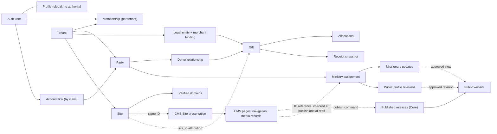
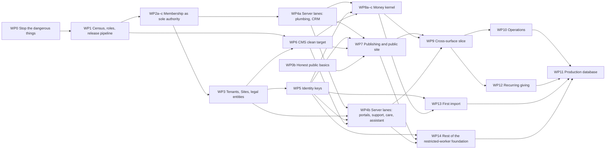

# Core CRM, CMS and database — recommended target architecture and build plan

**Status:** recommendation for an owner decision, dated 15 November 2026 and amended on 16 November 2026 after seven further council rounds, a review for needless complexity and a final review, after which the coordinator ratified this text as the council's recommendation, with reservations ([C.8](./core-crm-cms-database-council-record.md#c8-final-review-and-ratification)). On 17 November 2026 the owner authorized the implementation of the whole plan. What has been built and verified since then is in the [implementation record](./core-crm-cms-database-implementation-record.md). This text describes the target and is not evidence that any package is implemented: where it says that nothing is built or tested, or that a package needs its own authorization, it speaks as of its ratification.

**Basis.** This report follows the adjudicated factual baseline in [`core-crm-cms-database-audit.md`](./core-crm-cms-database-audit.md) ("the audit") at commit `8ed81f5561c389fa47a576cd4c00d2d03e868fc9`. Finding IDs such as A01, NB-04 or NC-02 refer to that document. ADR numbers 0027–0030 are each shared by several files; here they mean the files named in section 14. Three independent council seats each proposed a complete architecture, then cross-reviewed one another; the coordinator adjudicated. Who proposed what, and where they disagreed, is in [section 11](#11-alternatives-and-decisions) and [Appendix A](./core-crm-cms-database-council-record.md#appendix-a--round-2-council-record). A third round then reviewed the finished plan. Its accepted amendments are folded into the text and listed in [Appendix B](./core-crm-cms-database-council-record.md#appendix-b--round-3-review-record). A fourth round scored the amended plan against minimum scores the owner set; what it changed, and what the fifth to ninth rounds changed after re-scoring it, is in [Appendix C](./core-crm-cms-database-council-record.md#appendix-c--scoring-rounds). The appendices are kept in the companion council record, apart from this plan, with the final review and its ratification ([section C.8](./core-crm-cms-database-council-record.md#c8-final-review-and-ratification)).

**How to read "present" and "proposed".** Statements about what exists cite the audit. Everything else in this report is a proposal. Budgets and scale figures are proposed targets or labelled assumptions; there is no measured application workload.

## 1. Recommended direction

**Keep Supabase, Postgres and Payload. Change who is allowed to decide what.** Core's problems come from several parts of the system each holding their own answer to "which organization is this, and what may this person do". The recommendation gives every fact one owner and makes the database check the tenant boundary itself.

In plain terms:

1. **One database, three owners.** Core's operational schemas hold people, organizations, permissions, money and Sites. Payload's `cms` schema holds authored pages, navigation and media records. Supabase manages its own schemas. Each area has one migration owner and its own database role.
2. **Membership is the only source of authority.** A login proves who someone is and nothing more. What they may do comes from a current membership in one organization, chosen per request. The one exception is a platform operator's support grant, which is read-only, time-boxed and a record of its own (5.4). The profile's tenant and role columns, the token tenant claim and the `super_admin` bypass all go.
3. **The database enforces the tenant boundary for every caller that has a user identity.** Staff work runs on the caller's own token, so the policies that protect the browser also protect the server. Money, role changes, care records and audit go through SQL command functions that check the caller's membership and the permission the action needs, and commit atomically. The all-powerful service key shrinks to a short, listed set of platform tasks.
4. **Payload is a private editing tool, not a second system of record.** It lives only in the admin app, connects with a role that can touch only `cms` and cannot change schema, and owns no login, organization, role, CRM or money fact.
5. **Publishing copies a page into Core's schema; the public site reads only those copies.** Each publish writes one immutable row. Withdrawing a page is one committed change. The public site never queries Payload and does not depend on the admin app being up.
6. **Money steps are single transactions with recoverable hand-offs.** Each step commits completely or not at all, each business effect has its own idempotency key, claimed work expires and is retried, posted facts never change, and receipts are frozen when issued.
7. **Rebuild the hosted databases from source rather than repairing them**, after an owner-approved census of what exists.
8. **Defer every mechanism that no first-release requirement needs.** That includes whole-site release compilation, database policies inside the CMS schema, configurable permission grants, Field Accounts and accounting delivery.

**Why this is the simplest dependable design.** It adds two database roles, a command schema and a small `platform` schema, release, head, publish-intent and media-use tables, a media custody table, an operator list, a lease on claimed work, and the Site, Party, account-link and legal-entity tables the accepted product already requires. It removes more than it adds: four competing sources of authority, the slug bridge between CRM and CMS, the HTTP dependency between the public site and the admin app, a staged-gift write path that skips finance checks and a destructive seed command. It uses documented Postgres, Supabase and Payload capabilities throughout, and where a capability is not yet proven on the pinned Payload pre-release, the plan names the test, and a fallback where one exists.

**What it costs.** Policies have to be written for tables the server reads today with the service key. Governed business steps move into SQL. The CMS schema is rebuilt once. Section 9 lists the continuing operating burden.

**What it does not deliver.** WP0–WP11 build a safe foundation for several organizations, with publishing, a thin CRM and one-time giving. WP12, WP13 and WP14 add monthly giving, a first import and the rest of the restricted-worker foundation, which a real organization needs before it can rely on Core. Section 12 lists what else a launch needs.

## 2. Product and architectural principles

Each principle is an outcome the accepted product sources require. The design in later sections is judged against them.

| #    | Principle                                                                                                                                                        | Source                                                                                            |
| ---- | ---------------------------------------------------------------------------------------------------------------------------------------------------------------- | ------------------------------------------------------------------------------------------------- |
| PR1  | No request reads or writes outside its tenant, and the database enforces this independently of application checks for every caller that carries a user identity. | `openspec/specs/identity-and-access/spec.md:35-53`; `platform-boundaries/spec.md:187-205`         |
| PR2  | Identity, tenant and role are resolved on the server from a verified session. The client asserts none of them.                                                   | `identity-and-access/spec.md:14-33`                                                               |
| PR3  | A login authorizes nothing by itself. Authority is a current membership. Removing it removes access on every path at the next request.                           | ADR-0214; `openspec/contracts/identity-and-access.md` (contract `af71db6f…`)                      |
| PR4  | One person may act in several organizations. Tenant choice is explicit and bound to the request.                                                                 | ADR-0214; ADR-0174                                                                                |
| PR5  | CRM owns operational truth; CMS owns public presentation; neither copies the other's facts; where they disagree, CRM wins.                                       | `openspec/contracts/platform-boundaries.md` (`8ac6e5…`, `ebd32f…`); ADR-0029 (reference-not-copy) |
| PR6  | A Site is presentation and giving-entry attribution beneath a Tenant. It is never an authorization, payment or accounting boundary.                              | contract `6d422b…`; ADR-0207                                                                      |
| PR7  | Posted financial facts are immutable. Money effects are neither lost nor duplicated on retry. Issued documents stay reproducible.                                | ADR-0206; `donation-lifecycle/spec.md:138-203`                                                    |
| PR8  | Sensitive actions need a specific capability checked on the server, and a reason where the contract says so.                                                     | `identity-and-access/spec.md:55-73`; `contribution-operations/spec.md:68-101`                     |
| PR9  | Public visitors see only published content of the Site they are on. Withdrawal reaches pages, caches and media predictably.                                      | `platform-boundaries/spec.md:230-266`; ADR-0030, 0126, 0171                                       |
| PR10 | Each schema has one migration owner, and an environment's state can be reproduced from source.                                                                   | ADR-0179; audit D02, D03                                                                          |
| PR11 | Payload is replaceable machinery. Only the admin app imports it.                                                                                                 | contract `8ac6e5…`; ADR-0178                                                                      |
| PR12 | Narrow surfaces show honest states: pending, failed, queued and unavailable are shown as such.                                                                   | `platform-principles` (donor trust through honest states)                                         |
| PR13 | Every new mechanism names the requirement it serves. Capabilities that are deferred are unavailable, not approximated.                                           | This assignment; audit NX-01                                                                      |
| PR14 | An AI assistant acts only within the authority of the person it serves. Its effects wait for that person's approval and are attributed to them.                  | `platform-boundaries/spec.md:163-185`; `platform-product-intent/spec.md:197-222`                  |

## 3. Conceptual model

### 3.1 Identities that must stay distinct

| Concept                               | Scope                     | Identity                                 | What it is, and is not                                                                                                                                                                                                                                                                                                                                  |
| ------------------------------------- | ------------------------- | ---------------------------------------- | ------------------------------------------------------------------------------------------------------------------------------------------------------------------------------------------------------------------------------------------------------------------------------------------------------------------------------------------------------- |
| Auth user                             | global                    | `auth.users.id`                          | A credential. Proves control of a login.                                                                                                                                                                                                                                                                                                                |
| Profile                               | global, one per auth user | `profiles.user_id`                       | Display name, avatar, preferences. Holds **no** tenant and **no** role.                                                                                                                                                                                                                                                                                 |
| Tenant                                | —                         | `tenants.id`                             | A sending organization. The isolation boundary. Has a lifecycle status.                                                                                                                                                                                                                                                                                 |
| Membership                            | tenant                    | `authz.memberships.id`                   | One role a person holds in one tenant: donor, missionary, or staff with a sub-role. A staff row may carry the tenant-administrator flag. A person may hold several rows, and each request acts under exactly one of them (5.1). Can be revoked. The only grant of tenant authority to a member; an operator's support grant is a separate record (5.4). |
| Platform operator                     | global                    | operator list                            | May run platform commands. Grants no tenant data access by itself.                                                                                                                                                                                                                                                                                      |
| Party                                 | tenant                    | `(tenant_id, id)`                        | The person, household or organization a business record concerns. Exists whether or not anyone can log in.                                                                                                                                                                                                                                              |
| Account link                          | tenant                    | `(tenant_id, user_id)`                   | "This login is this Party in this tenant". Created by a claim with proof or by accepting an invitation that names the Party. A gift never creates one (5.4).                                                                                                                                                                                            |
| Donor relationship                    | tenant                    | on a Party                               | The tenant's giving relationship with a Party. Not a person and not a login.                                                                                                                                                                                                                                                                            |
| Ministry assignment                   | tenant                    | on a Party                               | A missionary's operational role in the tenant. Replaces today's two meanings of `missionary_id`.                                                                                                                                                                                                                                                        |
| Missionary public profile             | tenant                    | on the ministry assignment               | The story, photo and display name a missionary controls, held as a candidate revision and an approved revision. Not a CMS document.                                                                                                                                                                                                                     |
| Publication restriction               | tenant                    | on the Party                             | Whether and how a worker may appear in public: a security level, a public alias and a do-not-publish flag (roadmap Phase 10).                                                                                                                                                                                                                           |
| Legal entity and merchant binding     | tenant                    | Core IDs                                 | Who legally receives money, and which payment account charges go to.                                                                                                                                                                                                                                                                                    |
| Site and Site domain                  | tenant                    | `sites.id`; verified host                | Presentation and giving-entry attribution. Exactly one default Site per tenant.                                                                                                                                                                                                                                                                         |
| Site presentation, page, navigation   | tenant, per Site          | Payload UUIDs                            | Authored content. The Site presentation shares its ID with the operational Site.                                                                                                                                                                                                                                                                        |
| Media record                          | tenant                    | Core custody ID, shared with `cms.media` | Editorial metadata in Payload; custody and bytes in Core.                                                                                                                                                                                                                                                                                               |
| Published release                     | tenant, per Site          | Core IDs                                 | An immutable copy of one published page or navigation set. What the public reads.                                                                                                                                                                                                                                                                       |
| Gift, allocation, correction, receipt | tenant                    | Core IDs                                 | Financial facts. Immutable once posted; corrections append. Carries Site attribution.                                                                                                                                                                                                                                                                   |
| Missionary update                     | tenant                    | `posts.id`                               | An operational record with review state. Not a CMS document.                                                                                                                                                                                                                                                                                            |
| Communication                         | tenant                    | Core IDs                                 | Intent, consent evaluation, provider acceptance and delivery evidence, kept distinct.                                                                                                                                                                                                                                                                   |

### 3.2 How they connect

### 3.3 Rules that follow

- A Party match is not permission to claim an account. An email match can attribute a guest gift to one clean same-tenant match, goes to staff review when ambiguous, and is never proof of identity (ADR-0215).
- A hostname selects a Site and therefore a tenant. It never selects a payment account; that comes from the tenant's legal entity.
- A CMS document ID is never an operational person, missionary or tenant ID. Public payloads name which is which.
- Removing a login or membership never deletes financial history.
- Nothing joins across tenants. One login may hold memberships in several tenants; their Party, donor and gift records stay separate (ADR-0214).
- Tenant-specific fields are not part of the first release. When they are needed, they belong in typed, tenant-scoped definition and value tables in Core, under the same policies — not in JSON on core records and not in Payload collections. Phase 11 owns that design.

## 4. Ownership map

"Writers" lists the only code allowed to change the record. "Told by" is how consumers learn of a change.

| Fact or record                                             | Canonical store                                                                                                                         | Writers                                                                                                                                                                                                                                                                                                                                                                                                                  | Readers and projections                                                                                                                                                                                                                                                                                     | Lifecycle                                                                                                                                                                                                                                                                                                                                                                                                                                                                                                                         | Told by                                                         |
| ---------------------------------------------------------- | --------------------------------------------------------------------------------------------------------------------------------------- | ------------------------------------------------------------------------------------------------------------------------------------------------------------------------------------------------------------------------------------------------------------------------------------------------------------------------------------------------------------------------------------------------------------------------ | ----------------------------------------------------------------------------------------------------------------------------------------------------------------------------------------------------------------------------------------------------------------------------------------------------------- | --------------------------------------------------------------------------------------------------------------------------------------------------------------------------------------------------------------------------------------------------------------------------------------------------------------------------------------------------------------------------------------------------------------------------------------------------------------------------------------------------------------------------------- | --------------------------------------------------------------- |
| Credential, session                                        | Supabase Auth                                                                                                                           | Supabase Auth                                                                                                                                                                                                                                                                                                                                                                                                            | Server, through `getUser`                                                                                                                                                                                                                                                                                   | Created at sign-up or invitation; ended only when its owner closes the account or a platform operator locks it, never by one organization, whether it removes a membership or erases a person                                                                                                                                                                                                                                                                                                                                     | Next request re-reads                                           |
| Profile                                                    | `public.profiles`                                                                                                                       | The owner                                                                                                                                                                                                                                                                                                                                                                                                                | Self; display snapshots                                                                                                                                                                                                                                                                                     | Anonymized when its owner closes the account; an organization's erasure never changes it                                                                                                                                                                                                                                                                                                                                                                                                                                          | Live read                                                       |
| Tenant and status                                          | `public.tenants`                                                                                                                        | Provision and status commands (platform operators)                                                                                                                                                                                                                                                                                                                                                                       | Every lane, through the membership helper                                                                                                                                                                                                                                                                   | Provisioning → active → suspended → closed; purged is a reserved status until the later purge package (section 12); never cascade-deleted                                                                                                                                                                                                                                                                                                                                                                                         | Helper reads status live                                        |
| Membership                                                 | `authz.memberships`                                                                                                                     | Invitation, claim, role-change, revoke, erase and close-account commands; the payment-outcome command, for the first paid gift of a giver whose login is already linked to a Party (5.4)                                                                                                                                                                                                                                 | Membership helper; assignments function                                                                                                                                                                                                                                                                     | Active, revoked. A revoked row is kept, and is revived if the same role is granted again; erasure and account closure delete rows                                                                                                                                                                                                                                                                                                                                                                                                 | Live lookup each request                                        |
| Platform operator list                                     | `authz.platform_operators`                                                                                                              | One add-and-remove script, run by the release job's owner (5.4). No command or screen                                                                                                                                                                                                                                                                                                                                    | Platform commands; the admin proxy, through one read function; from WP10, the support-grant check                                                                                                                                                                                                           | Add, remove; the last operator is never removed                                                                                                                                                                                                                                                                                                                                                                                                                                                                                   | Live lookup                                                     |
| Operator support grant                                     | `authz.support_grants`                                                                                                                  | The grant command, a platform command with MFA, which also ends a grant early (5.4, WP10)                                                                                                                                                                                                                                                                                                                                | `authz.current_tenant_id()` and the staff-read helper; the principal resolver; the tenant's administrators, on the screen that lists live grants                                                                                                                                                            | Granted with a reason and an expiry; over when it expires or is ended. Never a membership row. Kept as history, and a second grant is a new record                                                                                                                                                                                                                                                                                                                                                                                | Live lookup each request                                        |
| Party, donor relationship, ministry assignment             | `public.parties`, `donors`, `missionaries` (renamed keys)                                                                               | Staff through the user lane; claim and import commands, and later the merge command (8.4); the payment-outcome command, for a new giver's first paid gift (5.4); the set-worker-identity command, which sets the level and the alias at creation and creates and edits the restricted identity in `private.party_restricted`, and the restrict and lift commands afterwards, for the three publication fields (6.6, WP5) | Mission Control in full; portals as own-row projections; public as an allowlisted projection                                                                                                                                                                                                                | Soft-archive; merge is non-destructive (ADR-0216); erasure anonymizes, within the tenant                                                                                                                                                                                                                                                                                                                                                                                                                                          | Live read; no copies                                            |
| Missionary public profile                                  | Revision rows on the ministry assignment, in `public`                                                                                   | The missionary (candidate, withdraw) and a reviewer (approve, withdraw), through commands; the restrict command and, for an erased worker, the erase command, which mark the approved revision withdrawn (5.5, 6.6)                                                                                                                                                                                                      | The public projection; the donor portal                                                                                                                                                                                                                                                                     | Candidate → approved → withdrawn                                                                                                                                                                                                                                                                                                                                                                                                                                                                                                  | Read at render for public, after admission                      |
| Account link                                               | `public.account_links`                                                                                                                  | Claim command with fresh proof; the erase and close-account commands, which remove it; invitation acceptance, when the invitation names a Party                                                                                                                                                                                                                                                                          | Portals, to find "my" Party                                                                                                                                                                                                                                                                                 | Created on claim or invitation acceptance; removed on erasure or account closure                                                                                                                                                                                                                                                                                                                                                                                                                                                  | Live read                                                       |
| Legal entity, merchant binding                             | `public.legal_entities`, `public.payment_account_bindings`                                                                              | Provisioning and payment-account onboarding commands; binding status follows the provider's account events                                                                                                                                                                                                                                                                                                               | Gift commands; receipts                                                                                                                                                                                                                                                                                     | Pending → active ⇄ restricted; either can become disconnected; reconnecting opens a new version; a gift freezes the version it used                                                                                                                                                                                                                                                                                                                                                                                               | Live read                                                       |
| Site, domain                                               | `public.sites`, `public.site_domains`                                                                                                   | Provisioning, create-Site, Site-status and domain-verification commands                                                                                                                                                                                                                                                                                                                                                  | Host resolver; attribution; CMS                                                                                                                                                                                                                                                                             | Default Site is permanent; another Site is active or inactive, by command; a host is unique when verified                                                                                                                                                                                                                                                                                                                                                                                                                         | Resolver; the Site's status is read in each request's admission |
| Site presentation, pages, navigation (drafts and versions) | `cms.*`                                                                                                                                 | Payload, through the actor port (staff) and service port (provisioning)                                                                                                                                                                                                                                                                                                                                                  | Web Studio; the admin server's publish step                                                                                                                                                                                                                                                                 | Draft → version → submitted for publish; versions capped                                                                                                                                                                                                                                                                                                                                                                                                                                                                          | Publish command                                                 |
| Published release and head                                 | `public.published_releases`, `public.published_heads`                                                                                   | The publish commands (request, then fulfilment) and the withdraw command only, including the withdrawal that a restriction or the erasure of a worker triggers                                                                                                                                                                                                                                                           | The public reader in `packages/api`                                                                                                                                                                                                                                                                         | Release rows immutable; head moves by compare-and-swap; withdrawal flips the head                                                                                                                                                                                                                                                                                                                                                                                                                                                 | Read on each request                                            |
| Media custody record (tenant, content hash, status)        | `public.media_assets`                                                                                                                   | Core upload, delete and containment commands                                                                                                                                                                                                                                                                                                                                                                             | The fulfil-publish command; the media route; the media delete check                                                                                                                                                                                                                                         | Uploading → ready; contained when it must be denied everywhere; tombstoned by the delete command and purged after a delay longer than the database recovery window (6.6). Media-use rows are append-only where-used facts, written by publish fulfilment, by approval of a revision or an update, by a submit under an automatic policy, and by the care save. Whether a use is live is derived by one SQL predicate from the head, revision, update, note or care-thread message the row names (6.6); a care use is never public | The live-use predicate, read on each request                    |
| Media editorial record (alt text, credit, folder)          | `cms.media`, same ID as the custody record                                                                                              | Created through the service port by the upload's finalize step; edited through the actor port                                                                                                                                                                                                                                                                                                                            | Web Studio; the admin server when it serializes a page                                                                                                                                                                                                                                                      | Follows the custody record                                                                                                                                                                                                                                                                                                                                                                                                                                                                                                        | Publish command                                                 |
| Media bytes                                                | Private object bucket, key `{tenant_id}/{content hash}`                                                                                 | Core upload command: a one-object signed upload to a temporary key, then a finalize step that writes the sanitized bytes once under the content-hash key                                                                                                                                                                                                                                                                 | Core media route: public requests get bounded variants only, need a live public use of the asset and are refused when it is contained; a signed-in caller who can read the record that uses an asset, or who authored it, is served it uncached, and so is a staff editor for any CMS asset of their tenant | Immutable; purged after the delay that follows a deletion (6.6)                                                                                                                                                                                                                                                                                                                                                                                                                                                                   | The route admits every request; no shared cache                 |
| Missionary update                                          | `public.posts` with review state                                                                                                        | Missionary (draft, withdraw); reviewer (approve, withdraw) through commands; the erase command, which marks an erased worker's updates withdrawn (5.5)                                                                                                                                                                                                                                                                   | Donor feed; public Site block through an approved view. Email to followers is deferred (section 12)                                                                                                                                                                                                         | Draft → in review → published → withdrawn                                                                                                                                                                                                                                                                                                                                                                                                                                                                                         | Live for portals; read at render for public, after admission    |
| Gift intake, payment observation and review state          | `donations`, intake allocation lines, `staged_gifts`, `staged_gift_allocations` (today's names)                                         | Command functions only                                                                                                                                                                                                                                                                                                                                                                                                   | Finance review screens; workers                                                                                                                                                                                                                                                                             | Mutable operational state; never the posted record                                                                                                                                                                                                                                                                                                                                                                                                                                                                                | Live read; outbox for notices                                   |
| Posted gift, allocations                                   | Separate posted tables, written once by the posting command (ADR-0206). Their shape is fixed in 8.4; physical names are settled in WP8b | Posting command only                                                                                                                                                                                                                                                                                                                                                                                                     | CRM, portals and reports, through one effective-amount view                                                                                                                                                                                                                                                 | Immutable for every role; corrections, refunds and dispute reversals append                                                                                                                                                                                                                                                                                                                                                                                                                                                       | Live read; outbox                                               |
| Receipt (official statements are deferred)                 | Immutable receipt-fact rows keyed to the posted gift, and private object bytes                                                          | Eligibility and receipt facts: the posting command, by the receipt owner's rule. Rendered file: a worker, from the outbox, pinned to the facts and a template version                                                                                                                                                                                                                                                    | Donor download and every send reuse the stored file                                                                                                                                                                                                                                                         | Append-only; superseded, never edited                                                                                                                                                                                                                                                                                                                                                                                                                                                                                             | Email outbox keyed by receipt                                   |
| Raw provider event                                         | Event store, keyed by provider account, mode and event ID                                                                               | Webhook intake (system-entry command)                                                                                                                                                                                                                                                                                                                                                                                    | Workers                                                                                                                                                                                                                                                                                                     | Retained; processing state uses a lease                                                                                                                                                                                                                                                                                                                                                                                                                                                                                           | —                                                               |
| Communication                                              | Communication tables (ADR-0217–0223), deferred. The delivery record for every send through the gateway ships with WP8b                  | One email gateway                                                                                                                                                                                                                                                                                                                                                                                                        | Staff history; consent gate                                                                                                                                                                                                                                                                                 | Retention and redaction per ADR-0223                                                                                                                                                                                                                                                                                                                                                                                                                                                                                              | Provider webhooks                                               |
| Care notes, restricted notes                               | The care tables; a restricted note is a row of `crm_notes`                                                                              | Care commands; a restricted note through RLS                                                                                                                                                                                                                                                                                                                                                                             | The care sub-role, within today's author and subject restrictions; for a restricted note, the tenant-administrator flag                                                                                                                                                                                     | Product decision on author access (A04)                                                                                                                                                                                                                                                                                                                                                                                                                                                                                           | Live read                                                       |
| Audit                                                      | `audit_logs` and operation ledgers                                                                                                      | Command functions; actor taken from the session. The operator script, for a change to the operator list (5.4)                                                                                                                                                                                                                                                                                                            | The tenant's staff, as the read policy admits today; from WP10, an operator under a support grant                                                                                                                                                                                                           | Append-only                                                                                                                                                                                                                                                                                                                                                                                                                                                                                                                       | —                                                               |

**What changes hands compared with today:** Payload stops owning tenants, user roles, missionary updates and public serving. Core stops accepting writes to governed tables from the browser or from generic service-key handlers.

## 5. Tenant and authorization design

### 5.1 Authentication and authority

- **Authentication** stays with Supabase Auth: one global credential per person (ADR-0214). Platform operators must have MFA, checked from the session's assurance level. No factor is enrolled in either project today (B06, NX-09), and TOTP enrolment and verification are switched off in the repository's Auth configuration (`supabase/config.toml:279-281`; NR-31). WP2c switches them on and builds the enrolment and challenge screens.
- **Authority** is a row in `authz.memberships` that is active and unrevoked. The table gains `granted_by` and `revoked_at`. An operator's support access is not a membership row. It is a record of its own, `authz.support_grants` (5.4). The membership table's unique key covers inactive rows too (`20260226113000_authz_memberships_foundation.sql:61-62`), so granting a role the person held before revives that row: the command clears `revoked_at` and sets the new `granted_by`, and the earlier grant stays in the audit log. Revoking sets `revoked_at` and `is_active = false` together, so the helpers that test `is_active` stay correct as they are.
- **Tenant administration is a flag on a staff membership; every other authority is a capability.** `authz.membership_role` is donor, missionary or staff, and the staff sub-roles are finance, mobilizer, development, hr and member_care. Tenant administration exists today only as `profiles.role = admin`, and the capability registry carries `tenant_admin` as a named grant with no membership behind it. The design adds a boolean, tenant administrator, to a person's staff membership row, and sets it on the staff row that today's admin profiles already hold. The backfill gave the member-care sub-role, and with it the care capability, to every staff, admin and super-admin profile (`20260226113000_authz_memberships_foundation.sql:99-111`). Each such row the census keeps, and each staff row WP2a creates, takes the development sub-role unless the decision table of WP2 names another; none keeps member care by default. It is not a new role or sub-role, so the staff check that about a hundred policies call and the resolver's rules stay as they are for this flag, and it reaches the registry as the existing `tenant_admin` grant. The flag also has to reach the code that asks for an administrator today. The assignments functions and the resolver return it. `hasRole(…, "admin")` becomes true only for a staff membership in the active tenant that carries the flag; today any staff membership satisfies it (`packages/auth/permissions.ts:64-71`). About seventy files under `packages/api/src` test the role name directly, the email, PDF-template, automation and organization-settings handlers among them, and contribution operations keeps a capability table of its own (`packages/api/src/admin/contribution-operations/permissions.ts:270-285`), which is retired for the registry. The assistant runtime's platform gates that test `super_admin` move to the operator list. Every other authority is a capability in the code registry (`packages/auth/capabilities`, ADR-0210), granted through role bundles, which is the one vocabulary ADR-0174 clause 8 allows. The registry holds 18 capabilities today, all for contributions, gift history, admin screens and permissions, so WP2a adds the ones the commands in 5.4 need. "Tenant-administrator membership" and "tenant admins" below mean a staff membership with the flag, and "publishing grant" means the publishing capability. Refunds and resolving parked provider work need capabilities that only the tenant-administrator grant holds today (`packages/auth/capabilities/bundles.ts`); the finance-approver bundle exists, and a staff sub-role that holds it is an owner option. The `platform_admin` grant is retired with `super_admin`: its contribution-settings bundle moves to the tenant administrator, and approving a widening of permissions has no holder until Phase 12.
- **Several memberships in one tenant.** The unique key on memberships lets a person hold several staff rows in one tenant (`20260226113000_authz_memberships_foundation.sql:61-62`), and both the resolver and the registry refuse that today (`packages/api/src/principal/assignment.ts:106-113`; `packages/auth/capabilities/effective-capabilities.ts:163-164`; NR-18). The rule: the surface fixes the role class. Mission Control and Web Studio act on staff rows, the missionary workspace on the missionary row, the donor portal on the donor row. Each request acts under exactly one membership row, its Active Tenant Assignment, and only that row's grants apply: its sub-role's bundle and, where the row carries the flag, the tenant-administrator grant. The accepted contract requires this and supersedes any union of a person's memberships (`openspec/contracts/identity-and-access.md`, "Capability Aggregation Uses One Validated Context"), so the refusal in the resolver and the registry is that rule at work and stays. Where the surface and the tenant leave one live row, that row is the assignment. Where they leave several staff rows, the person chooses one, and the resolver takes it as the proposed assignment it already accepts (`assignment.ts:128-165`). The resolver is given the surface's role class and filters on it before it looks for a default, so its present preference for a staff row over a donor or missionary row in the same tenant goes (`assignment.ts:106-113`). The choice of sub-role travels in the page address, as the `~<sub-role>` segment that only a person with several staff rows ever sees (once a suffix on the tenant segment, which N2 removes; amended 2026-11-24). Every signed-in request also names its assignment in a second request header beside the tenant's, which carries the membership row's ID; the server and the browser data layer always send it. For an operator reading under a support grant it carries the grant's ID instead (5.4). In the database a role-class check passes only when the named row is the caller's, is live in the request's tenant and is of the class the policy asks for. With no header, a caller who holds exactly one live row in that tenant acts under it, and a caller who holds more than one, of any class, passes no check. A staff member who also gives is therefore never staff and donor in one statement. Commands and deferred work resolve the assignment again when they run. A person's other rows, in this tenant or in any other, add nothing to the request (ADR-0210; ADR-0174 clause 7).
- **Profiles** keep display data only. `profiles.tenant_id` and `profiles.role` are removed once nothing reads them. A "last used tenant" may remain as a landing hint.
- **Sign-up** creates a login and a profile and nothing else. It no longer assigns the demo tenant (A09). A donor membership appears when someone claims a Party with proof, or when a person whose login is already linked to a Party gives for the first time (5.4). A gift never links a login to a Party.
- **Capabilities** come from the existing code-owned registry, resolved from the one membership row that rule selects. Staff sub-roles get distinct bundles, which fixes B05 and A06. Command functions check a capability in the database through one SQL function that holds the bundle-to-capability mapping, and a test compares that function with the registry on every change. ADR-0210 defers capability tables to Phase 12, so no table is added. Configurable grants stay deferred.
- **A member directory.** Staff of a profile's tenant can read the whole row today (`20260625002117_canonical_tanstack_db_realtime_rls.sql:60-70`; NR-54). WP2b drops that policy, so that a profile is readable only by its owner, and a read function returns display name and role for the members of the active tenant. Staff screens and tenant administrators use it.
- **Mail that carries a link.** Invitation and claim messages are single-use tokens that Core issues and sends as transactional mail through the existing gateway in `packages/api/src/email`, under the tenant's sender identity (ADR-0215). That is the default sender in the tenant's email settings, once its sending domain is authenticated there (`packages/api/src/email/settings-store.ts`). Until then no automated mail goes out, because Asym provides no shared fallback account for tenant messages (ADR-0029); a new tenant's first administrator instead receives a single-use sign-in link that an operator issues and hands over in person. Core itself sends sign-up confirmation and password recovery, as protected-action links on the organization's verified home domain, through the organization's own mail account, and Supabase Auth sends no mail of its own on these flows. The repository configures no Auth sender today (`supabase/config.toml:213-221`), and the census records what each hosted project has. _Amended 2026-11-24 by the owner's decision of 21 November 2026 on tenant-owned domains (OpenSpec change `adopt-tenant-owned-domains`); the earlier text sent this mail under the platform's identity._

### 5.2 Choosing the tenant

| Surface                                           | How the tenant is chosen                                                                                                                                                                                                                                                                                               | Where it is verified                                                                                                                                                                                                                             |
| ------------------------------------------------- | ---------------------------------------------------------------------------------------------------------------------------------------------------------------------------------------------------------------------------------------------------------------------------------------------------------------------- | ------------------------------------------------------------------------------------------------------------------------------------------------------------------------------------------------------------------------------------------------ |
| Public website                                    | Request host → verified `site_domains` row → Site → tenant                                                                                                                                                                                                                                                             | Core resolver. Never a header the caller sets (C11).                                                                                                                                                                                             |
| Donor portal                                      | Verified home domain → tenant; account under `/donor-dashboard`                                                                                                                                                                                                                                                        | Resolver, then membership lookup                                                                                                                                                                                                                 |
| Mission Control, Web Studio, missionary workspace | The verified home domain names the tenant. Mission Control and the missionary workspace are served on it under `/admin` and `/missionary`; the address carries only an optional `~<sub-role>` (amended 2026-11-24). Web Studio is the exception below. Commands also take the tenant as an argument                    | Server resolver, then the database                                                                                                                                                                                                               |
| Jobs and webhooks                                 | Found by the worker wrapper from stored rows, for example the gift behind a payment reference, and confirmed inside the command (5.4)                                                                                                                                                                                  | By the wrapper, then inside the function                                                                                                                                                                                                         |
| Giving from the public site (guest or signed-in)  | Pass the request Host and any account-entry source hint. Resolve the active host's tenant, recheck under lock and attribute per §5.2. The donor server takes the host from the request's own `Host` header, never from a header the caller sets (amended 2026-11-27, ruling W8-R41 and the ruling on signed-in giving) | Inside the intake function, which derives the tenant from that Site row or home record, takes the legal entity from the giving targets the lines name and the merchant binding from that entity's active binding, and accepts no tenant argument |

The server uses the multi-membership resolver that already exists and is not yet wired in (`packages/api/src/principal`). It reads the user's live assignments, refuses to guess when more than one tenant is possible, and fails closed on malformed rows. The tenant is not stored on the profile, so two browser tabs can work in two organizations. For table reads through the Data API, the server sends the active tenant as a request header, which the database helper reads (5.4). Browser collections send the same header from the page's tenant context, and both send the assignment header beside it (5.1).

**Superseded: the domain carries the tenant, and the address carries only `~<sub-role>`.** Under the owner's decision of 21 November 2026 on tenant-owned domains (OpenSpec change `adopt-tenant-owned-domains`) the organization comes from the verified home domain, and package N2 removes the organization ID from the address and keeps the sub-role suffix. The rest of this paragraph is the earlier design, kept as history: the page address carries the tenant because a page request can carry only its address and its cookies, and a cookie is shared by every tab (ADR-0174 clause 7). The tenant is the first path segment. The segment is the tenant's ID, and the proxy treats a first segment as a tenant only when it is a UUID in canonical lower-case form, the form the resolver already demands (`assignment.ts:12-13`), optionally followed by `~` and one staff sub-role name or, from WP10, by `~support` for an operator who acts under a support grant (5.4). Nothing else is read as a tenant, so no page name can collide with it, and a renamed organization keeps its addresses. Today's database helper also demands a version digit of 1 to 5, which rejects the demo tenant's ID (NX-03); that pattern goes. That touches every signed-in page of the two staff apps, 53 in Mission Control and 11 in the missionary workspace, with their links and end-to-end tests. The proxy strips the prefix and passes the tenant to the render as a request header, which leaves the route tree and its page files as they are. Moving the pages under a dynamic segment is the fallback, taken only if the thin proof (section 12) shows that the rewrite breaks navigation or prefetching. A deep link that names a tenant the person does not belong to is refused and never switches organization. For a person with several staff rows in the tenant the segment also names the chosen sub-role (5.1); a link that names a sub-role the person does not hold falls back to their one assignment, or to the chooser when they have several. The cheaper alternative is one signed cookie for every staff surface, as Web Studio uses below. It needs an amendment to that ADR and is an owner decision (section 15).

**Calls from a page to the app's own API carry the tenant too.** Page code, Web Studio's pickers and label loaders included, calls the app's `/api` routes through one shared fetch wrapper that sends the page's tenant as a request header, and `getAuthContext` passes it to the resolver as the expected tenant. Without it the resolver refuses anyone who belongs to two organizations, because it never guesses. No such wrapper is in use today: about 70 direct calls in 48 files under `apps/admin`, `apps/missionary`, `packages/database`, `packages/ui` and `packages/lib` reach the apps' own API (NR-41). The wrapper therefore lives in a shared package, those calls move onto it, and a lint rule refuses a direct call to an own-API path anywhere else. Web Studio's pickers call Mission Control's API (`apps/admin/src/cms-ui/web-studio/flows/studio-missionaries.ts:62`), which the Web Studio cookie never reaches, so they send the tenant their page was rendered for.

**The proxy keeps its role check on pages.** Each app's proxy resolves the person's role on every protected page, from `profiles` today (`packages/auth/resolve-user-role.ts:42-67`; NR-20), and the donor and missionary layouts rely on that check running before the page shell streams. The check moves to the membership function, scoped to the tenant of the verified home domain (amended 2026-11-24). From WP10 the admin proxy also admits an operator who selects a live support grant of their own in that tenant (5.4). Sign-in, the callback, Web Studio and the `/api` routes stay outside the membership check, and the operator area (WP2c) is served only on an Asym operations address, never on a tenant domain (amended 2026-11-24). The donor portal keeps one page outside the membership check, for a signed-in person who holds no donor membership at that host: it offers the claim (5.4) and a link to giving, and the proxy sends such a person there and not to the public home. Checkout is outside the check as well. Every other portal page requires the donor membership. On API routes the proxy only refreshes the session.

**Donor accounts live on one designated home domain, which may also serve a Site** (amended 2026-11-24). A gift belongs to the Site of the page it started on. Session cookies are set for the host that issued them (`packages/auth/middleware.ts:238-270`), and no cookie is shared across hosts, because a parent-domain cookie would reach the organization's other names. Sign-in, registration, claim, recovery and sign-out happen on the tenant's home domain and nowhere else, under the account brand (Phase 4 PRD, line 167, as amended). A Site serves guests and recognizes verified givers at home. On another domain, signed-in giving carries the selections and source Site to the home checkout: the giving targets, amounts and terms, and the source Site's ID. Pass the request Host and any account-entry source hint. Resolve the active host's tenant, recheck under lock and attribute per §5.2. Six admission cases follow: a verified giver on a name that is both a Site's and the home gives in place, with that Site and the website as entry surface; a hand-off whose source is a current Site of the home domain's tenant keeps that Site; a hand-off whose source is absent, another tenant's, unknown or inactive, and a gift started inside the account, record an account entry with no Site; all three take the donor portal as entry surface; a guest on any admitted Site name gets that Site and the website; a giver named on a Site name that is not the home is refused (5.4; amended 2026-11-27, ruling W8-R41 and the ruling on signed-in giving). Intake validates every other input as it does for any gift, the bot challenge is verified again on the home domain, the rate limit there is keyed on the signed-in person and not on the Site the parameters name, and a return link is built from the Site's stored primary domain and never from a parameter. Nothing is signed, because nothing in the parameters is trusted (Phase 4 PRD, lines 176-184). A donor who gives on a Site as a guest has the gift joined to their record by the email match.

**The browser data layer is scoped to the person, the tenant and the selected assignment.** Today the browser client, its collections and their cache keys are shared singletons with no tenant in them (`packages/database/supabase/client.ts`, `collections/supabase-collection.ts`, `query-keys.ts`; NR-04). WP2 gives the layer one scope for each document, fixed when the page loads: the person, the tenant and the selected assignment. The browser client, the fetch wrapper, the collections and their cache keys take the tenant and the assignment from that scope and never from the live address, and keys in browser storage carry the person and the tenant. Changing organization or assignment is a full document load, which leaves no old client, query or upload state behind (ADR-0174 clause 7), so there is no scope to retire inside a page. A guard in the app shell renders nothing and reloads if the address's sub-role suffix, or the domain's organization (earlier, the tenant segment), ever differs from the scope, and a refused assignment or a change of signed-in user reloads too. Six modules call the browser client's tables directly, outside the collections: `packages/missionary/components/add-partner-dialog.tsx` and `task-dialog.tsx`, two data-table hooks in `packages/ui`, `packages/lib/hooks/use-donor-record.ts` and `packages/lib/assets.ts`. They move onto the scoped layer or behind server commands.

**Two channels cannot carry the header.** Realtime: source publishes seven tables (`funds`, `posts`, `locations` and four post-reaction tables; NR-09), no hosted database publishes any, and no screen subscribes to one. WP2b takes all seven out of the publication. A subscription would need a read policy that leaves out the active tenant, and Postgres combines permissive policies with OR, so such a policy would also hand both organizations' rows to an ordinary read. A table that later needs live updates gets a broadcast channel with its own authorization, by a separate decision. Storage: the policies of the buckets that signed-in users reach directly, profile images and, until WP7, editor images, check live membership in the tenant named in the object path. The media and receipt buckets have no policy for signed-in or anonymous users and are reached only by the server (6.6).

**One stated exception: Web Studio.** Payload's own screens and REST calls cannot carry an argument. For those, the chosen membership travels in a signed, HttpOnly cookie, refused when its organization differs from the domain's (amended 2026-11-24). Payload's REST routes are served under `/api` today, outside the Web Studio path. The plan mounts them under `/web-studio/api` (Payload's `routes.api` setting) and scopes the cookie to `/web-studio`. The cookie then never reaches Mission Control's own API routes, and Web Studio's REST calls pass through the admin proxy. For those routes the proxy only refreshes the session cookies (C09): it does no role lookup and never redirects, so an expired or unauthorized call gets a JSON 401 or 403 from Payload's strategy and not a page redirect. The move happens in WP2b, for the prototype, because WP2 already needs the organization choice inside Web Studio. Requests to those routes that change data must be same-origin. The proof in 15.2 confirms this on the pinned version; the fallback is a cookie that covers both paths. The cookie only narrows and membership is still checked. Since the domain names the organization, the earlier exception, two organizations in two Web Studio tabs, no longer arises (amended 2026-11-24). Each Web Studio page carries the tenant it was rendered for. A save, upload or publish whose tenant differs from the current cookie is refused with a prompt to reload, so switching organization in another tab never retargets an open form.

A requested tenant only narrows. The database repeats the membership check, so a forged request can at most select a tenant where the caller already holds a membership or, for an operator, a live support grant.

### 5.3 What enforces the boundary, by caller

| Caller                                        | Enforced by the database                                                                                                                                                                                                                                                                     | Enforced by the application only                                                                                                                                                                                                                                                                                                                                                                                                                                                                                                                                                                   |
| --------------------------------------------- | -------------------------------------------------------------------------------------------------------------------------------------------------------------------------------------------------------------------------------------------------------------------------------------------- | -------------------------------------------------------------------------------------------------------------------------------------------------------------------------------------------------------------------------------------------------------------------------------------------------------------------------------------------------------------------------------------------------------------------------------------------------------------------------------------------------------------------------------------------------------------------------------------------------- |
| Browser, own token                            | RLS: the row's tenant must be the request's active tenant, and the request's one assignment must be a live membership of the required class there (5.1); own-row rules; no write grant on governed tables; same-tenant foreign keys                                                          | —                                                                                                                                                                                                                                                                                                                                                                                                                                                                                                                                                                                                  |
| Server handler acting for a signed-in person  | Identical to the browser, because it uses the caller's token                                                                                                                                                                                                                                 | Fine-grained capability on ordinary reads                                                                                                                                                                                                                                                                                                                                                                                                                                                                                                                                                          |
| Command function called by a person           | The actor is the session user; membership, role class and the capability the action requires are re-checked for the tenant argument, with a required reason and any approval rule; all rows written under that tenant; atomic                                                                | Explanations, confirmation prompts and routing to a queue                                                                                                                                                                                                                                                                                                                                                                                                                                                                                                                                          |
| AI assistant acting for a person              | Identical to that person: their token, their active tenant, the same policies and commands                                                                                                                                                                                                   | That a prepared effect waits for the person's approval before the command is called                                                                                                                                                                                                                                                                                                                                                                                                                                                                                                                |
| Publish fulfilment by the admin server        | The intent was recorded under the publisher's own token and membership, is unexpired and unused, and names the same documents; the publisher still holds the membership and the capability, the Site belongs to the tenant, and both are still active; every reference belongs to the tenant | That the content is the serialized form of the versions the intent names                                                                                                                                                                                                                                                                                                                                                                                                                                                                                                                           |
| Platform command called by an operator        | The operator list and the MFA session level are checked inside the function; the tenant is an argument                                                                                                                                                                                       | That the operator's stated reason is true; the command records it                                                                                                                                                                                                                                                                                                                                                                                                                                                                                                                                  |
| Operator reading under a support grant (WP10) | RLS: the request selects the grant, which is the caller's, unexpired and unended, and the caller is on the operator list; staff-wide read policies only. No write policy and no command admits a grant                                                                                       | That the operator's stated reason is true; the grant records it                                                                                                                                                                                                                                                                                                                                                                                                                                                                                                                                    |
| Job or webhook, through a command function    | Tenant found from stored rows by the worker wrapper and confirmed inside the function (5.4); rows written under that tenant; same-tenant foreign keys                                                                                                                                        | That the right job was scheduled                                                                                                                                                                                                                                                                                                                                                                                                                                                                                                                                                                   |
| Gift intake from the public site              | The tenant is derived from the Site row or, for a gift started in the account area, from the home record, the legal entity from the giving targets and the merchant binding from that entity; every giving target must belong to that tenant and to one legal entity; one idempotent command | Pass the request Host and any account-entry source hint. Resolve the active host's tenant, recheck under lock and attribute per §5.2. Beyond that host, the database trusts the donor server for who a signed-in giver is, read from the session only on the organization's home, and for the fee-cover amount worked out from the fee policy, because it cannot see a session under the service key, and for nothing else (amended 2026-11-27, ruling W8-R41 and the ruling on signed-in giving). The donor server also applies the rate limit and the bot challenge before it calls the command. |
| Platform lane (service key)                   | Foreign keys and constraints only                                                                                                                                                                                                                                                            | Everything else. Hence a frozen, shrinking allowlist.                                                                                                                                                                                                                                                                                                                                                                                                                                                                                                                                              |
| Payload runtime                               | Confined to `cms`; cannot change schema; the composite key from pages and navigation to the Site presentation; compound unique keys                                                                                                                                                          | Which rows inside `cms` a staff member may touch                                                                                                                                                                                                                                                                                                                                                                                                                                                                                                                                                   |
| Anonymous, operational data                   | No table grants; only listed read functions keyed by verified host                                                                                                                                                                                                                           | —                                                                                                                                                                                                                                                                                                                                                                                                                                                                                                                                                                                                  |
| Anonymous, CMS                                | No grants on `cms` at all                                                                                                                                                                                                                                                                    | —                                                                                                                                                                                                                                                                                                                                                                                                                                                                                                                                                                                                  |

**What the database does not check, stated plainly.**

- Row isolation inside the `cms` schema stays in Payload's access functions. Section 11 explains why. Its blast radius is bounded: Payload cannot reach operational data, and the public never reads `cms`. Nor does any key tie a Site presentation to its Site: the link is a soft shared-ID reference, and the publish commands and the admission read check the Site and its tenant in Core (6.4).
- The host a public gift arrived on. Pass the request Host and any account-entry source hint. Resolve the active host's tenant, recheck under lock and attribute per §5.2. The intake command trusts the donor server only for the host it was called on and, for a signed-in giver, the user ID it verified from the session (amended 2026-11-27, ruling W8-R41 and the ruling on signed-in giving). It also takes the fee-cover amount the donor server worked out, checked against a bound, and derives everything else itself (5.4).
- That the content handed to publish fulfilment is the serialized form of the versions the intent names. The database checks the intent and every reference, and trusts the admin server for the content.
- That an AI assistant's prepared effect waited for the person's approval. The database sees only that person's command.

### 5.4 Policies and commands

- **One policy pattern: the row's tenant must be the request's active tenant.** `authz.current_tenant_id()` stops reading the token claim. It serves reads through the Data API by signed-in users and nothing else. It returns the tenant named in the request header, read from the request-headers setting that the Data API fills for each request and accepted only as a value Postgres casts to `uuid`, and only when the caller holds a live membership there and the tenant is active. From WP10 it also returns that tenant, on the same condition that the tenant is active, for an operator whose request selects a live support grant of their own there (below). The role-class, sub-role and capability helpers judge the caller's one assignment for that tenant, the row the request selects (5.1). Command functions do not use it; "How a command runs", below, says what they use. Every policy for signed-in users on a tenant table requires the row's tenant to equal that value, plus its role-class or own-row condition, written so that each lookup runs once per statement. The helper returns a tenant only when the request's assignment resolves: the row the header names, the caller's one live row there or, from WP10, the caller's live support grant that the header names. An own-row branch is bound to its class as well: the donor branch admits only under a donor assignment and the missionary branch only under a missionary assignment, so a missionary who also gives never reads gifts given and gifts received in one statement. A request that names no tenant returns nothing. The claim-keyed policies in source already have this shape and keep their tenant condition without edits (their `is_super_admin()` branch is removed separately, below): 76 in the development database, and more after a full replay (migrations `20261005050728`, `20261025120000`, `20261025120800`). About 35 other tables admit on membership or ownership alone, among them `donors`, `donations`, `crm_notes` and the support and member-care tables (`20260625002117`, `20260501001500`, `20260414180338`). WP2 adds the tenant condition to them, because without it a person in two organizations receives both organizations' rows from any unfiltered read (NR-01). Repointing the helper to a request-tenant setting is the repository's own planned fix (`docs/security/tenant-read-floor.md:70`, #2298); the request-header channel, the live-membership condition and the universal tenant condition are added here. The token claim is retired, and the feed-preferences route moves to the resolver (NX-03).
- **Policies that switch on are reviewed first.** The claim-keyed policies have never admitted anyone on a hosted database, because the helper returns nothing today (A19). Before the repoint ships, an activation review lists each one: table, operation, role-class condition and who gains access. Nineteen Support Hub tables, among them `support_audit_log`, grant insert, update and delete to signed-in users behind such a policy (`20260515025814_support_hub_core_modules.sql:545-573`; NR-02). Write grants on the audit log and on every other governed table in the list are revoked in the same migration as the repoint.
- **No `super_admin` branch.** The policy branches that call `is_super_admin()` are removed; 151 policies in the development database carry one. A platform operator who needs to see a tenant's data receives an expiring support grant through an audited command the tenant's admins can see. This replaces Payload's unscoped role too (NA-07). A support grant is read-only. It is one record, `authz.support_grants`, which holds the operator, the tenant, the reason, who granted it, `expires_at` and `ended_at`, and it is never a membership row. The accepted contract bounds an operator by an audited, purpose-bound, time-boxed tenant grant and forbids manufacturing a member assignment for every principal (`openspec/contracts/identity-and-access.md:218`), and the Phase 12 PRD lists the operator tenant grant as a context of its own beside the membership-backed assignment (`phase-12-full-role-permission-configuration.md:1553-1555`). So nothing about memberships changes for it: `authz.memberships` gains no column, the rule that a staff row has a sub-role holds without exception, and the staff check and the general membership check are not edited. The work is in two parts: WP2c prepares the read policies, and WP10 adds the grant and its request context. The staff check, `authz.has_staff_membership`, admits any active staff row when no sub-role is asked for, and write policies call it in that form: 46 insert, update and delete policy statements in source, those of the nineteen Support Hub tables among them (`20260226113000_authz_memberships_foundation.sql:181-203`; `20260515025814_support_hub_core_modules.sql:551-573`; NR-30). A grant is not a staff row, so none of them admits it. Nor does it satisfy the general membership check, `authz.has_membership`, which the write policies on `notification_queue` and `audit_logs` call (`20260226113000_authz_memberships_foundation.sql:158-179, 317-463`; NR-47), so every write policy and sub-role check refuses an operator under a grant with no edit to either check, and a command refuses because the assignment header names no membership row of the caller's. The resolver's platform-operator principal is a type only, with no grant and no resolution behind it (`packages/api/src/principal/types.ts:46-50`), and the registry's grant subjects have no support subject (`packages/auth/capabilities/bundles.ts:70-93`); WP10 adds both. In WP2c the staff-wide read policies move to one staff-read helper, which equals the staff check for now. A read policy that calls the general check with no role class, or with staff among its classes, keeps that check and gains the helper as a second branch, so that it still admits every member it admits today and, from WP10, an operator under a grant; `field_policies_read` is one (`20261005050728_field_policy_foundation.sql:29-34`). The catalog gate asserts that no insert, update or delete policy calls the helper. WP10 then makes a grant a request context of its own. The assignment header names the grant. `authz.current_tenant_id()` and the staff-read helper admit it only when the request selects it, it is unexpired and unended, and the caller is still on the operator list. It never combines with a membership the same person holds in that tenant: a request acts under the grant or under one membership row, never both. The principal resolver returns it as an operator-grant context, and the registry gives that context one read-only bundle (proposed: `admin.dashboard.access` and `admin.reports.view`). The admin proxy's admission check (5.2) and the SQL capability function learn the same context (the organization chooser goes with N2; amended 2026-11-24). An operator under a grant therefore reads what every staff member reads and nothing that a sub-role or the tenant-administrator flag guards, writes nothing and calls no governed command. Care records are outside it in the first release (section 15), and so is a restricted worker's identity, whose read function uses the staff check (WP5). The grant command is a platform command (below). It checks the operator's MFA session level in the database, requires a reason, caps the duration at a limit the owner sets, and writes the grant, which the tenant's administrators see on a screen that lists live grants. A grant is over when it expires or when the same command ends it early, which sets `ended_at`. Each grant is a new record, so an earlier one stays as history. The operator list itself has one writer, a script and not a command (below).
- **Governed tables** — money, memberships, audit, care, consent, support audit — have no insert, update or delete grant for signed-in users. Their writes go through command functions that run as the session user's request. Each re-checks in the database the caller's membership, role class and the capability the action requires, and commits every row of the operation together. A refund therefore needs `contributions.run_refunds` and not merely the finance sub-role (`openspec/contracts/contribution-operations.md`, contract `1fc05376…`). A high-risk command refuses without a reason, and where the tenant's approval policy asks for a second person, a correction or refund waits as a request until someone else approves it (below). Only explanations, confirmation prompts and routing stay in application code, so a staff member who calls a command directly skips nothing that matters. Care commands keep today's author and subject restrictions in addition to the sub-role. A restricted note is not a governed table: it is a row of `crm_notes`, read and inserted through RLS, and both of its policies require the tenant-administrator flag (5.5). With this in place the escalation in A01 cannot happen: the role-change command requires a tenant-administrator membership in that tenant (5.1) and has no platform role to grant. The role-change command also sets and clears the tenant-administrator flag, and an invitation may carry it; both need `people.manage_members`. The revoke, role-change, erase and close-account commands refuse to remove a tenant's last administrator. A tenant left without one is repaired by a platform command that issues an administrator invitation and records a reason.
- **Human and worker commands are separate entry points.** A human command takes its actor from the session and checks membership. A worker command is executable only by the service key and derives its tenant from stored rows. Signed-in and anonymous users cannot call it. Publish fulfilment is the one system entry that completes a person's request, and it acts only on an intent that person's own token recorded (6.6). Every command function has a fixed search path, and default `PUBLIC` execution is revoked in the transaction that creates it; wrappers and overloads are covered by the catalog gate.
- **Gift intake is a named exception to the caller-token rule.** A guest has no session, and a signed-in giver may have no membership yet. The donor server calls one system-entry intake command with the service key. Pass the request Host and any account-entry source hint. Resolve the active host's tenant, recheck under lock and attribute per §5.2. The command freezes the Site and the entry surface under the six admission cases of 5.2 and derives the tenant from that host (amended 2026-11-27, ruling W8-R41 and the ruling on signed-in giving), the legal entity from the giving targets the lines name, and the merchant binding from that entity's active binding. Every giving target belongs to exactly one legal entity (WP3), and lines whose targets belong to different entities are refused until payment groups are built (section 12). The command accepts only these inputs: the request's host and, on the home domain, an optional source Site ID; an idempotency key; one or more allocation lines that each name exactly one giving target of that tenant and together equal the donor's gift amount, in the legal entity's currency (`donation-lifecycle/spec.md:66-88`); the donor's fee-cover choice and payment-method class, with the fee-cover amount the donor server worked out from the fee policy (`packages/api/src/donate/fee-policy.ts`); for a monthly gift, its terms (WP12); the entry surface, and a source code where there is one; the donor's choice to give anonymously toward the missionary and the public; contact details; and, for a signed-in giver, the user ID the donor server verified, which it records as the actor without requiring a membership. The command adds the fee cover as one more line, on the legal entity's reserved fee-cover fund (Phase 13 PRD: a dedicated line on a reserved system fund, never spread into the designations), refuses a fee cover that is negative or above five percent of the donor's lines plus 100 cents (amended 2026-11-27, part 2a's fix round; a card's gross-up is about 3 percent plus 31 cents), and stores the total to be charged as the lines plus the fee cover. A donor's line may not name a reserved fund. No total comes from the browser, as today (`packages/api/src/schemas/donate.ts`). A source code is admitted when it matches an active row of the tenant's source-code list, a small table that a tenant administrator maintains. A value that matches none is never added to the list and never copied to the gift; the intake row keeps it, bounded in length, for staff to triage (Phase 13 PRD: match or triage, never mint). Today the code is put on the giving link and then dropped (NR-37). The anonymity choice is frozen on the gift, as the contract requires (`openspec/contracts/donation-lifecycle.md:400-404`); the donor's own preference only seeds it. No column holds the choice today, and the masking code hides a donor unless a preference says otherwise (NR-36). Intake is the only public write. It stores the giver's details on the intake row and creates no Party, donor relationship, account link or membership; the table below says what is written when the payment succeeds. The donor server applies a rate limit per address and per Site and verifies a bot challenge before it calls the command, because an open guest checkout invites card testing against a tenant's payment account (NR-08). The repository has neither control today. The limit is a counter kept by one system-entry SQL function, keyed on the Site and a hash of the address in a fixed window, or on the signed-in person for giving on the home domain (5.2), so it needs no new store. The challenge is one provider, verified on the server, with its secret kept server-side and its script allowed in the donor app's content-security policy (section 15).
- **Ordinary tables** keep simple writes through RLS, as the collection registry already intends.
- **Request hygiene.** `withOperation` checks origin and content type for mutations in one place (B02).
- **Signed-in reads are not cached across callers.** Several server reads cache service-key results keyed by tenant alone (`packages/api/src/reads/member-care.ts`, `dashboard-stats.ts`; NR-03). That ignores sub-roles and outlives a revoked membership. A read that moves to the caller's token loses that cache. On the anonymous path only release bodies are cached across requests, each under its release ID (6.6). Directory, index, update, support-progress and map reads return current rows on every request, so a restriction or a withdrawal reaches a list at the same request it reaches the page.
- **AI assistance has no lane of its own.** An assistant reads and acts on the token and active tenant of the person it serves, through the same policies and commands, and a prepared effect waits for that person's approval (PR14). The assistant runtime is disabled by default today. Its service-key call sites, and its SQL functions that read `profiles.tenant_id`, are classified in WP4b.

**How a command runs.** A tenant command is a definer function owned by the guard role, which cannot bypass row security. Inside it the current role is the guard role, so the policies written for signed-in users do not apply; each governed table has a policy for the guard role, keyed on the guard's own tenant setting. A human command reads the caller from the session and the assignment from the request's assignment header. It checks that the named row is the caller's and is live in that tenant, checks the tenant's status and the capability on that row alone, and only then sets that tenant for the transaction. Where the caller names no row and holds exactly one live row in the tenant, that row is the assignment; with more than one and none named, the command refuses. One human command admits a suspended tenant: a donor's cancellation of their own monthly gift (5.5). A worker command comes in two parts. The guard's policies show no row until a tenant is set (`20261024150000_tenant_guard.sql:55-63`), so the guard function cannot look up the tenant it should enter. A wrapper that only the service key can call, running with that key's rights, finds the tenant from the stored anchor it is given: the provider event's account, the gift, the publish intent, the import batch, or the Site or home record for intake. It takes no tenant from its caller and writes nothing. It then calls the guard-owned function, which sets that tenant, reads the anchor again under the guard's policy and refuses if the two disagree. Deferred work is of two kinds. Work on evidence the system already holds, or that a committed command queued to finish its own effect, a provider event or call, a notice, a file removal or an accepted stop, checks no membership, which is why it also runs for a suspended tenant (5.5). Work whose writes were not decided when the person acted, publish fulfilment, each chunk of an import and each step of an export, stores that person and their selected assignment and resolves the assignment again before it writes: the row must still be theirs and live, and must still hold the capability and any clearance the work needs. The accepted contract requires this of deferred member work (`openspec/contracts/identity-and-access.md:220`), and Phase 30 requires it of every import batch (`phase-30-imports-migration.md:82`). A refusal pauses the work with a reason and writes nothing; another assignment of the same person is never substituted. For an operator's export the proof is the operator list, not a membership (8.1). The guard role lacks what this needs today: it may use two schemas and write one table (`20261024150000_tenant_guard.sql:46-52`; NR-13). WP1 grants it use of the `auth` and `authz` schemas and their helper functions, and each later command brings the least table privilege and the guard policy for the tables it reads and writes. If the hosted platform does not allow the grant on the `auth` schema, a command reads the caller from the request's claims setting directly; the WP1 proof covers both.

A few commands cross tenants or act before a tenant exists: provisioning a tenant, changing its status, granting support access, issuing an administrator invitation to a tenant that has none, recording a domain's attachment steps, closing an account, and exporting a tenant. They cannot run as the guard role, because `tenants` and the operator list have no tenant column for a guard policy to test. They are definer functions owned by `postgres` in the `platform` schema, with a fixed search path, and each checks the operator list and the MFA session level itself, through one shared check. They do not go in the existing `private` schema: a caller of an invoker wrapper needs use of the schema the command sits in, and `private` is closed to signed-in users and holds helpers that must stay out of their reach. Each is reached through a thin invoker wrapper in `public`, as tenant commands are, because the Data API exposes no other schema. One function there returns whether the caller is on the operator list, and the admin proxy calls it to admit the operator area. Closing an account is the exception: its caller is the account's owner, and it checks their session and fresh proof (5.5). The catalog gate's schema list gains `platform`, and the gate asserts a fixed search path and no `PUBLIC` execution on every definer function, the guard role's included, and no anonymous execution outside a reviewed allowlist of the public read functions. Each of those is read-only, with a fixed empty search path, an explicit projection, no dynamic SQL and its own host, Site, tenant and subject admission, and anonymous callers still hold no grant on any table or view beneath them. The operator list has row security forced and no privilege for signed-in or anonymous users. It has one writer: an idempotent script that the release job's owner runs to add or remove an operator. The script writes a row in `audit_logs` with no tenant, which names the acting person and a reason, and it refuses to remove the last operator. There is no platform command, wrapper or screen for managing operators.

**What each command needs.** Capability names marked new, and the bundles that hold them, are proposals for the owner (section 15). The default holder of each new capability is in brackets.

| Command                                                                                                       | Capability                                                                                            | Reason required        | Second person                                          |
| ------------------------------------------------------------------------------------------------------------- | ----------------------------------------------------------------------------------------------------- | ---------------------- | ------------------------------------------------------ |
| Invite, change role, revoke                                                                                   | new `people.manage_members` (tenant administrator)                                                    | yes                    | no                                                     |
| Create a Site, deactivate or reactivate a Site other than the default, verify a domain, set the account brand | new `sites.manage` (tenant administrator)                                                             | no                     | no                                                     |
| Start payment-account onboarding                                                                              | new `payments.manage_account` (tenant administrator)                                                  | yes                    | no                                                     |
| Edit drafts, upload media, delete a media asset                                                               | new `web_studio.edit` (every staff sub-role)                                                          | no                     | no                                                     |
| Publish, withdraw, contain media                                                                              | new `web_studio.publish` (the development sub-role and the tenant administrator)                      | to withdraw or contain | no; a publisher may publish their own draft            |
| Approve an update or a profile revision                                                                       | new `updates.review` (every staff sub-role)                                                           | to reject              | the author cannot approve their own                    |
| Withdraw an update or a profile revision                                                                      | the author for their own; `updates.review` for anyone else's                                          | for a reviewer         | no                                                     |
| Restrict a worker's publication, or lift a restriction                                                        | new `safety.restrict_publication` (tenant administrator)                                              | yes                    | no                                                     |
| Set a worker's identity: legal name, and level and alias at creation                                          | `safety.restrict_publication`                                                                         | yes                    | no                                                     |
| Read and write care notes                                                                                     | new `care.access` (the member-care sub-role)                                                          | —                      | —                                                      |
| Reply to a support ticket, or add a note to one (WP4b)                                                        | a live staff membership of any sub-role, as the Support Hub policies admit today                      | no                     | no                                                     |
| Approve (which posts) or relink a staged gift                                                                 | `contributions.apply_corrections`                                                                     | to relink              | no                                                     |
| Refund; resolve parked provider work                                                                          | `contributions.run_refunds`; `contributions.use_provider_actions`                                     | yes                    | for a refund, by the tenant's approval policy          |
| Correct a gift                                                                                                | `contributions.apply_corrections`                                                                     | yes                    | by the tenant's approval policy                        |
| Request a correction that the policy sends for approval                                                       | `contributions.request_corrections`, which every staff sub-role holds today, or the direct capability | yes                    | the approver                                           |
| Request a refund that the policy sends for approval                                                           | `contributions.run_refunds` and `contributions.request_corrections`, as today                         | yes                    | the approver                                           |
| Approve or reject a correction or refund request                                                              | `contributions.approve_corrections`                                                                   | to reject              | never the requester, where the policy separates duties |
| Resend a receipt                                                                                              | `contributions.manage_receipts`                                                                       | no                     | no                                                     |
| Cancel a donor's monthly gift                                                                                 | `contributions.apply_corrections`                                                                     | yes                    | no                                                     |
| Change contribution settings: automatic posting, the approval policy and the source-code list among them      | `contributions.manage_settings`, which moves to the tenant administrator                              | yes                    | no                                                     |
| Change the publication policy                                                                                 | `safety.restrict_publication` (tenant administrator)                                                  | yes                    | no                                                     |
| Commit an import                                                                                              | new `imports.commit` (tenant administrator)                                                           | yes                    | no                                                     |
| Issue an import upload; start an import dry run; reverse an import batch                                      | `imports.commit` (tenant administrator)                                                               | to reverse             | no                                                     |
| Erase a person                                                                                                | new `people.erase` (tenant administrator)                                                             | yes                    | no; the reason and the audit row are the control       |

A command that a person runs on their own record needs a membership, not a capability. A donor's claim needs the proof the command names. Starting a monthly gift goes through gift intake, as a one-time gift does (WP12); changing or cancelling their own needs a live donor membership whose account link reaches the commitment's Party, and the cancellation is accepted for a suspended tenant too (5.5). A missionary's draft update, candidate profile revision and the images uploaded for them need a live missionary membership. Accepting an invitation needs no membership: the caller is the signed-in person, the single-use token is the authority, and the command refuses a session whose verified email is not the invited address. A person with no login registers on that app's sign-up screen and returns to the link. Platform commands check the operator list, as above, and worker commands on system-held evidence check nothing about a person. Publish fulfilment and import chunks are the exception: each checks the stored assignment again, through a membership helper that takes an assignment ID, because the session helper reads the caller and a worker has none. Closing one's own account needs only the session and fresh proof (5.5).

**Approval of corrections and refunds is each tenant's policy.** The accepted rule is role, a mandatory reason and an audit row, with no second person by default; an organization may require an independent approver for the categories and amounts it chooses (Phase 13 PRD, D5). The tables exist: `contribution_approval_policies` holds a tenant's mode, which is no approval required, one approver or separation of duties, and `contribution_correction_requests` holds refund and correction requests alike (`20260611120000_contribution_correction_requests.sql`; `packages/api/src/admin/contribution-operations/approval-policy.ts`). Today a tenant with no row falls back to separation of duties, the strictest mode (NR-35). Provisioning therefore writes a new tenant's row explicitly as no approval required, and a tenant administrator may strengthen it through the contribution settings command. The SQL commands read the whole policy row themselves: its mode, the categories that always need approval and the gates the tenant has suppressed (`approval-policy.ts:79-98`). Where it asks for a second person, the request command stores the request and nothing else: no effect row, no reservation and no provider call. The approve command needs `contributions.approve_corrections`, refuses the requester under separation of duties, and on approval runs the correction or refund transaction of 8.1.

**What a first paid gift writes.** A match is by normalized email within the tenant. For a guest it is the email entered at checkout. For a signed-in giver it is the session's email and no other, and only once Auth has confirmed it (WP1); a session whose email is not confirmed is matched as a guest's. An email typed at checkout that differs from the session's is kept on the intake row as contact evidence and takes no part in the match or in the new Party's identity. The checkout response has the same shape on every row, so it never shows whether an email was already known (`openspec/contracts/donation-lifecycle.md:335-337`). Attribution never grants access (ADR-0215). The accepted contract finds or creates the giver's Party when the contribution is accepted, and says that a rejected or abandoned checkout must create no Party, claim or membership (`openspec/contracts/donation-lifecycle.md:328-333`). For a card, a contribution is accepted when the payment succeeds. So the payment-outcome command applies this table, in its own transaction, from the details intake stored. Today's begin step creates the donor before any payment (`20261024141000_begin_donation_saga_donor_conflict_reuse.sql:97-148`; NR-33); that write moves, and the intake row's donor reference, which is nullable already, is filled when the payment succeeds. The outbox row requires a donor today, and the provider step reads the donor to create a provider customer (`20260223170000_atomic_rpc_and_donation_saga.sql:900`; `packages/api/src/donate/saga.ts:200-262`; NR-45). Both stop: the outbox column becomes nullable, and a one-time gift creates no provider customer. A monthly gift needs one, which WP12 creates with the subscription.

| Giver                                                       | Email match in the tenant | Written when the payment succeeds                                                                                                                                                                                                                   |
| ----------------------------------------------------------- | ------------------------- | --------------------------------------------------------------------------------------------------------------------------------------------------------------------------------------------------------------------------------------------------- |
| Guest                                                       | none                      | A new Party and donor relationship, unclaimed                                                                                                                                                                                                       |
| Guest                                                       | one donor                 | Attribution of the gift to that donor, and nothing else                                                                                                                                                                                             |
| Signed in, no account link                                  | none                      | A new Party and donor relationship, unclaimed, exactly as for a guest. The session identifies the payer. A gift is not a claim, so no link and no membership is written, whatever email the session carries (ADR-0215). The portal offers the claim |
| Signed in, no account link                                  | one donor                 | Attribution only: no link and no membership. The portal offers the claim                                                                                                                                                                            |
| Signed in, linked                                           | —                         | The gift on the linked Party                                                                                                                                                                                                                        |
| Signed in, linked to a Party that has no donor relationship | —                         | A donor relationship on the linked Party and a donor membership. No new Party and no new link: the link was proven when it was made, as for an invited missionary who gives                                                                         |

**When a gift is held for review.** Donor email is unique within a tenant (`20261024140000_identity_email_normalizer_and_donor_keys.sql:162-164`), so an email matches one donor or none, and the table alone never produces an ambiguous donor. The payment-outcome command sets an attribution hold on the staged gift in two cases: the email matches one donor whose recorded name disagrees with the name the giver entered, as when spouses share a mailbox; or the email matches none and the existing matcher scores a possible duplicate (`packages/api/src/donate/guest/donor-matching.ts`). A held gift is never posted automatically (8.1) and waits in review. A begun gift that is never paid is not a gift: it appears in no giving history or total, and the scanner closes it as abandoned after a period the owner sets (proposed: seven days), cancelling the provider's payment object (8.1). A monthly intake ends as not started when the provider reports its subscription expired, or when the sweep of 15.2 ends it (WP12), not by this scanner.

### 5.5 Revocation, sensitive data and operators

- Membership checks are live on every path, so revoking a membership, or the expiry or ending of an operator's support grant (5.4), takes effect at the next request in the browser, the server, commands and Web Studio. It does not touch the person's login or sessions. The login is shared across organizations (ADR-0214), so ending it would lock the person out of their other organizations, and a token carries no tenant authority in any case. A login is ended only when its owner closes the account (next item) or when a platform operator locks a compromised login, which is a ban through Supabase's Auth admin API from the platform lane and not a delete. An operator makes that call from the operator area: the server runs the shared operator and MFA check (5.4), requires a reason, calls the Auth admin module that WP10 builds, and that module, which holds the service key as a platform-lane entry (7.2), writes a row in `audit_logs` with no tenant.
- **Erasure stops at the tenant; closing an account is the person's own act.** A tenant administrator's erase command anonymizes that tenant's Party and the mutable records about it, removes that tenant's account link and the person's memberships there, and applies the retention rules. It first records a stop on that Party's live monthly commitments in the tenant, and keeps the provider identifiers and the stop obligation through the anonymization until the provider confirms, and it is refused for the tenant's last administrator. It never changes the profile, the login, its sessions or another organization's records, which are not the tenant's to change (ADR-0214). Closing the account is a separate platform command that only its owner can call, from their own session with fresh proof. Fresh proof is a one-time code sent to the login's address and entered in the same session. It records a stop on the person's own live monthly commitments, with the same kept obligation, anonymizes the profile and removes every account link and membership of that login. The login is then soft-deleted through the Auth admin API and its sessions are revoked. The `auth.users` row stays, so the anonymized profile and every row that names the person as an author keep their keys. The API's default, a hard delete, would cascade to the profile and is refused outright for anyone who wrote a care note (`20250101000000_init_schema.sql:28`; `20260414180338_member_care_foundation.sql:71`; NR-43). It is refused while the login is a tenant's last administrator. Each organization's Party stays until that organization erases it. Both commands also queue the removal of the person's stored images: the avatar, cover and editor images that sit in public buckets today under the person's own folder (`20261027100000_profiles_bucket_owner_folders.sql:16-18`; `20261028100000_editor_image_storage.sql:16-18`; NR-51), which no database row removes. Erasure removes those under the tenant's folder, closure those under every tenant's. An image in custody (6.6) sits under no person's folder, and neither command deletes one. Erasing a worker also withdraws what is published about them, one way and in the same transaction: the subject's live releases are withdrawn, as a restriction withdraws them, and the worker's approved profile revision and updates are marked withdrawn (6.6). They and the images they use are refused from the next request, on the public site and in the donor feed, and no command restores them. Closure changes no organization's records, so published content about the person stays until that organization withdraws it or erases its Party. Both are proposed defaults for the owner (section 15). The addresses that named a removed object are cleared with it: `profiles.avatar_url`, and the copies on `donors.avatar_url` and `missionaries.cover_url`, because the profile has no cover column. Erasure clears them on that tenant's records and changes nothing else on the profile; closure clears them wherever they named the closed login's objects. Soft deletion revokes sessions, but an access token already issued stays valid until it expires, up to an hour, so closure also stamps the profile as closed, and the profile's own-row policy refuses any write after that.
- Care records are governed tables behind the care commands. A restricted note is a row of `crm_notes`, read and inserted through RLS. Reads need a current membership with the right sub-role, or for a restricted note the tenant-administrator flag; authorship alone no longer grants access after revocation, pending the product decision in A04. Their content never enters command logs (A02). The policies do not say this today: the member-care tables admit every staff sub-role (`20260414180338_member_care_foundation.sql:184-301`), and a restricted CRM note is gated on `profiles.role` (`20260818000000_crm_notes.sql:46-79`). WP4b narrows the member-care read policies to the member-care sub-role and moves their writes behind the care commands. WP2b rewrites both restricted-note policies, for select and for insert, to the tenant-administrator flag, which has to happen before the profile columns can go.
- The `tenants.stripe_*` columns are dropped once the tenant Stripe client is replaced (WP8). Under Stripe Connect there is no tenant secret to keep (D10).
- **Tenant status by operation.** Suspension denies new checkout, new publication and ordinary access. System commands keep recording and reconciling the payments, refunds, disputes and receipts that were already accepted, under the ownership frozen on the gift. A donor can still cancel their own monthly gift while the tenant is suspended, because the provider goes on charging it. That cancellation is the one human command that accepts a suspended tenant: it checks the donor membership and the account link without the tenant-status condition. For a suspended tenant the donor portal serves one page, the signed-in donor's live monthly gifts with the cancel action, through a read function under the same rule, and refuses every other signed-in page and read. Sign-in and the callback stay. Closing a tenant first records a stop on its live monthly commitments and sends it to the provider, and closure does not discard inbound provider evidence. A closed tenant admits no membership (8.1), so no person reads or writes it, while system commands keep recording provider evidence. A tenant that leaves stays closed and retained: purged is a reserved status until the later purge package (section 12), and a purge is then blocked while obligations, unresolved cases or retention holds remain.

## 6. Payload integration

### 6.1 What Payload owns

**Owns:** Site presentations, pages, navigation, media editorial records, drafts, versions and editor locks, and an attribution-only link from a login to a Payload user record (ADR-0174).

**Does not own:** tenants, users' roles or permissions, operational Site identity, domains, missionaries and the public profile content they edit themselves, funds, missionary updates, any CRM or money record, media bytes, or what the public sees.

### 6.2 Collections

| Collection           | Notes                                                                                                                                                                                                                                                                                                                                                       |
| -------------------- | ----------------------------------------------------------------------------------------------------------------------------------------------------------------------------------------------------------------------------------------------------------------------------------------------------------------------------------------------------------- |
| `site-presentations` | One per operational Site, created only by provisioning through the service port, under the Site's UUID and with the tenant read from `public.sites`. Its link to `public.sites` is a soft shared-ID reference, with no cross-schema key (6.4). The name avoids repeating a table name across schemas, which Payload's `schemaName` option does not support. |
| `pages`              | One collection with a `family` field (standard, missionary, project), `tenant_id`, `site`, `slug`, optional subject and giving-target IDs. Unique on `(site, slug)`. The public path is the slug, which may hold several segments; there is no family prefix. Replaces three page collections and `missionary-profiles`.                                    |
| `navigation`         | Per Site. Items point at pages or validated external links.                                                                                                                                                                                                                                                                                                 |
| `media`              | A plain collection, not a Payload upload collection: editorial metadata only (alt text, credit, folder), under the same ID as Core's custody record. Bytes are private (6.6).                                                                                                                                                                               |
| `principal-links`    | Login ID plus display snapshot, for authorship and locks. No tenant or role columns. Replaces `cms-users` as an authority.                                                                                                                                                                                                                                  |

Dropped: `cms.tenants` (content carries a plain tenant UUID), `ministry-updates` (operational `posts` own these), `missionary-profiles` and `page-templates`. Page starters, which are `page-templates` documents today, move into code for the first release. Web Studio's template gallery and its create-from-template flow stay: they read the starters from code and create drafts through the actor port.

Adapter settings: UUID primary keys (`idType`), `allowIDOnCreate`, schema push off, no extensions, and `blocksAsJSON` if it passes qualification (6.7). All three options were read in the Postgres adapter's published 4.0.0-beta.9 source, not in an installed copy: the repository pins 4.0.0-beta.3 (`apps/admin/package.json:35`), and the WP6 proofs confirm them on the new pin. `allowIDOnCreate` applies to every collection, so the `tenantScoped()` factory discards a supplied ID on create everywhere except the two service-port creates that need one, Site presentations and media.

### 6.3 Keeping content inside its tenant

- One `tenantScoped()` collection factory supplies the tenant field, the access functions, relationship filters and a validation hook that reads **the document's** tenant, never the actor's home tenant (C06, NC-03).
- Compound unique keys (C18) and a same-tenant composite foreign key cover page → Site presentation on the base `pages` table, and navigation → Site presentation in the same way. Page → media is held by the same rule in both block-storage branches: the `tenantScoped()` relationship filter and validation hook at save, and the fulfil-publish command checking every media reference against Core's custody table. The accepted contract puts Payload-side scope on adapter validation (`openspec/contracts/platform-boundaries.md:498-501`). Relational blocks keep only the single-column key to `cms.media` that Payload generates; no tenant column or hand-written constraint is added to block tables.
- Staff Local API calls go through one **actor port** with access checks on and mandatory tenant conditions. Provisioning, media registration and the admin server's publish step use a narrower **service port**. A CI inventory lists every call that overrides access; today's strategy uses overrides for tenant and user sync, and those calls disappear.
- Payload's GraphQL route is removed, and its REST routes, mounted under `/web-studio/api` (5.2), are limited to same-origin Web Studio use.
- A Payload hook that needs a Core fact, such as whether a document has a live head or whether a missionary or fund reference belongs to the tenant, calls a Core read function on the caller's token. `cms_runtime` gains no grant outside `cms`.

### 6.4 References to operational records

- **Site:** a soft shared-ID reference, like every other cross-schema reference (ADR-0029; `phase-05-public-website-runtime-contract.md:507`, A15). `site-presentations` holds one row for each operational Site, created only by provisioning through the service port under the Site's UUID, with the tenant read from `public.sites`. Pages and navigation keep their composite key to the presentation inside `cms` (6.3). Authentication never creates or repairs a mapping, which removes the slug bridge and everything that followed from it (C02–C05). No key crosses the schemas, so Payload's migrations do not depend on `public.sites`, and `cms_owner` holds no right outside `cms`. The request-publish command, the fulfil-publish command and the admission read check the Site and its tenant against Core, so a presentation with no Site, or with the wrong tenant, publishes nothing and serves nothing.
- **Missionary and fund:** plain UUID fields, not Payload relationships. Web Studio offers a picker backed by Core. The reference is checked against the document's tenant when saved, checked again by the publish command, and resolved through Core's public projection when the page is read. A foreign-tenant, inactive or withdrawn reference resolves to nothing: the giving action is hidden and the condition is reported (ADR-0029, C12). That rule is for a giving target that stops being available while the page stays public. A page whose subject is restricted or no longer consents to publication is withdrawn by command. One whose subject is inactive is refused at admission for as long as that lasts (6.6).
- **One giving target per page.** A page that takes gifts carries exactly one target ID. Accepted ADR-0124 pins a released page to exactly one Phase 13 Designation. Designations do not exist yet, so using the fund ID in the first slice is an interim that needs an owner decision (section 15).
- **Missionary-controlled content.** A missionary page is a staff-authored frame. The missionary's own story, photo and display name are not copied into `cms`. They live in Core as a candidate and an approved revision on the ministry assignment, written from the missionary workspace through commands and reviewed under the same tenant rule as updates. The page renders the approved revision through Core's public projection (`platform-surfaces/spec.md:112-120`). Which fields a missionary may edit is an owner decision (section 15).

### 6.5 Authentication bridge

The Payload strategy calls the same Core resolver as every other handler, once per request, and builds a minimal actor from it. It never creates a tenant, never reads `profiles.role`, never queries `authz` directly (A08), and no longer re-runs six lookups per request (NX-06). Session refresh is handled by the admin proxy, which Web Studio's REST routes pass through once they sit under `/web-studio/api` (5.2, C09). `apps/admin/lib/admin-access.ts` moves to the resolver with the strategy. The admin layout stops enabling Payload's job runner (NC-05).

### 6.6 Publishing, preview, versions and media

**Publishing contract.**

1. An editor saves. Payload stores a draft or version in `cms`, as now.
2. The editor publishes from a Web Studio action backed by an admin endpoint. It is not a Payload hook inside Payload's own transaction, and Payload's status field is not a public signal: its native publish control is hidden or mapped to this action.
3. The endpoint first calls Core's **request-publish command** on the caller's token, naming the tenant, the Site and the exact document and version pairs. The command checks the caller's membership and publishing capability, that the Site is a Site of that tenant in Core, and the Site's status, and records a short-lived publish intent that names the actor and the assignment they acted under. The endpoint sends the assignment header as well as the tenant: the Web Studio cookie carries the chosen membership row beside the tenant, and a person with several staff rows chooses one before Web Studio opens. That one row is the authorization, the audit record and the retry key.
4. The admin server then reads those exact versions through the service port, serializes them with the existing allowlist serializer, lists the media they use, and calls the **fulfil-publish command** as a system entry. Only the service key can call it, so a publisher cannot hand Core content of their own making. In one transaction in `public`, the command checks that the intent is unexpired, unused and names the same pairs, checks again that the intent's assignment is still the actor's, is live and holds the publishing capability and that the Site still belongs to the tenant and both are still active, and checks every operational and media reference against Core's own tables (it does not read `cms`), refusing a document whose subject may not be published; inserts an immutable row in `published_releases` for each document, with its version ID, a digest of the content, which a retried fulfilment must match, the page's subject and its reach; records which media each release uses; marks the intent fulfilled, which completes the audit record; and moves their heads in `published_heads` together, by compare-and-swap on a counter that only increases.

If step 4 fails, the Payload version exists and nothing is public. A retry is keyed on the intent, so it is safe. An intent carries no authority of its own: if the publisher's membership is revoked, or the tenant is suspended, before fulfilment, fulfilment refuses. "Live" in Web Studio is read from the head, not from Payload's status. The reader treats a release as untrusted when it renders: it parses the content against the shared block registry, drops unknown blocks and never renders stored markup unescaped. Nothing is sent to a cache on publish or withdrawal. A body is cached under its release ID and is read only after an admission that names that ID, so nothing has to expire, and the cross-app expiry signal of ADR-0030, which no code implements today (NR-39), is not built (section 14). Scheduled publishing is deferred; when it is built it is an outbox row that calls the same commands.

**Reach.** A release carries a reach, listed or link-only (ADR-0119). The publish request names it or takes the tenant's default; with neither, the request is refused. The first release holds that default per tenant, as one more setting of the tenant's publication policy (below), changed by the same administrator command (5.4); the accepted decision keys it by legal entity, Site and page family as well (section 14). Directory and index reads return listed releases only. A link-only page is served to someone who has its address. A page with no live release is not public. The admission read returns the reach, and the proxy sets `X-Robots-Tag: noindex` on a link-only page, which the accepted contract requires (`openspec/contracts/public-ministry-pages.md:672-685`). The first release ships no sitemap. When one is added it lists listed heads only and passes the same admission on every request, and the donor app's day-long cache rule for `/sitemap.xml` goes (section 14).

**Keys.** A head is one row per Site, document and locale, and carries the public path. A unique index on Site, locale and path over live heads makes fulfilment refuse a path that another live document holds. A changed path leaves no redirect, and the old one returns 404. The accepted decision allows one direct redirect when a listed page moves (ADR-0119); the first release does not build it, and section 14 records that as a narrowing. The `tenantScoped()` factory refuses to delete a document that has a live head, so a public page always has a screen from which it can be withdrawn.

**The tenant's review rule** is a publication policy in Core: one row per missionary content path (missionary update, missionary profile), either review required or automatic, changed by a tenant administrator. Under automatic the submit command itself marks the update or revision approved, in the same transaction, and writes its media uses as an approval does. With no row, review is required. Staff-authored pages are not a policy path. The accepted requirement covers missionary-managed content (`openspec/specs/platform-boundaries/spec.md:230-250`), and the tenant's control over pages is the publishing capability: an editor without it cannot publish, and a publisher may publish their own draft.

**Withdrawal** is a Core command on the caller's token that flips the head and writes an audit row. It writes no media use: a use is live only while its release is the live head, so the flip is enough (see Media custody). It takes effect at the next request, because every request reads the head before it serves anything (see Reading). Because withdrawal bumps the counter, a delayed older publish loses the compare-and-swap. Copies already in browsers or crawlers cannot be recalled. An asset that another live release still uses stays available; denying an asset everywhere is a separate containment command. Withdrawal is for a page, for a restriction and for the erasure of a worker (5.5). A suspended or closed tenant, an inactive Site and an inactive subject flip no head: the admission read refuses them for as long as the condition lasts, so reactivation restores the pages with no republishing.

**Safety and consent narrow at once.** Accepted intent bounds what is served by the latest safety ceiling, consent and containment, and makes the denial at request time authoritative (ADR-0119). None of the records this needs exists today: no migration holds a security level, a public alias or a do-not-publish flag (NR-16). WP5 adds the three to the Party, where the roadmap's Phase 10 places them (`roadmap.md:440`), because that phase says they cannot be retrofitted once real data exists. A constraint trigger refuses a restricted or high-risk level without an alias that differs from the legal name (WP5). One name projection returns the alias when there is one, otherwise the display name of the approved public profile, otherwise the Party's display name. It never returns the legal name, which is not on the Party (WP5). Every surface outside Mission Control takes a worker's name from it and never from the legal name: public reads, donor-portal reads, the donor feed, receipt facts and emails. The donor feed takes an author's name and photo from `profiles` today (`packages/api/src/posts/index.ts:60`); both move to the projection and the approved profile revision in WP7. The feed is also cached for minutes under a tag that only the JavaScript post handlers expire (`packages/api/src/posts/index.ts:44-50`; NR-44). A SQL command cannot expire it, so WP7 removes that cache and the feed is read on the caller's token on every request. Nothing Core sends to a payment provider names a worker, in a statement descriptor, a description or metadata, or in the product and price behind a subscription item, which carry a generic name. The fields change only through restrict and lift commands, which need their own capability and record a reason. A release names its subject as the ministry assignment the page is about. The restrict command acts on the Party, finds that Party's ministry assignments, withdraws every live release about any of them and marks the approved profile revision of each withdrawn, in the same transaction. Like a withdrawal, it takes effect at the next request and waits for no cache. Exposure may narrow at once and widens only through a newly reviewed release (ADR-0119), so a worker's profile photo and story do not return after a lift, or with a release made under the alias, without a fresh approval. Neither restrict nor lift writes a media use. What each level does in the first release is for the owner to confirm (section 15): do-not-publish blocks publication and withdraws; a change to restricted or high risk withdraws, and a new release about that worker is made under the alias and may be link-only, never listed, until the reach ceilings of the rest of the Phase 10 foundation exist (WP14); standard and sensitive change nothing yet.

**Reading.** The public app reads through `PublishedContentReader`, the interface ADR-0027 defines in `packages/api`, with a new implementation backed by the release tables. This uses the capability that ADR reserved: taking the admin app off the read path. Every request is admitted before any cached content is read, which the accepted contract requires (`openspec/contracts/public-ministry-pages.md:308-316`; ADR-0119). One read function, keyed by verified host and path and never cached across requests, returns the page's live head and its reach, the Site's live navigation release, and whether the tenant, the Site and the page's subject may be served now. Admission runs in the donor app's proxy (`apps/donor/proxy.ts`), which Next runs before a route renders and before a prerendered shell is served. The proxy calls the read function for the request's host and path, answers the 404 or the uncached 503 itself, and otherwise hands the release ID to the render in a request header that it sets itself and overwrites on every inbound request. It answers a 503 by returning the response itself, with its body and `Cache-Control: no-store`, which is the documented way for a proxy to set a status (`.next-docs/01-app/03-api-reference/03-file-conventions/proxy.mdx:589-591`); a page cannot set one. It answers a 404 by rewriting to a route that calls `notFound()` before anything streams. Next's documentation does not say whether a rewrite can carry a status of its own, so nothing here relies on that. The donor app's not-found page names one brand today (`apps/donor/app/global-not-found.tsx:9-12`) and becomes neutral in WP7. Admission has two levels, because the donor app also has routes that no release backs. On every page request the proxy resolves the host and refuses an unknown one, and on a Site host it refuses when the tenant or the Site is not active. A short code-owned list names the routes that are not release-backed: checkout, the document-signing page (`/sign/[token]`), the legal pages, the no-access page, the account routes (sign-in, sign-up, recovery and the auth callback), which on a non-home Site redirect to home, except the sign-in paths, which are refused there (5.2; amended 2026-11-24; reserved paths match before CMS pages), the `/home` redirect to the home page, which the proxy issues itself, and the `/api` routes and the media route, which admit themselves. Those are admitted on that status alone. Every other path on a Site host, the home page included, also needs a live head and a servable subject, or it gets the 404. The home domain's account paths are not refused on suspension, because a donor can still cancel a monthly gift there (5.5). The proxy's matcher skips paths that end in an extension such as `.json` or `.xml` today (`apps/donor/proxy.ts:33-36`). WP7 narrows it to build assets and to a code-owned list of the app's own static files, so that no path the catch-all route serves skips the proxy, and the render treats a request with no release header as not found. The read cannot sit inside the page: every app prerenders a shell and streams the rest (`docs/ai/rules/frontend.md:116-124`), and once streaming has started the status is fixed at 200, so a later `notFound()` cannot produce the 404 (`.next-docs/01-app/02-guides/streaming.mdx:611-621`). If the thin proof (section 12) shows the proxy cannot carry the read, the public route blocks instead: it sets `export const instant = false` and awaits admission before any Suspense boundary. In that case the listed routes await the host and status check the same way, and the route sets the noindex header. A page with no admission gets the same 404 as an unknown path. If the read itself fails, the response is an uncached 503, never a cached page. Only then is the page body read, cached under its release ID with function-level `use cache`. The SQL function that returns a release body returns a row only while that release is the live head of an active Site of an active tenant and its subject may be served, so a release ID someone kept opens nothing, through the app or straight through the Data API. The cached read sits above that function and takes the release ID and nothing else. When admission ran in the proxy the render does not repeat it, which keeps the one admission read of 9.2; in the blocking fallback the route's own uncached admission comes first. A release is immutable, so its cached body is never stale, and a body is never served without a current admission. Live operational data on a page, such as support progress or a missionary's recent updates, is read at render through the listed read functions, which select from approved Core views. It is never copied into a release and never cached across requests. Directory and index blocks are read the same way, so a restricted or withdrawn worker leaves every list at the next request. Anonymous callers hold no grant on the views.

**Navigation** is its own release row. A page and the menu published separately can therefore disagree until both are published; that is the stated price of deferring whole-site generations.

**Preview** is served by the admin app to signed-in staff only. The public app and the preview use one shared block registry, so every block type that previews also renders live (NC-02).

**Versions and autosave.** Autosave moves from 300 ms to about two seconds with a bounded maximum delay, and versions are capped per document (NC-04).

**Localization** is deferred. Release rows carry a locale column from the start, because it is part of their key. No generation column is reserved: adding a nullable column later rewrites no stored row, so whole-site generations can still be added without replacing the tables.

**Media custody.** Core owns the bytes and a custody record, `public.media_assets`, holding tenant, content hash and status. Three facts are kept apart: whether processing has finished, whether the asset is contained, and where it is used. A media use is an append-only where-used fact, the evidence ADR-0126 asks for: the asset, the kind of use, and the ID of the release, profile revision, update, care note or care-thread message that uses it. It is written once, by publish fulfilment, by approval of a revision or an update, by a submit under an automatic policy, or by the care save. It is never updated or ended, and it carries no audience flag. Whether a use is live is derived, not stored. One SQL predicate, shared by the media route, the media delete check and the purge of a deleted asset, says a use is live when its release is the current live head of its page, when its profile revision or update is the approved one that its own read serves now, or when its care note or message still exists. A release that a republish superseded is no longer the head, so an image dropped from a page stops being served unless another live use remains. The audience comes from the using record. For an update that is `posts.visibility` (NR-21), read on each request, so an image on a partners-only update is served only on the signed-in path, and a later change of visibility needs no write to the use. An upload starts with a Core command that records the asset as uploading and issues a one-object signed upload into a private Supabase Storage bucket under a temporary key, within limits on bytes, pixel count and type (proposed: 15 MB, 25 megapixels, and JPEG, PNG or WebP; the WP6 proof runs at those sizes). A finalize step then decodes the image, applies its orientation, re-encodes it deterministically without metadata or source filename, computes the hash of the sanitized bytes, writes the object once under an immutable, content-addressed key prefixed by tenant, produces each bounded variant the same way, re-reads each stored object to confirm that no metadata remains, and marks the asset ready. Only then is the editorial record created in Payload under the same ID, through the service port; that last step is safe to retry. Today's direct browser-to-Blob upload ends, and Payload's storage and image-transform plugins go with it. The same command and custody serve the images a missionary uploads for a profile or an update, which go to a public bucket today (`packages/api/src/upload/editor-image.ts`). Such an image gets a custody record and no editorial record, because the missionary workspace cannot reach Payload. The same upload also takes images for care threads and care notes from Mission Control, into the same public bucket (`packages/api/src/upload/editor-image.ts:29-30, 79-82`; NR-40). Those move to the custody command in WP4b. Their use is a row that names the note or the thread's message, written by the care command that saves it. It is live while that note or message exists, so removing one writes no media use. It is never public, and the signed-in path serves the image only to a caller whose token can read that note or thread. The media bucket, like the receipt bucket of WP8b, has no Storage policy for signed-in or anonymous users. One storage module in `packages/api` holds the service key for both, and for the import bucket of WP13, which has no Storage policy either, as a named platform-lane entry: it issues the signed upload, runs finalize, and reads bytes for the media route and the receipt download only after Core has admitted the request. Sanitizing is new work: the current transform only resizes. If finalize cannot fit a function's time and memory limits for the admitted sizes, the worker deferred below comes forward.

**Media delivery.** A Core route in `packages/api`, mounted in the donor app for the public and in all three apps for signed-in callers, serves the bytes. Its paths carry no file extension, because the donor app marks any path ending in an image extension as immutable for a year (`apps/donor/next.config.ts:147-154`; NR-15). The route sets its own cache header, and a test asserts that no media response carries that rule's. The public gets bounded variants only. Each request is admitted first, as a page is: the asset must not be contained, and must have a live public use whose page or record itself passes admission, so the images of a suspended tenant or an inactive subject are refused with their pages. No command ends a use. The shared predicate (see Media custody) is evaluated on every request, as ADR-0126 requires of the resolver, so a use stops being live when its release is withdrawn or superseded, or when its operational revision or update is replaced, withdrawn or restricted; an asset with another live use stays available. The admission of the using page or record still checks safety level, consent, tenant status and Site status on each request. A signed-in path serves an asset uncached to a caller whose own token can read the record that uses it, and to its author before approval. A staff member who holds the editing capability in the asset's tenant is served any CMS asset of that tenant on this path: a draft has no use row, and the media library lists every asset. That is how staff preview, how a partner sees an image on a partners-only update, and how a missionary sees their own draft. Nothing defines today who may read a partners-only update: the feed returns public posts and the author's own (`packages/api/src/posts/index.ts:71-75`). The proposed rule, which the owner confirms (section 15), is a donor whose record follows that missionary (`public.follows`). WP7 writes it once, as a read policy on `posts`, and the donor feed and the signed-in media path both rest on it. Public media does not go through the Next image optimizer: the donor app sets a 30-day minimum cache there (`apps/donor/next.config.ts:105`; NR-07), nothing connects that cache to Core's withdrawal, and ADR-0126 asks for bounded derivatives that Core produces itself. No shared cache may answer in the route's place, so public media responses are not shared-cached. The route streams the variant itself and never hands out a storage address. A signed link would be fetched without a fresh admission, and Supabase's CDN can go on answering for one after it expires, so no lifetime bounds it. The response carries `Cache-Control: private, no-cache` and an ETag of the content hash, so a browser keeps its copy and revalidates through the route, which admits the request again and answers 304. A function response is limited to 4.5 MB on Vercel, which bounded variants stay under. Deleting an asset is refused while the same predicate finds a live use: the editor first removes it from the page and republishes, which ADR-0126 treats as a normal draft. Deletion is then a Core command under the editing capability (5.4) that tombstones the custody record, followed by a purge through the storage module, delayed longer than the database recovery window, and the purge checks the predicate again and keeps the object while an asset of the tenant that is not deleted has the same content hash. A tenant purge, when the later package builds it (8.4), does not consult the predicate: a closed tenant's heads are never flipped, and admission already refuses its pages and images. A separate sanitizing worker and derivative pipeline are deferred until uploads need more than this.

### 6.7 Version line and upgrades

- Stay on the Payload v4 line (ADR-0178) and move in WP1 to a patched pre-release, 4.0.0-beta.9 or newer, with the Node floor raised to match. Three published advisories apply to the current pin (C01). Move to stable v4 when it ships.
- Every version bump runs one scripted **qualification suite**: Local API access defaults; version-read access; migrations up from an empty database; no same-named tables or enums across schemas (C16); hand-written constraints surviving the next generated migration; UUID and supplied-ID behaviour; start-up as `cms_runtime` with no schema-changing statement; the REST mount under `/web-studio/api`; a media record created with a supplied ID and no upload; a REST write to a document's status that makes nothing public; pooling mode; and, if adopted, JSON block round-trips with a media reference and one block schema change.
- `blocksAsJSON` stores blocks in one JSON column instead of dozens of child tables. It would cut the `cms` schema from about 94 tables to about 25 and make each autosave a two-row write; both figures are estimates, not measurements. It is adopted only if the suite passes; otherwise blocks stay relational. With JSON blocks, Payload creates no relation rows for references inside blocks, so they have no foreign key. Relational blocks keep only the single-column key to `cms.media` that Payload generates. In both branches the save hook and the fulfil-publish command validate each media reference (6.3), fulfilment records the media use, and deleting a media record checks for a live use with the shared predicate (6.6).
- Nothing outside the admin app and the reader implementation knows Payload exists, which keeps a later replacement contained.

## 7. Schema and migration ownership

### 7.1 Who owns what

| Schema                                | Owner role                                      | Changed by              | Reachable through the Data API                                                                                                                                                                    |
| ------------------------------------- | ----------------------------------------------- | ----------------------- | ------------------------------------------------------------------------------------------------------------------------------------------------------------------------------------------------- |
| `public`                              | `postgres`                                      | Supabase SQL migrations | Yes; RLS forced on every tenant table                                                                                                                                                             |
| `authz`                               | `postgres`                                      | Supabase SQL migrations | No; reached through definer functions                                                                                                                                                             |
| Command schema (today `tenant_guard`) | Functions owned by a non-login, non-bypass role | Supabase SQL migrations | Through listed wrappers only                                                                                                                                                                      |
| `cms`                                 | `cms_owner`                                     | Payload migrations only | No; schema usage revoked from `anon` and `authenticated`                                                                                                                                          |
| `platform`                            | `postgres`                                      | Supabase SQL migrations | No; only through the `public` wrappers of the health-check read function and the platform commands of 5.4; holds the environment marker and expected migration heads                              |
| `private` (exists today)              | `postgres`                                      | Supabase SQL migrations | No; closed to signed-in users (`20261025125700_crm_table_preference_session_identity.sql:38`; NR-62). Holds helper functions and the restricted-identity table, reached through definer functions |
| `auth`, `storage`, `realtime`, others | Supabase                                        | Supabase                | As Supabase defines                                                                                                                                                                               |

**Existing gates move with the design.** CI already enforces parts of this, and would reject the plan's own changes unless they are updated in the same change. The catalog gate requires a definer function outside the `tenant_guard` schema to have a bypass owner, and requires every new tenant table to ship a policy or an exception entry (`scripts/verify/tenant-rls-catalog.mjs`). The service-key gate pins `withOperation` call sites by count, and its ceiling table by checksum, in the gate and in its unit test (`scripts/verify/service-role-client-gate.mjs:64-71`; `tests/unit/scripts/service-role-client-gate.test.ts`). WP4a, WP6 and WP10 each change it, for the split wrapper, the storage module and the Auth admin module. Frozen acceptance suites pin seams this plan replaces (NR-49): the person-anchor suite fails if a later migration names `persons`, if the generated database types change, or if a reader stops reading the profile's tenant (`tests/unit/acceptance/issue-2256/`), and CI's real-stack list runs suites that assert today's claim-keyed and profile-keyed policies (`.github/workflows/ci-integration.yml:95-118`). Each package rewrites or retires the suites whose seam it replaces, in the same change, and its issues name them. The field-policy census asserts a dated capture of the live schema by its checksum: 171 columns across nine tables, `profiles`, `donors`, `donations` and `missionaries` among them (`scripts/verify/field-policy-census.mjs:17-55`; NR-19). No column can be dropped under it, so WP1 replaces the capture with a classification manifest kept in the repository and checked against the migrated schema. Each later package then adds field-policy rows for the tables and columns it adds, because an unclassified record family stays hidden on every surface (`openspec/contracts/identity-and-access.md:14-32`). The manifest classifies fields and enforces nothing at run time. Enforcement is the one projection decision that the same contract requires for the donor portal, the missionary workspace and governed exports ("Phase 3 Role-scoped Access Uses One Projection Boundary"): the resolver in `packages/api/src/projection`, which no handler calls today. WP4 routes those responses and exports through it. The public projection stays an explicit allowlist, the listed read functions over approved views, and a test asserts that every column they return is classified public. A browser collection keeps reading a table directly only where its grants and policies already hold the same field ceiling. CI's seed check expects exactly one profile (`.github/workflows/ci-integration.yml:83-90`). The catalog gate's schema list does not yet include `platform` (`scripts/verify/tenant-rls-catalog.mjs:19-24`). The public-entry lint pins the admin reader's paths. The command schema therefore keeps the name and owner role `tenant_guard`, and each work package names the gate entries it changes.

### 7.2 Database roles by runtime

| Runtime                                                   | Role                                                           | Can do                                                                                                                                                                                                                                                                  |
| --------------------------------------------------------- | -------------------------------------------------------------- | ----------------------------------------------------------------------------------------------------------------------------------------------------------------------------------------------------------------------------------------------------------------------- |
| Browser collections                                       | `authenticated`, `anon`                                        | RLS-bound reads and ordinary writes                                                                                                                                                                                                                                     |
| Server handlers acting for a person                       | `authenticated`, on the caller's token                         | The same                                                                                                                                                                                                                                                                |
| Command functions                                         | Non-login, non-bypass owner, entered through definer functions | Rows of the tenant in hand, atomically                                                                                                                                                                                                                                  |
| Platform commands                                         | `postgres`-owned definer functions in `platform`               | Provisioning, tenant status, support access, an administrator invitation for a tenant that has none, a domain's attachment steps and the tenant export, each after its own operator and MFA check; and closing an account, on its owner's session and fresh proof (5.5) |
| Jobs, webhooks, public gift intake and publish fulfilment | `service_role`, calling system-entry command functions         | As above; tenant derived inside from stored rows or, for intake, from the Site or the home record (5.4)                                                                                                                                                                 |
| Platform lane                                             | `service_role`, direct                                         | Bypass; a frozen allowlist that only shrinks, with two stated additions: the storage module for media, receipt and import-file bytes (6.6), and one Auth admin module that soft-deletes a closed login and bans a compromised one (5.5)                                 |
| Payload runtime                                           | `cms_runtime`, login                                           | Read and write rows in `cms`; no schema changes; nothing outside `cms`; a connection limit set on the role                                                                                                                                                              |
| Payload migrations                                        | `cms_owner`, login, release job only                           | Schema changes in `cms`; no right outside `cms`                                                                                                                                                                                                                         |
| Core migrations                                           | `postgres`, release job only                                   | Schema changes in Core schemas                                                                                                                                                                                                                                          |

No application runtime holds `postgres` or the migration connection string. `PAYLOAD_DATABASE_URI` becomes mandatory and the fallback to `SUPABASE_DB_URL` is deleted (NA-04).

### 7.3 Preventing a second schema writer

Three independent stops, any one of which is enough:

1. Schema push is hard-coded off unless the database host is loopback.
2. `cms_runtime` cannot create or alter anything, so a misconfigured server fails instead of changing a hosted schema.
3. The existing CLI wrapper keeps refusing to migrate over a schema-push marker.

### 7.4 One release job per environment

In fixed order: Supabase migrations; Payload migrations; catalog gates (tenant-table RLS, grants, cross-schema name collisions, and a schema fingerprint compared with CI's fresh replay); write the expected migration heads; deploy the applications. The job for the database that the production-target deployments use starts on a push to the production branch. It deploys production itself: it stages a production-target deployment of each application without assigning the production domains, checks that deployment's health route against the migration heads, and promotes it without a rebuild. The preview smoke workflow is not the pattern: it creates preview-target deployments through the provider's API (`scripts/qa/deploy-hosted-preview.mjs:88-119`), and promoting one of those rebuilds it with production settings. Today a push to the production branch deploys all three apps through Vercel's Git integration, outside any workflow (`apps/*/vercel.json`; NR-42), so that is switched off in the same change and no deployment starts before its migrations. Each application's health check compares the heads it was built against with the expected heads, read through one read-only function, and blocks promotion when the database is behind. A database that is ahead passes, so an application can be rolled back after a migration. Every migration must therefore be safe for the application release already running: expand first, contract in a later release. A preview deployment whose branch adds a migration uses one `preview` Supabase project, which carries the `disposable` marker and is rebuilt by the release job for that branch. The existing concurrency group is keyed by pull request and cancels a run in progress (`.github/workflows/qa-smoke-preview-deploy.yml:19-21`), so two labelled pull requests would rebuild the one project under each other. The rebuild of the preview project, the deployment that uses it and its smoke run therefore run as one job in a repository-wide concurrency group, with no cancellation, so the next rebuild waits until that smoke run ends. The per-pull-request group stays for pull requests that carry no migration. The project never touches development. The job is the only holder of migration credentials. A destructive cutover, such as replacing the CMS schema in WP6, runs in a maintenance window. Until WP6 replaces the prototype, the name-collision gate carries one recorded exception for `cms.tenants`. This replaces the manual hosted push script and makes parity a gate (D02, A11).

### 7.5 Environment marker and reset policy

A one-row table records whether a database is `disposable`, `shared` or `production`. Seed and reset scripts read it from the target and refuse anything but `disposable`. This replaces the URL comparison in the hosted seed script (NA-03). The migration creates the row as `disposable`. Its value changes only through a manually dispatched step of the release job, on the owner's approval, and only forward, to `shared` or `production`. A database with no marker counts as not disposable. Neither hosted database has one today, so the first rebuild of each (development in WP1, and the production-named project if WP11 rebuilds it in place) is a named one-off step of the job that takes the census sign-off as its input. The same job sets the passwords of the two CMS login roles from its secrets after the role migration, because a migration cannot hold them.

"Reset" is allowed only where the marker says `disposable`. Everywhere else, "repair" means forward migrations through the release job with both ledgers matching source. Development has no marker before WP1, so its first rebuild is the one-off step above. From then it carries `disposable` until the WP9 journey passes, which is what permits the CMS replacement in WP6 on the owner's census sign-off; it becomes `shared` afterwards. A new or rebuilt production database starts as `disposable` and is set to `production` only at the end of WP11. Before any approved reset, each item the owner marked as kept has an export, a byte inventory of its files, a restoration mapping and reconciliation criteria; without a tested way to bring it back, that reset does not run. Resetting an environment is not tenant offboarding and does not use its command.

## 8. Consistency and lifecycle

### 8.1 Which operations are atomic, and where the transaction lives

Every row below is one SQL command function, except where the row says a step runs outside the database or in bounded steps. None holds a transaction open across a provider call, a PDF render, a file upload or an email.

| Operation                                                           | One transaction contains                                                                                                                                                                                                                                                                                                                                                                                                                                                                                                                                                                                                                                                                                                                                                                                                                                                                                                                                                                                                                                                                                                                                                                                                                                                                                                                                                                                                                                                                                                                                                                                                                                                                         | Idempotency key                                                           | On retry                                                                                                                                                                                                  |
| ------------------------------------------------------------------- | ------------------------------------------------------------------------------------------------------------------------------------------------------------------------------------------------------------------------------------------------------------------------------------------------------------------------------------------------------------------------------------------------------------------------------------------------------------------------------------------------------------------------------------------------------------------------------------------------------------------------------------------------------------------------------------------------------------------------------------------------------------------------------------------------------------------------------------------------------------------------------------------------------------------------------------------------------------------------------------------------------------------------------------------------------------------------------------------------------------------------------------------------------------------------------------------------------------------------------------------------------------------------------------------------------------------------------------------------------------------------------------------------------------------------------------------------------------------------------------------------------------------------------------------------------------------------------------------------------------------------------------------------------------------------------------------------ | ------------------------------------------------------------------------- | --------------------------------------------------------------------------------------------------------------------------------------------------------------------------------------------------------- |
| Begin gift                                                          | Validated intent and its allocation lines, each naming one target of one legal entity and together equal to the gift amount; fee cover as one more line, on that entity's reserved fund; the giver's contact details, anonymity choice and, when signed in, verified user ID; Site, entry method and admitted source code; the legal entity and its active merchant binding; audit; provider-request outbox row. No Party, donor relationship, account link or membership (5.4). Refused when the entity has no active binding, when the lines' targets belong to different legal entities, or when a donor's line names a reserved fund. Keeps today's `begin_donation_saga` core, less its donor write in the gift row and in the outbox row                                                                                                                                                                                                                                                                                                                                                                                                                                                                                                                                                                                                                                                                                                                                                                                                                                                                                                                                                   | Tenant + request key                                                      | Returns the first result                                                                                                                                                                                  |
| Close an unpaid intake (WP8a)                                       | The intake marked abandoned; an outbox row that cancels the provider's payment object                                                                                                                                                                                                                                                                                                                                                                                                                                                                                                                                                                                                                                                                                                                                                                                                                                                                                                                                                                                                                                                                                                                                                                                                                                                                                                                                                                                                                                                                                                                                                                                                            | Gift + close                                                              | A payment that succeeded first wins: the payment-outcome command applies to an abandoned intake as to an open one                                                                                         |
| Create provider objects                                             | Outside the database, driven by the outbox, on the bound account. The request, a digest of its parameters and its first submission time are stored before dispatch                                                                                                                                                                                                                                                                                                                                                                                                                                                                                                                                                                                                                                                                                                                                                                                                                                                                                                                                                                                                                                                                                                                                                                                                                                                                                                                                                                                                                                                                                                                               | Provider idempotency key derived from the gift                            | The same key and parameters, and only inside the provider's guaranteed window, 24 hours for Stripe. After it an unknown outcome goes to reconciliation and is not resubmitted                             |
| Apply payment outcome                                               | Payment state; on success, the identity outcome and any attribution hold of 5.4, the staged gift and its allocations copied from the intake lines; audit, event completion, follow-up outbox rows                                                                                                                                                                                                                                                                                                                                                                                                                                                                                                                                                                                                                                                                                                                                                                                                                                                                                                                                                                                                                                                                                                                                                                                                                                                                                                                                                                                                                                                                                                | Provider account + payment object + effect kind; unique payment reference | Re-runs the whole command; nothing returns early past a missing effect (P6, P16)                                                                                                                          |
| Review allocations                                                  | Revision check, sum and tenant validation of every line, replace, audit — validation before any write. The sum is checked against the amount charged, and the fee-cover line stays on the reserved fund and cannot be edited or moved                                                                                                                                                                                                                                                                                                                                                                                                                                                                                                                                                                                                                                                                                                                                                                                                                                                                                                                                                                                                                                                                                                                                                                                                                                                                                                                                                                                                                                                            | Expected revision                                                         | A rejected split changes nothing (P15, NB-10, NV-03)                                                                                                                                                      |
| Post gift                                                           | Immutable posted gift and allocation rows in their own tables, carrying the attribution frozen at intake and whether the gift was recorded outside Asym, which only an import sets; the receipt owner's eligibility decision and, when eligible, numbered receipt facts in immutable rows keyed to the posted gift; audit; outbox. A person posts by approving after review (5.4). A worker entry posts a clean online gift when the tenant's setting allows it, and records the setting's version. Clean means: payment final, lines valid, no attribution hold, no open refund reservation or dispute, no line for a restricted or high-risk worker, and an amount under the tenant's large-gift threshold where one is set (Phase 13 PRD, D7.a). The worker entry runs after the payment outcome and again whenever a reservation or dispute on the gift closes; an attribution hold is cleared only by a person                                                                                                                                                                                                                                                                                                                                                                                                                                                                                                                                                                                                                                                                                                                                                                              | Accepted source occurrence + posting kind                                 | No second posting                                                                                                                                                                                         |
| Correct                                                             | Expected revision, balanced effect rows, receipt consequence, audit, outbox                                                                                                                                                                                                                                                                                                                                                                                                                                                                                                                                                                                                                                                                                                                                                                                                                                                                                                                                                                                                                                                                                                                                                                                                                                                                                                                                                                                                                                                                                                                                                                                                                      | Gift + correction command ID                                              | Replay completes missing steps and appends nothing twice (NB-03, NV-04)                                                                                                                                   |
| Request refund                                                      | Bounds check and **reservation** against the refundable amount, attempt row, audit, outbox. Refused when the gift's binding is disconnected, because Core can no longer call that account                                                                                                                                                                                                                                                                                                                                                                                                                                                                                                                                                                                                                                                                                                                                                                                                                                                                                                                                                                                                                                                                                                                                                                                                                                                                                                                                                                                                                                                                                                        | Refund command ID                                                         | An unresolved reservation blocks a competing refund                                                                                                                                                       |
| Request a correction or refund that needs approval                  | The request with its payload, reason and expected revision. No effect row, no reservation and no outbox row (5.4)                                                                                                                                                                                                                                                                                                                                                                                                                                                                                                                                                                                                                                                                                                                                                                                                                                                                                                                                                                                                                                                                                                                                                                                                                                                                                                                                                                                                                                                                                                                                                                                | Request ID                                                                | Returns the first result                                                                                                                                                                                  |
| Approve or reject a request                                         | The approver's capability and, under separation of duties, that the approver is not the requester; on approval, the Correct or Request refund transaction of this table                                                                                                                                                                                                                                                                                                                                                                                                                                                                                                                                                                                                                                                                                                                                                                                                                                                                                                                                                                                                                                                                                                                                                                                                                                                                                                                                                                                                                                                                                                                          | Request ID                                                                | An approved request applies once                                                                                                                                                                          |
| Confirm refund                                                      | Provider refund effect, reversal, reservation settlement, receipt consequence, audit, outbox. A partial amount is spread across the gift's effective lines by largest remainder, the fee-cover line included, clamped per line, unless the request names the lines (Phase 13 PRD, D5.b). A confirmed refund with no request in Core, such as one made in the provider's dashboard, is applied the same way, with no actor and a task for finance. A refund the provider later reports as failed appends the opposite effect and a receipt consequence, and raises a task                                                                                                                                                                                                                                                                                                                                                                                                                                                                                                                                                                                                                                                                                                                                                                                                                                                                                                                                                                                                                                                                                                                         | Provider account + refund ID + effect kind (confirmed, failed)            | One economic effect                                                                                                                                                                                       |
| Dispute or return                                                   | The provider's observation; a reservation that blocks competing refunds while the case is open; a staff task. A lost dispute appends a reversal, spread across lines as a refund is, and a receipt consequence; a won one releases the reservation; one won after it was lost appends a reinstatement. An inquiry, a status beginning `warning_`, is recorded and raises a task; it reserves nothing and ends when the provider closes it                                                                                                                                                                                                                                                                                                                                                                                                                                                                                                                                                                                                                                                                                                                                                                                                                                                                                                                                                                                                                                                                                                                                                                                                                                                        | Provider account + dispute ID + status                                    | One effect per status                                                                                                                                                                                     |
| Recurring invoice                                                   | Built in WP12: one gift per paid invoice, with the lines of the term revision in force for its occurrence (WP12), whether or not the commitment has since been changed or cancelled; the invoice's payment reference is stored with it, so that a refund or dispute of a renewal finds its gift; counters are derived, never incremented. Until WP12, invoice and subscription events are stored and parked, and today's counter increment is removed                                                                                                                                                                                                                                                                                                                                                                                                                                                                                                                                                                                                                                                                                                                                                                                                                                                                                                                                                                                                                                                                                                                                                                                                                                            | Provider account + invoice ID + effect kind                               | Nothing to double-count (NB-02)                                                                                                                                                                           |
| Start, change or cancel a monthly gift (WP12)                       | The recurring group with its lines and line-term versions, cohort, leg and item bindings, or the change to them, serialized for the cohort; audit; provider-request outbox row. Starting is gift intake with the monthly terms (5.4), and the commitment is pending until its first invoice is paid                                                                                                                                                                                                                                                                                                                                                                                                                                                                                                                                                                                                                                                                                                                                                                                                                                                                                                                                                                                                                                                                                                                                                                                                                                                                                                                                                                                              | Request key                                                               | Returns the first result                                                                                                                                                                                  |
| Apply subscription state (WP12)                                     | The provider's report that a subscription is past due, cancelled, unpaid or expired, recorded on the commitment. A commitment the provider ends is ended with the reason; one its donor cancelled is never revived. A paid invoice or an active report clears past due                                                                                                                                                                                                                                                                                                                                                                                                                                                                                                                                                                                                                                                                                                                                                                                                                                                                                                                                                                                                                                                                                                                                                                                                                                                                                                                                                                                                                           | Provider account + subscription ID + status + the provider's event time   | One effect per status                                                                                                                                                                                     |
| Issue receipt                                                       | Receipt facts are written in the posting transaction when the gift is eligible. A worker renders one file pinned to those facts and a template version, and every download and send reuses it. Each send leaves a delivery record                                                                                                                                                                                                                                                                                                                                                                                                                                                                                                                                                                                                                                                                                                                                                                                                                                                                                                                                                                                                                                                                                                                                                                                                                                                                                                                                                                                                                                                                | Receipt ID; a deliberate resend is a new submission                       | Resend works and repairs status (NB-07, P10)                                                                                                                                                              |
| Role change, invitation, claim                                      | One command each; actor from the session                                                                                                                                                                                                                                                                                                                                                                                                                                                                                                                                                                                                                                                                                                                                                                                                                                                                                                                                                                                                                                                                                                                                                                                                                                                                                                                                                                                                                                                                                                                                                                                                                                                         | Request key                                                               | —                                                                                                                                                                                                         |
| Provision tenant                                                    | Tenant, default Site with no domain until a name the tenant owns is claimed (no platform subdomain; amended 2026-11-24), default legal entity with its reserved fee-cover fund, the approval-policy row, and the first administrator's invitation, for a staff membership with the administrator flag and the sub-role the command names (development by default), in one command; then the CMS Site presentation through the service port, keyed on the shared ID                                                                                                                                                                                                                                                                                                                                                                                                                                                                                                                                                                                                                                                                                                                                                                                                                                                                                                                                                                                                                                                                                                                                                                                                                               | Provisioning key                                                          | A step record on the tenant makes a re-run safe                                                                                                                                                           |
| Onboard a payment account                                           | The binding recorded as pending. The connected account is created outside the database, and the provider's account event moves the binding to active                                                                                                                                                                                                                                                                                                                                                                                                                                                                                                                                                                                                                                                                                                                                                                                                                                                                                                                                                                                                                                                                                                                                                                                                                                                                                                                                                                                                                                                                                                                                             | Legal entity + mode                                                       | A re-run returns the same binding and a fresh onboarding link, because the provider's link expires. After a disconnection it opens a new binding version, pending, and the old version stays on its gifts |
| Commit an import (WP13)                                             | Not one transaction: a real organization's history does not fit one statement under the Data API's limit. The dry run is a job as well: its command takes the batch that the upload command created, with the file's key already fixed, and a worker entry parses, validates and stages the rows in bounded chunks, resolving again before each chunk the assignment that the dry-run command stored and pausing if it no longer holds `imports.commit`, and stores the digest, counts and totals on the batch. The commit command, on the administrator's token, checks the capability and the digest and counts the dry run stored, and marks the batch committing, storing the administrator and the assignment they acted under. Staged rows cannot change once the dry run is complete, so it reads none of them again. A worker entry then applies the batch in bounded chunks, each one transaction within the 9.2 budget and each begun only after that assignment is resolved again and still holds `imports.commit`; a batch whose assignment no longer does pauses, and an administrator who holds the capability resumes it under their own assignment: workers and funds, then donors, then posted gifts with their allocations, each row carrying the batch reference; no receipt and no email; audit. The batch is committed when the applied counts and totals equal the dry run's. Until then Mission Control shows it in progress. A reversal has the same shape: the reverse command stores the administrator's assignment, and a worker entry archives, in bounded chunks under the same assignment rule, only the people records that nothing else has touched (ADR-IM-018) | Tenant + batch ID; within it, tenant + source + external ID for each row  | A resumed chunk writes nothing twice; a failed chunk is retried under the lease rule (8.2)                                                                                                                |
| Erase a person (WP10)                                               | The cancellation of that Party's live monthly commitments in the tenant, queued first; that tenant's Party anonymized, with the mutable records about it, and, for a worker, the subject's live releases withdrawn and the approved profile revision and updates marked withdrawn (5.5); that tenant's account link and the person's memberships there removed; audit. Posted rows and receipt facts are untouched, and so are the profile, the login and every other tenant (5.5). Refused for the tenant's last administrator                                                                                                                                                                                                                                                                                                                                                                                                                                                                                                                                                                                                                                                                                                                                                                                                                                                                                                                                                                                                                                                                                                                                                                  | Request key                                                               | —                                                                                                                                                                                                         |
| Close an account (WP10)                                             | A platform command the owner calls for their own login, with fresh proof: a stop recorded on the person's own live monthly commitments; the profile anonymized and every account link and membership of that login removed; audit. Refused while the login is a tenant's last administrator. The login is then soft-deleted and its sessions revoked outside the database, through the Auth admin API (5.5)                                                                                                                                                                                                                                                                                                                                                                                                                                                                                                                                                                                                                                                                                                                                                                                                                                                                                                                                                                                                                                                                                                                                                                                                                                                                                      | The user ID                                                               | A re-run finds no link, membership or commitment left and repeats the soft delete and the session revocation, which are safe to repeat. That is how a closure whose Auth call failed is finished          |
| Publish or withdraw                                                 | Publish fulfilment: intent check; the actor's current membership and capability, the Site's tenant, and the tenant's and Site's status checked again; reference checks; release rows for every document; media uses; head moves; the intent marked fulfilled. Withdrawal: head flip and audit, with no write to media uses                                                                                                                                                                                                                                                                                                                                                                                                                                                                                                                                                                                                                                                                                                                                                                                                                                                                                                                                                                                                                                                                                                                                                                                                                                                                                                                                                                       | Publish intent; head counter                                              | A stale publish loses the compare-and-swap                                                                                                                                                                |
| Approve, withdraw an update or a profile revision, restrict or lift | The approved revision or update and the media uses it adds; or the update or profile revision marked withdrawn, with no write to media uses; or the restriction, the withdrawal of the subject's live releases and the subject's approved profile revision marked withdrawn, with no write to media uses; or the lift, which restores no release or revision and writes no media use; audit; outbox                                                                                                                                                                                                                                                                                                                                                                                                                                                                                                                                                                                                                                                                                                                                                                                                                                                                                                                                                                                                                                                                                                                                                                                                                                                                                              | Request key                                                               | —                                                                                                                                                                                                         |
| Contain media (WP7)                                                 | The asset marked contained, with a reason; audit                                                                                                                                                                                                                                                                                                                                                                                                                                                                                                                                                                                                                                                                                                                                                                                                                                                                                                                                                                                                                                                                                                                                                                                                                                                                                                                                                                                                                                                                                                                                                                                                                                                 | Asset ID                                                                  | —                                                                                                                                                                                                         |
| Change a tenant's status (WP3)                                      | A platform command: suspend, reactivate or close, with a reason. Closing first records a stop on the tenant's live monthly commitments and sends it to the provider; each stays stop pending until the provider confirms                                                                                                                                                                                                                                                                                                                                                                                                                                                                                                                                                                                                                                                                                                                                                                                                                                                                                                                                                                                                                                                                                                                                                                                                                                                                                                                                                                                                                                                                         | Tenant + target status                                                    | A re-run finds the status already set                                                                                                                                                                     |
| Offboard a tenant (WP10)                                            | A platform operator with a second factor, on a closed tenant. Export: a worker writes the tenant's rows and files to an archive in the private bucket through the storage module. The export record names the operator who started it and the one person who may fetch it, a tenant administrator at the time the tenant was closed. That person downloads it through a route in the admin app that checks no membership (5.2; earlier, outside the tenant segment), signed in and after fresh proof (5.5). The route checks the export record, not a membership, because a closed tenant admits none, and hands out no storage address. The export stores the operator and runs only while that person is on the operator list; otherwise the job pauses and another operator resumes it. The tenant then stays closed and retained. Purge is not built in WP10: it is a later package (section 12), which starts when the owner sets the retention period (15.1). Its order is fixed here, because the stores constrain it: CMS documents through Payload's service port; stored objects through the storage module, because an SQL delete would orphan the files; then Core rows in bounded statements, the tenant row last. Who may start a purge and which records it may reach are settled by that package under the accepted disposal rules (8.4)                                                                                                                                                                                                                                                                                                                                         | Tenant + step                                                             | A resumed step repeats nothing                                                                                                                                                                            |
| Resolve parked provider work (WP8c)                                 | One of three outcomes, each with a reason, by a person who holds the provider-actions capability. Retry: for a dead-lettered inbound event, or an outbound operation still inside the provider's window, resets the attempts and queues it again under the lease rule. An operation parked past the window is never retried: it is adopted or abandoned. Adopt: records the provider object that reconciliation found as the outcome of a parked operation, through the same apply command. For a paid provider object that matches no local operation or term revision, adopt records a gift at the amount the provider collected, held for review, and staff set its lines through allocation review. Abandon: closes the operation as never performed, releases any reservation and lets a new request be made under a new key                                                                                                                                                                                                                                                                                                                                                                                                                                                                                                                                                                                                                                                                                                                                                                                                                                                                | Case ID + outcome                                                         | One outcome per case                                                                                                                                                                                      |

**Money that goes back before posting.** Posting waits for review by default, so a paid gift can be refunded or disputed before anyone posts it. Today a full refund moves a staged gift to refunded from any state, outside the transition table, and nothing sets a staged gift to posted at all (`packages/api/src/giving/staged-gifts.ts:106-112`, `:411-467`; NR-33). The refund and dispute commands record such an effect on the gift's payment observation, because there is no posted row to append to. A gift whose whole amount has gone back is closed as refunded: while it stays refunded it is not posted and gets no receipt facts. If that refund later fails, or the lost dispute is later won, the reinstatement is recorded on the payment observation and the gift returns to review, to be posted like any other. A gift refunded in part posts at its original amount, and the posting command appends the reversal in the same transaction, so its receipt facts are written net. An open refund reservation or an open dispute keeps a gift out of posting, for a person and for the worker entry.

### 8.2 Mechanisms, and the requirement behind each

| Mechanism                                                | Needed because                                                                                                                                                                                           | Scope                                                                                                                                                                                                                                                                                                                                                                                                                                                                                                                                                                                                                                                                                                                                                                                                                                                                                                                                                                                                                                                                                                                                                                                                                                                                                                                                                                                                                                                                                                                                                                                                                                                                                                                                                                                                                                                                                                                                                                                                                                                                                                                                                                                                                                                                                   |
| -------------------------------------------------------- | -------------------------------------------------------------------------------------------------------------------------------------------------------------------------------------------------------- | --------------------------------------------------------------------------------------------------------------------------------------------------------------------------------------------------------------------------------------------------------------------------------------------------------------------------------------------------------------------------------------------------------------------------------------------------------------------------------------------------------------------------------------------------------------------------------------------------------------------------------------------------------------------------------------------------------------------------------------------------------------------------------------------------------------------------------------------------------------------------------------------------------------------------------------------------------------------------------------------------------------------------------------------------------------------------------------------------------------------------------------------------------------------------------------------------------------------------------------------------------------------------------------------------------------------------------------------------------------------------------------------------------------------------------------------------------------------------------------------------------------------------------------------------------------------------------------------------------------------------------------------------------------------------------------------------------------------------------------------------------------------------------------------------------------------------------------------------------------------------------------------------------------------------------------------------------------------------------------------------------------------------------------------------------------------------------------------------------------------------------------------------------------------------------------------------------------------------------------------------------------------------------------- |
| Outbox (exists)                                          | A provider call cannot join a database transaction                                                                                                                                                       | Payments, receipt and notice emails. Invitation and claim mail is needed before WP8, so it uses the existing workflow dispatch ledger; WP8a puts the outbox and that ledger under one lease rule                                                                                                                                                                                                                                                                                                                                                                                                                                                                                                                                                                                                                                                                                                                                                                                                                                                                                                                                                                                                                                                                                                                                                                                                                                                                                                                                                                                                                                                                                                                                                                                                                                                                                                                                                                                                                                                                                                                                                                                                                                                                                        |
| Lease on claimed work (new, on the work rows themselves) | A worker that dies after claiming strands the row today (NB-04, NV-01)                                                                                                                                   | Claims carry an expiry and an attempt counter; the scanner reclaims expired `processing` rows and rescans `received` ones. Completion must present the current attempt number, so a resumed stale worker cannot finish. After a fixed number of attempts a row dead-letters and raises a task (`donation-lifecycle/spec.md:190-203`). The lease is two columns on the event store, the outbox, the dispatch ledger and the import batch. `workflow_work_claims` stays for the work that uses it today: Support Hub moves, inbound email and workflow recovery (`packages/api/src/workflows/claims.ts`).                                                                                                                                                                                                                                                                                                                                                                                                                                                                                                                                                                                                                                                                                                                                                                                                                                                                                                                                                                                                                                                                                                                                                                                                                                                                                                                                                                                                                                                                                                                                                                                                                                                                                 |
| Business-effect keys (new)                               | Event-ID uniqueness does not stop two different events producing the same effect (NB-02, NB-05)                                                                                                          | The keys in 8.1. "Provider account" there means the account in one mode, test or live                                                                                                                                                                                                                                                                                                                                                                                                                                                                                                                                                                                                                                                                                                                                                                                                                                                                                                                                                                                                                                                                                                                                                                                                                                                                                                                                                                                                                                                                                                                                                                                                                                                                                                                                                                                                                                                                                                                                                                                                                                                                                                                                                                                                   |
| Attribution frozen at intake (new)                       | Posted rows are immutable, so an entry method or source code that was not captured can never be added (ADR-0206; `openspec/contracts/platform-boundaries.md:780`)                                        | Site, entry method and admitted source code on the gift from intake through posting, the donor's anonymity choice, and fee cover as its own line. An absent source code stays absent, and no raw query string is stored                                                                                                                                                                                                                                                                                                                                                                                                                                                                                                                                                                                                                                                                                                                                                                                                                                                                                                                                                                                                                                                                                                                                                                                                                                                                                                                                                                                                                                                                                                                                                                                                                                                                                                                                                                                                                                                                                                                                                                                                                                                                 |
| Account-bound provider events (new)                      | With Connect, one endpoint receives every connected account's events, and today's intake takes the tenant from payment metadata before stored rows (`packages/api/src/stripe/event-store.ts:154`; NR-05) | A Connect endpoint with its own secret. Tenant and binding are resolved from the event's account and mode, the gift's frozen binding must name that account and mode, whichever version of the binding it froze, and an event from an unknown account is stored and ignored. The endpoint is the connected-accounts kind, and an event whose live or test mode differs from the binding's is acknowledged, stored and ignored: a production Connect endpoint receives test events too, and a refusal would only make the provider retry them. An account event after activation moves the binding to restricted when the provider reports that the account can no longer take charges, back to active when it reports that charges are enabled again, and to disconnected when the account leaves the platform (Phase 13 PRD). A tenant reconnects by onboarding again, which opens a new binding version. On disconnected, new intake is refused, queued provider operations for that binding park, a task is raised and Core makes no further call on that account. Its live monthly commitments are marked as outside Core's control, because the provider goes on charging them on the organization's own account. A donor's stop is still recorded for such a commitment and stays pending (WP12). Reconnecting restores access, not the right to act (ADR-0015). The affected cohorts stay quarantined. When the new binding version names the same provider account, stops are derived afresh from what donors have asked and are sent first. Every other parked operation from before the disconnection expires and is never replayed: amount, destination and date changes, skips, pauses, resumes, payment-method changes and restarts. A cohort is released only after reconciliation shows that its subscription and items on that account still match Core's records, that no event is missing, that nothing is in flight and that every donor stop is in effect. When the new version names a different account, the stops stay pending and the task stays open for staff: nothing moves to the new account without the donor's fresh authorization. Every provider call names the bound account, and so does the browser's payment library, which direct charges require |
| Provider-operation record (extends the outbox)           | A provider's idempotency key is guaranteed only for a window, so a lease alone cannot authorize a late retry                                                                                             | The request, its digest, first submission time and outcome; the retry rule in 8.1                                                                                                                                                                                                                                                                                                                                                                                                                                                                                                                                                                                                                                                                                                                                                                                                                                                                                                                                                                                                                                                                                                                                                                                                                                                                                                                                                                                                                                                                                                                                                                                                                                                                                                                                                                                                                                                                                                                                                                                                                                                                                                                                                                                                       |
| Provider reconciliation (new)                            | Agreement between local tables does not prove agreement with the provider                                                                                                                                | A paged job compares the provider's records with local effects through each gift's frozen binding. A difference opens a repair case; nothing is changed blindly, and staff close a case with the resolve command of 8.1                                                                                                                                                                                                                                                                                                                                                                                                                                                                                                                                                                                                                                                                                                                                                                                                                                                                                                                                                                                                                                                                                                                                                                                                                                                                                                                                                                                                                                                                                                                                                                                                                                                                                                                                                                                                                                                                                                                                                                                                                                                                 |
| Refund reservation (strengthen existing)                 | Two refunds can otherwise exceed the gift while one is in doubt                                                                                                                                          | Reservation held until reconciled or until staff abandon the operation (8.1), not merely until the lease expires                                                                                                                                                                                                                                                                                                                                                                                                                                                                                                                                                                                                                                                                                                                                                                                                                                                                                                                                                                                                                                                                                                                                                                                                                                                                                                                                                                                                                                                                                                                                                                                                                                                                                                                                                                                                                                                                                                                                                                                                                                                                                                                                                                        |
| One effective-amount view (new)                          | CRM, donor portal, statements and reports disagree today (P7, NV-02)                                                                                                                                     | Every reader of "how much was given"                                                                                                                                                                                                                                                                                                                                                                                                                                                                                                                                                                                                                                                                                                                                                                                                                                                                                                                                                                                                                                                                                                                                                                                                                                                                                                                                                                                                                                                                                                                                                                                                                                                                                                                                                                                                                                                                                                                                                                                                                                                                                                                                                                                                                                                    |
| Dispatch ledger (exists)                                 | Separates "handed to the worker" from "effect done"                                                                                                                                                      | Keep; fold its claims into the same lease rule                                                                                                                                                                                                                                                                                                                                                                                                                                                                                                                                                                                                                                                                                                                                                                                                                                                                                                                                                                                                                                                                                                                                                                                                                                                                                                                                                                                                                                                                                                                                                                                                                                                                                                                                                                                                                                                                                                                                                                                                                                                                                                                                                                                                                                          |
| Receipt facts (new)                                      | Issued documents must stay reproducible, and the Phase 13 PRD marks both existing snapshot tables for removal                                                                                            | Immutable receipt-fact rows keyed to the posted gift, each recording the eligibility decision and the template version; one stored file per receipt; a delivery record per send. `contribution_receipt_snapshots` and the unwired `gift_receipt_records` are retired                                                                                                                                                                                                                                                                                                                                                                                                                                                                                                                                                                                                                                                                                                                                                                                                                                                                                                                                                                                                                                                                                                                                                                                                                                                                                                                                                                                                                                                                                                                                                                                                                                                                                                                                                                                                                                                                                                                                                                                                                    |

**Deliberately absent:** an event bus; change-data capture; any CRM↔CMS synchronization or projection tables beyond published releases; a whole-site release compiler; a second job broker; database policies inside `cms`; a server-side `pg` pool for Core.

### 8.3 Event ordering

Provider events are not ordered by arrival. Each payment and refund is reduced from valid state transitions and the provider's current object, and refund totals are the sum of distinct confirmed refunds, never the last snapshot received. Invoices join them in WP12, where a paid invoice is applied under the terms it was raised on even if it arrives after the commitment was changed or cancelled. Subscription state joins them there too, and never revives a commitment its donor cancelled. Disputes and returns are reduced the same way. A contradiction, or a provider payment that matches no local operation, parks one case for repair without discarding evidence and raises a Mission Control task, the shared staff work model (`platform-boundaries/spec.md:284-300`).

### 8.4 Corrections, merges, imports and deletion

- **Corrections** append. The posted tables are three: a gift header, its lines, and appended entries for corrections, refunds, dispute effects and voids. The header carries a link to the intake donation, unique when present and empty for an imported gift, which never had one. Everything appended after posting refers to the posted gift. What happens before posting, a payment observation, a review hold or a refund attempt on a gift not yet posted, refers to the intake donation. Today `contribution_corrections`, `contribution_adjustments`, `contribution_refund_attempts` each require a donation, the operation audit may name one, and all four cascade from it (`20260526132000_contribution_operations_core.sql:28,80`; `20260611100000_contribution_adjustments.sql:10`; `20260710170000_contribution_refund_attempts.sql:8`; NR-50), which would leave an imported gift impossible to void. The correction, adjustment and operation-audit keys move to the posted gift. Refund attempts and approval requests accept either reference, with exactly one set: the posted gift for a posted or imported gift, the intake donation for a refund before posting. The request table requires a donation today as well, and cascades from it (`20260611120000_contribution_correction_requests.sql:25`; NR-59), so without this an imported gift could not be voided in a tenant that requires approval. The cascades become `RESTRICT`. Posted rows, including their metadata, never change (ADR-0206). Mutable operational state — review status, deposit assignment, delivery status — lives in separate rows. ADR-0206 allows no column allowlist, so posted rows are written once into their own tables and a trigger refuses update and delete for every role. The trigger has no exception. Nothing this plan builds deletes a posted row, and whether a tenant purge ever may is for the later purge package to settle under the accepted disposal rules (Deletion, below). Today receipt status sits on `staged_gifts` and refund totals on `donations`, and both change after posting (`packages/api/src/giving/receipts.ts:404-413`); those move to delivery rows and appended adjustments.
- **Merges** happen within one tenant, keep a tombstone and replayable evidence, and never rewrite legal-donor facts, posted rows or issued documents (ADR-0216). Current views resolve aliases without double counting. Merge execution is later work; nothing in the first release blocks it.
- **Imports** are built in WP13: one tenant's donors, workers, funds and historical gifts, from a validated file, after a dry run. WP5 makes the room first: an external-identifier table scoped to tenant and source that points at typed targets, and a nullable import-batch ID on Party, donor, worker and fund rows. The posted gift header carries the same column from the migration that creates it (WP8b), and WP13 creates the batch table those columns point at. Imported gifts are posted and immutable, and a wrong gift import is corrected forward by void postings and a new import. Only people records that nothing else has touched can be reversed, which archives them (ADR-IM-018, under `docs/features/imports-migration/docs/adr/`).
- **Deletion.** Foreign keys to `tenants` become `RESTRICT` (NA-02). People and Parties are soft-archived; erasure anonymizes within the tenant, through a command (5.5, WP10). Offboarding a tenant is a platform command on a closed tenant. In the first release it exports rows and bytes, and the tenant then stays closed and retained. Purge after the retention period is a later package (section 12), which starts when the owner sets the retention period (15.1); until then purged is a reserved status. This plan fixes three things about that package and leaves the rest to it: a tenant is never cascade-deleted; a purge is blocked while obligations, unresolved cases or retention holds remain (5.5); and it runs as a resumable job of bounded statements in the order 8.1 gives, CMS documents, then stored objects, then Core rows. Who may start a purge and which records it may reach are governed by the accepted disposal rules, which that package must follow and this plan does not restate. The roadmap resolves records policy and tenant custody exports, the offboarding snapshot among them, in Phase 21 D26, and gives physical lifecycle execution to Phase 29 (`docs/prds/sitestacker-parity/roadmap.md:2522-2531`). ADR-0038 has Phase 18 disposal coordinate with, and never cascade into, Phase 7 facts, the Phase 13 ledger and Party identity (`docs/adr/0038-purpose-owned-records-schedules-and-verified-disposal.md:85-88`). The statement contract allows disposal of its package only to the records-retention service principal, with no staff disposal button (`openspec/contracts/statement-operations.md:527-530`). Destructive deletes are limited to drafts and records classified as disposable. Posted gifts cannot be deleted by anything this plan builds. The cascade from a donation through staging and adjustments is removed (P18).

### 8.5 Backup and restore

- **Rows:** point-in-time recovery on the production database. Supabase's backup documentation says custom role passwords are not kept in daily backups, so the restore runbook resets `cms_runtime` and `cms_owner`; the step is kept for point-in-time restores until a rehearsal shows it is not needed.
- **Bytes:** database backups exclude Storage objects. Immutable content-addressed keys plus a purge delay longer than the recovery window mean any restored row finds its file. A scheduled copy to a second store covers loss of the bucket. It is a storage sync job that runs outside the applications, not a service inside Core. It covers every kind of stored file a restored row needs, receipt files as well as media, and records the point in time it is complete to, so that a database restore can be matched to it. The copy removes an object once the primary has purged it.
- **Rehearsal:** restore into a fresh project. Supabase's restore to a new project copies rows, roles and auth users, and no Storage objects, bucket settings or Auth settings (https://supabase.com/docs/guides/platform/clone-project). So the runbook then re-applies bucket and Auth configuration from source, resets the two CMS role passwords, loads the objects from the second-store copy, and only then runs the release gates and a check that fetches the bytes of every media and receipt row. No application or worker is pointed at the copy. The restore needs a paid plan with physical backups, and the rehearsal runs before a production database exists, so point-in-time recovery is switched on for the disposable project it uses. No record shows this has been done (D12); it is part of the plan, not an assumption.

## 9. Performance and maintenance strategy

### 9.1 Assumptions

These are planning assumptions, not measurements. The audit found no application workload in either database.

- First release: up to about 20 tenants.
- Typical tenant: 2,000–20,000 donors, 50–500 missionaries, 5–30 staff.
- Large-tenant test fixture: 250,000 Parties and two million gifts.
- At most five concurrent editors per tenant. Public traffic is bursty. Each request costs one admission read; page bodies come from cache.

### 9.2 Proposed budgets

| Path                                       | Proposed target                                                                                                                                                                                                                           |
| ------------------------------------------ | ----------------------------------------------------------------------------------------------------------------------------------------------------------------------------------------------------------------------------------------- |
| Authority resolution per signed-in request | One Auth verification and one assignments call in the handler or render, shared through a request-scoped cache. The proxy adds one session refresh and, on page routes, one membership check for the tenant in the address                |
| Mission Control list page                  | At most four Data API round trips, keyset-paged, no unbounded read                                                                                                                                                                        |
| CRM detail                                 | At most four Core database calls                                                                                                                                                                                                          |
| Public page or image                       | One admission read on every request. The page body from cache, or at most three further round trips when it is not cached. One more for each live operational block on the page, such as a directory or support progress. None to Payload |
| Public page with images                    | Proposed: p95 time to first byte under 400 ms for an admitted page whose body is cached, and p95 under 300 ms for an admitted image answered 304. A directory block shows at most 24 thumbnails a page and loads them lazily              |
| Payload request                            | Core resolver once; no failing call                                                                                                                                                                                                       |
| Web Studio dashboard                       | At most ten Payload operations per load, none failing silently (NC-08)                                                                                                                                                                    |
| Normal indexed read, p95 at the database   | 300 ms                                                                                                                                                                                                                                    |
| Transactional write                        | Under two seconds, with no external call inside                                                                                                                                                                                           |
| Page versions                              | At most 50 per document; autosave no faster than two seconds                                                                                                                                                                              |
| Policy cost                                | The active tenant and the membership check are each resolved once per statement, not once per row                                                                                                                                         |

### 9.3 Connections

The database allows 60 connections. Core's three apps hold none directly: they use the Data API, which scopes role and request settings per transaction. Payload is the only pooled client, and after this design it serves editors only. Proposed ceiling: ten Payload connections in total across instances, enforced as a connection limit on the `cms_runtime` role because per-instance pool settings cannot bound a total; one for migrations, the rest left to Supabase's own services and headroom. Use session-mode pooling with a small pool until transaction mode passes the qualification suite.

**Likely first limits (prediction):** for editors, Payload's pool under concurrent editing, well before any row-volume limit. For the public, admission reads: every page and every image costs one Data API call, and nothing is shared-cached. The reliefs there are, in order, lazy loading and paged directory blocks, then a larger database compute size; remembering or batching an admission would weaken the contract's request-time rule and needs an owner amendment first. The editing reliefs are configuration: slower autosave, JSON blocks if adopted, a bounded dashboard query count (NC-08), and capping instance concurrency.

### 9.4 Justified now, and later

**Now:** tenant-first indexes on every list path; the active-membership index; the unique payment reference; compound CMS unique keys; paged reads everywhere the 1,000-row cap can truncate (P13, NB-06, NB-09), with complete exports carrying their own row count and totals; dimension joins done in SQL rather than long ID lists. Owners: the active-membership and tenant-first indexes ship with WP2 and WP4, compound CMS keys with WP6, paged notes and relationships (P13) with WP5, chunked report lookups (NB-09) with WP4, and the unique payment reference and the paged giving history (NB-06) with WP8.

**Later, on evidence:** reporting rollups, read replicas, a search projection, partitioning, whole-site generations.

### 9.5 What operators and agents must be able to see

Request ID, tenant, actor and lane on every log line; age of the oldest claimed event and outbox row; reclaim counts; expected against actual migration heads; denial counts by kind; platform-lane calls by allowlist entry; Payload pool waits; publish failures; gifts paid but not staged; refunds in doubt; open disputes; provider operations past their retry window; requests refused for naming no tenant; dead-lettered rows.

### 9.6 Continuing burden this design adds

| Burden                                                                                                                                         | Frequency                                            |
| ---------------------------------------------------------------------------------------------------------------------------------------------- | ---------------------------------------------------- |
| A policy for each new tenant table, and a test with two tenants                                                                                | Per table                                            |
| Business steps for governed writes maintained in SQL                                                                                           | Per change to those steps                            |
| Two CMS role secrets, reset after a restore                                                                                                    | Rare                                                 |
| Payload qualification suite on each version bump                                                                                               | Per bump                                             |
| Release job and catalog gates                                                                                                                  | Per release, automated                               |
| Restore rehearsal                                                                                                                              | Scheduled                                            |
| Copy of stored files, media and receipts, to a second store                                                                                    | Scheduled                                            |
| The capability function kept equal to the registry, by test                                                                                    | Per capability change, automated                     |
| Provider reconciliation job and its repair cases                                                                                               | Scheduled                                            |
| Field-policy rows for each table and column a package adds (7.1)                                                                               | Per table or column                                  |
| The service-key gate's pinned count and checksum, and the frozen suites a change replaces, updated in the same change (7.1)                    | Per change that touches them                         |
| Every migration expanded first and contracted in a later release (7.4)                                                                         | Per migration                                        |
| The `preview` Supabase project and its rebuilds (7.4)                                                                                          | Per pull request that carries a migration, automated |
| Each claimed name's attachment, recorded by an operator with a second factor after Core's DNS challenge (WP3, N5)                              | Per domain                                           |
| The operator list, kept by script (5.4)                                                                                                        | Rare                                                 |
| The lease scanner, the abandoned-checkout close and the delayed media purge, and triage of dead-lettered and parked work (5.4, 6.6, 8.2, WP10) | Scheduled; per alert                                 |

## 10. Current-to-target mapping

| Current component                                                                                                              | Action                                                                                                                                                                                                                  | Reason                                             |
| ------------------------------------------------------------------------------------------------------------------------------ | ----------------------------------------------------------------------------------------------------------------------------------------------------------------------------------------------------------------------- | -------------------------------------------------- |
| `getAuthContext` re-reading authority per request                                                                              | Retain; put the principal resolver behind it                                                                                                                                                                            | Audit §7; requirement 4                            |
| `packages/api/src/principal`, `current_user_assignments()`                                                                     | Adapt: wire in                                                                                                                                                                                                          | Built, unwired; gives multi-membership             |
| `packages/auth/capabilities`                                                                                                   | Retain as the only fine-grained permission source. Adapt: the tenant-administrator flag reaches it as the `tenant_admin` grant, a request acts under one selected assignment, and the `platform_admin` grant is retired | ADR-0210; A06, B05                                 |
| `hasRole` profile-role fallback; `profiles.role`, `profiles.tenant_id`                                                         | Retire                                                                                                                                                                                                                  | A03, C08, NA-02                                    |
| `authz.current_tenant_id()`                                                                                                    | Adapt: repoint from the token claim to the request's tenant, checked against membership                                                                                                                                 | NX-03, A07; the repository's planned fix (#2298)   |
| The token tenant claim, and the feed-preferences route's use of it                                                             | Retire                                                                                                                                                                                                                  | NX-03                                              |
| `is_super_admin()` in policies and Payload                                                                                     | Replace with operator list and an expiring support grant, a record of its own                                                                                                                                           | A01, NA-07                                         |
| `updateUserRole` mutation and its SQL function                                                                                 | Replace with a role-change command; delete the mutation (WP2c)                                                                                                                                                          | A01                                                |
| Donor GraphQL endpoint                                                                                                         | Retire in WP4b, unless the owner keeps it (section 15). No caller was found in application code; if kept, its mutations go through the same commands                                                                    | A01, B02                                           |
| `withOperation` handing out the service-role client                                                                            | Split: `withOperation` gives out the caller-token client only; a separate platform wrapper carries the service key under the allowlist                                                                                  | A10                                                |
| Service-role allowlist gate                                                                                                    | Retain; it measures the migration                                                                                                                                                                                       | Audit §7                                           |
| `tenant_guard` role and `withTenant`                                                                                           | Retain; generalize into the command schema                                                                                                                                                                              | A10                                                |
| 21 anonymous policies, anonymous grants, default privileges, `TRUNCATE` grants                                                 | Replace with explicit grants and host-keyed read functions                                                                                                                                                              | D01, D04, NA-06                                    |
| Single-column tenant foreign keys                                                                                              | Adapt to composite, starting with gift and Site relationships. The gift-to-donor key already exists in source (`20261025100000`) and is retained.                                                                       | D05, P15                                           |
| Cascading foreign keys to `tenants`                                                                                            | Replace with `RESTRICT`                                                                                                                                                                                                 | NA-02                                              |
| Sign-up trigger assigning the demo tenant                                                                                      | Replace in WP5; until then it writes a donor membership in the demo tenant (WP2)                                                                                                                                        | A09                                                |
| `persons` scaffold                                                                                                             | Drop in WP5, with `missionaries.person_id` and `profiles.person_id`; `parties` replaces it                                                                                                                              | P1                                                 |
| Two meanings of `missionary_id`                                                                                                | Consolidate on the ministry assignment; unique per tenant and Party                                                                                                                                                     | NC-06, P3, NX-04                                   |
| Supabase strategy tenant and user sync                                                                                         | Replace with resolver plus principal link                                                                                                                                                                               | C02–C05, A08, C09, NX-06                           |
| Ten Payload collections on serial IDs                                                                                          | Replace in place with the clean baseline in 6.2 (WP6)                                                                                                                                                                   | ADR-0179; C18, NC-03                               |
| Published-content reader interface and allowlist serializer                                                                    | Retain; add the release-backed implementation                                                                                                                                                                           | ADR-0027; C11, C13                                 |
| Admin `/api/cms/public/*` routes and donor HTTP client                                                                         | Retire in WP6 with the prototype; the release-backed reader replaces them in WP7                                                                                                                                        | C13; decision 1                                    |
| Donor block rendering, navigation, sample-data routes; the `/give`, `/donate` and `/missionaries` redirects, which are removed | Create and replace                                                                                                                                                                                                      | NC-02, NC-07, C19                                  |
| Public Vercel Blob media                                                                                                       | Replace with private custody                                                                                                                                                                                            | C14, NC-01, D12                                    |
| `begin_donation_saga`, event store, dispatch ledger, refund-attempt design, consent gate                                       | Retain                                                                                                                                                                                                                  | Audit §7                                           |
| The begin step's donor write, the outbox row's required donor, and the provider customer for a one-time gift                   | Retire: the donor is written when the payment succeeds, the outbox column becomes nullable, and only a monthly gift creates a customer (WP8a, WP12)                                                                     | NR-33, NR-45                                       |
| Webhook apply, staging, corrections, receipt sending                                                                           | Replace with commands                                                                                                                                                                                                   | P6, NB-02–NB-05, NB-07, NV-01–NV-04, P10, P15, P16 |
| Recurring counter increments                                                                                                   | Retire for good. Invoice events are parked until WP12, which creates one gift per paid invoice and derives the counters                                                                                                 | NB-02                                              |
| Legacy staged-gift routes                                                                                                      | Replace. They are the only working approve and relink path today, so the WP8 commands ship in the same release that removes them.                                                                                       | NB-01, NV-03                                       |
| `donor_pledges`                                                                                                                | Classify; split recurring commitments from fixed-total pledges when recurring giving is built                                                                                                                           | ADR-0012                                           |
| `account_claim_requests`, `legacy_account_invitations` scaffolds                                                               | Adapt for donor account claims. `legacy_account_invitations` requires a donor (`donor_id NOT NULL`), so staff and first-admin invitations need a new table or a schema change (WP3)                                     | Requirement 10                                     |
| `donor_merge_candidates`                                                                                                       | Retain for later merge work                                                                                                                                                                                             | ADR-0216                                           |
| `workflow_work_claims` expiry rule                                                                                             | Retain for its callers; the same lease rule is added to the event store, outbox and dispatch-ledger rows                                                                                                                | NB-04                                              |
| `contribution_receipt_snapshots`; `gift_receipt_records`                                                                       | Retire both, for immutable receipt-fact rows keyed to the posted gift                                                                                                                                                   | P10, P19                                           |
| Platform Stripe key fallback; `tenants.stripe_*` columns                                                                       | Replace with legal entity and merchant binding                                                                                                                                                                          | NA-08, D10                                         |
| `seed:demo:hosted`, `db-migrate-hosted.mjs`                                                                                    | Replace with the release job and environment marker                                                                                                                                                                     | NA-03, D02                                         |
| `PAYLOAD_DATABASE_URI` fallback; conditional schema push                                                                       | Replace                                                                                                                                                                                                                 | NA-04, NX-05                                       |
| Stripe sync engine in the production-named project                                                                             | Retire after a dependency check, or bring into source                                                                                                                                                                   | D11                                                |
| `backup_*` and Twenty-era `crm_*` tables                                                                                       | Retire per the Phase 1 matrix in WP1, after the census; keep `crm_command_logs`. Revoke staff writes on `crm_record_links`; CRM detail reads `donor_merge_candidates`                                                   | D09                                                |
| `vendor/payload-upstream` 3.77.0                                                                                               | Remove in WP1, or relabel as 3.77.0 reference only                                                                                                                                                                      | NA-05                                              |
| Policies that admit on membership or ownership alone, on about 35 tables                                                       | Adapt: add the active-tenant condition                                                                                                                                                                                  | NR-01                                              |
| Browser client, collections and cache keys as shared singletons                                                                | Adapt: scope to person and tenant                                                                                                                                                                                       | NR-04                                              |
| Server reads cached by tenant with the service key                                                                             | Replace with uncached caller-token reads                                                                                                                                                                                | NR-03, B01                                         |
| Seven tables with no tenant column                                                                                             | Adapt: add `tenant_id`, same-tenant keys and forced row security                                                                                                                                                        | NR-12, D05                                         |
| `missionaries` readable by signed-in users as two columns only                                                                 | Adapt: a staff read policy or view that keeps care columns restricted                                                                                                                                                   | NR-10                                              |
| Public media through the Next image optimizer                                                                                  | Replace with bounded variants from the media route                                                                                                                                                                      | NR-07, C14                                         |
| Stripe events matched by payment metadata; no dispute handling                                                                 | Replace with account-bound events and a dispute command                                                                                                                                                                 | NR-05, NR-06                                       |
| Seven tables in the Realtime publication in source                                                                             | Remove all seven from the publication; no screen subscribes                                                                                                                                                             | NR-09, D07                                         |
| Proxy role check that reads `profiles` (`packages/auth/resolve-user-role.ts`)                                                  | Adapt: page routes check membership for the tenant in the address; API routes only refresh the session                                                                                                                  | NR-20                                              |
| Field-policy census that asserts a dated capture of the live schema                                                            | Replace with a classification manifest in the repository                                                                                                                                                                | NR-19                                              |
| Staff directory screen, read-only, and no invitation code                                                                      | Adapt into the members screen, with the invite, change-role and revoke commands (WP2c, WP3)                                                                                                                             | NR-32                                              |
| Staff check that admits any staff row; resolver and registry with no operator context                                          | Retain the staff check: a support grant is never a membership row. Staff-wide read policies move to a staff-read helper (WP2c); the resolver and the registry gain the operator-grant context (WP10)                    | NR-30                                              |
| Approval-policy and request tables for corrections and refunds                                                                 | Retain; the SQL commands read them, and provisioning writes the light default                                                                                                                                           | NR-35                                              |
| Single-event provider replay                                                                                                   | Replace with the resolve command for parked work (WP8c)                                                                                                                                                                 | NR-34                                              |
| The cross-app publish signal of ADR-0030, which no code implements                                                             | Not built: release bodies are cached under their release ID                                                                                                                                                             | NR-39                                              |
| Care-thread and care-note images in a public bucket                                                                            | Replace with private custody (WP4b)                                                                                                                                                                                     | NR-40                                              |
| Direct calls from pages to the apps' own API                                                                                   | Adapt: one shared fetch wrapper that carries the tenant, and a lint rule (WP2b)                                                                                                                                         | NR-41                                              |
| Production deployment by Vercel's Git integration                                                                              | Replace with deployment by the release job (WP1)                                                                                                                                                                        | NR-42                                              |
| The donor feed's function-level cache                                                                                          | Retire in WP7; the feed is read on the caller's token                                                                                                                                                                   | NR-44                                              |

## 11. Alternatives and decisions

### 11.1 The alternatives every seat weighed

| Alternative                                                                                                                            | Strongest case                                                             | Outcome                                                                                                                                                                                                                                                                                                                              |
| -------------------------------------------------------------------------------------------------------------------------------------- | -------------------------------------------------------------------------- | ------------------------------------------------------------------------------------------------------------------------------------------------------------------------------------------------------------------------------------------------------------------------------------------------------------------------------------ |
| **Fix the defects and keep the service key** — patch A01 and A03, key the CMS bridge by ID, wrap the admin client with a tenant filter | Weeks, not months. No policy authoring.                                    | Rejected as the destination; its urgent patches are adopted in WP0. Isolation would stay a convention across more than 180 service-role call sites, against PR1, and the first cross-tenant bug would land in money or care data.                                                                                                    |
| **The accepted target as written** — ADR-0174, 0178, 0179, 0207 and Phase 23's serving generations in full                             | Internally consistent and heavily reviewed. Its authority rules are right. | Adopted for ownership and authority. Its machinery — whole-site release compiler, diagnostics sessions, governance epochs — is deferred. It couples a first release to mechanisms while `sites` does not exist yet (NX-01).                                                                                                          |
| **Payload owns more** — CRM records as collections, Payload login                                                                      | One admin framework, generated CRUD, one access language                   | Rejected by all three seats. Payload uses one database login with access rules in application code; donor and missionary apps may not import it; financial immutability and SQL atomicity fit poorly; a pre-release engine would hold the system of record.                                                                          |
| **Payload owns less or is removed** — content in Core tables with the existing rich-text editor                                        | One migration owner, RLS on content, no pre-release dependency, no bridge  | Rejected for now, narrowly. Core would rebuild drafts, versions, a block editor, autosave and preview, and Web Studio already exists. The exit is kept cheap. Revisit if v4 is not stable at release freeze and fails qualification.                                                                                                 |
| **Database policies for all server work through a per-request `pg` connection**                                                        | Real multi-statement transactions in TypeScript under RLS                  | Rejected now. It adds a second data stack and a connection pool to three serverless apps against a 60-connection ceiling. Caller-token lanes and SQL commands give the same guarantee without it.                                                                                                                                    |
| **Separate database or project for the CMS; schema or project per tenant**                                                             | Stronger blast-radius separation; trivial offboarding                      | Rejected. A separate CMS database gives up the single recovery point that content and operational rows share. Per-tenant projects conflict with the shared credential (ADR-0214) and multiply migrations. Nothing in this design joins across tenants, so a dedicated project for one tenant with a contractual need stays possible. |

### 11.2 The ten contested decisions

Positions are after cross-review. "Changed" means the seat moved from its own proposal.

| #   | Decision                                   | Seat A (Fable 5.2)                                                               | Seat B (GPT-6.1 Sol)                                      | Seat C (Gemini 4 Carbon)                                                            | Adjudicated                                                                                                                                                                                                                                                                                                                                        |
| --- | ------------------------------------------ | -------------------------------------------------------------------------------- | --------------------------------------------------------- | ----------------------------------------------------------------------------------- | -------------------------------------------------------------------------------------------------------------------------------------------------------------------------------------------------------------------------------------------------------------------------------------------------------------------------------------------------- |
| 1   | How the public reads content               | Changed to per-page release rows                                                 | Site generation head, reusing page releases               | Per-page release rows                                                               | **Per-page immutable release rows in Core; one publish may activate several documents in one transaction; a nullable generation ID is reserved.** Round 4 dropped the reserved column, which can be added when it is needed.                                                                                                                       |
| 2   | Isolation inside `cms`                     | Application-enforced, role-confined                                              | Changed to the same                                       | Application-enforced with role confinement from the start; adopted Seat A's factory | **Application-enforced through one factory and two ports, with the runtime role confined to `cms`. Stated as an accepted exception to PR1.**                                                                                                                                                                                                       |
| 3   | How human server work reaches the database | Changed in detail: caller token kept; tenant as a checked argument, not a header | Caller-token commands; approved RLS projections for reads | Changed to caller token for people; tenant guard for workers only                   | **Caller token for reads and commands. The service key only for the platform allowlist and for jobs that derive their tenant from stored rows.** Round 3 added one system entry: publish fulfilment, which acts only on an intent the publisher's own token recorded (6.6).                                                                        |
| 4   | Owner of missionary updates                | Operational                                                                      | Operational                                               | Changed to operational                                                              | **Operational `posts` with review state.**                                                                                                                                                                                                                                                                                                         |
| 5   | CMS tenant and Site records                | `site-presentations`, real foreign key                                           | Changed to the same                                       | Changed to the same                                                                 | **No `cms.tenants`. `site-presentations` shares the Site's ID and has a foreign key to it.** A later review made the link a soft shared-ID reference with no cross-schema key, as ADR-0029 decides (6.4).                                                                                                                                          |
| 6   | Existing hosted data                       | Rebuild, census widened; fresh project for production-named                      | Changed: census, then regenerate fixtures                 | Census, forward-migrate `public`, reset `cms`; no new project                       | **Census with owner sign-off, then rebuild from source. Transform only what the owner marks as kept. In place or fresh project is the owner's call.**                                                                                                                                                                                              |
| 7   | Identity model depth                       | Changed: thin Party plus ministry assignments                                    | Small spine with contact links and designations           | Changed to Seat B's small spine                                                     | **Party, account link and ministry assignment now. Households, organizations and relationship graph later.**                                                                                                                                                                                                                                       |
| 8   | Legal entity and merchant binding          | Changed: create now                                                              | Foundational now; Stripe Connect already accepted         | Binding per legal entity before real money                                          | **Create legal entity and merchant binding before any real charge. Accepted intent already settles Stripe Connect with tenant-owned accounts.**                                                                                                                                                                                                    |
| 9   | Media                                      | Private bucket, route, live check                                                | Changed: add sanitizing and a resolver                    | Changed: in-request stripping, release-gated route; worker deferred                 | **Private immutable bytes, EXIF and filename stripping in a synchronous finalize step, a Core route that checks the asset is live. Separate derivative worker deferred.** Round 3 refined this in 6.6: re-encoding without metadata, bounded variants only, and a route that serves an asset while a live release uses it and it is not contained. |
| 10  | Block storage                              | Changed: conditional JSON                                                        | JSON, qualified                                           | JSON                                                                                | **JSON blocks if the qualification suite passes; otherwise relational.**                                                                                                                                                                                                                                                                           |

### 11.3 Reasoning on the decisions that mattered most

**Decision 1 — public read path.** Seat A's original design, a live reader in the admin app with cache tags, is exactly what ADR-0027 and ADR-0030 accepted, and the reader exists. It lost because of two concrete properties. Every cache miss on a public page would call the admin app and compete with editors for Payload's small pool. And withdrawal would depend on an expiry call crossing two deployments, with a cache lifetime as the only fallback. Per-page release rows make withdrawal a committed database fact, take public traffic off Payload entirely, and give the publish commands one place to enforce the tenant's review rule and check every reference. The cost is the release and head tables, a publish-intent table, a media-use table, and the publish and withdraw commands. ADR-0027 makes the transport behind the reader swappable and reserves taking the admin app off the read path as a capability with a stated trigger. The release-backed reader invokes that reserved capability behind the existing interface. Both ADR-0027 and ADR-0030 need amending to say so (section 14).

Seat B held that accepted intent (ADR-0145) requires one Publish to activate related page, navigation and reusable-section revisions together, with failure leaving the previous complete result. The adjudicated design meets that for the documents in one publish by moving their heads in one transaction, and public reads take page and navigation in one statement. It does not provide a single site-wide head that pins every member, so two separately cached fragments can disagree briefly. **This is preserved dissent.** Whole-site generations return when a requirement needs atomic multi-page launches, scheduled releases or whole-site rollback, and they can be added then without replacing the tables. Deferring them needs an owner amendment to ADR-0145's first-release scope (section 14).

**Decision 2 — isolation inside `cms`.** Seat B first required database policies inside `cms`, bound to each Payload transaction. In cross-review it withdrew that as a gate. The reasons hold: Payload reads do not always run inside a transaction, the adapter offers no supported hook for per-request settings, and the mechanism would need re-proving on every pre-release bump. ADR-0174 itself permits Payload's private tables to be either unreachable to API roles or protected by tested RLS. What is lost is real and should be said plainly: an omitted condition in Payload access code could expose one tenant's CMS rows to another tenant's staff. Role confinement does not prevent that. The mitigations are the single factory, the two ports, the override inventory and two-tenant tests, and the fact that the public never reads `cms`. A one-day spike could reopen this later; JSON blocks would cut the policy surface from about 94 tables to about 25.

**Decision 3 — server lane.** A function that accepts a tenant argument from a service-key caller trusts its caller; the existing `tenant_guard.enter()` does exactly that. It prevents a query from spilling across tenants within a call. It does not check that the human behind the request belongs to that tenant. Calling with the person's own token lets the database see `auth.uid()` and check membership itself. Commands take the tenant as a checked argument. For table reads, the active tenant reaches the database as a request header read by the repointed helper; repointing the helper is the repository's own planned fix, and the header is this design's addition. Seat C's gateway was therefore rejected for human work, and Seat C withdrew it in cross-review. It is kept, in effect, for jobs and webhooks, where there is no human and the tenant is derived from stored rows, and for the gift intake of section 5.4, where the tenant is derived from the Site. Round 3 added publish fulfilment to that short list: the admin server calls it with the service key, and it acts only on an intent the publisher's own token recorded (6.6).

**Decision 4 — missionary updates.** Missionaries write updates in the missionary app, which may not import Payload. Review state and authorship are operational facts. Making Payload the authoring store would either route the missionary app through the admin app or break the boundary contract. Seat C, which had proposed it, agreed in cross-review.

**Decision 6 — existing data.** Seat B began at "preserve and classify; no reset" and moved to "census first, then regenerate confirmed fixtures". All three now agree on the shape. The census is short because the data is small, and it is still required: the audit read counts, not contents, and never inspected Vercel Blob. The seats still differ on the production-named project: Seat A would replace it with a fresh project, Seat C would rebuild it in place, and Seat B wants evidence that the whole environment is disposable first. That is left as an owner decision at the census (section 15).

### 11.4 What would change the recommendation

| Decision       | Evidence that would change it                                                                                       | Smallest test                                                                                                                                                                                                         |
| -------------- | ------------------------------------------------------------------------------------------------------------------- | --------------------------------------------------------------------------------------------------------------------------------------------------------------------------------------------------------------------- |
| 1              | The live reader serves cold pages with the admin app stopped, and cross-deployment expiry is reliably a few seconds | Publish; stop the admin app; request a cold and a warm page; unpublish and time the 404                                                                                                                               |
| 1              | The owner requires atomic multi-page launches in the first release                                                  | Product confirmation                                                                                                                                                                                                  |
| 2              | Every Payload statement stays on a tenant-scoped transaction with no pool timeouts                                  | One-day spike on the exact pin with forced RLS on one collection and its versions table                                                                                                                               |
| 3              | Policy cost on caller-token list reads exceeds budget                                                               | Query plan for the CRM list as a member with 50,000 seeded rows. If it fails, reads move into caller-token functions, still not the service key                                                                       |
| 5              | Payload's generated migrations drop hand-written constraints                                                        | Add the composite key from pages to the Site presentation, generate the next migration, inspect it. Fallback: the hand-written migration of 15.2, which the release job re-applies and the qualification suite checks |
| 10             | JSON blocks fail a round-trip or a schema change                                                                    | The qualification suite                                                                                                                                                                                               |
| Payload itself | v4 is not stable at release freeze and fails qualification                                                          | The qualification suite on the release candidate                                                                                                                                                                      |

### 11.5 What the review rounds changed

Seven review rounds, a review for needless complexity and a final review followed the first draft of this plan. Their accepted changes are folded into the text, and the plan no longer carries a history of them. What each round changed, what it reversed and what was not adopted are in the council record: [Appendix C](./core-crm-cms-database-council-record.md#appendix-c--scoring-rounds) for the scored rounds and the final review, and [Appendix D](./core-crm-cms-database-council-record.md#appendix-d--what-each-round-changed-in-the-plan) for the summaries that stood here.

## 12. Dependency-ordered implementation plan

Every package is future work and needs its own authorization. Nothing below has been built or tested. Each package states what happens to existing hosted data, who the authoritative writer is while it runs, and how far it can be rolled back. A package's acceptance list is the normative statement of its behaviour: where another section of this plan differs from it, the package governs.

**First useful increments:** WP0, which all three apps can deploy at once, and WP0b as the first visible improvement. WP0's one SQL change reaches a hosted database with the WP1 rebuild. **Foundational prerequisites:** WP1–WP3. **First complete cross-surface slice:** WP9. **First point at which a real organization can start on Core:** the end of WP11, which waits for WP12, WP13 and WP14.

Only direct edges are drawn. A dependency that a package states and the diagram omits, such as WP8 on WP1 and WP3, is reached through the drawn edges. Human commands delivered before WP4a use the per-request caller-token client that `packages/auth` already provides, with the assignment header the request carried; WP4a makes it the only client that `withOperation` gives out; the server's session clients and the browser collections have sent the tenant and assignment headers since WP2b. The edge from WP5 to WP4b means WP5's key change; WP5's closing column drop itself waits for WP4b. One step of WP4b, the move of care images, waits for WP7's media-use table and is not drawn (WP4). The edge from WP9 to WP12 is WP12's exit, which extends the WP9 journey; its commands can be built once WP8 and WP4b are done.

**Packages are containers, not single issues.** WP2, WP4 and WP8 are split into parts below. Every package is groomed into issues that each name the input contract, the grants, the rows one transaction writes, the failure states, the old writer that is removed and the acceptance evidence. Five thin proofs come first, because each settles a risk in 15.2 before work is committed behind it: one caller-token CRM read (WP4a), one fully constrained money command (WP8a), one release-backed public page (WP7), one provider operation recovered after a lost response (WP8a), and one Mission Control section served under a tenant prefix by a proxy rewrite, with its navigation and prefetching measured (WP2b). Each is the first issue of the package named and runs on a disposable environment before the rest of that package is groomed. The first runs before the second release of WP2b ships and the last before its first release, because they settle its policy cost and its routing (15.2).

**The production-named project until WP11.** It is to be frozen as the first step of WP1: the owner confirms that no application deployment points at it, its Stripe sync job is paused once the census confirms nothing depends on it, and nothing else writes to it. The audit could not establish what points at it today. If the census finds a deployment that does, the owner decides where it points before the freeze. Until WP11 the deployments that the release job stages and promotes (7.4) use the development database, and their health check reads its migration heads. WP1–WP9 acceptance runs against development and CI only.

**Not in this plan.** These have no work package and remain target intent until the owner schedules them. Delivery of support replies, the delivery half of P12: replies stay queued and unsent, and the composer says so (WP4b). The communication history model of ADR-0217–0223 (requirement 18), beyond the existing consent and suppression gate, which is kept and still guards receipt and notice emails, and beyond the delivery record of WP8b; email to followers when a missionary update is approved is deferred with it. Linking support contacts to CRM records (P11), a consent history and a sealed care-case model (P14). Also left open in the audit, by choice: P2, P5, P20, D08, A12–A18 and the conditional gaps B03 and B04.

**What WP0–WP14 deliver.** Several organizations safely isolated. Staff, missionary and donor access by membership. Web Studio authoring with preview, publish and withdrawal on one or more Sites. One-time and monthly giving by guests and signed-in donors on the tenant's own payment account, with review, posting, refunds, disputes and receipts, a giver's choice to stay anonymous to the missionary and the public, and a monthly gift the donor can change and cancel. Account claim. Missionary updates and self-edited profile content under review, with restricted workers protected. A first import of an organization's donors and gift history. Operator support access. Restore, and offboarding by export and closure.

**What a launch additionally needs.** WP12 and WP13 are the two capabilities this plan treats as gates for the first real tenant, so they are packages. None of the following is built by this plan, and each builds on the package named. The owner decides which of them also gate that tenant (section 15). The rest of the restricted-worker foundation is not in this table: the accepted sources make it a prerequisite for the first real tenant, so it is a package, WP14.

| Capability                                                                                                                | Why it matters                                                                                                                                                                                                 | Builds on                                     | Owning source                                                         |
| ------------------------------------------------------------------------------------------------------------------------- | -------------------------------------------------------------------------------------------------------------------------------------------------------------------------------------------------------------- | --------------------------------------------- | --------------------------------------------------------------------- |
| Email to followers when an update is approved; communication history screens and further senders                          | Until then updates reach donors in the portal and on the Site only                                                                                                                                             | The delivery record of WP8b; the consent gate | ADR-0217–0223; roadmap Phases 6 and 17                                |
| Delivery of support replies                                                                                               | Replies are stored and not sent                                                                                                                                                                                | WP4b; the delivery record of WP8b             | Roadmap Phase 26                                                      |
| Offline gifts and batches                                                                                                 | Checks and bank transfers cannot be recorded                                                                                                                                                                   | WP8b                                          | ADR-0007–0010; roadmap Phase 15                                       |
| Official year-end statements                                                                                              | Donors get a giving history labelled as not official                                                                                                                                                           | WP8b                                          | ADR-0040–0042; roadmap Phase 19                                       |
| Households, organizations and merge execution                                                                             | The first release has a thin Party only                                                                                                                                                                        | WP5                                           | ADR-0216; roadmap Phase 9                                             |
| Scheduled publishing, localization and whole-site launches                                                                | Each is deferred with a stated trigger; the locale column is the only one reserved                                                                                                                             | WP7                                           | ADR-0145; roadmap Phase 24                                            |
| Sitemap, structured data and the search-and-share manifest                                                                | A public site is found by its address or the directory only                                                                                                                                                    | WP7                                           | `public-ministry-pages` contract, D14                                 |
| A redirect when a listed page changes path                                                                                | The old address answers 404                                                                                                                                                                                    | WP7                                           | ADR-0119                                                              |
| Reach defaults by legal entity, Site and page family                                                                      | One reach default for each tenant                                                                                                                                                                              | WP7                                           | ADR-0119                                                              |
| Malware disposition and sandboxed decoding of uploads                                                                     | Uploads are re-encoded within pixel limits and nothing more                                                                                                                                                    | WP6                                           | ADR-0126, 0171                                                        |
| Gifts through donor-advised funds and churches, and soft credit                                                           | Such a gift must not produce a tax receipt for the adviser                                                                                                                                                     | WP8b                                          | ADR-0003; roadmap Phases 7 and 14                                     |
| Accounting exports and deposit reconciliation                                                                             | Finance cannot close a month in its own ledger from Core alone                                                                                                                                                 | WP8b                                          | Roadmap Phase 20                                                      |
| Missionary Field Accounts and support balances                                                                            | A missionary sees gifts, not an account balance                                                                                                                                                                | WP5, WP8b                                     | Roadmap Phase 21                                                      |
| Support-raising tools beyond updates and the support view                                                                 | Partner tasks and contact management stay as they are today (P5)                                                                                                                                               | WP5                                           | Roadmap Phase 28                                                      |
| One checkout that pays several legal entities                                                                             | A cart is limited to one legal entity and says so                                                                                                                                                              | WP8a                                          | `donation-lifecycle/spec.md:112-117`                                  |
| Carrying an organization's active monthly gifts over from its previous platform                                           | Without it every monthly donor has to set up again                                                                                                                                                             | WP12, WP13                                    | Roadmap Phases 16 and 30                                              |
| The rest of imports: relationships, custom fields, files and content                                                      | WP13 brings donors, workers, funds and gifts only                                                                                                                                                              | WP13                                          | Roadmap Phase 30                                                      |
| A giving cart for several designations in one checkout                                                                    | The intake command accepts several lines; the checkout screen offers one target                                                                                                                                | WP8a                                          | Roadmap Phase 13                                                      |
| Monthly gifts by bank debit                                                                                               | The first slice takes cards only                                                                                                                                                                               | WP12                                          | Roadmap Phase 16                                                      |
| A guest stopping a monthly gift without an account                                                                        | A guest stops a monthly gift only after claiming the account; until then staff stop it on request                                                                                                              | WP12                                          | ADR-0015                                                              |
| One line of a monthly gift on its own charge date, pause or payment method                                                | Every line of a gift shares its charge date, pauses and payment method. A line can still be changed in amount or destination, or ended, on its own                                                             | WP12                                          | ADR-0013                                                              |
| Giving campaigns, tagged short links and QR codes, and reporting by source                                                | The source-code list exists from WP8a; the link builder and its public redirect do not                                                                                                                         | WP8a                                          | Roadmap Phase 13                                                      |
| The recurring recovery schedule, reminders, cadences other than monthly, offline recurring gifts, and fixed-total pledges | A failed renewal stays failed. The donor can save a new payment method for the next renewal and cannot yet pay the missed one                                                                                  | WP12                                          | ADR-0014, 0016, 0017; roadmap Phase 16                                |
| Sign-up confirmation and password-recovery mail under the organization's own brand                                        | Those two messages carry the platform's brand until then. The accepted Phase 4 design sends them through the organization's sender (`phase-04-identity-account-claiming-foundation.md:164-168`)                | WP3                                           | Roadmap Phases 4, 6 and 17                                            |
| Donor sign-in with Google, Apple or Facebook                                                                              | Donors sign in and claim an account by email only. The accepted decision keeps the three providers in scope and blocks each until it passes its own qualification, and email claims do not complete that scope | WP2, WP5                                      | ADR-0215; roadmap Phase 4                                             |
| Mobilization, applications and onboarding                                                                                 | Mission Control's mobilize and events screens stay as they are today. WP4b moves their reads to the caller's token and changes nothing else                                                                    | WP5                                           | Roadmap Phase 41                                                      |
| Tenant purge after the retention period                                                                                   | A tenant that leaves is exported and closed, and its data is retained                                                                                                                                          | WP10                                          | ADR-0038; roadmap Phase 21 D26; the owner's retention decision (15.1) |
| Roles and permission grants that a tenant configures                                                                      | Until then each staff sub-role holds a fixed bundle of capabilities                                                                                                                                            | WP2                                           | ADR-0210; roadmap Phase 12                                            |
| Designations as the giving target                                                                                         | Until then a gift names a fund or a ministry assignment. A worker funded through two legal entities needs two giving targets, which waits for Designations                                                     | WP3, WP8a                                     | ADR-0124; roadmap Phase 13                                            |
| AI assistance on the four surfaces                                                                                        | This plan builds no assistant feature and does not switch the runtime on, which is disabled by default today. WP4b puts the assistant on the token and tenant of the person it serves                          | WP4b                                          | `platform-product-intent/spec.md:197-222`                             |

### WP0 — Stop the dangerous things

- **Problem:** A01, NA-03, NB-01, NV-03, the schema-push half of NA-04 and NX-05, and the receipt message in NC-07.
- **Behaviour:**
  - The role mutation cannot grant a platform role or target the caller, and its SQL function requires the caller to be an admin of the target tenant. Until WP2 that check reads `profiles.role`; WP2 moves it to the tenant-administrator membership.
  - The hosted seed refuses to run.
  - Schema push is off for any non-loopback host.
  - Legacy staged-gift routes keep working, since they are the only approve and relink path, but require the finance capability and the state check.
  - The checkout success screen says what is true.
- **Touches:** `packages/graphql`, one SQL function, `scripts/seed-demo.sh`, `apps/admin/payload.config.ts` (the schema-push setting), `packages/api/src/admin/contributions/staged-gifts.ts`, the checkout client.
- **Depends on:** nothing.
- **Hosted data:** untouched. This package changes source only, and all three apps can deploy it at once. Its SQL function fix ships as a migration and reaches hosted databases with the WP1 rebuild.
- **Acceptance evidence:**
  - Staff calling the role mutation are rejected and no role changes.
  - Non-finance staff are refused on each legacy route.
  - The seed script exits on a hosted URL.
  - A server started against a non-loopback host does not push schema.
  - The checkout success screen makes no receipt claim.
- **Exit:** each defect has a test that failed before and passes after.
- **Writer and rollback:** writers unchanged. Revert the change.

### WP0b — Honest public basics

- **Problem:** the registry half of NC-02 and the recovery half of A09. Neither depends on the foundation packages.
- **Behaviour:** one shared block registry, used by Web Studio's preview now and by the public renderer from WP7; password recovery through Supabase Auth in all three apps. The registry is not wired into today's public reader, which WP6 removes.
- **Touches:** the public block components in `packages/ui`, the preview in `apps/admin`, the three auth screens.
- **Depends on:** nothing.
- **Hosted data:** untouched.
- **Acceptance evidence:** every block type renders in preview from the registry; a recovery email round trip succeeds in each app.
- **Exit:** the registry is the only place a block type is declared for preview. Today's public reader keeps its own list until WP6 removes it, and WP7 gives the public site the same registry.
- **Writer and rollback:** writers unchanged. Revert the change.

### WP1 — Census, database roles and the release pipeline

- **Problem:** NR-52, NR-58, D01 (the 21 demo policies), D02, D03, D04, D06, D09, D11, C01, NR-13, NR-19, NR-29, NR-42, NR-63, NA-04, NX-05.
- **Behaviour:**
  - The release job in 7.4, the environment marker and the migration-head check. Production deployment moves from Vercel's Git integration into the job (7.4). The job gains the dispatched step that sets the marker, the one-off first rebuild, and the step that sets the CMS role passwords (7.5).
  - Roles `cms_owner` and `cms_runtime`.
  - Payload moves to a patched pre-release, 4.0.0-beta.9 or newer, with the Node floor raised (C01). It moves here and not in WP0 so that WP0 can deploy before any database is rebuilt. On the new pin, Local API access defaults, version-read access and migrations up from an empty disposable database pass before the rebuild.
  - The `preview` Supabase project of 7.4, carrying the `disposable` marker. Its rebuild, deployment and smoke run share one repository-wide concurrency group.
  - The command schema, its non-bypass owner role, the wrapper convention, the function rules of 5.4 and the rule separating human and worker entry points. The schema is closed to signed-in users today (`20261024150000_tenant_guard.sql:44-49`), so they are granted use of it and execution of each human entry point, and of nothing else in it; worker entry points stay executable by the service key only. The same holds for the platform commands' schema: signed-in users get use of it and execution of each command, and each command refuses a caller who is not on the operator list. Each app's health route calls the health function with the service key, as a named allowlist entry. The command schema keeps the name and owner role `tenant_guard`, so the catalog gate's exemption for that owner still applies (7.1). The guard role is granted use of the `auth` and `authz` schemas and their helper functions, which it lacks today. The `platform` schema takes the cross-tenant commands of 5.4. Later packages add commands, and with each one the table privilege and guard policy it needs.
  - Sign-up email confirmation switched on, in `supabase/config.toml`, where it is off today (line 203), and in each hosted project, whose value the census records. A verified email in this plan means a confirmation the person completed. Each hosted project gets a custom SMTP sender for Auth under the platform's identity (superseded 2026-11-24 for tenant flows; see 5.1) and an Auth email limit sized for sign-ups (proposed: 100 an hour), because the built-in mailer delivers only to the project's own team and is not meant for production (Supabase's Auth SMTP guide). Local and CI runs use the CLI's mail catcher. The register and recovery screens pass a return address on the host they were opened on, which WP3's allowlist step admits; `packages/ui/components/auth/RegisterScreen.tsx:79-88` passes none today. Tests on a preview confirm through the Auth admin API's generated link, never by switching confirmation off.
  - Default privileges and the 21 demo policies revoked; the three public buckets get size and type limits and lose public access where the product does not need it (D06).
  - The production-named project frozen, as described above.
  - The migration connection string removed from application runtimes.
  - The `backup_*` tables and the retired Twenty-era `crm_*` tables dropped after the census, keeping `crm_command_logs`; staff write grants on `crm_record_links` revoked (D09).
  - Platform proofs from 15.2, run before anything depends on them: definer functions owned by a non-bypass role on a hosted project, with the grant on the `auth` schema, and one human command called on a signed-in token; custom login roles through the pooler, including what a client sees when the role's connection limit is reached; Payload start-up as `cms_runtime`; and a browser sending the tenant and assignment headers to the hosted Data API across origins.
  - The field-policy census rebuilt as a classification manifest in the repository, in place of its dated capture of the live schema (7.1), so that later packages can drop and add columns.
  - The catalog gate extended: `platform` in its schema list, and an assertion of a fixed search path and no `PUBLIC` execution on every definer function, with anonymous execution allowed only on the allowlisted public read functions (5.4).
  - `vendor/payload-upstream`, a copy of Payload 3.77.0, removed or relabelled as reference only (NA-05).
- **Touches:** `.github/workflows`, `apps/*/vercel.json`, `scripts/db-migrate-hosted.mjs`, `scripts/cms/`, `apps/admin/src/cms/payload-database-config.ts`, the Payload version and the CI Node pin, `scripts/verify/tenant-rls-catalog.mjs`, `scripts/verify/field-policy-census.mjs` with its manifest, new SQL migrations for roles, the `platform` schema and grants; `packages/ui/components/auth/RegisterScreen.tsx`, the recovery screen and the Auth section of `supabase/config.toml`.
- **Census, with owner sign-off before anything is reset:**
  - Each auth user in both projects: is any a real person's login?
  - Development's one page, four templates and one giving page: fixtures or kept? Exported as JSON regardless, as cheap insurance.
  - The 36 donations and other demo-scale rows: fixtures or kept?
  - Vercel Blob contents, which were never inspected.
  - The Stripe sync engine in the production-named project: what depends on it, and can its 556 mirrored payment intents be reproduced from Stripe?
  - Supabase Auth settings, captured into configuration.
  - The deployed application revision, Payload's deployed database role, and backup settings.
  - For every item marked kept: its export, the byte inventory of its files, a restoration mapping and reconciliation criteria (7.5).
- **Then:** rebuild development from source through the release job and reseed it. Development has no marker yet, so this is the job's one-off first rebuild, on the census sign-off; the rebuilt database carries `disposable` (7.5). The owner decides whether the production-named project is later rebuilt in place or replaced (WP11).
- **Depends on:** WP0.
- **Acceptance evidence:**
  - Schema fingerprint equality between CI's replay and development.
  - `cms_runtime` cannot create a table or read `public.donors`.
  - The deployed Payload connection reports `current_user = cms_runtime`.
  - None of the 21 demo policies or default grants remains, and none of the retired `backup_*` and `crm_*` tables exists after the rebuild.
  - A column with no manifest row fails CI, and a classified column can be dropped by removing its row.
  - A push to the production branch starts no deployment outside the job.
  - A deployment built against migration heads that its database does not have is not promoted; an application rolled back after a later migration still passes its health check; a release that carries an out-of-order migration stops before it deploys; and a preview that carries a new migration changes nothing in development.
  - Two pull requests that each carry a migration rebuild the preview project one after the other, the second only after the first's smoke run has ended.
  - A reset script refuses a database that has no marker.
  - An address outside the project's team registers in a hosted project, receives the confirmation and lands signed in on the host it registered on.
- **Exit:** no application environment holds a `postgres` connection string.
- **Writer and rollback:** writers unchanged; only credentials and schema provenance change. Before the reset, revert. After an approved reset, forward only.

### WP2 — Membership as the only authority

- **Problem:** NR-47, NR-49, NR-54, NR-55, NR-57, NR-60, A03, A06, A08, NX-03, NA-07, B05, NR-01, NR-02, NR-04, NR-09, NR-11, NR-18, NR-20, NR-22, NR-23, NR-30, NR-31, NR-41, NR-43, NR-61, NR-64; requirements 2, 4 and 5. Requirement 3 is completed by WP4 and WP8.
- **Behaviour:** sections 5.1 and 5.2, the membership, helper, policy and operator parts of 5.4, and the revocation rule in 5.5, in three parts that ship in order.
  - **WP2a — membership and resolver.** The new membership columns and the tenant-administrator flag. The one-assignment rule of 5.1: the resolver taking the chosen row as its proposed assignment and the surface's role class as an input, and the capability function judging one row alone. The chooser for a person with several staff rows ships with the address suffix in WP2b; until then the resolver refuses such a person, as it does today. The new registry capabilities with their default holders. The `platform_admin` grant retired. A membership for every profile that lacks one, with the development sub-role for a staff row unless the decision table names another (5.1). Revoke and re-grant on the one membership row (5.1). The principal resolver wired behind `getAuthContext`, with the profile-role fallback removed. The tenant-administrator flag returned by the assignments functions and the resolver; `hasRole` and the primary-role rule changed to read it; every handler that tests the `admin` role name moved onto it or onto a capability; contribution operations' own capability table retired for the registry (5.1). `apps/admin/lib/admin-access.ts` and the Payload strategy on the resolver. The member directory. The proxies' role check moved from `profiles` to the membership function (5.2). The two trigger functions that refuse a contribution correction, request or audit row when the actor's `profiles.tenant_id` differs from the row's tenant (`20260611150000_contribution_approval_notifications.sql:115-188`; `20260611151000_contribution_correction_notifications.sql:95-110`; NR-49) are rewritten to test membership, because they would otherwise stop every such write by a person working in a second organization. The helper behind saved CRM views and table preferences, `private.crm_table_preference_actor` (`20261025125700_crm_table_preference_session_identity.sql:55-116`; NR-55), reads the same two profile columns and `super_admin`. It is rewritten in the same change to test live staff membership and, for a tenant default, the view-defaults capability on the caller's assignment, together with the real-stack suite that pins it. In this release it tests live staff membership in the tenant it is given; with no assignment header its capability test judges the caller's one live staff row there and refuses a caller who holds several staff rows there, as the resolver does today; the one-assignment rule of 5.1 applies once the header is sent (5.4), and it judges the selected assignment from the second release of WP2b, when the session client that calls it sends the tenant and assignment headers, which it does not today (`packages/api/src/shared/request-session-client.ts:28-56`; NR-70). The reader manifest scanned `public` and `authz` only, so `private` is added to its scan. Every query that filters `profiles` by tenant or role moves to membership or to the member directory in this release, because a profile holds one tenant at most and a person may now hold two (NR-68): `packages/api/src/profile/index.ts` and `queries.ts`, `shared/queries.ts` (behind posts and follower requests), `donor-portal/index.ts` and `service.ts`, `missionary-portal/service.ts`, `admin/users.ts`, `admin/support/service.ts`, `admin/contributions/service.ts`, `admin/comments/index.ts`, `admin/crm/relationships/service.ts` (through its generic tenant-row helper), the three approval files under `admin/contribution-operations`, `eve/notifications/store.ts`, and three queries in `packages/graphql/handler.ts`. The existing scanner looks for a property read of the column and not for a query filter (`tests/unit/acceptance/issue-2256/migration-text.acceptance.test.ts:200`), so the reader manifest gains the filter pattern, the generic helper's call included, and fails on any that remains. The retained-draft hook (`packages/ui/hooks/retained-draft.tsx`) scopes drafts by the page's tenant. The acceptance suites that pin a reader of the profile's tenant are rewritten in the same change (7.1). The real-stack suites that assert the claim-keyed and profile-keyed policies are rewritten with the second release of WP2b, which replaces those policies. A second tenant in seed data.
  - **WP2b — tenant selection and the policy pattern.** It ships as two releases, because a migration must be safe for the release already running (7.4). The first carries the tenant on every request while the database still ignores it: the organization picker; the tenant in the page address (5.2; removed again by package N2 under the owner's decision of 21 November 2026, which keeps the sub-role suffix), with the sub-role suffix and the assignment chooser for a person with several staff rows; the assignment header beside the tenant's, on the shared fetch wrapper and the browser data layer; the shared fetch wrapper for the apps' own API routes, in a shared package, with the direct calls moved onto it and the lint rule that keeps them there (5.2), Web Studio's pickers included; an organization chooser outside the tenant segment; the browser data layer scoped to person, tenant and selected assignment, with the six direct table call sites moved onto it; Payload's REST routes moved under `/web-studio/api` for the prototype, with the Web Studio tenant cookie, which also carries the chosen membership row, and the proxy's refresh-only rule, and the module that builds the create-from-template address (`flows/web-studio-create-api.ts`) checked to follow the new prefix; the feed-preferences route on the resolver. The field-policy reader sends the tenant and assignment headers on its read of `field_policies` from this release, so that the resolver still finds its rows once the second release repoints the helper (NR-56). The server's other per-request session clients, `createClient` in `packages/database/supabase/server.ts` and `createRequestSessionClient` in `packages/api/src/shared/request-session-client.ts`, send both headers no later than the second release, because from then a read on the caller's token that names no tenant returns nothing (5.4); `packages/api/src/admin/org-settings.ts`, `packages/api/src/posts/comments.ts` and the table-preference route use them today. The second is the migration: `authz.current_tenant_id()` repointed after the activation review, with the role-class, sub-role and capability helpers judging the row that the assignment header selects, with governed write grants revoked in the same migration, among them the insert grant on `audit_logs` (`20260226113000_authz_memberships_foundation.sql:319`) and the write grants on the four member-care tables (`20260414180338_member_care_foundation.sql:167-170`) and on `field_policies` (`20261005050728_field_policy_foundation.sql:24`), and with them the insert, update and delete grants that signed-in users hold on `notification_queue`, the Support Hub tables, `support_contacts`, `support_tickets`, the six `pdf_template_*` child tables, `crm_command_logs` and the six finance tables a later migration opened to the Data API (`20260513173739_expose_phase_03_service_tables_to_rest.sql:9-14`), all of which only server code writes (`packages/database/collections/registry.ts:242-250`; NR-47, NR-54, NR-66); the staff tenant-select policy on `profiles` dropped; the tenant condition added to the tables that lack it, the class condition added to each own-row branch (5.4; NR-61), and a live staff membership in that tenant added to the read, update and delete policies on `member_care_private_notes`, which test authorship with no membership and no tenant (`20260414180338_member_care_foundation.sql:336-381`); both restricted-note policies on `crm_notes`, for select and for insert, moved from `profiles.role` to the tenant-administrator flag; Storage policies moved to membership in the tenant named in the object path, for the profile and editor-image buckets, by a test that takes no assignment, since Storage cannot carry the header: any live row of the caller in that tenant; the `email-assets` bucket has only a public read with no tenant condition, and server code uploads to it (`20260511024000_email_assets_storage_bucket.sql:14-16`; NR-60), so that policy is dropped: a public bucket still serves each image by its address, and no one can then list another tenant's objects; the seven tables taken out of the Realtime publication.
  - **WP2c — operators.** The operator list with MFA, row security forced and no privilege for signed-in or anonymous users, and its one writer, the add-and-remove script of 5.4, with no command, wrapper or screen for managing operators. The shared check of the operator list and the MFA session level that every platform command calls (5.4). TOTP enrolment and verification switched on in Auth configuration (`supabase/config.toml`, and the hosted setting the WP1 census captures). An operator area in the admin app, served only on an Asym operations address and refused on every tenant domain (ruling 4 of 24 November 2026), with factor enrolment and the challenge step; the admin proxy admits it only for a person on the operator list, which it learns from one read function (5.4). The role-change and revoke commands, with the `updateUserRole` mutation deleted. Removal of every `is_super_admin()` branch, and in the same policy rewrite the read side of 5.4: staff-wide read policies move to one staff-read helper, which equals the staff check for now. A read policy that calls the general check with no role class or with staff among its classes, `field_policies_read` among them, keeps that check and gains the helper as a second branch, so it admits every member it admits today. The member-care read policies admit every staff sub-role until WP4b narrows them, and they are not moved: they and the restricted-note policies stay on the staff check, so no grant reaches a care record or a restricted note. The catalog gate asserts that no insert, update or delete policy calls the helper. Nothing in this package admits an operator to a tenant's data: the staff check, the general membership check, the resolver and the registry do not change for operators here. The assistant runtime's platform gates that test `super_admin` move to the operator list. The support grant, its command, its request context and its screen are built in WP10; until then an operator sees a tenant's data only through an ordinary membership in a fixture tenant.
- **Touches:** `authz.memberships` (new columns, the tenant-administrator flag, the active-membership index), `authz.platform_operators` with its add-and-remove script, `supabase/config.toml` (TOTP), the admin app's operator area with its enrolment and challenge screens, `packages/graphql` (the role mutation), the helper, the staff-read helper, the catalog gate and the `is_super_admin()` policy branches, `packages/auth`, `packages/api/src/principal`, `packages/api/src/feed-preferences`, the assignments and memberships SQL functions, `packages/auth/permissions.ts`, `packages/api/src/admin/contribution-operations/permissions.ts`, the handlers under `packages/api/src` that test the `admin` or `super_admin` role name, the three proxies, the Payload strategy, `packages/database` (clients, collections and cache keys scoped by tenant), the Storage policies for profile and editor images, the policies of about 35 tables, the field-policy manifest's rows for `profiles`, the link helpers, proxies and end-to-end suites of Mission Control and the missionary workspace, and their page files only if the fallback of 5.2 is taken (`apps/admin/app/(app)/**`, `apps/missionary/app/**`), the shared fetch wrapper with the calls that move onto it under `apps/admin`, `apps/missionary`, `packages/database`, `packages/ui` and `packages/lib`, and its lint rule, the six modules that call browser tables directly (5.2), `apps/admin/payload.config.ts` (`routes.api`) with the Payload REST route folder, `packages/auth/middleware.ts` and `resolve-user-role.ts`, `packages/api/src/principal/assignment.ts`, `packages/auth/capabilities/effective-capabilities.ts` and `bundles.ts`, the three Web Studio files that call Mission Control's API, and the CI seed check with `scripts/seed-demo.sh` and `supabase/AGENTS.md`, which expect one profile today.
- **Depends on:** WP1.
- **Data:** a second tenant is added to seed data as a SQL fixture, so every suite and the seeded application have two tenants; today only CI's real-stack isolation tests build their own. Every profile without a membership gets one from its profile role and tenant, and admin profiles get the tenant-administrator flag on their staff row. No staff row keeps the member-care sub-role by default (5.1). `profiles.role` and `profiles.tenant_id` are dropped in a later migration once nothing reads them. That migration closes WP5, because two of their readers are settled only after WP2: the assistant-runtime functions (WP4b) and the person link (WP5). It follows a manifest of every reader (NR-11): the `profiles_person_same_tenant_fk` constraint and its check (`20261025110000_person_anchor.sql`), with `profiles.person_id` dropped because the Party link moves to `account_links` in WP5; the Storage policies for profile and editor images; the `crm_notes` policies; the SQL functions listed in `docs/security/identity-person-anchor.md:118-134`, which include contribution notification triggers and assistant-runtime functions; the sign-up trigger; generated types; and the field-policy manifest's rows for `profiles`. The drop is gated on the catalog showing no remaining dependency.
- **Interim rules until WP3 delivers the verified-host resolver:** the donor app has no tenant of its own today: it takes a signed-in person's tenant from `profiles.tenant_id`, and its proxy resolves none (`packages/auth/context.ts:297-302`). From WP2a it takes the tenant from the person's one live donor membership, through the resolver, for the proxy check, server reads and the browser header. A person with donor memberships in two tenants is refused there until WP3, where the two-tenant donor-portal cases are tested. Sign-up keeps assigning the demo tenant, as a donor membership and no longer as a profile tenant, until WP5 replaces it. It cannot use the request's host: the tenant is set by a trigger on the new `auth.users` row, which sees no request (`20260227060000_auth_role_hardening.sql:62-86`).
- **Writer and cutover:** a decision table of every fixture user, tenant and role under the old and the new rules is reviewed before cutover. There is no traffic for a logged comparison period to observe. The application treats membership as authoritative from WP2a, and the database from the second release of WP2b.
- **Acceptance evidence:**
  - Revoking a membership denies Mission Control, the Data API and Web Studio at the next request.
  - A user with memberships in both fixture tenants sees each only when it is selected, including inside Web Studio.
  - No policy or route reads the token claim, and no policy references `is_super_admin()`.
  - A person in both fixture tenants who issues an unfiltered read receives one tenant's rows, and a request that names no tenant receives none.
  - A direct update of a support audit row is refused, and so is a staff member's direct insert into `support_messages`, `notification_queue`, `crm_command_logs` or `pdf_template_audit_events` through the Data API, and a direct read of another member's profile row.
  - An anonymous listing of the `email-assets` bucket returns nothing, and an image in it still loads by its address.
  - A donor-class member cannot read a table the activation review marked staff-only.
  - Switching organization shows no row cached from the previous one.
  - A person who loads care data, switches to their finance assignment in the same tenant and then receives a delayed care response sees neither the cached nor the late data, because the switch loaded a new document, and the same holds after the care row is revoked.
  - An address whose tenant segment or suffix differs from the document's scope renders nothing and reloads (from N2: a domain whose organization, or a suffix, differs).
  - Avatar and editor-image uploads work for a person with two memberships.
  - None of the seven tables is in the Realtime publication.
  - The member directory returns the active tenant's members and no others.
  - The operator script adds and removes idempotently, writes an audit row and refuses to remove the last operator.
  - A deep link that names a tenant the person does not belong to is refused and switches nothing (from N2: a request on the domain of an organization the person does not belong to).
  - A person in two organizations can call the app's own API in each.
  - An expired session on a Web Studio REST call gets a JSON 401 and no redirect.
  - Between the two releases of WP2b every read still works.
  - A person with finance and member-care rows chooses one, and under the finance assignment the capability function returns no `care.access`; WP4b proves the care read and the care command, which it narrows and builds.
  - A person with finance and member-care rows who chooses the other row can then do what that row allows, and an assignment in the header that is revoked, or is not theirs, is refused.
  - A page address that names a sub-role the person does not hold opens under their one assignment, or shows the chooser when they have several, and never acts under the named one.
  - A staff member who also gives sees the donor portal as a donor and, reading `donations` there with no filter, receives their own gifts and no others, while the same person's request with no assignment header receives nothing.
  - A direct insert into `audit_logs`, a member-care table or `field_policies` on a signed-in token is refused for a row of every class.
  - A missionary who also gives, reading `donations` with no filter in the donor portal, receives the gifts they gave and none given to them, and the reverse in the workspace.
  - A person with two rows in one tenant uploads an avatar.
  - A tenant administrator changes contribution settings.
  - Inside Web Studio a person in two organizations sees only the selected one's missionaries and funds in pickers and labels.
  - A signed-in person with no membership in the address's tenant is stopped by the proxy before the page shell.
  - The SQL capability function and the code registry return the same capabilities for every bundle and for the tenant-administrator flag.
  - Each new capability in 5.4 is held by its default holder and refused to a sub-role that is not one.
  - A staff member without the administrator flag is refused by the email, PDF-template, automation and organization-settings handlers that ask for an administrator, and one with the flag is admitted and holds the contribution settings capability.
  - A finance staff member cannot read a restricted note.
  - The shared MFA-level check refuses a session without the second factor and passes after the challenge, and WP3 runs the same case on the first platform command that ships.
  - A person who is not an operator cannot open the operator area.
  - The catalog shows every staff-wide read policy on the staff-read helper, those of the member-care tables excepted, and no insert, update or delete policy that calls it.
  - A donor row and a missionary row still read `field_policies`.
  - Before WP3, a signed-in donor reaches the portal through their one donor membership, and a person with donor memberships in both fixture tenants is refused there.
  - A staff member created by the backfill holds the development sub-role and not the `care.access` capability.
  - A direct call to an own-API path fails the lint rule.
- **Exit:** the test that asserts the profile-role fallback is inverted and passes; no policy or route reads the token claim or calls `is_super_admin()`; and the catalog shows the tenant condition on every signed-in policy of a tenant table. The own-API lint rule passes with no exemption.
- **Rollback:** revert, down to the first release of WP2b once its second has shipped. The column drop that makes the whole package forward-only closes WP5.

### WP3 — Tenants, Sites and legal entities

- **Problem:** NA-02, C11, NA-08, D05, NR-32, NR-38; requirements 1, 6 and 17.
- **Behaviour:**
  - A provision-tenant command with a step record. This package delivers its Core half; WP6 adds the CMS step.
  - `sites` and `site_domains` with a verified-host resolver.
  - Provisioning gives a tenant no platform subdomain: every name it uses is one it owns, claimed through six recorded proofs (Core's own DNS challenge, attachment, routing, HTTPS, sign-in ready, and activation by the tenant administrator), and nothing tenant-facing is served before a name is ready (amended 2026-11-24 by the owner's decision of 21 November 2026; OpenSpec change `adopt-tenant-owned-domains`). Local development and CI resolve the same names through `*.localhost` or a test Host header, which is what lets two tenants be tested on one donor app.
  - A create-Site command, so that a tenant can hold more than one Site; the fixture tenant has two. A set-Site-status command under `sites.manage` (5.4) deactivates and reactivates a Site other than the default. The publish commands and admission read that status (6.6).
  - Domain verification is the six recorded proofs. An operator records attachment with a second factor, and may start the first challenge for an organization with no ready name; no Auth allowlist step is taken unless N4's proof shows one is needed. A Site that is not home only redirects its account routes to the home domain (5.2).
  - The tenant's home domain is its own record (the donor-portal host record keeps its ID and now means home). Every Site's account link lands on it, and it shows one history across Sites under one account brand, a Core record beside the host (`platform-surfaces/spec.md:88-95`). The verify-domain, designate-home, activate and set-account-brand commands of 5.4 are built here beside create-Site, and each needs `sites.manage`.
  - The apps take the tenant from the verified home domain from here on, which ends WP2's interim rule for it.
  - `legal_entities` and `payment_account_bindings` are added; bindings start empty and are filled by the onboarding in WP8a. The `tenants.stripe_*` columns stay until WP8 replaces the tenant Stripe client that still reads them (`packages/api/src/stripe/tenant-client.ts`).
  - Every giving target belongs to exactly one legal entity, and once a gift names it its entity cannot change (`docs/prds/sitestacker-parity/phase-20-accounting-exports-reconciliation-decision-log.md:202-204`). The entity is never taken from the Site, a tenant default or the donor's country (ADR-0207). Until Designations exist the giving targets are funds and ministry assignments, and neither carries an entity today (NR-38), so `funds` and `missionaries` gain `legal_entity_id` under a same-tenant composite key, filled once with the tenant's first legal entity. A new fund or assignment names its entity. A tenant with one entity has it preselected, and the stored value is always explicit (`openspec/contracts/donation-lifecycle.md:589-598`). A worker funded through two legal entities needs two giving targets, which waits for Designations (Phase 13).
  - Provisioning creates each legal entity's reserved fee-cover fund and the tenant's approval-policy row, set to no approval required (5.4). `funds` gains a system-purpose column, null or fee cover, unique for each legal entity. Fund lists, pickers and public reads return only rows where it is null, and intake refuses a donor's line that names a reserved fund.
  - The tenant status command (suspend, reactivate, close) in `platform` (8.1), and tenant status honoured by the membership helper.
  - `RESTRICT` on foreign keys to `tenants`.
  - Composite same-tenant keys on gift and Site relationships. The gift-to-donor key already exists in source.
  - The invite command (5.4) and its acceptance, for staff, missionary and first-administrator invitations, and a members screen in Mission Control that reads the member directory and calls invite, change role and revoke. Nothing of this exists today: the staff directory screen is read-only and tells the reader to ask a platform administrator, the user update route answers 403, and the invitation tables are schema with no code (`apps/admin/app/(app)/admin/teams`; `packages/api/src/admin/users.ts:43-46`; NR-32). Without it an organization's second staff member and every missionary have no way in. The existing `legacy_account_invitations` scaffold is donor-bound (`donor_id NOT NULL`) and cannot hold these, so this package adds a membership-invitation table or generalizes the scaffold by migration. An invitation may carry the administrator flag. A platform command issues an administrator invitation, with a reason, to a tenant that has no administrator, and is refused for a tenant that has one (5.4). A person with no login registers on the app's sign-up screen and returns to the link, and the command refuses a session whose verified email is not the invited address (5.4).
  - Invitation mail goes through the existing email gateway, queued on the workflow dispatch ledger (5.1, 8.2).
- **Touches:** new SQL migrations; `packages/api/src/identity`; a new provisioning module; operator screens in the admin app's operator area (WP2c); the staff directory screen (`apps/admin/app/(app)/admin/teams`), which becomes the members screen; a Mission Control settings screen for the create-Site, Site-status, verify-domain and account-brand commands; migrations on `funds` (the legal entity and the system purpose) and `missionaries`; the donor app's proxy and server tenant resolution; every non-test file that holds the demo-tenant constant; field-policy rows for the tables and columns it adds (7.1).
- **Depends on:** WP2.
- **Data:** the demo tenant and the fixture tenant each gain a default Site, a legal entity with its reserved fee-cover fund, and an approval-policy row. The fixture tenant is re-created through the command.
- **Writer and cutover:** provisioning commands become the only writers of `tenants`, `sites`, domains and legal entities. Direct SQL stops being a supported path.
- **Acceptance evidence:**
  - A tenant is created with no hand-written SQL.
  - A suspended tenant returns nothing through the browser Data API and Web Studio, and the server and public lanes gain the same check in WP4b and WP7, each with its own test, while worker commands follow the status rules of 5.5, tested in WP8.
  - `DELETE FROM tenants` fails.
  - An unknown or unverified host resolves to nothing.
  - A second Site is created by command.
  - A verified Site domain records its attachment to the deployment, and each claimed name records its six proofs.
  - A person who registers on a tenant's home domain confirms, in any browser, and lands signed in there, and a return address that is not one of the organization's verified names is refused on Core's own error page on the same domain.
  - A newly provisioned tenant serves nothing tenant-facing until a name it owns is ready, and two fixture tenants resolve to their own Sites on one donor app.
  - An invitation link is single-use, expires, is bound to the invited person and purpose, and is not consumed when a link scanner fetches it; registration, recovery and change-of-email links take the same protected-action form.
  - A tenant administrator invites a staff member and a missionary from the members screen, and a staff member without the member-management capability is refused.
  - A revoked staff member invited again to the same sub-role is admitted on the revived row.
  - An operator suspends and reactivates a tenant by command, and that command refuses a session without the second factor and succeeds after the challenge.
  - A fund or assignment cannot change its legal entity once a gift names it.
  - A person with donor memberships in both fixture tenants sees each tenant's donor account on its own home domain and loads their profile and settings in each, and a missionary with a row in each loads the workspace, their profile and an update in each.
  - A tenant administrator makes a second administrator and then gives up the flag, and the last one cannot.
  - An operator issues an administrator invitation to a tenant whose first invitation expired unaccepted, and the command is refused for a tenant that has an administrator.
  - A fund list and a picker never show the reserved fund.
- **Exit:** every demo-tenant constant is gone from non-test code, the sign-up trigger's excepted until WP5.
- **Rollback:** additive, so revert; forward only once later packages depend on the new tables.

### WP4 — Server lanes

- **Problem:** NR-56, A02, A04, A05, A10, A19, NB-09, NR-03, NR-10, NR-23, NR-25, the authorship half of P12, and the conditional gaps B01 and B02.
- **Behaviour:** `withOperation` is split. It gives out the caller-token client with the active tenant and assignment headers and nothing else; a separate platform wrapper carries the service key and is the only thing the allowlist gate counts. Handlers move in two parts, each needing read policies on its tables and commands for its governed writes.
  - **WP4a — plumbing and CRM.** This part is all that WP7 and WP8 wait for.
    1. CRM list, detail, notes, relationships and reports, with report lookups chunked (NB-09). The three tables behind saved views and table preferences have no grant and no policy and are read with the service key today (NR-70); they get a select grant and a tenant policy here, so that their reads can move to the caller's token. CRM detail reads `donor_merge_candidates` in place of the retired `crm_merge_candidates`. Staff reads of `missionaries` get a policy or view that keeps care columns restricted, because signed-in users can read only two of its columns today (`20261026105000`; NR-10).
    2. Mission Control's governed exports pass through the projection resolver (7.1), which no code calls yet (NR-67). The one server export that is access-checked and audited today is the CRM report (`packages/api/src/admin/crm/reports/export.ts`). Its rows are totals by donor, fund or worker and a list of sync failures, with no tenant column, and the resolver judges one classified record of one tenant at a time, so it would refuse them. Following ADR-0212, the report's derived columns are classified in the manifest as a record type of their own, each row is bound to its tenant and its group, and the serializer builds its columns from the resolved exportable set, for the bulk-export operation on the Mission Control surface. The unused contribution-batch CSV builder, which has its own escaping, is deleted (`packages/api/src/admin/contribution-batches/results.ts`); the Support Hub's report export, built in the browser with the shared encoder and no audit record, comes under the same policy in WP4b. The field-policy reader, which has sent the tenant and assignment headers since WP2b, moves onto the caller-token client first: it reads `field_policies` on a cookie-only client today (`packages/api/src/field-policies/reader.ts:65-68`), which returns no rows once that table's policy needs the request's tenant, and the resolver would then strip every field (NR-56).
  - **WP4b — portals, Support Hub, member care, the assistant runtime and the rest.**
    1. Missionary and donor portal reads, after WP5's key change, each response passing through the projection resolver (7.1).
    2. Support Hub. Reply and note commands take the author from the session (P12), and the reply composer says that replies are not sent yet.
    3. Member care. Subject to the owner's decision on A04, reads require a current membership with the care sub-role, within today's author and subject restrictions. The read policies on the member-care tables, which admit every staff sub-role today, are narrowed to it, and their writes move from the service key to the care commands (5.5). The insert, update and delete grants for signed-in users went in WP2b, which broke nothing, because only server code writes these tables. Care-thread and care-note images move to custody here, because the care commands write their media uses (6.6).
    4. The assistant runtime's service-key call sites and SQL functions, each classified as caller-token, system entry or platform allowlist, with a two-tenant test (5.4).
    5. Everything left except money (WP8) and the Payload strategy (WP6). That includes the donor GraphQL endpoint, which no application code calls: it is deleted with the allowlist entry of `packages/graphql/handler.ts` unless the owner keeps it (section 15), in which case its resolvers move to the caller-token lane and the commands.
  - A read that cached service-key results by tenant loses that cache when it moves (5.4).
  - Mutations check origin and content type centrally.
  - Restricted content leaves command logs; audit rows take their actor from the session.
- **Touches:** `packages/api/src/shared/with-operation.ts`, each domain's handlers, `packages/api/src/projection` and the portal and export serializers that call it, new policies and commands per domain, `docs/security/service-role-client-allowlist.json`.
- **Depends on:** WP2. WP4a runs alongside WP5 and WP6. WP4b also needs WP3, for tenant status, WP5, for the portal reads, and WP6, for the custody command and the signed-in media path, and finishes before WP9. Its care-image step also needs the media-use table, which WP7 creates, so that step ships after WP7's table migration.
- **Data:** none. Rows are unchanged; only credentials, policies and grants change.
- **Writer and cutover:** per handler, behind the existing shrink-only allowlist. The authoritative writer never changes, only its credential. Under RLS a broken read returns an empty list rather than an error, so each moved handler gets a two-tenant test before its allowlist entry is removed.
- **Acceptance evidence:**
  - The allowlist ceiling falls with each change.
  - A care-note image is refused anonymously and to a member who cannot read the note.
  - Every moved handler, called with the other tenant's ID, returns no rows and writes nothing.
  - A revoked care-note author can no longer read their notes.
  - A read that was cached does not serve one sub-role's data to another.
  - An assistant acting for tenant A's staff is refused tenant B's rows exactly as the person would be.
  - A suspended tenant returns nothing through a moved handler.
  - A field the manifest forbids on a surface is absent from that surface's response even when the query selects it, a column with no classification appears on no portal response and in no export, a donor marked anonymous stays anonymous in nested rows and in an export, and a field classified for a surface still appears there.
  - A finance staff member who reads the member-care tables through the Data API receives no rows, and neither does a staff member created by the WP2 backfill. A person with finance and member-care rows reads care rows and runs a care command under the member-care assignment, and is refused both under the finance assignment.
- **Exit:** the allowlist holds only platform-lane entries, system-entry command callers, and the entries owned by WP6 (prototype CMS code removed with the replacement), WP7 and WP8.
- **Rollback:** per handler, by reverting the change.

### WP5 — Identity keys

- **Problem:** P1, P3, NC-06, NX-04, A09, P13, NR-12, NR-16, NR-24; requirements 8–10.
- **Behaviour:**
  - `parties`, and `donors.party_id`.
  - `account_links` and the claim command with email proof, using the existing claim scaffold. Invitation acceptance gains the link: an invitation that names a Party creates the account link together with the membership, which is how an invited missionary reaches their own record.
  - Own-row access moved from `profile_id` to the account link. The own-row policies on `donors`, `donations`, `donor_activities`, `donor_pledges`, `donor_feed_preferences`, `follows` and `missionaries` join through `donors.profile_id` or `missionaries.profile_id` today (`20260625002117_canonical_tanstack_db_realtime_rls.sql:176-259` and three later migrations), and the portal queries find a donor the same way (`packages/lib/hooks/use-donor-record.ts`, `packages/api/src/donor-portal/service.ts`, `reads/donor-history.ts`, `shared/queries.ts`). A claim writes an account link and no `profile_id`, so without this a donor who claims would see nothing. Account links are backfilled from every non-null `profile_id`, and those policies and queries are repointed to the link, each branch keeping the class condition that WP2b gave it (5.4).
  - Ministry assignment keys replacing both meanings of `missionary_id`, unique per tenant and Party.
  - The missionary workspace resolves the caller's ministry assignment in the selected tenant, through the account link and the Party, and gives that assignment's ID, never the profile's, to its dashboard, analytics, donor, task, update and follower-request hooks and handlers. They pass the profile ID as the missionary ID today (`apps/missionary/app/analytics/page-client.tsx:325-326`; `packages/api/src/missionaries/metrics.ts:314-351`; NR-69).
  - On the Party, where Phase 10 places them, the three fields that cannot be retrofitted once real data exists: a security level (standard, sensitive, restricted or high risk), a public alias and a do-not-publish flag. The same migration creates `party_restricted`, which the Phase 10 PRD wants from the first migration (its lines 97 and 214). A worker's legal name, real country, precise location and real photo reference sit there (no package before WP14 stores a real photo, so the reference stays empty until then), in the existing `private` schema, which the Data API does not expose, with row security forced and a guard policy, and are read only through one definer function. One command, set worker identity, creates and edits that row and, when a worker is created, sets the level and the alias. It needs `safety.restrict_publication`, and the create-worker form, an invitation that names a new worker and the import (WP13) all call it. Until WP14 adds clearance, that function admits the tenant's staff through the staff check, so an operator's support grant (5.4) never reaches it. `parties` keeps a display name, so no reader of a worker's name is written against the legal name and none has to be rewritten later. A constraint trigger on both tables refuses a restricted or high-risk level without an alias that differs from the legal name, because the two names sit in different tables. The level is never empty: it defaults to standard, and a source marker records where it came from, as the PRD specifies (lines 214 and 222). A worker created by invitation, by staff or by import with no level given keeps the unreviewed default, raises the unreviewed signal, and cannot be the subject of a release until someone with `safety.restrict_publication` confirms or changes the level. One name projection returns the alias when there is one, then the approved profile's display name, then the Party's display name, and never the legal name, and every surface outside Mission Control takes a worker's name from it (6.6). After a worker is created, the restrict and lift commands (5.4), delivered here, are the only writers of the three fields: signed-in users hold no insert or update privilege on those columns of `parties`, by a column-level grant. They get a control on the worker's record in Mission Control. Their publishing effect arrives with WP7.
  - Field-policy rows for `parties`, the three new fields and every other column this package adds (7.1).
  - Sign-up that creates no tenant authority, replacing WP2's interim rule once claims work. With it, the donor portal's page for a signed-in person who holds no donor membership, which offers the claim and a link to giving, and `/checkout` taken out of the membership check (5.2).
  - Paged CRM notes and relationships.
  - The empty `persons` scaffold dropped, with `missionaries.person_id`, `profiles.person_id` and their field-policy rows (`20261025110000_person_anchor.sql`). Nothing reads or writes them today.
  - `tenant_id`, same-tenant keys and forced row security on three tables that have no tenant column and change keys here: `donor_activities`, `follower_requests` and `missionary_tasks`. The four post-reaction tables get the same in WP7 (NR-12).
  - An external-identifier table and a nullable import-batch ID on Party, donor, worker and fund rows (8.4). The posted gift header carries the same column from its first migration (WP8b), and WP13 creates the batch table those columns point at.
  - As the closing step, the drop of `profiles.role`, `profiles.tenant_id`, `donors.profile_id` and `missionaries.profile_id`, once WP4b has moved the assistant-runtime functions and the catalog shows no remaining reader (the manifest in WP2).
- **Touches:** new SQL migrations on `persons`, `profiles`, `donors`, `missionaries`, `posts`, `follows`, `follower_requests`, `missionary_tasks`; the own-row policies of the seven tables named above; `packages/api/src/admin/crm`, `missionary-portal`, `donor-portal`, `reads/donor-history.ts` and `shared/queries.ts`; `packages/lib/hooks/use-donor-record.ts`, `use-donation-metrics.ts` and `use-tasks.ts`; `packages/api/src/missionaries`, `posts` and `follower-requests`; `apps/missionary`, `packages/missionary` and `packages/database/hooks/missionary-donors.ts`; the three auth screens; `apps/donor/proxy.ts` and the portal's claim page; the worker's record screen in Mission Control; the new `party_restricted` table in the `private` schema, its one read function and the set-worker-identity command, with the create-worker form and the invitation flow that call it; the field-policy manifest and rows for the tables it changes.
- **Depends on:** WP3. Its closing column drop also waits for WP4b.
- **Data:** each donor and missionary gets a Party from evidence, not by matching names or emails. The seven-row duplicate group is never collapsed automatically: each row gets its own Party, left for merge review, unless the owner maps it otherwise (section 15). A Party's display name is the profile's display name where one is set and its full name otherwise (`20250101000000_init_schema.sql:31-34`). No `party_restricted` row is written for a fixture worker unless the seed marks that worker restricted.
- **Writer and cutover:** new key columns are added and filled beside the old ones; readers move; the old columns are dropped last. Old records stay the source until their readers have moved.
- **Acceptance evidence:**
  - Donor detail names the right missionary after the key change, with fixtures whose profile and assignment IDs differ.
  - With fixtures whose profile and assignment IDs differ, a missionary loads the dashboard figures, analytics, partner list, tasks, updates and follower requests in each of two tenants.
  - A seeded 1,500-note tenant pages with exact counts.
  - A claim attempt with a matching email and no proof is refused.
  - A claim link is single-use, expires, and is refused for another person or after the contact has changed.
  - An external identifier resolves to its typed target inside its own tenant only.
  - A worker with an alias appears under the alias in the donor portal, and the legal name does not.
  - A staff member's direct insert or update of a Party's security level, alias or do-not-publish flag is refused, and the restrict command sets them.
  - A restricted level without an alias, or with an alias equal to the legal name, is refused.
  - A signed-in user's direct Data API read of `party_restricted` returns nothing, a staff member of the tenant reads a worker's legal name through the read function, and a donor, a missionary and a staff member of another tenant do not.
  - A worker created by invitation or by staff with no level given holds the standard level with the unreviewed marker and raises the signal.
  - An invited missionary who accepts the invitation opens their own record with no claim step.
  - A donor who claims an account sees their gifts in the portal with `profile_id` empty, and a donor who was linked before the change still does.
  - A newly signed-up person with no membership lands on the claim page, can start a claim and can reach checkout, and reaches no other portal page.
  - No `persons` table and no `person_id` column remains.
- **Exit:** no column named `missionary_id` points at `profiles`, and no own-row policy joins through `profile_id`.
- **Rollback:** revert until the old columns are dropped; forward only after.

### WP6 — CMS clean target

- **Problem:** C02–C06, C09, C14, C18, NC-01, NC-03–NC-05, NX-06, NR-71.
- **Behaviour:** sections 6.1–6.5; the media upload and delete commands, custody record, private bucket and storage module from 6.6; the CMS step of provisioning. The target replaces the prototype in place, in one change. The two cannot live side by side: the ID type is one adapter-wide setting, three collection slugs are the same, one app compiles one Payload configuration with one generated type file and one import map (NR-17), and ADR-0179 rules out a second CMS or a version selector. Web Studio has no users and development is `disposable`, so its `cms` schema is rebuilt from the new baseline. `media` is a plain collection. The prototype collections, the slug bridge, the strategy's tenant sync, the admin public routes and the donor's HTTP client go in the same change, and the template gallery with its create-from-template flow is rewired to starters in code (6.2). From then until WP7 the donor app has an empty reader and development's public site shows no CMS content; nothing public exists to regress. The public-entry lint is updated for the paths this change deletes. The 15.2 proofs for supplied IDs, hand-written constraints, the plain media collection and JSON blocks run before the baseline migration is committed, because the baseline takes one block-storage form: JSON if that proof passes, relational if it does not (decision 10).
- **Touches:** `apps/admin/payload.config.ts`, `apps/admin/src/cms/**`, `apps/admin/src/migrations/`, `apps/admin/src/cms-ui/web-studio/**`, `apps/admin/app/api/cms/public/*`, `apps/donor/lib/cms`, a new `public.media_assets` migration, the media route, the public-entry lint (`scripts/verify/cms-public-sole-entry.mjs`), and the service-key allowlist with its gate, which lose the template endpoint's entries and gain one, the storage module for media and receipt bytes (6.6); field-policy rows for `public.media_assets`.
- **Depends on:** WP1, WP2b and WP3.
- **Data:** development's prototype `cms` tables are dropped after the WP1 export and replaced by the new baseline on UUIDs, an approved reset under the `disposable` marker. One Site presentation is created for every existing Site. Development content is re-created from the WP1 export if the owner kept it, otherwise regenerated as fixtures. No dual write.
- **Writer and cutover:** one change, inside a maintenance window: freeze prototype authoring, replace the configuration and the schema, and re-create content. From then the target collections are the only authoring authority.
- **Acceptance evidence:**
  - Tenant A staff cannot read, reference or upload into tenant B through Web Studio, REST or the Local API ports.
  - Every Site has exactly one presentation, under the Site's ID and with the Site's tenant, and the CMS step of provisioning creates none for an ID that is not a Site in Core.
  - An uploaded image with location data is stored without it, original and variants.
  - Staff can preview an unpublished image and open any asset in the media library, and an anonymous request for it is refused.
  - A signed-in member's direct Storage read or write on the media bucket is refused.
  - The dashboard loads within the 9.2 budget.
  - An upload over the byte or pixel limit is refused.
  - A registration in Payload that fails after finalize is retried without writing a second object.
  - A save from a Web Studio page rendered for another organization is refused with a prompt to reload.
  - A client-supplied ID on a page create is discarded.
  - The template gallery creates a draft from a starter.
- **Exit:** the target passes its acceptance in development, and no prototype collection remains.
- **Rollback:** before the change, discard it. After it, rebuild development from source through the release job; forward only once WP7 depends on it.

### WP7 — Publishing and the public site

- **Problem:** NR-46, C11–C13, C15, C19, NC-02, NC-07, NA-06, NR-07, NR-15, NR-21, NR-26, NR-27, NR-39, NR-40, NR-44, and NC-09 (one reviewer); requirements 19 and 20.
- **Behaviour:**
  - The publishing contract in 6.6 and the release-backed reader.
  - The shared block registry from WP0b, now fed by releases.
  - Real navigation.
  - The request-publish and fulfil commands refuse a release whose subject is a worker still marked unreviewed (WP5).
  - Missionary and project pages from releases instead of sample data; `/give`, `/donate` and `/missionaries` as ordinary paths with no redirect.
  - Review state on missionary updates, with the tenant's rule enforced by command, and the command that withdraws an update, for its author and for a reviewer (5.4).
  - The missionary public profile: its revision rows, the candidate, approve and withdraw commands, the screen in the missionary workspace, and the page rendering the approved revision (6.4).
  - A restriction withdraws by command. A suspended or closed tenant, an inactive Site and an inactive subject are refused by the admission read and flip no head, so reactivation restores the pages without republishing (6.6).
  - The restrict command, delivered in WP5, gains its publishing effect: it withdraws the subject's live releases and marks the subject's approved profile revision withdrawn in the same transaction, and writes no media use. The tenant's publication policy, the default reach included, with its administrator command (6.6).
  - The contain-media command (5.4): it marks an asset contained, with a reason, and the media route then refuses it on every path while the pages that use it stay live.
  - Reach on each release, listed or link-only, honoured by directory and index reads.
  - Media uses from approved operational content: approving a profile revision or an update records its images as media uses, which are append-only. Replacing, withdrawing or restricting it writes none: the live-use predicate of 6.6, one SQL function shared by the media route, the media delete check and the purge of a deleted asset, stops counting a use once its revision or update is no longer the approved one that its own read serves. An approved photo is therefore served without a CMS publish and an unapproved one never is. A use carries no audience: that comes from the update's `posts.visibility` on each request, so an image on a partners-only update is refused to the public and served on the signed-in path to a donor who follows that missionary, and an author sees their own draft. Images a missionary uploads go through the custody command of WP6.
  - A read policy on `posts` that admits a partners-only update to a donor who follows its missionary (the proposed rule in 6.6), with the donor feed's read moved onto the caller's token, so that the feed and the signed-in media path apply one rule. The feed's author name and photo move to the name projection and the approved profile revision. The feed's function-level cache is removed, so a review, a withdrawal or a restriction shows at the next request.
  - Admission in the donor app's proxy, or in a blocking public route if the thin proof says so (6.6). The public catch-all route has a `loading.tsx` that streams a 200 before the page runs (`apps/donor/app/(public)/(solid)/[...cmsSlug]/loading.tsx`), and an error thrown inside a streaming page is a 200 with an error boundary, not a 503; with admission in the proxy neither decides the status. That file stays as the Suspense boundary under which the page reads the release ID from the proxy's header, and moves with the route out of the `(solid)` group when the one public layout replaces the two groups (below), because a request header cannot be read in a prerendered shell; only the blocking fallback removes it. The four static redirects in `apps/donor/next.config.ts` (lines 195-214), for `/home`, `/give`, `/donate` and `/missionaries`, come out: Next applies configured redirects before the proxy runs (`.next-docs/01-app/03-api-reference/03-file-conventions/proxy.mdx:236-246`), so they would answer on an unknown host or for a suspended tenant. The proxy keeps only `/home`, sent to the home page after admission. `/give`, `/donate` and `/missionaries` point at the sample directory today, which this package deletes; they become ordinary paths at which a tenant may publish a page, and answer 404 like any other path with no live head. The header and menu, which the layouts build from fixed configuration today (`packages/ui/components/public/navbar.tsx`), are rendered from the navigation release under their own Suspense boundary. The route's `generateMetadata` runs outside the loading boundary; it reads the same release header and the same cached body, so a crawler receives a page's social metadata only while admission passes. One public layout replaces the hero and solid route groups and takes the header variant from the release. The two suites that pin the sample routes and the static shell (`tests/unit/apps/donor/static-shell-contract.test.ts`, `tests/e2e/instant-navigation.spec.ts`) are rewritten for the release-backed pages (NR-46). Public media streamed through the route with browser revalidation, and no storage address in any response.
  - The two levels of admission (6.6): the list of routes that no release backs, the proxy matcher narrowed to build assets and to the app's own static files (`icon.svg`, `og-image.png`), which a code-owned list names, while `/robots.txt` and `/sitemap.xml`, which have no file today, stay behind the proxy, and the catch-all route made optional so that the home page is a release. The sample-data public pages, the home page, the directory and the worker page among them, are deleted, and their layouts are kept as starters (6.2).
  - `X-Robots-Tag: noindex` on a link-only page (6.6).
  - Staff screens for the commands. Mission Control's feed moderation page, which is read-only today, becomes the review queue for updates and profile revisions, with approve, reject and withdraw, and carries the publication-policy setting. Web Studio's document screen carries publish with its reach, withdraw and the live state, and its media library carries contain.
  - Head keys, the reach argument and the deletion guard of 6.6. The media delete command of WP6 and its purge gain the live-use check here, because no use exists before the media-use table.
  - The media route mounted in all three apps, and public media taken off the Next image optimizer.
  - `tenant_id`, same-tenant keys and forced row security on the four post-reaction tables.
  - The six tenant-owned tables that stay anonymous-readable in source are closed and replaced by host-keyed read functions, once the owner decides NA-06. The global `currency_metadata` table can stay readable. The public map's browser read of `locations` (`usePublicLocations`) becomes a server read through one of those functions.
  - Publish and withdraw commands write an audit row naming the person who asked (C15).
- **Touches:** new `published_releases`, `published_heads`, publish-intent and media-use tables, with the locale and reach columns; the publication policy; field-policy rows for these tables; a migration adding review state to `posts`; `packages/api/src/cms/public`; `packages/api/src/posts`; `packages/api/src/admin/posts` and `apps/admin/app/(app)/feed`; `apps/admin/src/cms-ui/web-studio/**`; `packages/api/src/upload`; `apps/donor/app/(public)/**`; `apps/donor/lib/cms`; `apps/donor/next.config.ts`; `apps/donor/proxy.ts`; `apps/donor/app/global-not-found.tsx`; the test that every column the public read functions return is classified public (7.1); `apps/admin/src/cms/**`, `apps/admin/payload.config.ts`, `apps/missionary`, `packages/ui/components/public/cms-media.tsx` and `navbar.tsx`, the static-shell and instant-navigation suites, and the public-entry lint (`scripts/verify/cms-public-sole-entry.mjs`).
- **Depends on:** WP4a (the caller-token lane), WP5 (assignment keys) and WP6. WP0b supplies the block registry.
- **Data:** existing posts gain a review state by migration; already-published posts start as approved unless the owner says otherwise (section 15). Images that existing posts and profiles reference by public URL are brought into custody or withheld; care-thread and care-note images move in WP4b, and no governed page keeps an unrestricted provider URL.
- **Writer and cutover:** the release-backed reader is switched on in one release. From then the publish and withdraw commands are the only writers of the CMS content the public sees, and the approval, restrict and lift commands, with a submit under an automatic policy (6.6) and the withdraw command for an update or a profile revision, are the only writers of the operational content the public sees. WP10's erase command later withdraws an erased worker's content through the same writes (5.5). Media uses are written only by fulfilment, by approval, by a submit under an automatic policy (6.6) and by the care save, and are never updated or ended.
- **Acceptance evidence:**
  - With the admin app stopped, the public site serves published pages with every block type.
  - After a withdrawal, with caches warm, the next request for the page answers with status 404, not a 200 that carries a not-found body, and the next request for its media is refused unless another live use remains.
  - A public image requested again with its ETag answers 304 only after a fresh admission, and no response carries a storage address.
  - With the admission read failing, the response is an uncached 503.
  - Each publish and withdrawal leaves an audit row naming the actor.
  - A delayed older publish cannot overwrite a withdrawal.
  - A page referencing another tenant's missionary or fund is refused at publish.
  - A Site presentation whose Site does not exist, or belongs to another tenant, publishes nothing and serves nothing.
  - An unreviewed missionary update is not public.
  - A missionary withdraws their own approved update or profile revision, and a reviewer withdraws another person's with a reason; it and its image are refused at the next request, and a missionary cannot withdraw another's.
  - A suspended tenant's Site serves nothing.
  - A signed-in user's direct call to the fulfil command is refused, and a publish intent cannot be fulfilled twice or after it expires.
  - A release holding an unknown block type or embedded markup renders nothing unsafe.
  - Restricting a missionary makes their page, its images and its social metadata unavailable at the next request, with caches warm.
  - An unapproved profile photo or story is not public, and an approved one appears without a CMS publish, served through the media route, while the photo it replaced is not.
  - An image that a republish drops from a page is refused at the next request, with no withdrawal, unless another live use remains.
  - An approved public update changed to partners-only has its image refused anonymously at the next request.
  - After a restriction is lifted the worker's approved updates and their images are served again, and the profile photo is not until a revision is approved again.
  - No withdraw, restrict, lift, replace or care-removal command writes a media-use row.
  - With the publication policy set to automatic, an update is public without a reviewer.
  - A link-only page is absent from the directory and served at its address.
  - A publish request for a listed page about a restricted or high-risk worker is refused.
  - A publish request for any page about a worker whose level is still marked unreviewed is refused, and succeeds once someone with `safety.restrict_publication` confirms or changes the level.
  - An image on a partners-only update is refused anonymously and to a signed-in donor who does not follow the missionary, and served to one who does, and the donor feed shows the update to those two donors the same way.
  - An editor without the publishing capability is refused by the request-publish command, and a publisher publishes their own draft.
  - A missionary sees the image in their own draft and another missionary does not.
  - Fulfilment refuses a path that another live document holds.
  - A document with a live head cannot be deleted.
  - Deleting an asset that has a live use is refused, and it succeeds once the page is republished without the asset; the bytes stay until the delayed purge, which checks for a live use again and keeps an object that another asset of the tenant, not deleted, holds under the same content hash.
  - An intent recorded under a development assignment is refused at fulfilment once that row is revoked, even though the same person still holds another staff row.
  - A direct Data API call for the body of a withdrawn release returns nothing.
  - Anonymous admission and body retrieval work with no service key, and an anonymous call to any table, view or command beneath them fails.
  - A publish request that names no reach, in a tenant with no default, is refused.
  - An intent whose actor is revoked or has lost the publishing capability, or whose tenant is suspended or whose Site is no longer active, before fulfilment is refused.
  - A restricted or withdrawn worker is absent from the directory and from every list block at the next request.
  - A contained image is refused publicly and to signed-in callers while its page still serves.
  - An image used only by a suspended tenant's pages, or by an inactive subject's page, is refused, and after reactivation the page and the image serve again with no publish.
  - A worker with an alias appears under the alias on the public site and in the donor feed, and the legal name appears in neither.
  - A staff member with the editing capability opens an image in a draft.
  - The home page is served from a release.
  - Checkout answers on an active tenant's Site with no head and is refused on a suspended one, while a request to a suspended tenant's home domain passes admission on the account's protected paths and reaches sign-in.
  - A request that the old matcher skipped cannot name a release.
  - `/give`, `/donate` and `/missionaries` are never redirected, answer 404 on an active Site with no live head at that path, and serve the page a tenant publishes there.
  - `/home` on an unknown host or a suspended tenant's Site is refused and not redirected.
  - A page whose release names the hero header and one whose release names the solid header are both served from the one public layout.
  - A link-only page answers with a noindex header.
  - Restricting a missionary removes their updates and legal name from the donor feed at the next request.
  - A reviewer approves an update and a profile revision from Mission Control.
  - No media response carries the donor app's immutable static-asset header.
- **Exit:** every public page, navigation set and image is served from a release or an approved operational revision after admission, and no public route reads `cms` or calls the admin app.
- **Rollback:** before the switch, discard. After it, forward only.

### WP8 — Money kernel

- **Problem:** NR-50, NR-53, NR-59, P6, P7, P8, P10, P15, P16, P17, P18, NB-01–NB-08, NV-01–NV-04, NA-08, D10, D13, NR-05, NR-06, NR-08, NR-14, NR-33 to NR-37, NR-45, NR-65, and the guest part of P9.
- **Behaviour:** sections 8.1–8.3, in three parts that ship in order. Each part removes the legacy routes and writers it replaces.
  - **WP8a — payment accounts, events and intake.** Payment-account onboarding: a tenant administrator starts it, Core creates the connected account for the legal entity, records the binding as pending and sends the administrator to the provider's hosted onboarding, and the provider's account events move the binding to active, between active and restricted, and to disconnected, after which onboarding opens a new version (8.2). One webhook endpoint of the connected-accounts kind, with its own secret, account-bound and mode-checked event matching, and the bound account on every provider call (8.2). The checkout page's first request becomes anonymous: it resolves the host to the tenant and the cart's giving targets to their one legal entity, and returns the publishable key with the connected account of that entity's active binding, which the browser's payment library needs for direct charges and is not given today (`apps/donor/app/(public)/(solid)/checkout/checkout-client.tsx:324`; NR-14), or an honest "giving unavailable" state. The lease rule on the event store, outbox and dispatch-ledger rows, with dead-lettering. Gift intake from the public site through the exception in 5.4, with allocation lines, Site, entry method, the source-code list, fee cover on the reserved fund and the anonymity choice, the rate limit and the bot challenge. Signed-in giving on the home domain (5.2): the hand-off from a Site's checkout with its plain parameters, and a gift started in the account area, which carries no Site. "Apply payment outcome" in one transaction, which writes the identity outcomes and the attribution hold of 5.4 when the payment succeeds. An intake that is never paid is closed as abandoned and its provider payment object cancelled; a payment that arrives first still becomes a gift. A one-time gift creates no provider customer, and the outbox row stops requiring a donor (5.4). The provider-operation record and its retry window. No platform fallback.
  - **WP8b — review, posting and receipts.** The approve command, which is the human entry of "Post gift" in 8.1: it validates and posts in one transaction, and today's `ready_to_post` state goes. Relink is its own command. Both replace the legacy staged-gift routes. Allocation review. Posting into the immutable posted tables, a header, its lines and appended entries (8.4), which carry the attribution frozen at intake and, from their first migration, a nullable import-batch ID (8.4) and a recorded-outside-Asym fact that is false for every gift made here, by a person after review or, where the tenant's setting allows it, by the worker entry for a clean online gift (8.1). Field-policy rows for the posted and receipt-fact tables (7.1). The resolver and the reader refuse every receipt record type by name today (`packages/api/src/projection/policy.ts:16-20`; `field-policies/reader.ts:32-36`; NR-56); the new receipt-fact type is admitted there, and the two retired snapshot names stay refused. Receipt eligibility, immutable receipt-fact rows keyed to the posted gift, one stored file per receipt and the delivery record; the two existing snapshot tables are retired. Receipt and notice emails sent from the outbox through the one email gateway, which the existing consent and suppression gate guards. Before any real recipient is mailed, that gateway captures each send in one local transaction ahead of the provider call: the event and its purpose, the exact recipient, the source record, artifact and template it refers to, the submission identity, and the consent verdict as evaluated at that moment with the inputs it used (ADR-0218, ADR-0220). Provider outcomes attach to that record, which is the delivery record; there is no second history. That evidence cannot be rebuilt later, so it ships with the first real send, and invitation and claim mail use the same gateway. History screens, newsletters and other channels stay deferred. The effective-amount view. A paged giving-history export, labelled as not an official statement, that refuses to print an incomplete year and labels a gift recorded outside Asym as recorded in the organization's previous system. Until offline gifts are built, the missionary's support view and the donor's giving history say that gifts by check or bank transfer made after the import are not shown.
  - **WP8c — corrections, refunds, disputes and reconciliation.** Correction and refund commands with the capability and reason rules of 5.4, and the request and approve commands under the tenant's approval policy. A partial refund or dispute spread across the gift's lines. Refunds and disputes before posting, refunds made in the provider's dashboard, failed refunds and inquiries (8.1). The resolve command for parked work, which replaces today's replay of one event type (`packages/api/src/stripe/replay.ts`). `donors.stripe_customer_id`, which names a customer on the tenant client's account, goes with that client. The donor portal's wallet reads it (`packages/api/src/donor-portal/billing.ts`), so from here until WP12 the wallet says plainly that no payment method is on file. Refund reservations. The dispute and return command. The provider reconciliation job, and beside it the local check that reads complete, ordered sets and compares paid gifts with staged gifts, not payment initializations (P8, NB-08). The tenant Stripe client replaced, the `tenants.stripe_*` columns dropped (D10) and obsolete function overloads removed (D13). The delete cascade from donations removed (P18).
- **Explicitly deferred, with reasons:** offline gift entry stays unavailable (it needs ADR-0007–0010), and recurring giving is built in WP12. The recurring-invoice command is not written here: a command that cannot be exercised cannot be proven, so invoice and subscription events are stored and parked, today's counter increment is removed (NB-02), and the command arrives in WP12. Official statements built from frozen populations wait for ADR-0040–0042. A checkout that pays several legal entities is deferred too: the spec forms one payment group per entity (`donation-lifecycle/spec.md:112-117`), and until that is built a cart is limited to one entity and says so.
- **Touches:** `packages/api/src/donate`, `stripe`, `giving`, `admin/contributions`, `admin/contribution-operations`, `workflows`, `donor-portal`; new SQL commands; a source-code table and the per-gift anonymity columns; the approval-policy and request tables that exist today; `apps/donor/proxy.ts`, the checkout routes and client; the field-policy manifest and rows for the tables it changes; the Mission Control task module, for dead-lettered and parked work.
- **Depends on:** WP3, WP5, the command schema from WP1 and the caller-token lane from WP4a. WP8b also needs WP6, for the storage module that holds receipt files.
- **Data:** the 36 existing donations are replaced by seed data or, if the owner kept any, held until WP13 imports them as legacy posted gifts with verified totals. No pipeline rows exist in development; the production-named project's pipeline tables were not counted and fall under the WP1 census.
- **Writer and cutover:** the new commands become the only money writers. The legacy routes and counter writers are removed in the same release that the replacement commands ship, before public checkout opens.
- **Acceptance evidence:**
  - Fault injection at each step boundary followed by retry yields exactly one of each effect.
  - A worker killed after claiming is reclaimed without manual edits, and a resumed stale worker cannot complete.
  - A $70 refund in doubt blocks a competing $50 refund on a $100 gift.
  - Duplicate and out-of-order events converge.
  - A receipt downloaded after a profile change matches the issued snapshot.
  - A donor-year of 1,001 gifts produces a complete giving history or a refusal, never a short one.
  - No `stripe_*` column remains on `tenants`.
  - A tenant completes test-mode onboarding; intake for a legal entity whose binding is pending is refused; in a tenant with two legal entities, checkout for a target of each starts the payment library on that entity's account; an event from one connected account cannot change another tenant's gift, whatever its metadata says.
  - A provider response that is lost and retried after the provider's idempotency window parks the operation for reconciliation and creates nothing twice.
  - A dispute that is opened blocks a refund. Lost, it appends a reversal and a receipt consequence. Won, it releases the reservation.
  - Finance staff without the refund capability are refused by the function itself; a refund or correction with no reason is refused.
  - Under separation of duties a refund waits, reserves nothing and calls no provider until a second person approves it, and its requester cannot approve it; under no approval required one person refunds.
  - An update or delete of a posted row is refused for every role, with no exception, while its receipt delivery status still changes.
  - A gift with two allocation lines keeps both through staging and posting; a line for another legal entity is refused.
  - A burst of intake requests from one address is throttled before any provider object is created.
  - A request without a valid bot challenge creates no provider object.
  - The reconciliation job reports a planted difference between the provider's records and local ones, and changes nothing.
  - A gift that is not eligible posts without a receipt and records why.
  - Two gifts through one Site from different entry surfaces stay distinguishable after posting; a source code on the tenant's list survives replay, staging and posting; one that is not on the list is kept for triage and never reaches the gift; a missing one stays absent.
  - A guest completes a card payment on a tenant's connected account in test mode; a test-mode event cannot change a live binding or gift.
  - A claim that exhausts its attempts dead-letters and raises a task.
  - Each row of the intake table in 5.4 is exercised.
  - With automatic posting on, a clean online gift posts and its receipt issues with no staff action; a gift whose giver's name disagrees with the donor its email matches, and one the matcher scores as a possible duplicate, wait in review.
  - A receipt for a gift to a worker who has an alias names the alias.
  - Nothing sent to the payment provider for a gift to a worker carries a worker's name: not the statement descriptor, a description or metadata.
  - A payment, a refund and a dispute arriving for a suspended tenant are recorded, while new intake is refused.
  - An abandoned or declined checkout leaves no Party, donor relationship, account link or membership; a signed-in giver with no account link who gives for the first time gets a Party and a donor relationship, unclaimed, when the payment succeeds, and no account link or membership; a giver whose login is already linked to a Party with no donor relationship gets the donor relationship and a donor membership, and no new Party or link; an unpaid intake ages to abandoned.
  - A declined card reads as failed in giving history and in Mission Control, and the same intent paid with another card becomes one gift.
  - A paid gift awaiting review reads as received and not yet receipted in the donor portal, is absent from the missionary's support total, and the payment-time thank-you makes no receipt claim.
  - A $100 gift with fee cover is charged the policy's total and stores a $100 line and a fee-cover line on the reserved fund; a total supplied by the browser is ignored; a full refund reverses both lines.
  - A $30 refund of a gift split $60 and $40 reduces the lines by $18 and $12, and each target's effective amount moves by exactly that; a refund that names one line reduces only it; a partial dispute lost does the same.
  - A gift refunded in full before posting cannot be posted while it stays refunded, and has no receipt; one refunded in part posts with its reversal in one transaction; a gift with an open dispute waits.
  - A refund made in the provider's dashboard reaches the gift; a refund that fails after confirmation is undone; an inquiry does not block a refund and leaves no reservation when it closes; a dispute won after it was lost reinstates the amount.
  - An active binding that the provider restricts refuses new intake and still records payments, refunds and disputes; a disconnected account parks its queued operations and raises a task.
  - A dead-lettered event retried by staff applies once; an operation parked past the window is adopted when the provider has the object and abandoned when it does not, after which a new refund can be requested; staff without the capability are refused.
  - A gift marked anonymous shows no donor identity in the missionary workspace or on the public site, while finance, the receipt and the donor's own history still show the donor.
  - A gift to a restricted worker, and one over the tenant's large-gift threshold, wait in review with automatic posting on.
  - Lines whose targets belong to two legal entities are refused at intake.
  - A gift closed as refunded before posting whose refund then fails returns to review and can be posted.
  - A retry of an operation parked past the provider's window is refused.
  - A payment that arrives after an intake was closed as abandoned still becomes one gift.
  - A donor's line that names the reserved fund is refused, and a reviewer cannot move the fee-cover line.
  - A restricted binding that the provider re-enables takes intake again; a disconnected tenant onboards again and gives on the new version; a refund on a disconnected binding is refused.
  - With automatic posting on, a gift whose dispute is won posts with no staff action.
  - A one-time gift, guest or signed-in, creates no provider customer, and its outbox row is written with no donor.
  - Give in place at home or resume there from another Site. Keep a current source Site, otherwise record an account entry with no Site. Revalidate targets and terms (amended 2026-11-27, ruling on signed-in giving).
  - A receipt or notice to a suppressed address is not sent and the refusal is recorded; a marketing opt-out does not block a receipt; a send whose provider call fails still leaves its one delivery record, written before the call with the recipient, the template and the consent verdict, and the provider's outcome attaches to that record.
- **Exit:** every reader of a gift amount uses the effective-amount view, no legacy money route or writer remains, and the reconciliation job runs clean on the fixture.
- **Rollback:** before real charges, revert. After real charges begin, containment and forward reconciliation only.

### WP9 — First complete cross-surface slice

- **Problem:** no journey has ever been proven across the four surfaces with two tenants (audit section 6).
- **Behaviour:** nothing new is built. The journey below runs as an automated test against a disposable environment.
- **Touches:** end-to-end tests, seed data for two tenants, one of them with two Sites.
- **Depends on:** WP2–WP8.
- **Data:** fixtures only.
- **Writer and rollback:** none; tests and fixtures only.
- **The journey:**
  1. A visitor on tenant B's verified host reads a published missionary page with every block rendered.
  2. The visitor gives as a guest. The gift carries the Site, legal entity and merchant binding.
  3. The webhook applies the payment and stages the gift in one transaction.
  4. Finance staff approve it, which posts it. An immutable receipt is issued and emailed once.
  5. The donor later claims an account by email proof and sees the gift in the donor portal.
  6. The missionary sees it in the workspace.
  7. Tenant A's staff see none of it, through any path.
  8. A partial refund updates every current view and leaves the original receipt intact with a successor.
  9. A staff member's membership is revoked and every surface denies at the next request.
  10. The missionary is marked restricted, and their page and its images are refused at the next request.
- **Acceptance evidence:** the test passes with a worker interrupted once along the way.
- **Exit:** the journey is part of CI, and development's marker is then set to `shared` by the release job's dispatched step, on the owner's approval (7.5). This is the proof that the architecture works as one system.

### WP10 — Operations

- **Problem:** NR-51, NR-60; D12; the offboarding half of NA-02; NR-43; the operator-grant half of NR-30; no observability of stuck work.
- **Behaviour and acceptance evidence, item by item:**
  - Restore rehearsal (8.5): a point-in-time restore into a fresh project, with bucket and Auth configuration re-applied from source, the CMS role passwords reset and the objects loaded from the second-store copy, passes the release gates and fetches the bytes of every media and receipt row, an issued receipt and a public image among them. Point-in-time recovery is switched on for the disposable project the rehearsal uses.
  - Tenant offboarding: the offboard command of 8.1 exports rows and bytes, and the one person the export record names downloads the archive through the authenticated route of 8.1. The tenant is closed, which ends all access while system commands keep recording provider evidence (5.5). After the export a fixture tenant still holds every row in `public` and `cms` and every object in the bucket. Tenant purge is a later package (section 12). It starts when the owner sets the retention period (15.1) and follows the accepted disposal rules (8.4). Until then purged is a reserved status, and a tenant that leaves stays closed and retained.
  - Observability from 9.5: every signal is a log field or a queryable count. Alerts exist only for stuck or lost work and for release mismatch: the age of the oldest claimed event or outbox row, dead-lettered rows, gifts paid but not staged, refunds in doubt, provider operations past their retry window, publish failures, and an application built against migration heads its database does not have. A planted stuck claim raises one. Open disputes reach finance through the staff task of the dispute command (8.1). Reclaim counts, denial counts, platform-lane calls, Payload pool waits and no-tenant refusals stay counts until one proves to need a threshold. The workflow contract has urgency decided "rather than alerting on everything or failing silently" (`openspec/contracts/workflow-orchestration.md:17`).
  - Second-store copy: a scheduled copy of every kind of stored file a restored row needs, receipt files as well as media, with the point in time it is complete to. It drops an object once the primary has purged it. The rehearsal above is its proof.
  - Person erasure: an erased donor's gifts remain with the identity anonymized, that tenant's account link and the person's memberships there are gone, and immutable receipt facts are kept under the retention rule. A person who also belongs to a second tenant keeps their login, profile, history and access there. Erasure is refused for the tenant's last administrator. An erased worker's profile, updates and page, and the images they use, are refused publicly and are absent from the donor feed at the next request, no command restores them, and the erasure deletes no object in custody.
  - Account closure: a person closes their own account with fresh proof. The profile is anonymized, every account link and membership of the login is removed, the login is soft-deleted through the Auth admin API and its sessions revoked, and each organization's Party stays until that organization erases it. Closing the account of a person who wrote a care note succeeds, and the note keeps its author key. Closure is refused while the login is a tenant's last administrator. A closure whose Auth call failed is finished by a re-run.
  - Login lock: an operator bans a fixture login from the operator area with a reason. The login can no longer sign in, its `auth.users` row, profile and memberships stay, an audit row with no tenant names the operator and the reason, and a session without the second factor is refused.
  - Stored images: after an erasure, the person's image objects under that tenant's folder are gone and those under another tenant's folder still serve; after a closure, all of them are gone, and a still-valid access token cannot write to the closed profile.
  - Offboarding authority: an operator removed from the list during an export pauses it, and another operator resumes it; a person the export record does not name cannot fetch the archive.
  - Operator support access: the grant command, the record `authz.support_grants` and the screen where a tenant's administrators see live grants (5.4). A grant becomes a request context of its own: the assignment header names the grant; `authz.current_tenant_id()` and the staff-read helper of WP2c admit it only when the request selects it, it is unexpired and unended, and the caller is still on the operator list; and it never combines with a membership the same person holds in that tenant. The principal resolver gains its operator-grant context with the read-only bundle, and the admin proxy's admission check, the organization chooser and the SQL capability function learn the same context. Evidence: an operator under a live grant reads a staff-readable table and `field_policies`, is refused an insert on `crm_notes`, which an ordinary staff row in the same tenant can make, fails a sub-role policy, reads no member-care row, no restricted note and no restricted worker's legal name, and is refused by a governed command; a write policy that calls the staff check and one that calls the general membership check, on tables that keep their signed-in write grant, both refuse the grant; a request that does not select the grant reads nothing under it; an operator who also holds a membership in the tenant acts under the grant or under the membership, never both; a grant that has expired or been ended, or whose operator has left the list, admits nothing at the next request; the SQL capability function and the code registry return the same read-only bundle for the grant context; a grant needs an MFA session and a reason, and the tenant's administrators see it on their screen. A second grant to the same operator and tenant, after the first expired, succeeds, and both records are kept.
- **Touches:** runbooks, the release job, operator commands, `authz.support_grants`, `authz.current_tenant_id()` and the staff-read helper, `packages/api/src/principal`, `packages/auth/capabilities`, the SQL capability function, the admin proxy, the organization chooser (removed by N2), the grants screen for tenant administrators, the offboard, erase and account-closure commands, the Auth admin module with its service-key allowlist entry, logging.
- **Depends on:** WP9.
- **Data:** disposable environments only.
- **Writer and rollback:** a person erasure and an account closure are irreversible once confirmed. The offboarding export deletes nothing.
- **Exit:** each item's evidence exists.
- **Dropped from this plan:** the migration baseline squash that an earlier draft placed here. It repairs nothing in tenancy, publishing or money. It can be revisited when replay time becomes a problem.

### WP12 — Recurring giving, first slice

- **Problem:** NR-48; requirement 12, the recurring half of P9, NB-02, NR-34. Monthly support is how missionaries are funded (`platform-product-intent/spec.md:49`), and updating a recurring gift and changing a payment method are the donor portal's first named tasks (`platform-surfaces/spec.md:38-39`).
- **Behaviour:**
  - **Starting a monthly gift.** A donor, signed in or not, starts a monthly gift at checkout, on a Site as a guest or on the home domain when signed in (5.2), to one or more targets of one legal entity. Starting is gift intake: the system-entry command of 5.4 with the monthly terms added, the same tenant derived from the Site or the home domain, legal entity derived from the targets and binding derived from that entity, the same rate limit and bot challenge, and the same identity outcomes, written when the first invoice is paid. Checkout offers no monthly gift today (`apps/donor/app/(public)/(solid)/checkout/checkout-donation.ts:183-191`).
  - **The recurring records.** Core records the gift on the accepted recurring model (ADR-0012, 0013, 0017), with monthly as the only cadence the first slice offers. A recurring-giving group is created by the donor's explicit action for one tenant, Party, legal entity and currency, with its frozen binding, Site and attribution; it is a commitment, not a pledge. The group holds one stable line for each destination, and a change to a line's amount adds a line-term version and never overwrites the old one. The lines sit in one billing cohort with one monthly execution leg, which is one subscription on the bound account, created from the outbox, and each line owns exactly one subscription item in it. The group freezes its giving time zone and anchor date in a schedule epoch, and each expected renewal is a named occurrence, to which its invoice attaches. Changes and provider operations for one cohort are serialized. "Commitment" below means the group, and a term revision is the set of line-term versions in force for an occurrence.
  - **The first gift and the start date.** Checkout and the portal preview the first gift, the next amount and date and the two dates after it. Checkout attempts one disclosed first gift at once, whatever start date the donor picks (ADR-0017; Phase 16 PRD, line 535). If the series starts today, that gift is its first occurrence. If the donor picks a later date, the gift made today stands outside the series and attaches to no occurrence, and the first occurrence falls on the chosen date, with nothing prorated. The provider's documentation does not settle how to ask for that: a subscription anchored on a later date with no proration raises no invoice until that date, and the documentation does not say whether a one-off item added at creation is invoiced at once. WP12's provider proof chooses between two forms (15.2). In the first, the subscription is anchored on the chosen date and its first invoice is due at once, carrying today's gift as a one-off item. In the second, today's gift is a one-off payment that saves the payment method, and the subscription is created when it succeeds, anchored on the chosen date: "apply payment outcome" applies that payment, which ends the pending state, and queues the creation of the subscription. In either form that first payment is the commitment's first payment for the pending rule below, and its gift carries the lines of the first term revision. In the second form the provider expires nothing, so the sweep of 15.2 ends a commitment whose first payment is never made. One executor owns the first attempt, so a resubmission, a timeout or a replayed event makes no second one.
  - **Pending until the first payment.** A commitment is pending until its first invoice is paid, and one that is never paid ends as not started: the provider expires a subscription whose first payment is not made within 23 hours when the subscription is created to stay incomplete until paid, which is the creation mode Core uses and the first thing WP12's provider proof confirms.
  - **Renewals.** Each paid invoice of the series is one accepted occurrence: the apply-invoice command, which does for an invoice what "apply payment outcome" does for a payment, the identity outcomes and attribution hold of 5.4 included, creates one gift keyed on provider account, invoice and effect kind, with the lines of the term revision the invoice was raised under, and follows the same posting and receipt path as a one-time gift, which for a clean renewal is the worker entry when the tenant allows automatic posting (8.1). An invoice attaches to its named occurrence by billing period, and the occurrence carries the revision in force when its period began. Core sends an amount change to the provider with no proration, so it takes effect at the next renewal. Core writes no revision into the provider's metadata. Stripe fixes an invoice's copy of subscription metadata only when the invoice is finalized, about an hour after it is created, so a copy could name a newer revision than the one the invoice was raised under, and the occurrence already answers the question. The apply-invoice command finds the commitment by subscription ID on the bound account, takes the occurrence's revision, confirms that its total equals the invoice's amount, and sends anything else to reconciliation, where staff adopt it as a gift at the amount the provider collected (8.1). Only an amount that differs from the occurrence's revision goes to reconciliation. In the first form of a later start date the first invoice carries the gift outside the series: it attaches to no occurrence, and the command checks its amount against the first term revision. A provider invoice with nothing due, and a voided one, is recorded against its commitment as evidence and creates no gift, no reconciliation case and no task; the provider issues such invoices when a date moves or collection is paused. The apply-invoice command also stores the invoice's payment reference, which the worker reads from the invoice's payments because the pinned API version no longer puts it on the invoice (`packages/api/src/stripe/api-version.ts`), so that a refund or dispute of a renewal finds its gift. On the pinned API version the worker retrieves the invoice with its payments expanded. A payment event whose payment belongs to an invoice is answered by that command and is not an unmatched payment. Invoice and subscription events parked by WP8 are replayed through the commands.
  - **Failed renewals and retries.** A failed invoice is shown as failed. The accepted decision makes retry policy the product's (ADR-0014), but Stripe keeps the retry schedule as a setting of the account that owns the subscription, which under direct charges is the organization's own account, and enables it by default (https://docs.stripe.com/billing/revenue-recovery/smart-retries). No per-subscription switch exists, so Core stops retries invoice by invoice. When a renewal's payment fails, the apply-invoice command queues one provider operation that turns automatic collection off on that invoice, keyed on provider account, invoice and effect kind. The first slice schedules no retry of its own, so a failed renewal stays failed. Saving a payment method never charges and never revives a missed occurrence (`openspec/contracts/donation-lifecycle.md:190-194`): the next renewal is collected on the new method, and the missed one stays missed. Paying a missed occurrence is a separate action that names the occurrence, previews it and is confirmed by the donor (Phase 16 PRD, "Try this scheduled gift now"); it arrives with the recovery schedule (section 12). The same account setting decides whether the provider later cancels the subscription, marks it unpaid or leaves it past due, so apply subscription state accepts each. A provider attempt that fires anyway still yields exactly one gift, and reconciliation raises a task that names the account's retry setting. The bounded recovery schedule and its reminders are the rest of Phase 16 (section 12).
  - **The donor's controls, and who may use them.** The donor changes the amount or the payment method and cancels in the portal; staff cancel with a reason. The accepted contract gives the donor more controls than those, and the first slice builds all but two of them for monthly gifts (`openspec/contracts/donation-lifecycle.md:166-194`): changing a line's destination, changing the next date, setting an optional last date, skipping one named occurrence, pausing for a set time or until further notice, resuming on the unchanged schedule, and restarting a stopped gift as a new group linked to the old one, with fresh authorization. Changing cadence waits with the other cadences, and stopping recovery of a missed occurrence waits with the recovery schedule (section 12). The amount, payment-method and cancel commands, the command that ends one line of a gift (ADR-0013) and the seven above are all human commands on the caller's token, and all need the caller's account link to the commitment's Party. A person with no account link claims the Party first (WP5). A guest reaches the controls by claiming the account (WP5), which the thank-you message offers; until then staff can cancel.
  - **What each control does.** Each control is a command on the caller's token, serialized for the cohort. Scope follows ADR-0013. Amount, destination, last date and ending a line act on one line: that line's term or item changes at the boundary under one previewed command, its siblings' terms and dates do not change, and nothing is charged, prorated or caught up. Payment method, next date, skip, pause and resume act on the cohort, which in this slice is the whole group, and the preview names every line affected. Giving one line its own charge date, pause, skip or payment method needs that line on a schedule of its own, and that split is deferred (section 12). A destination change adds a line-term version and sends nothing to the provider, because the item's product and price name no worker (6.6). A change of the next date adds a schedule epoch. A last date adds a line-term version for its line and the matching schedule epoch that the contract requires of a final boundary (`openspec/contracts/donation-lifecycle.md:184-187`), and moves no sibling's dates. Skip, pause and resume each write a lifecycle fact. A restart creates the linked successor group, with its own schedule epoch and fresh authorization. Each of these but the destination change queues one provider operation from the outbox. Each previews its effect before the donor confirms, and none charges, prorates, catches up or moves the calendar grid.
  - **A gift attributed by an email match.** A commitment attributed by an email match, whether its giver was signed in or not, carries a needs-proof flag, because attribution never grants access. The donor linked to that Party sees it as an unverified monthly gift on their email, with no contact or card detail, and can stop it at once. A single-use code sent to that mailbox clears the flag, and only then can they see its details or use any control but the stop.
  - **Stopping.** A donor can always record a stop, including while the tenant is suspended or the binding is disconnected. Core accepts and timestamps it at once and schedules nothing further itself. Whether the provider has stopped is a separate fact: the commitment reads as stop pending until the provider confirms, and no screen says collection has stopped before then (ADR-0015). Cancelling ends Core's own future collection work at once and asks the provider to stop; the commitment is stop pending until the provider confirms. It never discards a payment already made and never reactivates the commitment: provider events arrive in no guaranteed order, so a paid invoice that arrives after the cancellation still creates its gift. A donor can cancel while the tenant is suspended, on the one portal page a suspended tenant keeps, through the read function and the command exception of 5.5. Erasing a donor, and a person closing their account, first record a stop on that person's live commitments (5.5).
  - **A disconnected payment account.** A commitment whose binding is disconnected is marked as outside Core's control and offers no change action. Its stop is recorded, no call is made on the lost account, and the stop is the first operation sent if the organization reconnects the same account (8.2).
  - **Subscription state from the provider.** One more command, apply subscription state, applies the provider's subscription events. It accepts a trialing or a paused report and changes no commitment state on it. It records past due, which a paid invoice or an active report clears, and ends the commitment with the reason when the provider reports it cancelled, unpaid or expired, as happens after failed renewals or when the organization cancels it in its own provider dashboard. It never revives a commitment its donor cancelled.
  - **Customers and payment methods.** A provider customer exists only on the connected account that created it, so Core keeps one customer reference for each donor and merchant binding, where today one ID sits on the donor (`donors.stripe_customer_id`). The customer is created with the subscription from the intake's contact details and held on the pending commitment. When the first invoice is paid it becomes the reference of the donor and binding that the payment-outcome command wrote or found. For an attribution-only match it stays on the commitment and is not attached to the matched donor. The donor portal changes a payment method by creating a setup intent on the commitment's frozen connected account, confirming it in the browser with that account's ID given to the payment library, as checkout does (section 14), and setting the subscription's default payment method from the outbox. Today's wallet opens the provider's hosted billing portal on the donor-level customer ID (`packages/api/src/donor-portal/billing.ts:15-69`; NR-48), which WP8c drops.
  - **Deferred.** Fixed-total pledges, offline recurring gifts, other cadences, reminders and the recovery schedule (ADR-0014, 0016, 0017) stay deferred. The group, line, cohort, leg, item-binding, schedule-epoch and occurrence records do not: later Phase 16 work builds on them, and adding them afterwards would mean restructuring live commitments.
- **Scope check before grooming:** this is a first slice of roadmap Phase 16, which lists twelve prerequisite phases. What the slice may leave out is a choice of cadences and of recovery timing (section 15). The recurring identities and execution boundaries above are settled by ADR-0012–0017 and are built either way, and the slice claims nothing beyond monthly gifts by card.
- **Touches:** `packages/api/src/stripe`, `donate`, `donor-portal`; new SQL commands (start, change, skip, pause, resume, restart, cancel, apply invoice, apply subscription state); the cancellation step of the erase, close-account and tenant-status commands (8.1); the read function for a suspended tenant's one portal page; `apps/donor/proxy.ts`, which sends a suspended tenant's donor to that page; a provider customer reference for each donor and merchant binding; the recurring group, line and line-term, cohort, execution-leg, item-binding, schedule-epoch and occurrence tables; `donor_pledges`, which stops taking new rows; donor checkout and portal; the missionary support view; field-policy rows for the commitment tables.
- **Depends on:** WP5, WP8 and WP4b, which moves the donor-portal and missionary-workspace reads. Its exit also waits for WP9. The erase and close-account commands are built in WP10, which may come before or after this package, so their cancellation step and its acceptance line ship with whichever of the two is built second.
- **Data:** none carried.
- **Writer and cutover:** the commitment and invoice commands are the only writers.
- **Acceptance evidence:**
  - One invoice delivered twice, and two delivered out of order, yield exactly one gift each.
  - A group with two lines is one subscription with two items, discloses one initial charge, previews the next amount and the next three dates, and posts two allocations at each renewal.
  - A donor who gives on the 10th and picks the 1st of next month as the start is charged once on the 10th, for a gift disclosed as outside the series that attaches to no occurrence, and once on the 1st.
  - A resubmission, a timeout and a replayed event add no second first gift and no prorated one.
  - A gift started on the 31st renews on the last day of a shorter month and returns to the 31st.
  - Editing one line keeps the other line's identity and item.
  - Two changes sent at once are applied one after the other.
  - After a failed renewal, collection is turned off on that invoice and no provider-run retry fires across the account's default window.
  - A donor who saves a new payment method while an invoice is unpaid causes no charge attempt, and the next renewal is collected on the new method.
  - A payment that succeeds, then a cancellation, then the late delivery of the paid invoice still yield exactly one gift, and the commitment stays cancelled.
  - An invoice raised before an amount change keeps its original amount and lines when it is applied after the change.
  - An unpaid invoice for a cancelled commitment creates no gift.
  - A change made while a renewal invoice is a draft yields one gift at the invoiced amount with the earlier revision's lines.
  - A change made mid-cycle raises no prorated invoice.
  - An invoice whose amount differs from its revision's goes to reconciliation.
  - A destination change keeps the line's identity and item, sends nothing to the provider and posts the next renewal to the new target.
  - A changed next date moves only the dates its preview showed and raises no prorated invoice.
  - Each control shows its preview before it is confirmed.
  - Ending one of two lines, and giving one line its own last date, leave the other line's amount and dates unchanged, and an interruption at any provider step of either collects nothing twice.
  - A skipped occurrence collects nothing and the next one is collected.
  - A pause creates no debt, and a resume charges nothing at once and keeps the original dates.
  - A last date is inclusive.
  - A restart keeps the old group's history and takes fresh authorization.
  - A donor changes the payment method with no staff involved, through a setup intent on the commitment's connected account, and a donor with gifts on two bindings changes each.
  - A failed invoice reads as failed in Mission Control, the donor portal and the missionary workspace.
  - An invoice for a suspended tenant is recorded.
  - With automatic posting on, a renewal posts and its receipt issues with no staff action.
  - A guest starts a monthly gift, and after claiming the account the same person cancels it.
  - A signed-in person with no membership starts one, and the first paid invoice writes a Party and donor relationship and no link or membership.
  - A monthly gift whose first payment is never made reads as not started and creates no gift.
  - A subscription the provider cancels after failed renewals ends the commitment on every signed-in surface.
  - A refunded renewal and a disputed renewal each find their gift.
  - A renewal raises no unmatched-payment task.
  - A donor cancels during suspension, and closing a tenant leaves no collecting subscription.
  - An invoice whose amount differs from its revision's, once adopted, becomes one gift at the amount paid.
  - A donor of a suspended tenant opens the one remaining portal page and cancels, and every other portal page is refused.
  - A commitment on a disconnected binding offers no change action, records the donor's stop without a provider call and sends that stop first after the same account reconnects.
  - After a disconnection during which the subscription was changed outside Core, reconnecting replays no parked change and releases the cohort only once reconciliation has passed.
  - A commitment reads as stop pending until the provider confirms, and a delayed worker cannot revive it.
  - An erased donor's monthly gift, and that of a person who closed their account, keeps its stop obligation and the provider identifiers that needs until the provider confirms, and reads as stopped only then.
  - A commitment attributed by an email match shows the linked donor no detail and takes no change before the one-time code, and can be stopped by them at once.
  - A subscription that goes past due, recovers and goes past due again shows each state.
  - A provider invoice with nothing due, and a voided one, is recorded against its commitment and creates no gift, no reconciliation case and no task; a trialing report and a paused report change no commitment state.
- **Exit:** the WP9 journey gains a monthly gift with one renewal.
- **Rollback:** before real subscriptions, revert. After them, forward only.

### WP13 — First import

- **Problem:** requirement 22. A real organization arrives with its donors and years of gift history, more than one statement can carry under the Data API's time limit (NR-28).
- **Behaviour:**
  - **Who imports, and the file.** A staff-reviewed import of one tenant's donors, workers, funds and historical gifts from a validated file, committed by a tenant administrator who holds the import capability (5.4). A tenant administrator uploads the file and starts the dry run; the platform's team can help prepare a file, outside Core. The upload is issued by a command that needs `imports.commit`. It creates the batch and fixes the file's key under the tenant's prefix, so the dry-run command takes a batch and never a key from its caller. The file goes straight to a private bucket by a Core-issued signed upload, as media does (6.6), through the storage module, because a function's request body is limited to 4.5 MB. It is kept for the reversal window that the import decisions set (ADR-IM-015).
  - **The dry run.** The dry run has the commit's shape: a command marks the batch validating, and a worker entry parses the file and stages the validated rows in bounded chunks, then stores the digest, counts, totals and rejected rows on the batch. Staged rows cannot change once the dry run is complete, so the commit applies exactly the rows it staged and compares the stored digest without reading them again.
  - **Workers and funds.** The file set includes workers and funds, committed before gifts, so that every imported allocation has a target. A worker row carries a security level and an alias, and its legal name is written to `party_restricted`. The dry run rejects a restricted or high-risk worker with no distinct alias, and a worker row that gives no level is imported at the standard level with the unreviewed marker, and cannot be the subject of a release until someone with `safety.restrict_publication` confirms or changes the level (WP5; Phase 10 PRD).
  - **The commit.** A commit writes Parties, donor relationships, workers, funds and legacy posted gifts through commands, each row carrying its import batch and external identifier. It is not one transaction: the command marks the batch committing and stores the administrator's assignment, and a worker entry applies it in bounded chunks, re-proving that assignment before each one (5.4), each within the write budget (9.2), as Phase 30 asks of every import job (`phase-30-imports-migration.md:82`).
  - **Imported gifts.** An imported gift takes its legal entity from its giving targets, as an online gift does (5.4, WP3): an imported fund or worker names its entity in the file, a tenant with one entity has it filled in, and a gift whose lines name targets of two entities is rejected in the dry run. An imported gift carries no merchant binding, no Site and no source code, and its entry method is the reserved import value (`docs/prds/sitestacker-parity/phase-02-site-locale-currency-foundation.md:383`). Each imported gift is written with the recorded-outside-Asym fact and a receipt-eligibility reason that says so, in the same transaction as the gift, which Phase 30 requires (`docs/prds/sitestacker-parity/phase-30-imports-migration.md:200`), so that history exports and later year-end statements can tell it from a gift receipted here. It issues no receipt and sends no email, and it is idempotent on tenant, source and external ID. This package is a first slice of roadmap Phase 30 and follows that phase's rules for source-owned commits and reconciliation; the rest of the phase stays deferred.
- **Touches:** the dry-run, commit and reverse commands and the worker entries that stage and apply a batch; an import-batch table that holds the batch's state, its lease and its staged rows, with field-policy rows; a private import bucket with no Storage policy for signed-in or anonymous users, and the file's key in it, through the storage module; `packages/api/src/admin/crm`; one Mission Control screen.
- **Depends on:** WP5, WP6 for the storage module, WP8b for posting, and WP8c for the void postings that correct a wrong import.
- **Data:** the importing tenant's file only.
- **Writer and cutover:** the import command is the only writer of imported rows.
- **Acceptance evidence:**
  - The file's counts and totals equal the imported ones.
  - A re-run creates nothing.
  - A worker row with a restricted or high-risk level and no distinct alias is rejected in the dry run, and a worker imported with no level given holds the standard level with the unreviewed marker and raises the signal.
  - An imported donor can claim an account.
  - The other tenant sees none of it.
  - Imported gifts carry no receipt and no invented attribution, are marked as recorded outside Asym, and are labelled so in the giving-history export.
  - Every imported allocation names an imported or existing worker or fund, and a gift whose target is missing is rejected in the dry run.
  - A wrong gift import, whose gifts have no intake donation, is corrected by void postings and no posted row changes, and in a tenant whose policy requires approval the void is requested and approved against the posted gift.
  - Reversing a batch archives only the people records that nothing else has touched.
  - A file the size of the large-tenant fixture (9.1) commits with no statement over the write budget.
  - A worker killed mid-batch resumes and the totals still match.
  - Revoking the administrator during a dry run pauses it with nothing further staged.
  - Revoking the committing administrator between two chunks pauses the batch with nothing further written, another assignment of the same person does not carry it on, and a second administrator resumes it.
  - A batch in progress is shown as in progress.
  - A dry run of a file the size of the large-tenant fixture completes with no statement over the write budget.
  - A gift whose lines name targets of two legal entities is rejected in the dry run.
  - A signed-in member's direct Storage read of an import file is refused.
  - A dry-run command that names another tenant's batch is refused.
- **Exit:** the fixture organization's file and a file the size of the large-tenant fixture both import cleanly in a disposable environment.
- **Rollback:** before commit, discard the dry run. After commit, imported gifts are posted and immutable (ADR-0206). A wrong gift import is corrected forward, by void postings through the money commands and a new import, with no receipt and no email. People records that nothing else has touched can be reversed (Phase 30, ADR-IM-018).

### WP14 — Rest of the restricted-worker foundation

- **Problem:** NR-16; roadmap Phase 10. The accepted sources place the whole foundation before the first tenant and before any surface shows a real worker's identity (`docs/prds/sitestacker-parity/phase-10-sensitive-data-safety.md:9`). WP5 and WP7 build its first part.
- **Behaviour:** what the Phase 10 PRD still asks for. Where that PRD names a mechanism this plan replaced, the plan's governs: the real photo is served by the media route's signed-in path to a caller with clearance, not by a signed link, and the route admits that caller through the `party_restricted` read function, because the photo has no media use; `party_restricted` sits in a schema the Data API does not expose and is read only through one definer function, which checks clearance or a live access grant and writes the read-audit row in the same call; the retro-scrub needs no cache invalidation, because nothing public is served without admission; and the projection resolver it extends is the one WP4 wires in. `party_restricted` has held those facts since WP5; this package narrows its read function from the tenant's staff to a caller with clearance or a live access grant; an operator's support grant (5.4) is not one. The clearance capability and the access grants: standing, requested and break-glass. An append-only audit of sensitive reads. The tenant's country-risk table with its ratchet. The marker that says where a level came from and the signal for workers no one has reviewed have existed since WP5 and are not rebuilt here. Reclassification, which withdraws what Core controls and says plainly what it cannot recall. The single publication firewall with its lint.
- **Touches:** the read function of `party_restricted`, Mission Control's worker record, the capability registry, the new grant, read-audit and country-risk tables, field-policy rows.
- **Depends on:** WP4b, WP5 and WP7. WP11 waits for it.
- **Data:** fixtures only. No name moves, because WP5 placed them.
- **Writer and cutover:** set worker identity, restrict, lift and reclassify are the only writers of a worker's level and restricted identity.
- **Acceptance evidence:** the PRD's own acceptance, and: no query open to a donor, a missionary, an anonymous caller or staff without clearance returns a restricted worker's legal name; a worker whose level no one has reviewed still raises the WP5 signal after the read function is narrowed.
- **Exit:** that evidence exists in a disposable environment.
- **Rollback:** before real data, revert. After it, forward only.

### WP11 — Production database

- **Problem:** the production-named project is drifted, carries a schema-push marker and an untracked Stripe engine (D02, D03, D11).
- **Behaviour:** per the owner's census decision, either rebuild that project from source through the release job or create a fresh project and retire the old one. Its environment marker is set to `production` last, by the release job's dispatched step (7.5; see the cutover line).
- **Touches:** Supabase project configuration, deployment environment variables, the Stripe engine's cron job and functions.
- **Depends on:** WP10, WP12, WP13 and WP14.
- **Data:** nothing is carried over unless the census marked it kept.
- **Writer and cutover:** the database is created by the release job before any application points at it. The release job points the production-target deployments (7.4), which have used the development database since WP1 (section 12), at the new database, and stages and promotes them there, only after the WP9 journey passes with test-mode payments on preview deployments pointed at the new database; the previews themselves are never promoted while its marker is still `disposable`. The database is then rebuilt once more through the release job from the same artifacts, which the `disposable` marker permits, and only then is the marker set to `production`. Posted test gifts leave only with that rebuild, because no command deletes a posted gift (8.4).
- **Acceptance evidence:** schema fingerprint equals CI's; the restore rehearsal of WP10 has passed; the WP9 journey passes; the qualification suite of 6.7 has passed on the Payload version pinned for this database. WP11's acceptance is the release freeze that 11.1 and 11.4 name. Before real charges are enabled or a production receipt is issued, the approvals that the Phase 7, 13 and 16 PRDs require are on file for the exact issuer, jurisdiction, card terms, recurring authorization, cancellation, notices and evidence retention admitted: review by qualified finance and tax counsel, and approval of the recurring terms by payments counsel and the processor (`phase-07-receipt-statement-compliance-and-donor-credit.md:9`; `phase-16-pledges-recurring-commitments.md:18`), and a Stripe implementation review of the Connect topology (Phase 13 PRD, line 649). These are source gates, not launch-table choices. Test-mode work does not wait for them.
- **Exit:** a real organization can be provisioned, can import its donors and gift history, and can receive one-time and monthly gifts. WP14 has passed its acceptance before the first real tenant is provisioned or a real worker's page is shown. The launch items in the table at the start of this section that the owner marks as gates still apply.
- **Rollback:** before real data, rebuild. After real data, forward migrations only.

## 13. Verification plan

All of this is future work. None of it has been run. The table groups the packages' tests by risk, so that coverage can be checked across packages. It adds no rule: each package's acceptance list governs (section 12).

| Area                       | Journeys and failure cases                                                                                                                                                                                                                                                                                                                                                                                                                                                                                                                                                                                                                                                                                                                                                                                                                                                                                                                                                                                                                                          |
| -------------------------- | ------------------------------------------------------------------------------------------------------------------------------------------------------------------------------------------------------------------------------------------------------------------------------------------------------------------------------------------------------------------------------------------------------------------------------------------------------------------------------------------------------------------------------------------------------------------------------------------------------------------------------------------------------------------------------------------------------------------------------------------------------------------------------------------------------------------------------------------------------------------------------------------------------------------------------------------------------------------------------------------------------------------------------------------------------------------- |
| Tenant isolation           | Two tenants, each with staff, finance staff, donor and missionary. Every handler, command and collection called with the other tenant's IDs. Expect no rows and no writes.                                                                                                                                                                                                                                                                                                                                                                                                                                                                                                                                                                                                                                                                                                                                                                                                                                                                                          |
| Membership lifecycle       | Join by invitation; hold two tenants in two tabs; revoke a membership in tenant A mid-session while the person's session in tenant B carries on; erase a person in tenant A and confirm that their login, profile and access in tenant B are untouched; close an account and confirm its sessions end and each organization's Party remains; revoke or demote a tenant's last administrator. An unfiltered read by a member of two tenants; a request that names no tenant; a call to the app's own API by a member of two tenants; a deep link naming a tenant the person is not in; switching organization with cached rows. A revoked member invited again. A second administrator made, and the flag given up. Erasing the last administrator, and the last administrator closing their account. A signed-up person with no membership on the donor portal.                                                                                                                                                                                                     |
| Roles and capabilities     | Non-finance staff attempt each money command through the route, the function and a direct table write. Finance staff without the refund capability call the refund function directly. A high-risk command with no reason, and, under separation of duties, a request approved by its requester. Staff attempt to grant themselves any role. A person with two staff rows acts under the one they chose and gains nothing from the other, and a staff member who also gives is a donor in the portal.                                                                                                                                                                                                                                                                                                                                                                                                                                                                                                                                                                |
| Governed data              | Direct insert and update on money, audit, membership and care tables as a signed-in user are refused, the support audit log included. Restricted note content is absent from every log.                                                                                                                                                                                                                                                                                                                                                                                                                                                                                                                                                                                                                                                                                                                                                                                                                                                                             |
| Public and private content | Anonymous requests for drafts, versions, unpublished media and another Site's pages. An anonymous request to every `public` table. An unknown host and a forged forwarding header. An image warmed in a cache before its page was withdrawn. An image on a partners-only update, requested anonymously, by a donor who does not follow the missionary and by one who does. A public image requested again with its ETag after its page was withdrawn. A contained image. A restricted worker in the directory and in a list block. An image used only by a suspended tenant's page. A signed-in member's direct read of the media bucket. A link-only page's noindex header. The home page from a release. Checkout on a suspended tenant's Site. A care-note image. An image that a republish dropped from its page. An image on an update whose visibility changed after approval.                                                                                                                                                                                |
| Unauthorized references    | A page referencing another tenant's missionary, fund or media is refused at publish and renders nothing if forced. A Site presentation whose Site does not exist, or belongs to another tenant, publishes nothing and serves nothing.                                                                                                                                                                                                                                                                                                                                                                                                                                                                                                                                                                                                                                                                                                                                                                                                                               |
| Payload confinement        | As `cms_runtime`: select from `public.donors`, create a table, drop a column. All fail. A development server pointed at a shared database cannot push schema.                                                                                                                                                                                                                                                                                                                                                                                                                                                                                                                                                                                                                                                                                                                                                                                                                                                                                                       |
| Identity                   | A shared email between spouses, which is held for review, and an unmatched email that the matcher scores as a possible duplicate, which is held too; a claim without proof; contact change after a claim; duplicate missionary rows; an invitation or claim link reused, expired, used by another person, or fetched by a link scanner.                                                                                                                                                                                                                                                                                                                                                                                                                                                                                                                                                                                                                                                                                                                             |
| Money                      | Duplicate and out-of-order events; worker death after claim; retry after each partial step; concurrent allocation review; refund in doubt; second receipt send. An event from another connected account carrying forged metadata. A test-mode event against a live binding. A provider response lost past the idempotency window. A claim that exhausts its attempts. A dispute opened, won and lost. A payment arriving for a suspended tenant. An update of a posted row. A refund and a dispute before posting. A refund made in the provider's dashboard; a refund that fails after confirmation; an inquiry; a dispute won after it was lost. A partial refund across two lines. A refund under each approval mode. Parked work resolved each way. A binding the provider restricts and then re-enables, and a disconnected account that reconnects. A gift closed as refunded whose refund then fails. A retry past the provider's window. A payment after an intake was closed. A refund on a disconnected binding. A dispute won with automatic posting on. |
| Publication                | Withdraw with caches warm, checking the status code and not only the body; a stale publish after a withdrawal; a page and navigation published together with a failure midway; a direct call to the fulfil command; a publish intent reused or expired; an intent whose actor was revoked or lost the publishing capability, or whose tenant or Site stopped being active, before fulfilment; the admission read failing; a release holding an unknown block.                                                                                                                                                                                                                                                                                                                                                                                                                                                                                                                                                                                                       |
| Sites                      | A tenant with two Sites: each gift carries the right Site, while donors and money stay tenant-wide. Both Sites' account links reach one home domain and one history. A donor signed in on the home domain gives on a Site as a guest and sees the gift in the portal after the match. A donor who chooses signed-in giving on each of two Sites is handed to the one home domain, and each gift keeps its Site; a Site ID of another tenant is refused, a missing one makes the gift one started in the account area, and altered targets or amounts are judged by intake as for any gift.                                                                                                                                                                                                                                                                                                                                                                                                                                                                          |
| References after publish   | A fund is deactivated after its page is published: the giving action disappears and the condition is reported. A missionary is restricted or withdraws consent: the page, its images and its social metadata are refused at the next request, with caches warm.                                                                                                                                                                                                                                                                                                                                                                                                                                                                                                                                                                                                                                                                                                                                                                                                     |
| Missionary updates         | A reviewed update reaches the donor feed and the public Site block; an unreviewed one reaches neither. A self-edited photo or story is public only once approved, and the photo is then served with no CMS publish. With the publication policy set to automatic, an update needs no reviewer.                                                                                                                                                                                                                                                                                                                                                                                                                                                                                                                                                                                                                                                                                                                                                                      |
| Web Studio tenant          | A staff member with two memberships enters Web Studio for each in turn and sees only that organization's content. A form left open while another tab switches organization is refused on save.                                                                                                                                                                                                                                                                                                                                                                                                                                                                                                                                                                                                                                                                                                                                                                                                                                                                      |
| Operator support           | An operator under a support grant attempts a write and a governed command; a grant without an MFA session; an operator without the second factor; a grant against a write policy that calls the staff check and one that calls the general membership check, on tables that keep their signed-in write grant; a request that does not select the grant; a grant held beside a membership in the same tenant; expiry, an early end and removal from the operator list; the grant as the tenant's administrators see it; the operator script run twice, and against the last operator.                                                                                                                                                                                                                                                                                                                                                                                                                                                                                |
| AI assistance              | An assistant acting for tenant A's staff requests tenant B's rows and is refused as the person would be. The approval gate on prepared effects is tested when the runtime is enabled; it is disabled by default today.                                                                                                                                                                                                                                                                                                                                                                                                                                                                                                                                                                                                                                                                                                                                                                                                                                              |
| Restricted workers         | A worker with an alias on the public site, in the donor portal, in the donor feed, on a receipt and in an email, with no worker's name in anything sent to the payment provider; a restricted level without an alias, or with an alias equal to the legal name; a link-only page against the directory; a listed release requested for a restricted worker; a restrict command against warm caches; a lift, after which the worker's updates and their images are served again and the profile photo is not until a revision is approved again; a staff member's direct write of the three fields; the donor feed at the next request.                                                                                                                                                                                                                                                                                                                                                                                                                              |
| Recurring giving           | A duplicate and an out-of-order invoice; a paid invoice delivered after its commitment was cancelled; an invoice raised before an amount change and applied after it; a payment-method change by the donor, which causes no charge on an unpaid invoice; a failed renewal with collection turned off and no provider retry; a skip, a pause and resume, a last date, a restart and a later start date; a reconnection that replays no parked change and releases the cohort only after reconciliation; a failed renewal on every signed-in surface; a renewal posted with no staff action where the tenant allows it. A guest's monthly gift, cancelled after a claim; a first payment never made; a subscription the provider cancels; a refunded renewal; a cancellation during suspension, with every other portal page refused; the monthly gift of an erased donor and of a person who closed their account. An invoice that matches no revision, adopted.                                                                                                     |
| Import                     | A dry run against the file's totals; a re-run; a claim by an imported donor; the other tenant's view; a wrong gift import corrected by void postings; a file the size of the large-tenant fixture; a worker killed mid-batch; a dry run at that size; a gift whose targets belong to two legal entities.                                                                                                                                                                                                                                                                                                                                                                                                                                                                                                                                                                                                                                                                                                                                                            |
| Field projection           | A field the manifest forbids on a surface, selected by a broad query; a column with no classification; an anonymous donor in nested rows and in an export.                                                                                                                                                                                                                                                                                                                                                                                                                                                                                                                                                                                                                                                                                                                                                                                                                                                                                                          |
| Public giving              | A guest and a signed-in non-member each give; neither can choose a tenant, legal entity or another tenant's giving target. Each kind of giver in the 5.4 table. A gift split across two targets keeps both lines. Two entry surfaces on one Site stay distinguishable after posting. A burst of requests from one address is throttled before any provider object exists. A gift with fee cover; a donor's line that names the reserved fund. An abandoned checkout and a declined card. A gift marked anonymous. Lines for two legal entities. A source code that is on the tenant's list and one that is not.                                                                                                                                                                                                                                                                                                                                                                                                                                                     |
| Outbound email             | Through the existing consent gate, kept under WP8's outbox: a receipt or notice to a suppressed address is not sent and the refusal is recorded; a marketing opt-out does not block a receipt.                                                                                                                                                                                                                                                                                                                                                                                                                                                                                                                                                                                                                                                                                                                                                                                                                                                                      |
| Completeness               | More than 1,000 notes, relationships, giving-history lines and report dimensions; exports carry their own counts and totals.                                                                                                                                                                                                                                                                                                                                                                                                                                                                                                                                                                                                                                                                                                                                                                                                                                                                                                                                        |
| Provisioning               | Kill between the Core step and the CMS step and re-run. Suspend, then reactivate: the Site's pages and images serve again with no publish. Invite a staff member and a missionary from the members screen. An operator's administrator invitation for a tenant whose first invitation expired.                                                                                                                                                                                                                                                                                                                                                                                                                                                                                                                                                                                                                                                                                                                                                                      |
| Migration safety           | The release job with an out-of-order migration; a database behind the build blocks promotion; an application rolled back after a migration still passes its health check; a preview carrying a new migration never touches development; the qualification suite on a Payload bump; a push to the production branch outside the job; two previews that each carry a migration; a reset against a database with no marker.                                                                                                                                                                                                                                                                                                                                                                                                                                                                                                                                                                                                                                            |
| Restore                    | Point-in-time restore into a new project; bucket and Auth configuration re-applied; role passwords reset; objects loaded from the second store; then a check that fetches the bytes of every media and receipt row.                                                                                                                                                                                                                                                                                                                                                                                                                                                                                                                                                                                                                                                                                                                                                                                                                                                 |
| Offboarding                | Export of a closed fixture tenant. The person the export record names downloads the archive after fresh proof, and anyone else is refused; an export whose operator leaves the list pauses, and another operator resumes it; after the export the tenant is still closed and no row or object is gone; a provider event for the closed tenant is still recorded.                                                                                                                                                                                                                                                                                                                                                                                                                                                                                                                                                                                                                                                                                                    |
| Performance                | The 9.2 budgets with the large-tenant fixture; five concurrent editors in each of two tenants, under the role's ten-connection limit, while the public site is polled; a public burst on a directory page with images.                                                                                                                                                                                                                                                                                                                                                                                                                                                                                                                                                                                                                                                                                                                                                                                                                                              |

## 14. Required future documentation decisions

None of these sources was edited. Each line is a change the recommendation would need, made through the owning process.

| Source                                                                                                                    | Proposed disposition                                                                                                                                                                                                                                                                                                                                                                                                                                                                                                                                                                                                                                                                                                                                                                                                                                       |
| ------------------------------------------------------------------------------------------------------------------------- | ---------------------------------------------------------------------------------------------------------------------------------------------------------------------------------------------------------------------------------------------------------------------------------------------------------------------------------------------------------------------------------------------------------------------------------------------------------------------------------------------------------------------------------------------------------------------------------------------------------------------------------------------------------------------------------------------------------------------------------------------------------------------------------------------------------------------------------------------------------- |
| `identity-and-access`, `platform-boundaries` specs and contracts                                                          | Keep. Add a requirement naming which callers are database-enforced and recording `cms` row isolation as an application-enforced exception. Clarify that the CMS domain owns publishing state and that Core's release tables are where it is stored. Amend any Public Site Generation requirement in `platform-boundaries` together with ADR-0145.                                                                                                                                                                                                                                                                                                                                                                                                                                                                                                          |
| ADR-0001, 0003, 0012, 0210, 0213, 0214, 0215, 0216                                                                        | Keep. Clarify in 0213 that the Party model is populated through its CRM owner, not through the reserved `persons` seam.                                                                                                                                                                                                                                                                                                                                                                                                                                                                                                                                                                                                                                                                                                                                    |
| ADR-0124 (one Page Giving Binding)                                                                                        | Keep. It pins a released page to one Phase 13 Designation. Record the fund ID as a stated interim until Designations exist, if the owner accepts it.                                                                                                                                                                                                                                                                                                                                                                                                                                                                                                                                                                                                                                                                                                       |
| ADR-0207                                                                                                                  | Amend: the CMS side is named `site-presentations`, because of the adapter's same-name limitation. The shared UUID stays a soft reference, as ADR-0029 (`reference-not-copy-cms-operational`) decides.                                                                                                                                                                                                                                                                                                                                                                                                                                                                                                                                                                                                                                                      |
| ADR-0174                                                                                                                  | Amend: adopt its authority clauses now; replace `super_admin` with an operator list and an expiring support grant that is a record of its own and not a membership; defer the diagnostics session, governance epochs and decision digests. Record the Web Studio tenant cookie as an exception to its per-tab context rule, or defer that rule for Web Studio. Record how Mission Control and the missionary workspace carry the tenant (5.2).                                                                                                                                                                                                                                                                                                                                                                                                             |
| ADR-0178                                                                                                                  | Keep. Add the qualification suite's contents.                                                                                                                                                                                                                                                                                                                                                                                                                                                                                                                                                                                                                                                                                                                                                                                                              |
| ADR-0179                                                                                                                  | Keep. Extend the census to the whole database and the object stores.                                                                                                                                                                                                                                                                                                                                                                                                                                                                                                                                                                                                                                                                                                                                                                                       |
| ADR-0027 (`transport-agnostic-public-content-reader`), ADR-0030 (`function-level-tagged-caching-publish-signal`)          | Amend. Keep the interface and the function-level caching. Record the release-backed reader as the implementation, and that the admission read on every request decides what is served. The cross-app publish signal of ADR-0030, which no code implements today, is not built: a release body is immutable, is cached under its release ID and is read only after admission, so nothing has to expire (6.6).                                                                                                                                                                                                                                                                                                                                                                                                                                               |
| ADR-0028 (`defense-in-depth-public-isolation`)                                                                            | Amend its statement that the CMS cannot use RLS: that describes the current privileged connection, not a property of Postgres.                                                                                                                                                                                                                                                                                                                                                                                                                                                                                                                                                                                                                                                                                                                             |
| ADR-0145 and dependent Phase 23 decisions                                                                                 | Amend first-release scope to per-page releases with multi-document activation; keep whole-site generations as the later target with a stated trigger.                                                                                                                                                                                                                                                                                                                                                                                                                                                                                                                                                                                                                                                                                                      |
| ADR-0126, 0171                                                                                                            | Amend the first-release scope: in-process decoding within pixel limits, with a re-read after encoding that asserts no metadata; sandboxed decoding and a malware disposition are deferred with the worker. Record the custody mechanism, that a media use is an append-only where-used fact whose liveness is derived on each request, and that an approved operational revision is a live use.                                                                                                                                                                                                                                                                                                                                                                                                                                                            |
| ADR-0119 (publication reach)                                                                                              | Keep. Current admission is read before any cached content is served, which this ADR and the public-ministry-pages contract (D18) require. A restriction also withdraws the affected releases and the subject's approved profile revision by command. Record two first-release narrowings: a listed page that changes path gets no redirect, and the reach default is held per tenant, not per legal entity, Site and page family.                                                                                                                                                                                                                                                                                                                                                                                                                          |
| ADR-0206                                                                                                                  | Keep. Record the physical layout: posted rows in their own write-once tables, with delivery and refund state held elsewhere.                                                                                                                                                                                                                                                                                                                                                                                                                                                                                                                                                                                                                                                                                                                               |
| Phase 13 PRD (D5, D7.a); the Phase 20 decision log                                                                        | Keep. The plan follows the approval policy with its light default, the automatic-posting rule with its fail-closed exceptions, and one legal entity for each giving target. Record funds and ministry assignments as the interim giving targets until Designations exist.                                                                                                                                                                                                                                                                                                                                                                                                                                                                                                                                                                                  |
| `public-ministry-pages` contract (D14: search and share)                                                                  | Record a first-release narrowing. A link-only page carries a noindex header. The search and share manifest, structured data and the sitemap are not built; a later sitemap lists listed pages only, passes admission on every request and replaces the donor app's day-long cache rule for `/sitemap.xml`.                                                                                                                                                                                                                                                                                                                                                                                                                                                                                                                                                 |
| Active change `add-guest-giving-and-gift-anonymity`                                                                       | Keep. WP8a builds its accepted-contribution boundary and the per-gift anonymity choice. Its contract text is already in `openspec/contracts/donation-lifecycle.md`.                                                                                                                                                                                                                                                                                                                                                                                                                                                                                                                                                                                                                                                                                        |
| `donation-lifecycle` spec (a cart that crosses legal entities, lines 112-117; legacy recurring reflection, lines 119-136) | Record a first-release narrowing: a cart is limited to one legal entity and says so, and separate payment groups come later (section 12). Amend the legacy recurring scenarios: WP8 parks invoice and subscription events and removes the counter increment, and WP12 derives the counters and stops new `donor_pledges` rows.                                                                                                                                                                                                                                                                                                                                                                                                                                                                                                                             |
| `identity-and-access` contract (processor identifiers kept off public surfaces)                                           | Amend: the connected account's ID may be given to the browser's payment library at checkout and in the donor portal's payment-method change (WP12), which direct charges require. It stays off every other public, donor and missionary surface.                                                                                                                                                                                                                                                                                                                                                                                                                                                                                                                                                                                                           |
| `identity-and-access` contract (the receipt-census clarification)                                                         | Amend. It binds the reserved `receipts` family to "the exact live inventory". The manifest replaces the live capture, and WP8b's receipt-fact tables are classified when they are added.                                                                                                                                                                                                                                                                                                                                                                                                                                                                                                                                                                                                                                                                   |
| ADR-0210                                                                                                                  | Keep. Add the capabilities the commands need, and record nothing new about aggregation: a request acts under one selected assignment, which the accepted contract already requires. The database check is a function, not a table, which that ADR defers to Phase 12.                                                                                                                                                                                                                                                                                                                                                                                                                                                                                                                                                                                      |
| ADR-0209 (field policies)                                                                                                 | Keep. Record the census's move from a dated live capture to a manifest in the repository, and that each package classifies the fields it adds.                                                                                                                                                                                                                                                                                                                                                                                                                                                                                                                                                                                                                                                                                                             |
| Phase 10 PRD; Phase 30, ADR-IM-018                                                                                        | Keep. WP5 puts the three fields on the Party, with an alias distinct from the legal name required for restricted and high-risk levels. The rest of the foundation is WP14, which the first real tenant waits for; until it is built the tenant's staff can read a worker's legal name through the restricted table's read function. Amend the PRD in the five places where this plan's mechanism replaces its own: the signed link for a real photo, where `party_restricted` sits, the cache invalidation behind the retro-scrub, the resolver it extends, and where the do-not-publish flag is kept, which the PRD puts with publishing consent (its line 140) and this plan puts on the Party (WP5, WP14). WP13 follows the reversal rule: an import reversal undoes people records only, and gifts are corrected by void and re-import.                |
| ADR-0003, ADR-0012–0017, roadmap Phases 10, 16 and 30                                                                     | Keep. Record WP5's three fields and WP14 as Phase 10, and WP12 and WP13 as first slices of Phases 16 and 30, each under its phase's rules.                                                                                                                                                                                                                                                                                                                                                                                                                                                                                                                                                                                                                                                                                                                 |
| `platform-surfaces` (GraphQL adapter requirement)                                                                         | Amend if the owner retires the donor GraphQL endpoint (section 15).                                                                                                                                                                                                                                                                                                                                                                                                                                                                                                                                                                                                                                                                                                                                                                                        |
| `docs/security/tenant-guard.md`                                                                                           | Amend to the generalized command lane and caller-token rule, together with the catalog, service-key and field-policy gates that enforce today's shape (7.1).                                                                                                                                                                                                                                                                                                                                                                                                                                                                                                                                                                                                                                                                                               |
| `docs/security/tenant-read-floor.md`, `donor-feed-preferences-rls.md`                                                     | Amend to the repointed helper and the retired token claim.                                                                                                                                                                                                                                                                                                                                                                                                                                                                                                                                                                                                                                                                                                                                                                                                 |
| `docs/guides/architecture/data-access-boundary.md`                                                                        | Amend its missionaries section, which sends every read of `public.missionaries` through the service-role client (lines 59-68), to the caller-token lane and the staff read policy or view of WP4a. Remove its approved exception for `packages/graphql/handler.ts` if the owner retires the donor GraphQL endpoint (section 15).                                                                                                                                                                                                                                                                                                                                                                                                                                                                                                                           |
| Stripe Connect topology                                                                                                   | Write the missing ADR. The Phase 13 PRD settles it; ADR-0011 calls it ratified but unwritten.                                                                                                                                                                                                                                                                                                                                                                                                                                                                                                                                                                                                                                                                                                                                                              |
| Financial ADR groups                                                                                                      | Adopt Seat B's release classification. Foundations now: 0002–0003, 0044, 0108 (assignment separation only), 0206–0208. With offline giving: 0007–0010. Before recurring giving: 0012–0017. With statements: 0040–0042. The rest are later roadmap.                                                                                                                                                                                                                                                                                                                                                                                                                                                                                                                                                                                                         |
| New decisions needed                                                                                                      | Server lanes; database roles per runtime; release pipeline and environment marker; reset-versus-repair policy; the publishing contract, including the two publish commands; missionary updates and self-edited profile content are operational; platform operators and the one script that writes the operator list, and the support grant as a request context of its own; media store; money effect identities, the lease rule and the provider retry window; the policy pattern and how the tenant is carried; payment-account onboarding and dispute handling; the AI assistant lane; a tenant's erasure of a person as distinct from the owner's closing of an account; who may see a partners-only update; abuse controls on public giving; funds and ministry assignments as the giving targets that carry a legal entity until Designations exist. |
| Roadmap                                                                                                                   | Record that "accepted" decisions for unbuilt phases are target intent, sequence WP0–WP14 ahead of further phase grooming, and place the launch items of section 12 against the phases that own them.                                                                                                                                                                                                                                                                                                                                                                                                                                                                                                                                                                                                                                                       |

## 15. Remaining uncertainties

### 15.1 Decisions that belong to the owner

| Decision                                                                                                                                              | Why it matters                                                                                                                                                                                                                                        | Default if undecided                                                                                                                                                                                                                                                                                                        |
| ----------------------------------------------------------------------------------------------------------------------------------------------------- | ----------------------------------------------------------------------------------------------------------------------------------------------------------------------------------------------------------------------------------------------------- | --------------------------------------------------------------------------------------------------------------------------------------------------------------------------------------------------------------------------------------------------------------------------------------------------------------------------- |
| Fixtures or kept data, for each item in the WP1 census                                                                                                | Determines reset versus transform                                                                                                                                                                                                                     | Nothing is reset, so WP1's rebuild and every later package wait                                                                                                                                                                                                                                                             |
| Rebuild the production-named project in place, or replace it                                                                                          | Role ownership, region, the untracked Stripe engine                                                                                                                                                                                                   | Decide at the census                                                                                                                                                                                                                                                                                                        |
| Whether a care-note author keeps access after leaving (A04)                                                                                           | Care privacy                                                                                                                                                                                                                                          | Access ends with membership                                                                                                                                                                                                                                                                                                 |
| Whether published posts and reactions are readable across tenants (NA-06)                                                                             | Public feed scope                                                                                                                                                                                                                                     | Scoped to the Site's tenant                                                                                                                                                                                                                                                                                                 |
| Donor email unique per tenant, or shared mailboxes allowed (P4)                                                                                       | Guest attribution and contact points                                                                                                                                                                                                                  | Keep uniqueness for the first slice. A guest gift whose email matches the tenant's one donor is attributed to that donor, as attribution and never as identity, and is held for review when the names disagree (5.4). Allowing shared mailboxes means replacing the unique index and adding a staff-review branch to intake |
| One giving target per page: whether the first slice may use the fund ID                                                                               | Accepted ADR-0124 already pins a page to one Phase 13 Designation, and Designations do not exist yet                                                                                                                                                  | Use the fund ID as a stated interim                                                                                                                                                                                                                                                                                         |
| Whether the first release needs atomic multi-page launches                                                                                            | Decision 1                                                                                                                                                                                                                                            | Not needed                                                                                                                                                                                                                                                                                                                  |
| Financial retention period on offboarding                                                                                                             | Setting it starts the tenant purge package (section 12) and fixes when a closed tenant's data may be purged                                                                                                                                           | No purge: a tenant that leaves stays closed and retained                                                                                                                                                                                                                                                                    |
| Which launch items in section 12 gate the first real tenant                                                                                           | How much stands between the end of this plan and a launch                                                                                                                                                                                             | None beyond the packages. WP12, WP13 and WP14 gate it already; WP14 is settled by the roadmap and the Phase 10 PRD and changes only through an amendment to them. The owner adds any others                                                                                                                                 |
| Whether the finance sub-role holds the finance-approver bundle                                                                                        | Otherwise only a tenant administrator can refund, approve a correction or resolve parked provider work (5.1)                                                                                                                                          | As today: the tenant administrator only                                                                                                                                                                                                                                                                                     |
| How Mission Control and the missionary workspace carry the tenant: in the page address, or in one signed cookie for every staff surface               | Route structure, against ADR-0174 clause 7. The page address touches the links and tests of all 64 signed-in pages of the two staff apps. The cookie touches none and gives up two organizations in two tabs                                          | Settled by the owner on 21 November 2026: the domain, with the dashboards on paths of the home domain (ruling 1 of 24 November; change `adopt-tenant-owned-domains`). Earlier default: the page address                                                                                                                     |
| Limits on operator support access: its longest duration, whether care records can ever be included, whether a tenant administrator must consent first | How much power an operator holds                                                                                                                                                                                                                      | Read-only, no care records, 15 minutes with a 60-minute ceiling, the limits ADR-0174 sets for its own elevated access                                                                                                                                                                                                       |
| What erasing a worker in a tenant, and closing an account, do to published content about that person                                                  | A worker's approved profile, updates and pages, and the images they use, name the person and are the organization's published content (5.5). Release rows are immutable, so the stored body of a withdrawn page still holds what it said              | Erasure withdraws that content one way, as a restriction withdraws a page, and deletes no image in custody. Closure changes no organization's records                                                                                                                                                                       |
| Whether donor-class members may read every fund and campaign row of their tenant                                                                      | The tenant read floor becomes live in WP2                                                                                                                                                                                                             | Decided in the activation review; staff-only until then                                                                                                                                                                                                                                                                     |
| Which profile fields a missionary may edit themselves                                                                                                 | The scope of 6.4                                                                                                                                                                                                                                      | Story, photo and display name, under the update review rule                                                                                                                                                                                                                                                                 |
| Keep or retire the donor GraphQL endpoint                                                                                                             | A parallel surface that carries spec requirements and held the A01 escalation                                                                                                                                                                         | Retire                                                                                                                                                                                                                                                                                                                      |
| Whether clean online gifts post automatically, and what a donor receives at payment time                                                              | A receipt follows posting, not payment. Phase 13 (D7.a) rules automatic posting with an exception-only queue, and review for a tenant that has not configured it, so the default follows that. What is left for the owner is the payment-time message | Review. The automatic entry ships either way, behind a tenant setting. Payment sends a thank-you that makes no receipt claim                                                                                                                                                                                                |
| Which legal issuers, countries, currencies and payment methods are admitted first                                                                     | The smallest payment, receipt and dispute contract                                                                                                                                                                                                    | Proposed: one legal issuer per tenant, one country and currency, cards only. The sources do not settle it; decide before WP8a is groomed                                                                                                                                                                                    |
| Which cadences and what recovery timing the first recurring slice offers                                                                              | The size of WP12. The recurring records, the execution boundaries and the donor's controls over a monthly gift are settled by ADR-0012–0017 and the donation-lifecycle contract, and are built either way                                             | Monthly gifts by card with the donor's controls, except a change of cadence and a stop on recovery, and no automatic retry; other cadences, the recovery schedule and paying a missed gift later                                                                                                                            |
| The names of the new capabilities in 5.4 and the bundles that hold them                                                                               | Who may publish, review, manage members and Sites, and restrict a worker                                                                                                                                                                              | As proposed in 5.4: editing and review for every staff sub-role, publishing for development and the tenant administrator, care for member care, the rest for the tenant administrator                                                                                                                                       |
| What each security level does in the first release                                                                                                    | The behaviour of WP5's fields (6.6)                                                                                                                                                                                                                   | Do-not-publish blocks and withdraws; restricted and high risk withdraw on change and are link-only at most afterwards; standard and sensitive change nothing yet                                                                                                                                                            |
| Who may see a partners-only update                                                                                                                    | No rule exists today: the donor feed returns public posts and the author's own (6.6)                                                                                                                                                                  | A donor whose record follows that missionary (`public.follows`)                                                                                                                                                                                                                                                             |
| Whether posts published before WP7 start as approved                                                                                                  | They would otherwise leave the feed at the migration                                                                                                                                                                                                  | Yes. They are fixtures in a disposable database                                                                                                                                                                                                                                                                             |
| How the seven-row duplicate donor group maps to Parties                                                                                               | WP5 gives each donor a Party from evidence                                                                                                                                                                                                            | One Party for each row, left for merge review                                                                                                                                                                                                                                                                               |
| Whether a first-release Party records its kind: person, household or organization (3.1)                                                               | An import brings a real organization's churches and couples in as unmarked Parties, and marking them afterwards is manual work                                                                                                                        | Not recorded: the thin Party of decision 7                                                                                                                                                                                                                                                                                  |
| Which bot challenge guards public giving                                                                                                              | The repository has none, and an open checkout invites card testing                                                                                                                                                                                    | Cloudflare Turnstile, verified on the server; any provider with a server-side verification call fits. The rate limit needs no decision: it is a counter in Postgres (5.4)                                                                                                                                                   |
| How long an unpaid checkout stays open before it is closed as abandoned                                                                               | An honest state in Mission Control and in the local check                                                                                                                                                                                             | Seven days                                                                                                                                                                                                                                                                                                                  |

### 15.2 Technical uncertainties and the proof that settles each

| Item                                                                                       | Confidence                                                                                                                                    | Smallest proof                                                                                                                                                                                                                                                                                                                                                                                                                                                                                                                                                                                                                                                                                                                                                                                                                                                                                                                                                                                                                                                                                                                                                                                                                                                                                                                                                                                                                                                                                                                                                                                                                                                                                                                                                                                                                                                                                                                                                                                                                                                                                                                                                                                                                                                                                                                                                                                                                                                               |
| ------------------------------------------------------------------------------------------ | --------------------------------------------------------------------------------------------------------------------------------------------- | ---------------------------------------------------------------------------------------------------------------------------------------------------------------------------------------------------------------------------------------------------------------------------------------------------------------------------------------------------------------------------------------------------------------------------------------------------------------------------------------------------------------------------------------------------------------------------------------------------------------------------------------------------------------------------------------------------------------------------------------------------------------------------------------------------------------------------------------------------------------------------------------------------------------------------------------------------------------------------------------------------------------------------------------------------------------------------------------------------------------------------------------------------------------------------------------------------------------------------------------------------------------------------------------------------------------------------------------------------------------------------------------------------------------------------------------------------------------------------------------------------------------------------------------------------------------------------------------------------------------------------------------------------------------------------------------------------------------------------------------------------------------------------------------------------------------------------------------------------------------------------------------------------------------------------------------------------------------------------------------------------------------------------------------------------------------------------------------------------------------------------------------------------------------------------------------------------------------------------------------------------------------------------------------------------------------------------------------------------------------------------------------------------------------------------------------------------------------------------- |
| Caller-token lane as the default for server reads                                          | High                                                                                                                                          | Move CRM list and detail; count policies and defects. WP4a's thin proof (section 12), on a disposable database before the second release of WP2b ships                                                                                                                                                                                                                                                                                                                                                                                                                                                                                                                                                                                                                                                                                                                                                                                                                                                                                                                                                                                                                                                                                                                                                                                                                                                                                                                                                                                                                                                                                                                                                                                                                                                                                                                                                                                                                                                                                                                                                                                                                                                                                                                                                                                                                                                                                                                       |
| Money steps as SQL commands                                                                | Medium–high                                                                                                                                   | Implement "apply payment outcome" with its wrapper, called in a fresh transaction with no tenant set: a valid anchor succeeds, an unknown one changes nothing, and another tenant's anchor cannot select this one. The constrained money command thin proof (section 12), WP8a's first issue                                                                                                                                                                                                                                                                                                                                                                                                                                                                                                                                                                                                                                                                                                                                                                                                                                                                                                                                                                                                                                                                                                                                                                                                                                                                                                                                                                                                                                                                                                                                                                                                                                                                                                                                                                                                                                                                                                                                                                                                                                                                                                                                                                                 |
| Hand-written constraints surviving Payload's generated migrations                          | Medium                                                                                                                                        | Add the composite key from pages to the Site presentation, generate the next migration, inspect it. WP6, before the baseline. Fallback: the constraints live in a hand-written migration that the release job re-applies, and the qualification suite checks them after every generated migration                                                                                                                                                                                                                                                                                                                                                                                                                                                                                                                                                                                                                                                                                                                                                                                                                                                                                                                                                                                                                                                                                                                                                                                                                                                                                                                                                                                                                                                                                                                                                                                                                                                                                                                                                                                                                                                                                                                                                                                                                                                                                                                                                                            |
| Supplied UUIDs for Site presentations and media records on v4                              | Medium–high; both options exist in the adapter                                                                                                | Create one of each with a supplied ID. WP6, before the baseline. Fallback: each keeps Payload's own ID and carries a unique `site_id` or `asset_id` column, with no cross-schema key                                                                                                                                                                                                                                                                                                                                                                                                                                                                                                                                                                                                                                                                                                                                                                                                                                                                                                                                                                                                                                                                                                                                                                                                                                                                                                                                                                                                                                                                                                                                                                                                                                                                                                                                                                                                                                                                                                                                                                                                                                                                                                                                                                                                                                                                                         |
| JSON blocks                                                                                | Medium                                                                                                                                        | The qualification suite's JSON round-trip with a media reference and one block schema change (6.7). WP6, before the baseline. Fallback: relational blocks (decision 10)                                                                                                                                                                                                                                                                                                                                                                                                                                                                                                                                                                                                                                                                                                                                                                                                                                                                                                                                                                                                                                                                                                                                                                                                                                                                                                                                                                                                                                                                                                                                                                                                                                                                                                                                                                                                                                                                                                                                                                                                                                                                                                                                                                                                                                                                                                      |
| Core-issued signed upload into a private bucket, with Payload holding metadata only, on v4 | Medium                                                                                                                                        | Upload through the Core command, finalize, register metadata in Payload under the same ID, pick the image in a block and in rich text, then serve and delete, in a disposable project. WP6, before the baseline. Fallback if rich text cannot pick from a plain collection: a custom rich-text image node that stores the custody ID                                                                                                                                                                                                                                                                                                                                                                                                                                                                                                                                                                                                                                                                                                                                                                                                                                                                                                                                                                                                                                                                                                                                                                                                                                                                                                                                                                                                                                                                                                                                                                                                                                                                                                                                                                                                                                                                                                                                                                                                                                                                                                                                         |
| Payload under transaction-mode pooling                                                     | Medium                                                                                                                                        | The suite on the pooler port under concurrent autosave. Nothing waits for it: Payload uses session-mode pooling with a small pool until it passes (9.3)                                                                                                                                                                                                                                                                                                                                                                                                                                                                                                                                                                                                                                                                                                                                                                                                                                                                                                                                                                                                                                                                                                                                                                                                                                                                                                                                                                                                                                                                                                                                                                                                                                                                                                                                                                                                                                                                                                                                                                                                                                                                                                                                                                                                                                                                                                                      |
| Admission before any cached content, under Cache Components                                | Medium                                                                                                                                        | Warm a page and its image, withdraw, and request both again on a preview deployment: the page must answer with status 404 and the image must be refused. Run with admission in the proxy and the release ID passed in a request header. The release-backed public page thin proof (section 12), before WP7. Fallback: the public route blocks and awaits admission before any Suspense boundary                                                                                                                                                                                                                                                                                                                                                                                                                                                                                                                                                                                                                                                                                                                                                                                                                                                                                                                                                                                                                                                                                                                                                                                                                                                                                                                                                                                                                                                                                                                                                                                                                                                                                                                                                                                                                                                                                                                                                                                                                                                                              |
| Admission reads under a public burst                                                       | Medium; unmeasured                                                                                                                            | 200 concurrent visitors for five minutes on a directory page with 24 thumbnails, on a preview deployment against a disposable project, recording the error rate and the p95 for page and image, and counting the admission reads that link prefetching adds, since a prefetch passes through the proxy as a page request does. With the release-backed public page thin proof, before WP7. Fallback: the reliefs in 9.3, and prefetching turned off on directory links if its reads break the budget                                                                                                                                                                                                                                                                                                                                                                                                                                                                                                                                                                                                                                                                                                                                                                                                                                                                                                                                                                                                                                                                                                                                                                                                                                                                                                                                                                                                                                                                                                                                                                                                                                                                                                                                                                                                                                                                                                                                                                         |
| Definer functions owned by a non-bypass role on hosted Supabase                            | Medium; the pattern exists in source and on neither hosted database                                                                           | Apply the tenant-guard migration to a disposable hosted project, with the grant on the `auth` schema. WP1. Fallback for the grant: a command reads the caller from the request's claims setting                                                                                                                                                                                                                                                                                                                                                                                                                                                                                                                                                                                                                                                                                                                                                                                                                                                                                                                                                                                                                                                                                                                                                                                                                                                                                                                                                                                                                                                                                                                                                                                                                                                                                                                                                                                                                                                                                                                                                                                                                                                                                                                                                                                                                                                                              |
| Custom login roles through the pooler                                                      | Medium–high; documented                                                                                                                       | Connect as each role through the pooler and read `current_user`. WP1                                                                                                                                                                                                                                                                                                                                                                                                                                                                                                                                                                                                                                                                                                                                                                                                                                                                                                                                                                                                                                                                                                                                                                                                                                                                                                                                                                                                                                                                                                                                                                                                                                                                                                                                                                                                                                                                                                                                                                                                                                                                                                                                                                                                                                                                                                                                                                                                         |
| Payload start-up as a role that cannot change schema                                       | Medium                                                                                                                                        | Start the pinned version as `cms_runtime` with push off and read the statement log. WP1                                                                                                                                                                                                                                                                                                                                                                                                                                                                                                                                                                                                                                                                                                                                                                                                                                                                                                                                                                                                                                                                                                                                                                                                                                                                                                                                                                                                                                                                                                                                                                                                                                                                                                                                                                                                                                                                                                                                                                                                                                                                                                                                                                                                                                                                                                                                                                                      |
| The media route within function limits                                                     | Medium                                                                                                                                        | One variant at the largest admitted size streamed through the route on a preview deployment, with memory and time measured. WP6, on the signed-in path. The conditional request answered 304 after a fresh admission runs with the release-backed thin proof, before WP7, because no public use exists until then. Fallback: a smaller largest variant                                                                                                                                                                                                                                                                                                                                                                                                                                                                                                                                                                                                                                                                                                                                                                                                                                                                                                                                                                                                                                                                                                                                                                                                                                                                                                                                                                                                                                                                                                                                                                                                                                                                                                                                                                                                                                                                                                                                                                                                                                                                                                                       |
| Publish fulfilment cannot be forged or replayed                                            | High                                                                                                                                          | A direct call as a signed-in user; an intent reused and expired. WP7                                                                                                                                                                                                                                                                                                                                                                                                                                                                                                                                                                                                                                                                                                                                                                                                                                                                                                                                                                                                                                                                                                                                                                                                                                                                                                                                                                                                                                                                                                                                                                                                                                                                                                                                                                                                                                                                                                                                                                                                                                                                                                                                                                                                                                                                                                                                                                                                         |
| Recovery after the provider's idempotency window                                           | High on the rule; untested                                                                                                                    | Lose a response, pass the window, confirm the operation parks and creates nothing, then resolve it both ways, adopt and abandon. WP8a for the parking, WP8c for the resolve command                                                                                                                                                                                                                                                                                                                                                                                                                                                                                                                                                                                                                                                                                                                                                                                                                                                                                                                                                                                                                                                                                                                                                                                                                                                                                                                                                                                                                                                                                                                                                                                                                                                                                                                                                                                                                                                                                                                                                                                                                                                                                                                                                                                                                                                                                          |
| Policy cost with the tenant condition on every policy                                      | Medium–high                                                                                                                                   | The CRM list plan of 11.4, with the membership check written with a constant argument. Run with the caller-token thin proof, before the second release of WP2b ships                                                                                                                                                                                                                                                                                                                                                                                                                                                                                                                                                                                                                                                                                                                                                                                                                                                                                                                                                                                                                                                                                                                                                                                                                                                                                                                                                                                                                                                                                                                                                                                                                                                                                                                                                                                                                                                                                                                                                                                                                                                                                                                                                                                                                                                                                                         |
| The tenant in the page address (history; superseded on 2026-11-21)                         | Medium on cost                                                                                                                                | History: proved (record D-19, D-101), then superseded by the owner's decision on tenant-owned domains; N1's proofs replace it (change `adopt-tenant-owned-domains`). One Mission Control section served under a tenant segment by a proxy rewrite, with navigation and prefetching measured. Before the first release of WP2b. The same proof carries the sub-role suffix for a person with two staff rows. Fallback: move the pages under a dynamic segment                                                                                                                                                                                                                                                                                                                                                                                                                                                                                                                                                                                                                                                                                                                                                                                                                                                                                                                                                                                                                                                                                                                                                                                                                                                                                                                                                                                                                                                                                                                                                                                                                                                                                                                                                                                                                                                                                                                                                                                                                 |
| Payload's own publish control cannot make anything public                                  | Medium; internals not tested                                                                                                                  | A REST write to a document's status changes no row outside `cms`. WP6. The public read is repeated in WP7, once a reader exists                                                                                                                                                                                                                                                                                                                                                                                                                                                                                                                                                                                                                                                                                                                                                                                                                                                                                                                                                                                                                                                                                                                                                                                                                                                                                                                                                                                                                                                                                                                                                                                                                                                                                                                                                                                                                                                                                                                                                                                                                                                                                                                                                                                                                                                                                                                                              |
| The browser's payment library on a connected account                                       | Medium–high; documented                                                                                                                       | One test-mode card payment through checkout on a connected account. WP8a                                                                                                                                                                                                                                                                                                                                                                                                                                                                                                                                                                                                                                                                                                                                                                                                                                                                                                                                                                                                                                                                                                                                                                                                                                                                                                                                                                                                                                                                                                                                                                                                                                                                                                                                                                                                                                                                                                                                                                                                                                                                                                                                                                                                                                                                                                                                                                                                     |
| A monthly gift on a connected account                                                      | Medium, because the documentation does not say whether a test clock works on a connected account                                              | In test mode on a connected account: start a subscription, leave its first invoice unpaid and confirm that the subscription expires within a day; start another, pay the first invoice, advance one period with the provider's test clock, change the amount mid-cycle and again while a renewal invoice is a draft, let a card fail at renewal, turn automatic collection off on the failed invoice and confirm no further attempt across the account's default retry window, then save a new payment method and confirm that no attempt is made on the open invoice and that ordinary renewals still finalize and collect, advance again, cancel, and confirm that each invoice attached to the occurrence of its billing period. For a later start date, create a subscription anchored on that date with today's gift as a one-off item and record whether its invoice is raised at once, which the documentation does not say; if it is not, take today's gift as a one-off payment that saves the payment method and create the subscription when it succeeds. Then, with the test clock, run each schedule control once: a later start date in the form that passed, a changed next date, a skip, a pause and resume, a last date, ending one of two lines, and a restart. Record which provider call each uses and which invoices and subscription states arrive, and confirm that none charges or prorates and that each paid invoice with an amount attaches to exactly one occurrence, or to none when it carries a first gift outside the series. Start of WP12. Fallbacks: if a test clock cannot be used there, raise the next invoice by resetting the subscription's billing anchor. If turning collection off on an invoice does not stop the account's retries, payment-account onboarding records a step in which the organization switches retries off in its own dashboard, and a binding takes monthly gifts only after a probe invoice shows no scheduled retry. If an unpaid first invoice does not expire the subscription, a scheduled sweep ends a commitment that is still pending after 24 hours and cancels its subscription. The second form of a later start date uses that sweep whatever the expiry proof shows, because it has no subscription to expire, and the sweep then cancels the unpaid payment. A schedule control whose provider call cannot be shown to be free of charges is withheld from the slice and listed in section 12 |
| A second factor for platform operators on hosted Auth                                      | Medium–high; documented, and switched off in the repository today                                                                             | Switch TOTP on in a disposable project, enrol a factor, pass the challenge, and confirm that the shared MFA-level check sees the higher assurance level and refuses a session without it. WP2c, and again in WP3 on the first platform command that ships                                                                                                                                                                                                                                                                                                                                                                                                                                                                                                                                                                                                                                                                                                                                                                                                                                                                                                                                                                                                                                                                                                                                                                                                                                                                                                                                                                                                                                                                                                                                                                                                                                                                                                                                                                                                                                                                                                                                                                                                                                                                                                                                                                                                                    |
| Restore into a new project, with stored files from the second store                        | Medium; the provider documents that the restore copies no Storage objects and no Auth settings                                                | The rehearsal of 8.5, on a disposable project with point-in-time recovery switched on. WP10                                                                                                                                                                                                                                                                                                                                                                                                                                                                                                                                                                                                                                                                                                                                                                                                                                                                                                                                                                                                                                                                                                                                                                                                                                                                                                                                                                                                                                                                                                                                                                                                                                                                                                                                                                                                                                                                                                                                                                                                                                                                                                                                                                                                                                                                                                                                                                                  |
| Soft delete of a login through the Auth admin API                                          | Medium–high; documented                                                                                                                       | Close a fixture account whose owner wrote a care note: the delete succeeds, the note keeps its author key and the old session is refused. WP10                                                                                                                                                                                                                                                                                                                                                                                                                                                                                                                                                                                                                                                                                                                                                                                                                                                                                                                                                                                                                                                                                                                                                                                                                                                                                                                                                                                                                                                                                                                                                                                                                                                                                                                                                                                                                                                                                                                                                                                                                                                                                                                                                                                                                                                                                                                               |
| Production deployment by the release job in place of Vercel's Git integration              | Medium–high; the preview workflow deploys through the provider's API, to the preview target only (7.4), so staging and promoting are new work | One deployment built and promoted by the job after its health check, with Git deployment switched off. WP1                                                                                                                                                                                                                                                                                                                                                                                                                                                                                                                                                                                                                                                                                                                                                                                                                                                                                                                                                                                                                                                                                                                                                                                                                                                                                                                                                                                                                                                                                                                                                                                                                                                                                                                                                                                                                                                                                                                                                                                                                                                                                                                                                                                                                                                                                                                                                                   |
| Re-encoding without metadata, on the stored master and every variant                       | New work; not present today                                                                                                                   | Upload an image with location data and inspect every stored object. WP6                                                                                                                                                                                                                                                                                                                                                                                                                                                                                                                                                                                                                                                                                                                                                                                                                                                                                                                                                                                                                                                                                                                                                                                                                                                                                                                                                                                                                                                                                                                                                                                                                                                                                                                                                                                                                                                                                                                                                                                                                                                                                                                                                                                                                                                                                                                                                                                                      |
| A request header reaching the database helper, from the server and from a browser          | Medium–high for the server, documented for Supabase's Data API; medium for the browser, which needs a passing cross-origin preflight          | One policy reading the request-headers setting in a disposable hosted project, called from a server and from a browser across origins, with missing and forged values. WP1. Tests on plain Postgres set the setting themselves. Fallback if a browser cannot send it: browser reads of tenant tables go through same-origin handlers on the caller's token                                                                                                                                                                                                                                                                                                                                                                                                                                                                                                                                                                                                                                                                                                                                                                                                                                                                                                                                                                                                                                                                                                                                                                                                                                                                                                                                                                                                                                                                                                                                                                                                                                                                                                                                                                                                                                                                                                                                                                                                                                                                                                                   |
| Payload's REST routes under `/web-studio/api`, with the tenant cookie scoped to that path  | Medium                                                                                                                                        | Two memberships, switch organizations, confirm every Payload request carries the right tenant and a refreshed session, and that an expired session gets JSON and no redirect. Before WP2b                                                                                                                                                                                                                                                                                                                                                                                                                                                                                                                                                                                                                                                                                                                                                                                                                                                                                                                                                                                                                                                                                                                                                                                                                                                                                                                                                                                                                                                                                                                                                                                                                                                                                                                                                                                                                                                                                                                                                                                                                                                                                                                                                                                                                                                                                    |
| Stripe Connect eligibility for the tenants' regions and charity status                     | Unverified                                                                                                                                    | Provider qualification per region, before WP8a is groomed. A tenant whose region fails is not onboarded; there is no platform-account fallback                                                                                                                                                                                                                                                                                                                                                                                                                                                                                                                                                                                                                                                                                                                                                                                                                                                                                                                                                                                                                                                                                                                                                                                                                                                                                                                                                                                                                                                                                                                                                                                                                                                                                                                                                                                                                                                                                                                                                                                                                                                                                                                                                                                                                                                                                                                               |
| The deployed revision, Payload's deployed role, backup settings, Auth settings             | Unknown                                                                                                                                       | The WP1 census                                                                                                                                                                                                                                                                                                                                                                                                                                                                                                                                                                                                                                                                                                                                                                                                                                                                                                                                                                                                                                                                                                                                                                                                                                                                                                                                                                                                                                                                                                                                                                                                                                                                                                                                                                                                                                                                                                                                                                                                                                                                                                                                                                                                                                                                                                                                                                                                                                                               |

No missing proof is replaced with an application-only fallback. Where a proof of a platform's behaviour fails and this plan names no fallback for it, the package that runs it stops and the question goes to the owner. No accepted decision is treated as implemented because it is written down. Official SiteStacker and Twenty material was not consulted in any round, so the product comparison the assignment asked for remains open.
