# Proposed corrected dependency graph

**Unapproved.** This graph preserves all 139 published edges and proposes only P27-F12 → P27-F23 (140 total direct internal and existing-issue edges). It does not alter the tracker.

```mermaid
graph TD
  P27_A01["P27-A01 · #1994"]
  P27_C04["P27-C04 · #1995"]
  P27_F12["P27-F12 · #1996"]
  P27_P14["P27-P14 · #1997"]
  P27_S01["P27-S01 · #1998"]
  P27_A02["P27-A02 · #1999"]
  P27_A09["P27-A09 · #2000"]
  P27_C01["P27-C01 · #2001"]
  P27_C05["P27-C05 · #2002"]
  P27_F13["P27-F13 · #2003"]
  P27_P01["P27-P01 · #2004"]
  P27_A03["P27-A03 · #2005"]
  P27_C02["P27-C02 · #2006"]
  P27_C06["P27-C06 · #2007"]
  P27_F01["P27-F01 · #2008"]
  P27_F21["P27-F21 · #2009"]
  P27_P02["P27-P02 · #2010"]
  P27_P03["P27-P03 · #2011"]
  P27_P04["P27-P04 · #2012"]
  P27_P05["P27-P05 · #2013"]
  P27_P08["P27-P08 · #2014"]
  P27_P15["P27-P15 · #2015"]
  P27_A04["P27-A04 · #2016"]
  P27_C03["P27-C03 · #2017"]
  P27_C07["P27-C07 · #2018"]
  P27_F02["P27-F02 · #2019"]
  P27_F08["P27-F08 · #2020"]
  P27_F22["P27-F22 · #2021"]
  P27_P10["P27-P10 · #2022"]
  P27_P16["P27-P16 · #2023"]
  P27_P18["P27-P18 · #2024"]
  P27_F03["P27-F03 · #2025"]
  P27_F23["P27-F23 · #2026"]
  P27_F24["P27-F24 · #2027"]
  P27_P17["P27-P17 · #2028"]
  P27_F04["P27-F04 · #2029"]
  P27_F05["P27-F05 · #2030"]
  P27_F14["P27-F14 · #2031"]
  P27_P19["P27-P19 · #2032"]
  P27_A05["P27-A05 · #2033"]
  P27_C08["P27-C08 · #2034"]
  P27_C09["P27-C09 · #2035"]
  P27_F06["P27-F06 · #2036"]
  P27_F09["P27-F09 · #2037"]
  P27_F15["P27-F15 · #2038"]
  P27_F18["P27-F18 · #2039"]
  P27_P06["P27-P06 · #2040"]
  P27_P07["P27-P07 · #2041"]
  P27_A06["P27-A06 · #2042"]
  P27_F07["P27-F07 · #2043"]
  P27_F10["P27-F10 · #2044"]
  P27_P09["P27-P09 · #2045"]
  P27_A07["P27-A07 · #2046"]
  P27_F11["P27-F11 · #2047"]
  P27_F20["P27-F20 · #2048"]
  P27_P11["P27-P11 · #2049"]
  P27_A08["P27-A08 · #2050"]
  P27_F16["P27-F16 · #2051"]
  P27_P12["P27-P12 · #2052"]
  P27_P13["P27-P13 · #2053"]
  P27_C10["P27-C10 · #2054"]
  P27_F17["P27-F17 · #2055"]
  P27_F19["P27-F19 · #2056"]
  P27_P20["P27-P20 · #2057"]
  P27_P21["P27-P21 · #2058"]
  P27_Q01["P27-Q01 · #2059"]
  P27_Q02["P27-Q02 · #2060"]
  P27_Q03["P27-Q03 · #2061"]
  P27_A01 --> P27_A02
  P27_A01 --> P27_A09
  P27_S01 --> P27_C01
  P27_C04 --> P27_C05
  P27_F12 --> P27_F13
  P27_S01 --> P27_P01
  P27_P14 --> P27_P01
  P27_A02 --> P27_A03
  P27_C01 --> P27_C02
  P27_C05 --> P27_C06
  P27_P01 --> P27_C06
  P27_P01 --> P27_F01
  P27_P01 --> P27_F21
  P27_P01 --> P27_P02
  P27_P01 --> P27_P03
  P27_P01 --> P27_P04
  P27_P01 --> P27_P05
  P27_P01 --> P27_P08
  P27_P01 --> P27_P15
  P27_A03 --> P27_A04
  P27_C02 --> P27_C03
  P27_C06 --> P27_C07
  P27_F01 --> P27_F02
  P27_F01 --> P27_F08
  P27_F21 --> P27_F22
  P27_P08 --> P27_P10
  P27_P04 --> P27_P10
  P27_P15 --> P27_P16
  P27_P08 --> P27_P16
  P27_P15 --> P27_P18
  P27_F02 --> P27_F03
  P27_F22 --> P27_F23
  P27_F22 --> P27_F24
  P27_P16 --> P27_P17
  P27_F03 --> P27_F04
  P27_F03 --> P27_F05
  P27_F13 --> P27_F14
  P27_F03 --> P27_F14
  P27_P17 --> P27_P19
  P27_P18 --> P27_P19
  P27_A01 --> P27_A05
  P27_P04 --> P27_A05
  P27_F05 --> P27_A05
  P27_C03 --> P27_C08
  P27_C04 --> P27_C08
  P27_F04 --> P27_C08
  P27_F05 --> P27_C08
  P27_F05 --> P27_C09
  P27_C04 --> P27_C09
  P27_F04 --> P27_F06
  P27_F04 --> P27_F09
  P27_F08 --> P27_F09
  P27_F14 --> P27_F15
  P27_F04 --> P27_F18
  P27_F12 --> P27_F18
  P27_F05 --> P27_P06
  P27_F05 --> P27_P07
  P27_A03 --> P27_A06
  P27_A05 --> P27_A06
  P27_F18 --> P27_F07
  P27_F09 --> P27_F10
  P27_P08 --> P27_P09
  P27_P07 --> P27_P09
  P27_A06 --> P27_A07
  P27_F10 --> P27_F11
  P27_F07 --> P27_F20
  P27_F22 --> P27_F20
  P27_P09 --> P27_P11
  P27_A04 --> P27_A08
  P27_A07 --> P27_A08
  P27_F14 --> P27_F16
  P27_F11 --> P27_F16
  P27_P11 --> P27_P12
  P27_P11 --> P27_P13
  P27_C03 --> P27_P13
  P27_F20 --> P27_C10
  P27_P13 --> P27_C10
  P27_C04 --> P27_C10
  P27_F16 --> P27_F17
  P27_F05 --> P27_F19
  P27_F16 --> P27_F19
  P27_F18 --> P27_F19
  P27_F21 --> P27_F19
  P27_P19 --> P27_P20
  P27_P12 --> P27_P20
  P27_P20 --> P27_P21
  P27_P03 --> P27_P21
  P27_A08 --> P27_Q01
  P27_A09 --> P27_Q01
  P27_C07 --> P27_Q01
  P27_C08 --> P27_Q01
  P27_C09 --> P27_Q01
  P27_C10 --> P27_Q01
  P27_F06 --> P27_Q01
  P27_F15 --> P27_Q01
  P27_F17 --> P27_Q01
  P27_F19 --> P27_Q01
  P27_F23 --> P27_Q01
  P27_F24 --> P27_Q01
  P27_P02 --> P27_Q01
  P27_P05 --> P27_Q01
  P27_P06 --> P27_Q01
  P27_P10 --> P27_Q01
  P27_P21 --> P27_Q01
  P27_A08 --> P27_Q02
  P27_A09 --> P27_Q02
  P27_C07 --> P27_Q02
  P27_C08 --> P27_Q02
  P27_C09 --> P27_Q02
  P27_C10 --> P27_Q02
  P27_F06 --> P27_Q02
  P27_F15 --> P27_Q02
  P27_F17 --> P27_Q02
  P27_F19 --> P27_Q02
  P27_F23 --> P27_Q02
  P27_F24 --> P27_Q02
  P27_P02 --> P27_Q02
  P27_P05 --> P27_Q02
  P27_P06 --> P27_Q02
  P27_P10 --> P27_Q02
  P27_P21 --> P27_Q02
  P27_Q01 --> P27_Q03
  P27_Q02 --> P27_Q03
  P27_F12 -->|Proposed addition| P27_F23
```

Existing-issue blocker contracts, source frontier, qualification inputs and parent hierarchy remain in [dependencies.json](dependencies.json). Parent links are not blocker edges.
