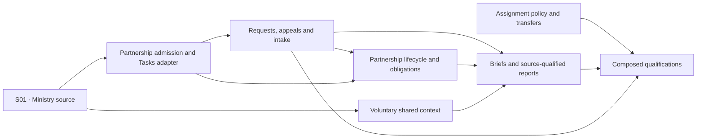

# Phase 27 implementation proposal — awaiting approval

Documentation PR: https://github.com/Asymmetric-al/core/pull/1993. Specification revision: `b5a65b3f2da880fcbfa4b3cae189d216d06542be`. Current inspected develop: `71b81fae2ce1f9b615bcfee8606cd2c978a70e71`.

This is the actual proposed GitHub issue breakdown and graph for approval. The per-ticket Markdown files are unpublished issue bodies, not a replacement tracker. No implementation issue has been created; no existing issue has been amended. The parent #1992 remains unchanged. All tickets begin `status:blocked` while specification integration or consumed prerequisites remain outstanding.

There are **68 proposed tickets**: 67 native children of #1992 and one source-owned Ministry Assignment enabler under existing Phase 9 #604. This fits GitHub's current 100-child/8-level hierarchy limit without grouping-only issues. The source enabler fills an accepted ADR0136 producer gap; public Page issue #1285 is a consumer, not a prerequisite for Phase 27.

Coverage is exact: **193 stories, 193 requirements, 711 acceptance cases, 141 monitor definitions and 204 unchecked OpenSpec tasks**. Every AC has one primary demonstrator; shared safety and usability contracts remain required within every reached slice. Requirements/stories spanning behaviors are complete only when all their mapped cases are proven. [Machine coverage](coverage.json) records every mapping. Run `python3 docs/features/donor-development/planning/implementation-proposal/verify.py` for deterministic structural verification; it does not run or certify the future feature. [Full issue payloads](tickets.json) and [exact dependency edges](dependencies.json) are reviewable without this conversation.

## Boundaries and gates

- The documentation PR must be integrated before implementation dispatch; it is not authorized for merge by this task.
- Earlier owner issues supply specific components. The proposal distinguishes native blocking edges from current-auth/source/provider qualification gates; no whole future phase is a blocker.
- E7 remains unresolved for the affected received-toward-appeal financial attribution. Its safe unavailable state and independent work are specified; do not invent the owner ruling.
- C-01 remains unresolved for affected posted-gift correction independence. Intake and Request review do not grant that authority; no correction implementation is dispatched on an assumed ruling.
- Phase 6 owns outbound preparation and sealed provider submission, but its narrow implementation allocation is missing in the current issue set; #897 incorrectly attributes it to the #888 occurrence compiler. The exact P6 producer and proof gate affected provider delivery in F11/F16. Independent native recording stays usable; no replacement transport or guessed producer is introduced.
- Existing tests and current code are prior art. Runtime authority, RLS/concurrency, actual-user comprehension, accessibility and provider qualification are future implementation evidence, not claimed by passing docs checks.
- Proposed material [existing-issue amendments](existing-issue-amendments.md) are part of this approval request. No issue mutation has occurred.
- Each source implements its own authorization, recovery, migration, accessible UX and applicable operational controls. The three Q tickets consume those behaviors for cross-source migration, measured operation and composed pilot/release evidence.

## Numbered breakdown

`A -> B` means B is blocked by A. Entries are in a valid dependency order, not a mandatory serial sequence. Bold IDs link to the complete fresh-context draft. “No new-ticket blocker” never clears the separate integration/component gates.

1. **[P27-A01: Transfer one named staff responsibility with protected intent and truthful history](issues/P27-A01.md)**

   **Blocked by:** [#607](https://github.com/Asymmetric-al/core/issues/607), [#620](https://github.com/Asymmetric-al/core/issues/620), [#613](https://github.com/Asymmetric-al/core/issues/613)

   **Delivers:** Staff can replace, end or deliberately keep an exact role-qualified assignment, including explicit primary handling, without changing other roles, work or access.

   **Sources:** REQ27-A03, REQ27-A04, REQ27-A07, REQ27-A08, REQ27-A09, REQ27-A10, REQ27-A11, REQ27-A12, REQ27-A14, REQ27-A16, REQ27-A17, REQ27-A18.

2. **[P27-C04: Inspect exact scoped giving facts without ratings](issues/P27-C04.md)**

   **Blocked by:** [#723](https://github.com/Asymmetric-al/core/issues/723)

   **Delivers:** An authorized staff reader sees accurate separate legal-giving/recognition facts for one subject, entity, currency and period, with understandable coverage and correction effects.

   **Sources:** REQ27-C15, REQ27-C16, REQ27-C17, REQ27-C18, REQ27-C20.

3. **[P27-F12: Create a clear financial, nonfinancial or mixed appeal](issues/P27-F12.md)**

   **Blocked by:** No implementation-issue blocker; integration and qualified-component gates still apply.

   **Delivers:** Staff create a named coordinated appeal with optional goals and a readable Working list, Requests and History shell.

   **Sources:** REQ27-F75, REQ27-F78, REQ27-F79, REQ27-F80, REQ27-F81, REQ27-F82, REQ27-F85, REQ27-F86, REQ27-F87, REQ27-F88, REQ27-F89, REQ27-F90.

4. **[P27-P14: Create an organization-owned usable stage list](issues/P27-P14.md)**

   **Blocked by:** No implementation-issue blocker; integration and qualified-component gates still apply.

   **Delivers:** An authorized configurator can use supplied starting definitions or deliberately create a complete additional list, cancel safely and recover the accepted list after a lost response.

   **Sources:** REQ27-P16, REQ27-P23, REQ27-P24, REQ27-P25, REQ27-P26, REQ27-P27.

5. **[P27-S01: [Phase 9] Manage one stable Ministry Assignment and its separate participant memberships](issues/P27-S01.md)**

   **Blocked by:** [#606](https://github.com/Asymmetric-al/core/issues/606)

   **Delivers:** Authorized staff create a real organization-owned ministry, see its current participants, and prospectively add/end/correct participant association while identity/history and access boundaries remain stable; P27 can reference current eligible ministry without a Page or support account.

   **Sources:** ADR0136 and accepted Phase 9 Ministry Assignment source contract.

6. **[P27-A02: Draft and preview bounded ordered assignment rules](issues/P27-A02.md)**

   **Blocked by:** [P27-A01](issues/P27-A01.md)

   **Delivers:** Administrators can save inert rules and understand the first proved match, protected choices and uncertainty before any activation.

   **Sources:** REQ27-A01, REQ27-A02, REQ27-A04, REQ27-A05, REQ27-A07, REQ27-A09, REQ27-A13, REQ27-A14, REQ27-A15, REQ27-A18.

7. **[P27-A09: Reconcile imported and merged assignment provenance without losing control](issues/P27-A09.md)**

   **Blocked by:** [P27-A01](issues/P27-A01.md), [#610](https://github.com/Asymmetric-al/core/issues/610)

   **Delivers:** Data stewards can migrate or repair staff assignment references while preserving role history, deliberate choices and actual source obligations.

   **Sources:** REQ27-A03, REQ27-A04, REQ27-A10, REQ27-A11, REQ27-A12, REQ27-A13, REQ27-A16, REQ27-A17, REQ27-A18.

8. **[P27-C01: Share a new eligible partnership update with its exact audience](issues/P27-C01.md)**

   **Blocked by:** [P27-S01](issues/P27-S01.md)

   **Delivers:** A staff member or missionary deliberately writes one eligible update from the existing partnership context, sees who may read it, and recovers the same accepted save across both permitted surfaces.

   **Sources:** REQ27-C01, REQ27-C02, REQ27-C03, REQ27-C04, REQ27-C05, REQ27-C06, REQ27-Q07.

9. **[P27-C05: Configure optional giving bands and make Off authoritative](issues/P27-C05.md)**

   **Blocked by:** [P27-C04](issues/P27-C04.md)

   **Delivers:** Authorized tenants opt into explained separate financial bands, edit bounded ranges safely, and turn ratings Off everywhere without damaging ordinary work or silently broadening saved views.

   **Sources:** REQ27-C13, REQ27-C14, REQ27-C18, REQ27-C19, REQ27-C21, REQ27-C22, REQ27-C23, REQ27-C24, REQ27-C29, REQ27-C30.

10. **[P27-F13: Add people and churches to a recorded appeal working list](issues/P27-F13.md)**

    **Blocked by:** [P27-F12](issues/P27-F12.md)

    **Delivers:** Staff deliberately plan outreach from permitted discovery results; later filter changes never alter the saved plan.

    **Sources:** REQ27-F38, REQ27-F39, REQ27-F40, REQ27-F41, REQ27-F42, REQ27-F43, REQ27-F44, REQ27-F45, REQ27-F46, REQ27-F47, REQ27-F48, REQ27-F49, REQ27-F50, REQ27-F51, REQ27-F52, REQ27-F53, REQ27-F54.

11. **[P27-P01: Start or reuse one continuing partnership in context](issues/P27-P01.md)**

    **Blocked by:** [P27-S01](issues/P27-S01.md), [P27-P14](issues/P27-P14.md)

    **Delivers:** A staff member deliberately starts ordinary identified-ministry work once, with a visible eligible owner, approved list and truthful next action, or safely reuses existing work.

    **Sources:** REQ27-P01, REQ27-P02, REQ27-P03, REQ27-P05, REQ27-P07, REQ27-P13, REQ27-P30, REQ27-P32, REQ27-Q01, REQ27-Q02, REQ27-Q03, REQ27-Q04, REQ27-Q05, REQ27-Q14.

12. **[P27-A03: Activate prospective reviewed routing and apply one current proposal](issues/P27-A03.md)**

    **Blocked by:** [P27-A02](issues/P27-A02.md), [#669](https://github.com/Asymmetric-al/core/issues/669)

    **Delivers:** Future qualified source changes can create an initial eligible assignment or one reviewable transfer proposal; nothing silently sweeps existing work.

    **Sources:** REQ27-A01, REQ27-A02, REQ27-A04, REQ27-A05, REQ27-A06, REQ27-A09, REQ27-A11, REQ27-A12, REQ27-A14, REQ27-A15, REQ27-A16, REQ27-A18.

13. **[P27-C02: Correct and restrict shared history without losing truthful context](issues/P27-C02.md)**

    **Blocked by:** [P27-C01](issues/P27-C01.md)

    **Delivers:** Authorized collaborators correct the actual occurrence and operators restrict accidental disclosure; history, lawful recovery and permitted read access survive closure, retention and safe stop/restore.

    **Sources:** REQ27-C07, REQ27-C08, REQ27-C09.

14. **[P27-C06: Review one qualified giving-pattern change through shared Tasks](issues/P27-C06.md)**

    **Blocked by:** [P27-C05](issues/P27-C05.md), [P27-P01](issues/P27-P01.md)

    **Delivers:** A separately opted-in qualified pattern entry produces one internal review with a current owner and real source action; completion, exit, correction and Off end or preserve the right work.

    **Sources:** REQ27-C25, REQ27-C26, REQ27-C27, REQ27-C28, REQ27-C29, REQ27-C30.

15. **[P27-F01: Prepare one significant nonfinancial Request in its real partnership context](issues/P27-F01.md)**

    **Blocked by:** [P27-P01](issues/P27-P01.md)

    **Delivers:** Staff can save and reopen a prayer, introduction, hosting or other significant invitation without enrolling a cultivation journey or inventing a financial amount.

    **Sources:** REQ27-F01, REQ27-F04, REQ27-F09, REQ27-F10, REQ27-F11, REQ27-F12, REQ27-F13, REQ27-F16, REQ27-F18.

16. **[P27-F21: Report an actual gift receipt with honest missing details](issues/P27-F21.md)**

    **Blocked by:** [P27-P01](issues/P27-P01.md)

    **Delivers:** An authorized report-only staff member records real offline receipt and its next responsibility in a small clear flow without posting money.

    **Sources:** REQ27-F56, REQ27-F57, REQ27-F58, REQ27-F59, REQ27-F60, REQ27-F61, REQ27-F62, REQ27-F63, REQ27-F64, REQ27-F65, REQ27-F66, REQ27-F67, REQ27-F68, REQ27-F69, REQ27-F70, REQ27-F71, REQ27-F72, REQ27-F73, REQ27-F74.

17. **[P27-P02: Admit a genuinely distinct continuing purpose without duplicating ordinary work](issues/P27-P02.md)**

    **Blocked by:** [P27-P01](issues/P27-P01.md)

    **Delivers:** Staff can explicitly record a separate continuing outcome only when requests/tasks/ownership cannot represent it.

    **Sources:** REQ27-P02, REQ27-P13, REQ27-P30, REQ27-P32.

18. **[P27-P03: Review and start a finite group with recoverable per-member outcomes](issues/P27-P03.md)**

    **Blocked by:** [P27-P01](issues/P27-P01.md)

    **Delivers:** Staff know exactly which selected relationships will start or reuse work and can recover partial progress without replaying accepted effects.

    **Sources:** REQ27-P04, REQ27-P13, REQ27-P30, REQ27-P32, REQ27-Q13.

19. **[P27-P04: Change partnership responsibility without transferring unrelated work or access](issues/P27-P04.md)**

    **Blocked by:** [P27-P01](issues/P27-P01.md)

    **Delivers:** Authorized staff can hand off an exact partnership responsibility and find a truthful repair path when no eligible recipient remains.

    **Sources:** REQ27-P05, REQ27-P10, REQ27-P13, REQ27-P30, REQ27-P32.

20. **[P27-P05: Correct a mistaken partnership reference without rewriting accepted facts](issues/P27-P05.md)**

    **Blocked by:** [P27-P01](issues/P27-P01.md)

    **Delivers:** Staff can repair an honest incorrect source link while retaining original meaning and independently owned history.

    **Sources:** REQ27-P02, REQ27-P06, REQ27-P13, REQ27-P30, REQ27-P32.

21. **[P27-P08: Pause until a deliberate organization-calendar review date](issues/P27-P08.md)**

    **Blocked by:** [P27-P01](issues/P27-P01.md)

    **Delivers:** Staff can pause and reschedule work without losing obligations or inventing review completion or donor duties.

    **Sources:** REQ27-P02, REQ27-P08, REQ27-P09, REQ27-P13, REQ27-P30, REQ27-P32.

22. **[P27-P15: Start work with an eligible list and an optional assessment](issues/P27-P15.md)**

    **Blocked by:** [P27-P01](issues/P27-P01.md)

    **Delivers:** Staff select the appropriate eligible list and optionally a current stage in one deliberate Start, while unassessed work remains visible and existing ordinary work is reused unchanged.

    **Sources:** REQ27-P18, REQ27-P21, REQ27-P23, REQ27-P24, REQ27-P25, REQ27-P26, REQ27-P27.

23. **[P27-A04: Apply one finite reviewed group with recoverable member results](issues/P27-A04.md)**

    **Blocked by:** [P27-A03](issues/P27-A03.md)

    **Delivers:** Staff can review selected current matches or manual transfers together, apply exactly that set, and recover partial results without duplicate changes.

    **Sources:** REQ27-A01, REQ27-A02, REQ27-A05, REQ27-A06, REQ27-A09, REQ27-A11, REQ27-A13, REQ27-A14, REQ27-A15, REQ27-A16, REQ27-A18.

24. **[P27-C03: Show actual exchanges separately from outreach and follow-up](issues/P27-C03.md)**

    **Blocked by:** [P27-C02](issues/P27-C02.md)

    **Delivers:** Staff and permitted missionaries see honest Last recorded exchange, Recent outreach and Next follow-up, with complete source recency and explicit uncertainty.

    **Sources:** REQ27-C10, REQ27-C11, REQ27-C12, REQ27-P33.

25. **[P27-C07: Refresh enabled giving analysis within a bounded recoverable profile](issues/P27-C07.md)**

    **Blocked by:** [P27-C06](issues/P27-C06.md)

    **Delivers:** Enabled scopes refresh fairly with visible cutoffs/deadlines; operators can stop, resume and roll forward analysis without recalculating disabled tenants or reviving old effects.

    **Sources:** REQ27-C31.

26. **[P27-F02: Enter relevant monetary or noncash Request terms without losing data](issues/P27-F02.md)**

    **Blocked by:** [P27-F01](issues/P27-F01.md)

    **Delivers:** Staff enter exact currency-aware terms or honest unknown amounts, and switch applicability without hidden financial submission or silent loss.

    **Sources:** REQ27-F01, REQ27-F04, REQ27-F07, REQ27-F10, REQ27-F11, REQ27-F13, REQ27-F14, REQ27-F15.

27. **[P27-F08: Configure whether a Request needs internal review](issues/P27-F08.md)**

    **Blocked by:** [P27-F01](issues/P27-F01.md)

    **Delivers:** Tenant staff with the right powers can use a clear default and deliberate per-Request exception, while ordinary review-free work remains quick.

    **Sources:** REQ27-F19, REQ27-F20, REQ27-F21, REQ27-F24, REQ27-F29, REQ27-F32, REQ27-F34, REQ27-F36.

28. **[P27-F22: Continue the same reported gift through finance recording](issues/P27-F22.md)**

    **Blocked by:** [P27-F21](issues/P27-F21.md), [#773](https://github.com/Asymmetric-al/core/issues/773)

    **Delivers:** Finance opens the exact reported item in its existing source workflow and the reporter sees qualified recorded/partial status without entering a second gift.

    **Sources:** REQ27-F56, REQ27-F57, REQ27-F58, REQ27-F59, REQ27-F60, REQ27-F61, REQ27-F62, REQ27-F63, REQ27-F64, REQ27-F66, REQ27-F67, REQ27-F68, REQ27-F70, REQ27-F72.

29. **[P27-P10: Receive one minimal in-product review reminder at the right source occurrence](issues/P27-P10.md)**

    **Blocked by:** [P27-P08](issues/P27-P08.md), [P27-P04](issues/P27-P04.md), [#891](https://github.com/Asymmetric-al/core/issues/891)

    **Delivers:** A currently eligible assignee finds the same due review through shared tasks and role-safe attention, with reliable source-ended history.

    **Sources:** REQ27-P08, REQ27-P10, REQ27-P13, REQ27-P30, REQ27-P32.

30. **[P27-P16: Choose any appropriate stage directly and retain each real assessment](issues/P27-P16.md)**

    **Blocked by:** [P27-P15](issues/P27-P15.md), [P27-P08](issues/P27-P08.md)

    **Delivers:** Staff can set a first stage, skip or return directly using advisory guidance, with one deliberate save and history of actual accepted changes only.

    **Sources:** REQ27-P20, REQ27-P23, REQ27-P24, REQ27-P25, REQ27-P26, REQ27-P27, REQ27-P29.

31. **[P27-P18: Prefill a clear starting list without taking away staff choice](issues/P27-P18.md)**

    **Blocked by:** [P27-P15](issues/P27-P15.md)

    **Delivers:** Configurators may set or clear one optional usual list; new work visibly starts from established valid intent, a proved sole eligible list or a permitted usable usual list, and otherwise asks.

    **Sources:** REQ27-P18, REQ27-P19, REQ27-P23, REQ27-P25, REQ27-P26, REQ27-P27.

32. **[P27-F03: Record the actual invitation and its independent supporter response](issues/P27-F03.md)**

    **Blocked by:** [P27-F02](issues/P27-F02.md)

    **Delivers:** Staff record what was asked and the actual answer in one clear save, including mixed financial and nonfinancial requests.

    **Sources:** REQ27-F02, REQ27-F05, REQ27-F06, REQ27-F07, REQ27-F08, REQ27-F09, REQ27-F12, REQ27-F13, REQ27-F14, REQ27-F15, REQ27-F16, REQ27-F18, REQ27-F76, REQ27-F79, REQ27-F86, REQ27-F87.

33. **[P27-F23: Resolve duplicate reports and existing recorded gifts by exact lineage](issues/P27-F23.md)**

    **Blocked by:** [P27-F22](issues/P27-F22.md)

    **Delivers:** Staff can reconcile two reports of one actual item or link its existing authoritative posting without duplicate money or destroyed provenance.

    **Sources:** REQ27-F59, REQ27-F60, REQ27-F61, REQ27-F62, REQ27-F63, REQ27-F64, REQ27-F67, REQ27-F68.

34. **[P27-F24: Track physical handling and truthful exceptions independently of posting](issues/P27-F24.md)**

    **Blocked by:** [P27-F22](issues/P27-F22.md), [#780](https://github.com/Asymmetric-al/core/issues/780)

    **Delivers:** Staff can transfer or resolve actual handling while finance status stays authoritative and unfinished property work never disappears.

    **Sources:** REQ27-F57, REQ27-F58, REQ27-F59, REQ27-F60, REQ27-F61, REQ27-F62, REQ27-F63, REQ27-F64, REQ27-F65, REQ27-F66, REQ27-F67, REQ27-F68, REQ27-F69, REQ27-F70, REQ27-F72, REQ27-F73, REQ27-F74.

35. **[P27-P17: Customize stage meaning and order without breaking retained work](issues/P27-P17.md)**

    **Blocked by:** [P27-P16](issues/P27-P16.md)

    **Delivers:** An authorized organization configurator can add stages, change same-meaning wording/guidance, reorder, retire or restore them while retaining stable references and explainable history.

    **Sources:** REQ27-P14, REQ27-P15, REQ27-P16, REQ27-P18, REQ27-P20, REQ27-P21, REQ27-P23, REQ27-P24, REQ27-P25, REQ27-P26, REQ27-P27.

36. **[P27-F04: Revise proposals and preserve late answers to earlier presented terms](issues/P27-F04.md)**

    **Blocked by:** [P27-F03](issues/P27-F03.md)

    **Delivers:** Staff revise preparation or forecasts and record a late answer without rewriting what the supporter actually saw.

    **Sources:** REQ27-F05, REQ27-F06, REQ27-F09, REQ27-F16, REQ27-F76, REQ27-F86.

37. **[P27-F05: Keep Request responsibility and follow-up truthful through pause and closure](issues/P27-F05.md)**

    **Blocked by:** [P27-F03](issues/P27-F03.md)

    **Delivers:** Staff can update paused/closed work, reassign responsibility or end one Request while remaining independent obligations stay visible.

    **Sources:** REQ27-F03, REQ27-F08, REQ27-F10, REQ27-F17.

38. **[P27-F14: Remove, exclude or deliberately return an appeal member](issues/P27-F14.md)**

    **Blocked by:** [P27-F13](issues/P27-F13.md), [P27-F03](issues/P27-F03.md)

    **Delivers:** Staff can change the plan with clear consequences while actual Requests and independent obligations remain intact.

    **Sources:** REQ27-F39, REQ27-F40, REQ27-F41, REQ27-F42, REQ27-F43, REQ27-F44, REQ27-F45, REQ27-F46, REQ27-F47, REQ27-F48, REQ27-F50, REQ27-F51, REQ27-F54, REQ27-F55.

39. **[P27-P19: Withdraw a list from new use while existing work continues](issues/P27-P19.md)**

    **Blocked by:** [P27-P17](issues/P27-P17.md), [P27-P18](issues/P27-P18.md)

    **Delivers:** Configurators can stop and restore new use of a list while existing assessed, unassessed and returning partnership work continues on its retained binding.

    **Sources:** REQ27-P15, REQ27-P17, REQ27-P18, REQ27-P19, REQ27-P23, REQ27-P24, REQ27-P25, REQ27-P26, REQ27-P27.

40. **[P27-A05: Preserve source work through representative handoff and departure](issues/P27-A05.md)**

    **Blocked by:** [P27-A01](issues/P27-A01.md), [P27-P04](issues/P27-P04.md), [P27-F05](issues/P27-F05.md)

    **Delivers:** A representative change either preserves lawful independent responsibility or observes the exact source-owned handoff condition; departure never waits to revoke access.

    **Sources:** REQ27-A07, REQ27-A08, REQ27-A09, REQ27-A11, REQ27-A13, REQ27-A14, REQ27-A16, REQ27-A18.

41. **[P27-C08: Prepare a meeting from a deterministic source-linked brief](issues/P27-C08.md)**

    **Blocked by:** [P27-C03](issues/P27-C03.md), [P27-C04](issues/P27-C04.md), [P27-F04](issues/P27-F04.md), [P27-F05](issues/P27-F05.md)

    **Delivers:** Staff can prepare for a meeting from one useful permission-safe on-screen summary of current partnership facts, actual exchange, financial lenses, Requests and next work without AI.

    **Sources:** REQ27-C32.

42. **[P27-C09: Work with churches while preserving people and financial identities](issues/P27-C09.md)**

    **Blocked by:** [#625](https://github.com/Asymmetric-al/core/issues/625), [P27-F05](issues/P27-F05.md), [P27-C04](issues/P27-C04.md)

    **Delivers:** Church-relations staff distinguish the church, its actual contacts and ministry relationships and can adapt present work without rewriting earlier participants or personal donor facts.

    **Sources:** REQ27-C33.

43. **[P27-F06: Show qualified source outcomes and hand a funding response to its owner deliberately](issues/P27-F06.md)**

    **Blocked by:** [P27-F04](issues/P27-F04.md), [#697](https://github.com/Asymmetric-al/core/issues/697), [#823](https://github.com/Asymmetric-al/core/issues/823)

    **Delivers:** Staff can see authoritative received/applied outcomes and start an independently authorized fixed-commitment handoff without a response becoming money.

    **Sources:** REQ27-F07, REQ27-F12, REQ27-F15.

44. **[P27-F09: Submit and decide one review of exact Request terms](issues/P27-F09.md)**

    **Blocked by:** [P27-F04](issues/P27-F04.md), [P27-F08](issues/P27-F08.md)

    **Delivers:** A qualified reviewer can inspect authorized terms and approve to present, request changes or refuse, with one durable source decision.

    **Sources:** REQ27-F19, REQ27-F20, REQ27-F21, REQ27-F22, REQ27-F23, REQ27-F24, REQ27-F27, REQ27-F28, REQ27-F29, REQ27-F30, REQ27-F31, REQ27-F32, REQ27-F34, REQ27-F35, REQ27-F37.

45. **[P27-F15: Apply one finite reviewed selection with truthful per-person results](issues/P27-F15.md)**

    **Blocked by:** [P27-F14](issues/P27-F14.md)

    **Delivers:** Staff can distinguish page from all-matching selection and safely finish or cancel a bounded bulk plan change.

    **Sources:** REQ27-F38, REQ27-F42, REQ27-F43, REQ27-F44, REQ27-F45, REQ27-F46, REQ27-F47, REQ27-F50, REQ27-F51, REQ27-F53, REQ27-F55, REQ27-F85, REQ27-F86, REQ27-F87, REQ27-F90.

46. **[P27-F18: Coordinate actual mixed-purpose Requests across appeals without copying their work](issues/P27-F18.md)**

    **Blocked by:** [P27-F04](issues/P27-F04.md), [P27-F12](issues/P27-F12.md)

    **Delivers:** Staff can deliberately link, unlink and relink a compatible Request while its terms, history and responsibility remain canonical.

    **Sources:** REQ27-F76, REQ27-F77, REQ27-F79, REQ27-F83, REQ27-F85, REQ27-F86, REQ27-F87.

47. **[P27-P06: Review only future work affected by a ministry source change](issues/P27-P06.md)**

    **Blocked by:** [P27-F05](issues/P27-F05.md)

    **Delivers:** Staff see a scoped review of genuinely affected future obligations, while routine name or participant changes preserve continuity.

    **Sources:** REQ27-P06, REQ27-P13, REQ27-P30, REQ27-P32.

48. **[P27-P07: Work from a complete next-action view without losing independent promises](issues/P27-P07.md)**

    **Blocked by:** [P27-F05](issues/P27-F05.md)

    **Delivers:** Staff can reuse appropriate existing work, inspect independently due matters and take each source-owned action from one shared context.

    **Sources:** REQ27-P07, REQ27-P13, REQ27-P30, REQ27-P32, REQ27-Q07, REQ27-Q08.

49. **[P27-A06: Opt into bounded automatic transfers and stop stale work immediately](issues/P27-A06.md)**

    **Blocked by:** [P27-A03](issues/P27-A03.md), [P27-A05](issues/P27-A05.md)

    **Delivers:** A tenant can enable Auto only for a declared rule-managed scope and turn it off with commit-time protection against old queued decisions.

    **Sources:** REQ27-A01, REQ27-A02, REQ27-A04, REQ27-A05, REQ27-A07, REQ27-A08, REQ27-A09, REQ27-A10, REQ27-A11, REQ27-A12, REQ27-A13, REQ27-A14, REQ27-A15, REQ27-A16, REQ27-A17, REQ27-A18.

50. **[P27-F07: Read Request and nonfinancial appeal measures with explicit meaning](issues/P27-F07.md)**

    **Blocked by:** [P27-F18](issues/P27-F18.md)

    **Delivers:** Staff distinguish requested, forecast, replied and nonfinancial progress without treating unknowns or overlapping supporter sets as disjoint money.

    **Sources:** REQ27-F04, REQ27-F05, REQ27-F15, REQ27-F17, REQ27-F18, REQ27-F78, REQ27-F86.

51. **[P27-F10: Reassign, withdraw and correct review without rewriting decisions](issues/P27-F10.md)**

    **Blocked by:** [P27-F09](issues/P27-F09.md)

    **Delivers:** Authorized staff can recover stalled routing or reconsider/revoke a decision while old reviewers and replayed work cannot act.

    **Sources:** REQ27-F21, REQ27-F23, REQ27-F24, REQ27-F27, REQ27-F28, REQ27-F30, REQ27-F31, REQ27-F33, REQ27-F34, REQ27-F35, REQ27-F36.

52. **[P27-P09: Record a real review and keep on hold or resume](issues/P27-P09.md)**

    **Blocked by:** [P27-P08](issues/P27-P08.md), [P27-P07](issues/P27-P07.md)

    **Delivers:** Staff complete the actual internal review and deliberately establish the next source state without reviving old effects.

    **Sources:** REQ27-P07, REQ27-P08, REQ27-P13, REQ27-P30, REQ27-P32.

53. **[P27-A07: Return protected responsibility to rules with its exact effect shown](issues/P27-A07.md)**

    **Blocked by:** [P27-A06](issues/P27-A06.md)

    **Delivers:** Staff can deliberately choose Use rules again without guessing whether it creates a proposal or immediately applies an eligible displayed result.

    **Sources:** REQ27-A04, REQ27-A05, REQ27-A06, REQ27-A07, REQ27-A09, REQ27-A11, REQ27-A12, REQ27-A14, REQ27-A18.

54. **[P27-F11: Enforce current Request review at the actual outward-action boundary](issues/P27-F11.md)**

    **Blocked by:** [P27-F10](issues/P27-F10.md), [#897](https://github.com/Asymmetric-al/core/issues/897)

    **Delivers:** Approved terms remain history, while a prospective action starts only under current matching clearance and owner authority.

    **Sources:** REQ27-F24, REQ27-F25, REQ27-F26, REQ27-F27, REQ27-F30, REQ27-F32, REQ27-F33, REQ27-F34, REQ27-F37.

55. **[P27-F20: Show exact source-backed financial appeal progress with honest coverage](issues/P27-F20.md)**

    **Blocked by:** [P27-F07](issues/P27-F07.md), [#697](https://github.com/Asymmetric-al/core/issues/697), [P27-F22](issues/P27-F22.md)

    **Delivers:** Staff see received-toward-appeal and other explicitly named measures without double counting, hidden caps or invented campaign mapping.

    **Sources:** REQ27-F15, REQ27-F78, REQ27-F79, REQ27-F86, REQ27-F88, REQ27-F90, REQ27-Q15.

56. **[P27-P11: Close finished partnership work after complete owner readiness](issues/P27-P11.md)**

    **Blocked by:** [P27-P09](issues/P27-P09.md)

    **Delivers:** Staff deliberately close the exact work while independently valid commitments and obligations remain accountable and history remains truthful.

    **Sources:** REQ27-F08, REQ27-P08, REQ27-P11, REQ27-P13, REQ27-P30, REQ27-P32.

57. **[P27-A08: Inspect and recover assignment history without widening current access](issues/P27-A08.md)**

    **Blocked by:** [P27-A04](issues/P27-A04.md), [P27-A07](issues/P27-A07.md)

    **Delivers:** Staff can understand actual/proposed/protected responsibility and recover results across devices, conflicts or access changes using only currently permitted facts.

    **Sources:** REQ27-A03, REQ27-A06, REQ27-A09, REQ27-A10, REQ27-A11, REQ27-A13, REQ27-A14, REQ27-A16, REQ27-A18.

58. **[P27-F16: Stop membership-dependent solicitation before its transport admission](issues/P27-F16.md)**

    **Blocked by:** [P27-F14](issues/P27-F14.md), [P27-F11](issues/P27-F11.md)

    **Delivers:** Removing or excluding a member fences only the applicable unstarted appeal solicitation, even if projection workers are down.

    **Sources:** REQ27-F39, REQ27-F43, REQ27-F45, REQ27-F46, REQ27-F47, REQ27-F48, REQ27-F49, REQ27-F50, REQ27-F52, REQ27-F53, REQ27-F54.

59. **[P27-P12: Reopen the same partnership without resurrecting old tasks or grants](issues/P27-P12.md)**

    **Blocked by:** [P27-P11](issues/P27-P11.md)

    **Delivers:** Staff return to the same continuing work and retained stage or absence with clear historical provenance and fresh eligibility.

    **Sources:** REQ27-P11, REQ27-P12, REQ27-P13, REQ27-P30, REQ27-P32.

60. **[P27-P13: Read a complete permitted partnership portfolio and history](issues/P27-P13.md)**

    **Blocked by:** [P27-P11](issues/P27-P11.md), [P27-C03](issues/P27-C03.md)

    **Delivers:** Staff trust current-work totals, closed history and source links without collapsing stages, responses, giving and recorded contact into one status.

    **Sources:** REQ27-P13, REQ27-P30, REQ27-P31, REQ27-P32, REQ27-Q06.

61. **[P27-C10: Compare native development work and qualified outcomes honestly](issues/P27-C10.md)**

    **Blocked by:** [P27-F20](issues/P27-F20.md), [P27-P13](issues/P27-P13.md), [P27-C04](issues/P27-C04.md)

    **Delivers:** Development staff see complete permitted owner/stage/Request and forecast-versus-qualified-outcome views without mandatory ratings or a reporting platform.

    **Sources:** REQ27-C34.

62. **[P27-F17: Resolve appeal membership safely after Party merge or unmerge](issues/P27-F17.md)**

    **Blocked by:** [P27-F16](issues/P27-F16.md), [#610](https://github.com/Asymmetric-al/core/issues/610)

    **Delivers:** Identity repair preserves origins and restricts only the conflicting member without silently choosing a new outreach intention.

    **Sources:** REQ27-F40, REQ27-F41, REQ27-F43, REQ27-F46, REQ27-F47, REQ27-F49, REQ27-F50, REQ27-F54.

63. **[P27-F19: Close or reopen an appeal while preserving real independent work](issues/P27-F19.md)**

    **Blocked by:** [P27-F05](issues/P27-F05.md), [P27-F16](issues/P27-F16.md), [P27-F18](issues/P27-F18.md), [P27-F21](issues/P27-F21.md)

    **Delivers:** Staff deliberately end coordination with truthful work disposition, then may record late facts or reopen without reviving ended work.

    **Sources:** REQ27-F75, REQ27-F80, REQ27-F83, REQ27-F84, REQ27-F85, REQ27-F86, REQ27-F87, REQ27-F89, REQ27-F90.

64. **[P27-P20: Clear a current assessment deliberately without losing history](issues/P27-P20.md)**

    **Blocked by:** [P27-P19](issues/P27-P19.md), [P27-P12](issues/P27-P12.md)

    **Delivers:** Staff may explicitly save no current stage on the same list, including while paused, with prior assessments retained and a clear Set stage next action.

    **Sources:** REQ27-P21, REQ27-P28, REQ27-P29.

65. **[P27-P21: Change the stage list on the same partnership with an honest destination assessment](issues/P27-P21.md)**

    **Blocked by:** [P27-P20](issues/P27-P20.md), [P27-P03](issues/P27-P03.md)

    **Delivers:** Staff deliberately switch a partnership to another currently eligible approved list, choose a valid target stage or explicit absence, and preserve identity, history and paused context through reliable recovery.

    **Sources:** REQ27-P12, REQ27-P15, REQ27-P17, REQ27-P18, REQ27-P21, REQ27-P22, REQ27-P23, REQ27-P24, REQ27-P25, REQ27-P26, REQ27-P27, REQ27-P28, REQ27-P29.

66. **[P27-Q01: Rehearse Phase 27 migration, disable and restore after real writes](issues/P27-Q01.md)**

    **Blocked by:** [P27-A08](issues/P27-A08.md), [P27-A09](issues/P27-A09.md), [P27-C07](issues/P27-C07.md), [P27-C08](issues/P27-C08.md), [P27-C09](issues/P27-C09.md), [P27-C10](issues/P27-C10.md), [P27-F06](issues/P27-F06.md), [P27-F15](issues/P27-F15.md), [P27-F17](issues/P27-F17.md), [P27-F19](issues/P27-F19.md), [P27-F23](issues/P27-F23.md), [P27-F24](issues/P27-F24.md), [P27-P02](issues/P27-P02.md), [P27-P05](issues/P27-P05.md), [P27-P06](issues/P27-P06.md), [P27-P10](issues/P27-P10.md), [P27-P21](issues/P27-P21.md)

    **Delivers:** Operators can move an admitted P27 deployment forward, interrupt/resume migration, disable new admission and restore compatible state without erasing history, exposing private context or replaying accepted work.

    **Sources:** REQ27-A12, REQ27-A17, REQ27-Q11.

67. **[P27-Q02: Qualify the admitted workload and exercise Phase 27 operating controls](issues/P27-Q02.md)**

    **Blocked by:** [P27-A08](issues/P27-A08.md), [P27-A09](issues/P27-A09.md), [P27-C07](issues/P27-C07.md), [P27-C08](issues/P27-C08.md), [P27-C09](issues/P27-C09.md), [P27-C10](issues/P27-C10.md), [P27-F06](issues/P27-F06.md), [P27-F15](issues/P27-F15.md), [P27-F17](issues/P27-F17.md), [P27-F19](issues/P27-F19.md), [P27-F23](issues/P27-F23.md), [P27-F24](issues/P27-F24.md), [P27-P02](issues/P27-P02.md), [P27-P05](issues/P27-P05.md), [P27-P06](issues/P27-P06.md), [P27-P10](issues/P27-P10.md), [P27-P21](issues/P27-P21.md)

    **Delivers:** An operator can identify the supported workload and freshness limits, see a real breached source signal, contain only the affected capability and safely reconcile accepted work.

    **Sources:** REQ27-A15, REQ27-C36, REQ27-Q12, REQ27-Q13.

68. **[P27-Q03: Prove composed user journeys and publish bounded release qualification](issues/P27-Q03.md)**

    **Blocked by:** [P27-Q01](issues/P27-Q01.md), [P27-Q02](issues/P27-Q02.md)

    **Delivers:** Representative staff, finance handlers and voluntary missionary contributors can understand and complete the admitted workflow without harmful interpretation; release evidence shows exactly what is specified, implemented, qualified, gated and activated.

    **Sources:** REQ27-A14, REQ27-A18, REQ27-C35, REQ27-C36, REQ27-F08, REQ27-F25, REQ27-F61, REQ27-P10, REQ27-P11, REQ27-P12, REQ27-P30, REQ27-Q08, REQ27-Q09, REQ27-Q10, REQ27-Q14, REQ27-Q16.

## Blocking graph

The overview shows domains; these group labels are not issues and create no blocking edges. The full [internal graph](graph.md) and edge contracts in dependencies.json are authoritative for proposal review. External components and non-issue gates are separately explicit in every draft.

P01 supplies the bounded Tasks adapter; F05 supplies the Request obligation readiness consumed by later P07/P11. Assignment handoff additionally consumes the actual P04/F05 sources. This overview intentionally groups independent parallel slices; only exact ticket edges impose order. Read the full acyclic ticket graph before changing an edge.

## Initial frontier after prerequisites

- P27-A01 — Transfer one named staff responsibility with protected intent and truthful history; #607, #620, #613; specification integration and exact qualified source gates still apply.
- P27-C04 — Inspect exact scoped giving facts without ratings; #723; specification integration and exact qualified source gates still apply.
- P27-F12 — Create a clear financial, nonfinancial or mixed appeal; no implementation-issue blocker; specification integration and exact qualified source gates still apply.
- P27-P14 — Create an organization-owned usable stage list; no implementation-issue blocker; specification integration and exact qualified source gates still apply.
- P27-S01 — [Phase 9] Manage one stable Ministry Assignment and its separate participant memberships; #606; specification integration and exact qualified source gates still apply.

## Approval requested

Approve or amend the numbered breakdown, direct blocking edges, proposed native parents, and scoped existing-issue amendments. Indicate any tickets that should be merged or split. Specification ratification alone does not approve this breakdown. After approval, recheck for duplicates, publish serially with returned IDs, add native parents/blockers, verify every body/relationship, and retain blocked labels until the actual gates clear. No implementation or PR merge is part of that publication step.
