# Phase 27 exact proposed blocking graph

A -> B means B is blocked by A. Only proposed-ticket edges appear here; every existing-issue edge and non-issue prerequisite remains in [dependencies.json](dependencies.json) and the issue body. This graph is mechanically checked for cycles.

```mermaid
flowchart TD
  P27_A01["P27-A01 · Transfer one named staff responsibility with protected intent and truthful history"]
  P27_C04["P27-C04 · Inspect exact scoped giving facts without ratings"]
  P27_F12["P27-F12 · Create a clear financial, nonfinancial or mixed appeal"]
  P27_P14["P27-P14 · Create an organization-owned usable stage list"]
  P27_S01["P27-S01 · [Phase 9] Manage one stable Ministry Assignment and its separate participant memberships"]
  P27_A02["P27-A02 · Draft and preview bounded ordered assignment rules"]
  P27_A09["P27-A09 · Reconcile imported and merged assignment provenance without losing control"]
  P27_C01["P27-C01 · Share a new eligible partnership update with its exact audience"]
  P27_C05["P27-C05 · Configure optional giving bands and make Off authoritative"]
  P27_F13["P27-F13 · Add people and churches to a recorded appeal working list"]
  P27_P01["P27-P01 · Start or reuse one continuing partnership in context"]
  P27_A03["P27-A03 · Activate prospective reviewed routing and apply one current proposal"]
  P27_C02["P27-C02 · Correct and restrict shared history without losing truthful context"]
  P27_C06["P27-C06 · Review one qualified giving-pattern change through shared Tasks"]
  P27_F01["P27-F01 · Prepare one significant nonfinancial Request in its real partnership context"]
  P27_F21["P27-F21 · Report an actual gift receipt with honest missing details"]
  P27_P02["P27-P02 · Admit a genuinely distinct continuing purpose without duplicating ordinary work"]
  P27_P03["P27-P03 · Review and start a finite group with recoverable per-member outcomes"]
  P27_P04["P27-P04 · Change partnership responsibility without transferring unrelated work or access"]
  P27_P05["P27-P05 · Correct a mistaken partnership reference without rewriting accepted facts"]
  P27_P08["P27-P08 · Pause until a deliberate organization-calendar review date"]
  P27_P15["P27-P15 · Start work with an eligible list and an optional assessment"]
  P27_A04["P27-A04 · Apply one finite reviewed group with recoverable member results"]
  P27_C03["P27-C03 · Show actual exchanges separately from outreach and follow-up"]
  P27_C07["P27-C07 · Refresh enabled giving analysis within a bounded recoverable profile"]
  P27_F02["P27-F02 · Enter relevant monetary or noncash Request terms without losing data"]
  P27_F08["P27-F08 · Configure whether a Request needs internal review"]
  P27_F22["P27-F22 · Continue the same reported gift through finance recording"]
  P27_P10["P27-P10 · Receive one minimal in-product review reminder at the right source occurrence"]
  P27_P16["P27-P16 · Choose any appropriate stage directly and retain each real assessment"]
  P27_P18["P27-P18 · Prefill a clear starting list without taking away staff choice"]
  P27_F03["P27-F03 · Record the actual invitation and its independent supporter response"]
  P27_F23["P27-F23 · Resolve duplicate reports and existing recorded gifts by exact lineage"]
  P27_F24["P27-F24 · Track physical handling and truthful exceptions independently of posting"]
  P27_P17["P27-P17 · Customize stage meaning and order without breaking retained work"]
  P27_F04["P27-F04 · Revise proposals and preserve late answers to earlier presented terms"]
  P27_F05["P27-F05 · Keep Request responsibility and follow-up truthful through pause and closure"]
  P27_F14["P27-F14 · Remove, exclude or deliberately return an appeal member"]
  P27_P19["P27-P19 · Withdraw a list from new use while existing work continues"]
  P27_A05["P27-A05 · Preserve source work through representative handoff and departure"]
  P27_C08["P27-C08 · Prepare a meeting from a deterministic source-linked brief"]
  P27_C09["P27-C09 · Work with churches while preserving people and financial identities"]
  P27_F06["P27-F06 · Show qualified source outcomes and hand a funding response to its owner deliberately"]
  P27_F09["P27-F09 · Submit and decide one review of exact Request terms"]
  P27_F15["P27-F15 · Apply one finite reviewed selection with truthful per-person results"]
  P27_F18["P27-F18 · Coordinate actual mixed-purpose Requests across appeals without copying their work"]
  P27_P06["P27-P06 · Review only future work affected by a ministry source change"]
  P27_P07["P27-P07 · Work from a complete next-action view without losing independent promises"]
  P27_A06["P27-A06 · Opt into bounded automatic transfers and stop stale work immediately"]
  P27_F07["P27-F07 · Read Request and nonfinancial appeal measures with explicit meaning"]
  P27_F10["P27-F10 · Reassign, withdraw and correct review without rewriting decisions"]
  P27_P09["P27-P09 · Record a real review and keep on hold or resume"]
  P27_A07["P27-A07 · Return protected responsibility to rules with its exact effect shown"]
  P27_F11["P27-F11 · Enforce current Request review at the actual outward-action boundary"]
  P27_F20["P27-F20 · Show exact source-backed financial appeal progress with honest coverage"]
  P27_P11["P27-P11 · Close finished partnership work after complete owner readiness"]
  P27_A08["P27-A08 · Inspect and recover assignment history without widening current access"]
  P27_F16["P27-F16 · Stop membership-dependent solicitation before its transport admission"]
  P27_P12["P27-P12 · Reopen the same partnership without resurrecting old tasks or grants"]
  P27_P13["P27-P13 · Read a complete permitted partnership portfolio and history"]
  P27_C10["P27-C10 · Compare native development work and qualified outcomes honestly"]
  P27_F17["P27-F17 · Resolve appeal membership safely after Party merge or unmerge"]
  P27_F19["P27-F19 · Close or reopen an appeal while preserving real independent work"]
  P27_P20["P27-P20 · Clear a current assessment deliberately without losing history"]
  P27_P21["P27-P21 · Change the stage list on the same partnership with an honest destination assessment"]
  P27_Q01["P27-Q01 · Rehearse Phase 27 migration, disable and restore after real writes"]
  P27_Q02["P27-Q02 · Qualify the admitted workload and exercise Phase 27 operating controls"]
  P27_Q03["P27-Q03 · Prove composed user journeys and publish bounded release qualification"]
  P27_A01 --> P27_A02
  P27_A01 --> P27_A09
  P27_S01 --> P27_C01
  P27_C04 --> P27_C05
  P27_F12 --> P27_F13
  P27_S01 --> P27_P01
  P27_P14 --> P27_P01
  P27_A02 --> P27_A03
  P27_C01 --> P27_C02
  P27_C05 --> P27_C06
  P27_P01 --> P27_C06
  P27_P01 --> P27_F01
  P27_P01 --> P27_F21
  P27_P01 --> P27_P02
  P27_P01 --> P27_P03
  P27_P01 --> P27_P04
  P27_P01 --> P27_P05
  P27_P01 --> P27_P08
  P27_P01 --> P27_P15
  P27_A03 --> P27_A04
  P27_C02 --> P27_C03
  P27_C06 --> P27_C07
  P27_F01 --> P27_F02
  P27_F01 --> P27_F08
  P27_F21 --> P27_F22
  P27_P08 --> P27_P10
  P27_P04 --> P27_P10
  P27_P15 --> P27_P16
  P27_P08 --> P27_P16
  P27_P15 --> P27_P18
  P27_F02 --> P27_F03
  P27_F22 --> P27_F23
  P27_F22 --> P27_F24
  P27_P16 --> P27_P17
  P27_F03 --> P27_F04
  P27_F03 --> P27_F05
  P27_F13 --> P27_F14
  P27_F03 --> P27_F14
  P27_P17 --> P27_P19
  P27_P18 --> P27_P19
  P27_A01 --> P27_A05
  P27_P04 --> P27_A05
  P27_F05 --> P27_A05
  P27_C03 --> P27_C08
  P27_C04 --> P27_C08
  P27_F04 --> P27_C08
  P27_F05 --> P27_C08
  P27_F05 --> P27_C09
  P27_C04 --> P27_C09
  P27_F04 --> P27_F06
  P27_F04 --> P27_F09
  P27_F08 --> P27_F09
  P27_F14 --> P27_F15
  P27_F04 --> P27_F18
  P27_F12 --> P27_F18
  P27_F05 --> P27_P06
  P27_F05 --> P27_P07
  P27_A03 --> P27_A06
  P27_A05 --> P27_A06
  P27_F18 --> P27_F07
  P27_F09 --> P27_F10
  P27_P08 --> P27_P09
  P27_P07 --> P27_P09
  P27_A06 --> P27_A07
  P27_F10 --> P27_F11
  P27_F07 --> P27_F20
  P27_F22 --> P27_F20
  P27_P09 --> P27_P11
  P27_A04 --> P27_A08
  P27_A07 --> P27_A08
  P27_F14 --> P27_F16
  P27_F11 --> P27_F16
  P27_P11 --> P27_P12
  P27_P11 --> P27_P13
  P27_C03 --> P27_P13
  P27_F20 --> P27_C10
  P27_P13 --> P27_C10
  P27_C04 --> P27_C10
  P27_F16 --> P27_F17
  P27_F05 --> P27_F19
  P27_F16 --> P27_F19
  P27_F18 --> P27_F19
  P27_F21 --> P27_F19
  P27_P19 --> P27_P20
  P27_P12 --> P27_P20
  P27_P20 --> P27_P21
  P27_P03 --> P27_P21
  P27_A08 --> P27_Q01
  P27_A09 --> P27_Q01
  P27_C07 --> P27_Q01
  P27_C08 --> P27_Q01
  P27_C09 --> P27_Q01
  P27_C10 --> P27_Q01
  P27_F06 --> P27_Q01
  P27_F15 --> P27_Q01
  P27_F17 --> P27_Q01
  P27_F19 --> P27_Q01
  P27_F23 --> P27_Q01
  P27_F24 --> P27_Q01
  P27_P02 --> P27_Q01
  P27_P05 --> P27_Q01
  P27_P06 --> P27_Q01
  P27_P10 --> P27_Q01
  P27_P21 --> P27_Q01
  P27_A08 --> P27_Q02
  P27_A09 --> P27_Q02
  P27_C07 --> P27_Q02
  P27_C08 --> P27_Q02
  P27_C09 --> P27_Q02
  P27_C10 --> P27_Q02
  P27_F06 --> P27_Q02
  P27_F15 --> P27_Q02
  P27_F17 --> P27_Q02
  P27_F19 --> P27_Q02
  P27_F23 --> P27_Q02
  P27_F24 --> P27_Q02
  P27_P02 --> P27_Q02
  P27_P05 --> P27_Q02
  P27_P06 --> P27_Q02
  P27_P10 --> P27_Q02
  P27_P21 --> P27_Q02
  P27_Q01 --> P27_Q03
  P27_Q02 --> P27_Q03
```

