# Published Phase 27 native blocker graph

All 139 edges below were read back from GitHub. The direction is prerequisite to consumer. Parent/sub-issue relationships are recorded separately in dependencies.json.

```mermaid
graph TD
  I606["AL-606 · existing owner"]
  I607["AL-607 · existing owner"]
  I610["AL-610 · existing owner"]
  I613["AL-613 · existing owner"]
  I620["AL-620 · existing owner"]
  I625["AL-625 · existing owner"]
  I669["AL-669 · existing owner"]
  I697["AL-697 · existing owner"]
  I723["AL-723 · existing owner"]
  I773["AL-773 · existing owner"]
  I780["AL-780 · existing owner"]
  I823["AL-823 · existing owner"]
  I891["AL-891 · existing owner"]
  I897["AL-897 · existing owner"]
  I1994["AL-1994 · P27-A01"]
  I1995["AL-1995 · P27-C04"]
  I1996["AL-1996 · P27-F12"]
  I1997["AL-1997 · P27-P14"]
  I1998["AL-1998 · P27-S01"]
  I1999["AL-1999 · P27-A02"]
  I2000["AL-2000 · P27-A09"]
  I2001["AL-2001 · P27-C01"]
  I2002["AL-2002 · P27-C05"]
  I2003["AL-2003 · P27-F13"]
  I2004["AL-2004 · P27-P01"]
  I2005["AL-2005 · P27-A03"]
  I2006["AL-2006 · P27-C02"]
  I2007["AL-2007 · P27-C06"]
  I2008["AL-2008 · P27-F01"]
  I2009["AL-2009 · P27-F21"]
  I2010["AL-2010 · P27-P02"]
  I2011["AL-2011 · P27-P03"]
  I2012["AL-2012 · P27-P04"]
  I2013["AL-2013 · P27-P05"]
  I2014["AL-2014 · P27-P08"]
  I2015["AL-2015 · P27-P15"]
  I2016["AL-2016 · P27-A04"]
  I2017["AL-2017 · P27-C03"]
  I2018["AL-2018 · P27-C07"]
  I2019["AL-2019 · P27-F02"]
  I2020["AL-2020 · P27-F08"]
  I2021["AL-2021 · P27-F22"]
  I2022["AL-2022 · P27-P10"]
  I2023["AL-2023 · P27-P16"]
  I2024["AL-2024 · P27-P18"]
  I2025["AL-2025 · P27-F03"]
  I2026["AL-2026 · P27-F23"]
  I2027["AL-2027 · P27-F24"]
  I2028["AL-2028 · P27-P17"]
  I2029["AL-2029 · P27-F04"]
  I2030["AL-2030 · P27-F05"]
  I2031["AL-2031 · P27-F14"]
  I2032["AL-2032 · P27-P19"]
  I2033["AL-2033 · P27-A05"]
  I2034["AL-2034 · P27-C08"]
  I2035["AL-2035 · P27-C09"]
  I2036["AL-2036 · P27-F06"]
  I2037["AL-2037 · P27-F09"]
  I2038["AL-2038 · P27-F15"]
  I2039["AL-2039 · P27-F18"]
  I2040["AL-2040 · P27-P06"]
  I2041["AL-2041 · P27-P07"]
  I2042["AL-2042 · P27-A06"]
  I2043["AL-2043 · P27-F07"]
  I2044["AL-2044 · P27-F10"]
  I2045["AL-2045 · P27-P09"]
  I2046["AL-2046 · P27-A07"]
  I2047["AL-2047 · P27-F11"]
  I2048["AL-2048 · P27-F20"]
  I2049["AL-2049 · P27-P11"]
  I2050["AL-2050 · P27-A08"]
  I2051["AL-2051 · P27-F16"]
  I2052["AL-2052 · P27-P12"]
  I2053["AL-2053 · P27-P13"]
  I2054["AL-2054 · P27-C10"]
  I2055["AL-2055 · P27-F17"]
  I2056["AL-2056 · P27-F19"]
  I2057["AL-2057 · P27-P20"]
  I2058["AL-2058 · P27-P21"]
  I2059["AL-2059 · P27-Q01"]
  I2060["AL-2060 · P27-Q02"]
  I2061["AL-2061 · P27-Q03"]
  I1994 --> I1999
  I1994 --> I2000
  I1998 --> I2001
  I1995 --> I2002
  I1996 --> I2003
  I1998 --> I2004
  I1997 --> I2004
  I1999 --> I2005
  I2001 --> I2006
  I2002 --> I2007
  I2004 --> I2007
  I2004 --> I2008
  I2004 --> I2009
  I2004 --> I2010
  I2004 --> I2011
  I2004 --> I2012
  I2004 --> I2013
  I2004 --> I2014
  I2004 --> I2015
  I2005 --> I2016
  I2006 --> I2017
  I2007 --> I2018
  I2008 --> I2019
  I2008 --> I2020
  I2009 --> I2021
  I2014 --> I2022
  I2012 --> I2022
  I2015 --> I2023
  I2014 --> I2023
  I2015 --> I2024
  I2019 --> I2025
  I2021 --> I2026
  I2021 --> I2027
  I2023 --> I2028
  I2025 --> I2029
  I2025 --> I2030
  I2003 --> I2031
  I2025 --> I2031
  I2028 --> I2032
  I2024 --> I2032
  I1994 --> I2033
  I2012 --> I2033
  I2030 --> I2033
  I2017 --> I2034
  I1995 --> I2034
  I2029 --> I2034
  I2030 --> I2034
  I2030 --> I2035
  I1995 --> I2035
  I2029 --> I2036
  I2029 --> I2037
  I2020 --> I2037
  I2031 --> I2038
  I2029 --> I2039
  I1996 --> I2039
  I2030 --> I2040
  I2030 --> I2041
  I2005 --> I2042
  I2033 --> I2042
  I2039 --> I2043
  I2037 --> I2044
  I2014 --> I2045
  I2041 --> I2045
  I2042 --> I2046
  I2044 --> I2047
  I2043 --> I2048
  I2021 --> I2048
  I2045 --> I2049
  I2016 --> I2050
  I2046 --> I2050
  I2031 --> I2051
  I2047 --> I2051
  I2049 --> I2052
  I2049 --> I2053
  I2017 --> I2053
  I2048 --> I2054
  I2053 --> I2054
  I1995 --> I2054
  I2051 --> I2055
  I2030 --> I2056
  I2051 --> I2056
  I2039 --> I2056
  I2009 --> I2056
  I2032 --> I2057
  I2052 --> I2057
  I2057 --> I2058
  I2011 --> I2058
  I2050 --> I2059
  I2000 --> I2059
  I2018 --> I2059
  I2034 --> I2059
  I2035 --> I2059
  I2054 --> I2059
  I2036 --> I2059
  I2038 --> I2059
  I2055 --> I2059
  I2056 --> I2059
  I2026 --> I2059
  I2027 --> I2059
  I2010 --> I2059
  I2013 --> I2059
  I2040 --> I2059
  I2022 --> I2059
  I2058 --> I2059
  I2050 --> I2060
  I2000 --> I2060
  I2018 --> I2060
  I2034 --> I2060
  I2035 --> I2060
  I2054 --> I2060
  I2036 --> I2060
  I2038 --> I2060
  I2055 --> I2060
  I2056 --> I2060
  I2026 --> I2060
  I2027 --> I2060
  I2010 --> I2060
  I2013 --> I2060
  I2040 --> I2060
  I2022 --> I2060
  I2058 --> I2060
  I2059 --> I2061
  I2060 --> I2061
  I607 --> I1994
  I620 --> I1994
  I613 --> I1994
  I723 --> I1995
  I606 --> I1998
  I610 --> I2000
  I669 --> I2005
  I773 --> I2021
  I891 --> I2022
  I780 --> I2027
  I625 --> I2035
  I697 --> I2036
  I823 --> I2036
  I897 --> I2047
  I697 --> I2048
  I610 --> I2055
  click I606 "https://github.com/Asymmetric-al/core/issues/606"
  click I607 "https://github.com/Asymmetric-al/core/issues/607"
  click I610 "https://github.com/Asymmetric-al/core/issues/610"
  click I613 "https://github.com/Asymmetric-al/core/issues/613"
  click I620 "https://github.com/Asymmetric-al/core/issues/620"
  click I625 "https://github.com/Asymmetric-al/core/issues/625"
  click I669 "https://github.com/Asymmetric-al/core/issues/669"
  click I697 "https://github.com/Asymmetric-al/core/issues/697"
  click I723 "https://github.com/Asymmetric-al/core/issues/723"
  click I773 "https://github.com/Asymmetric-al/core/issues/773"
  click I780 "https://github.com/Asymmetric-al/core/issues/780"
  click I823 "https://github.com/Asymmetric-al/core/issues/823"
  click I891 "https://github.com/Asymmetric-al/core/issues/891"
  click I897 "https://github.com/Asymmetric-al/core/issues/897"
  click I1994 "https://github.com/Asymmetric-al/core/issues/1994"
  click I1995 "https://github.com/Asymmetric-al/core/issues/1995"
  click I1996 "https://github.com/Asymmetric-al/core/issues/1996"
  click I1997 "https://github.com/Asymmetric-al/core/issues/1997"
  click I1998 "https://github.com/Asymmetric-al/core/issues/1998"
  click I1999 "https://github.com/Asymmetric-al/core/issues/1999"
  click I2000 "https://github.com/Asymmetric-al/core/issues/2000"
  click I2001 "https://github.com/Asymmetric-al/core/issues/2001"
  click I2002 "https://github.com/Asymmetric-al/core/issues/2002"
  click I2003 "https://github.com/Asymmetric-al/core/issues/2003"
  click I2004 "https://github.com/Asymmetric-al/core/issues/2004"
  click I2005 "https://github.com/Asymmetric-al/core/issues/2005"
  click I2006 "https://github.com/Asymmetric-al/core/issues/2006"
  click I2007 "https://github.com/Asymmetric-al/core/issues/2007"
  click I2008 "https://github.com/Asymmetric-al/core/issues/2008"
  click I2009 "https://github.com/Asymmetric-al/core/issues/2009"
  click I2010 "https://github.com/Asymmetric-al/core/issues/2010"
  click I2011 "https://github.com/Asymmetric-al/core/issues/2011"
  click I2012 "https://github.com/Asymmetric-al/core/issues/2012"
  click I2013 "https://github.com/Asymmetric-al/core/issues/2013"
  click I2014 "https://github.com/Asymmetric-al/core/issues/2014"
  click I2015 "https://github.com/Asymmetric-al/core/issues/2015"
  click I2016 "https://github.com/Asymmetric-al/core/issues/2016"
  click I2017 "https://github.com/Asymmetric-al/core/issues/2017"
  click I2018 "https://github.com/Asymmetric-al/core/issues/2018"
  click I2019 "https://github.com/Asymmetric-al/core/issues/2019"
  click I2020 "https://github.com/Asymmetric-al/core/issues/2020"
  click I2021 "https://github.com/Asymmetric-al/core/issues/2021"
  click I2022 "https://github.com/Asymmetric-al/core/issues/2022"
  click I2023 "https://github.com/Asymmetric-al/core/issues/2023"
  click I2024 "https://github.com/Asymmetric-al/core/issues/2024"
  click I2025 "https://github.com/Asymmetric-al/core/issues/2025"
  click I2026 "https://github.com/Asymmetric-al/core/issues/2026"
  click I2027 "https://github.com/Asymmetric-al/core/issues/2027"
  click I2028 "https://github.com/Asymmetric-al/core/issues/2028"
  click I2029 "https://github.com/Asymmetric-al/core/issues/2029"
  click I2030 "https://github.com/Asymmetric-al/core/issues/2030"
  click I2031 "https://github.com/Asymmetric-al/core/issues/2031"
  click I2032 "https://github.com/Asymmetric-al/core/issues/2032"
  click I2033 "https://github.com/Asymmetric-al/core/issues/2033"
  click I2034 "https://github.com/Asymmetric-al/core/issues/2034"
  click I2035 "https://github.com/Asymmetric-al/core/issues/2035"
  click I2036 "https://github.com/Asymmetric-al/core/issues/2036"
  click I2037 "https://github.com/Asymmetric-al/core/issues/2037"
  click I2038 "https://github.com/Asymmetric-al/core/issues/2038"
  click I2039 "https://github.com/Asymmetric-al/core/issues/2039"
  click I2040 "https://github.com/Asymmetric-al/core/issues/2040"
  click I2041 "https://github.com/Asymmetric-al/core/issues/2041"
  click I2042 "https://github.com/Asymmetric-al/core/issues/2042"
  click I2043 "https://github.com/Asymmetric-al/core/issues/2043"
  click I2044 "https://github.com/Asymmetric-al/core/issues/2044"
  click I2045 "https://github.com/Asymmetric-al/core/issues/2045"
  click I2046 "https://github.com/Asymmetric-al/core/issues/2046"
  click I2047 "https://github.com/Asymmetric-al/core/issues/2047"
  click I2048 "https://github.com/Asymmetric-al/core/issues/2048"
  click I2049 "https://github.com/Asymmetric-al/core/issues/2049"
  click I2050 "https://github.com/Asymmetric-al/core/issues/2050"
  click I2051 "https://github.com/Asymmetric-al/core/issues/2051"
  click I2052 "https://github.com/Asymmetric-al/core/issues/2052"
  click I2053 "https://github.com/Asymmetric-al/core/issues/2053"
  click I2054 "https://github.com/Asymmetric-al/core/issues/2054"
  click I2055 "https://github.com/Asymmetric-al/core/issues/2055"
  click I2056 "https://github.com/Asymmetric-al/core/issues/2056"
  click I2057 "https://github.com/Asymmetric-al/core/issues/2057"
  click I2058 "https://github.com/Asymmetric-al/core/issues/2058"
  click I2059 "https://github.com/Asymmetric-al/core/issues/2059"
  click I2060 "https://github.com/Asymmetric-al/core/issues/2060"
  click I2061 "https://github.com/Asymmetric-al/core/issues/2061"
```

The graph is a publication receipt, not completion evidence. All new nodes remain blocked and unassigned.
